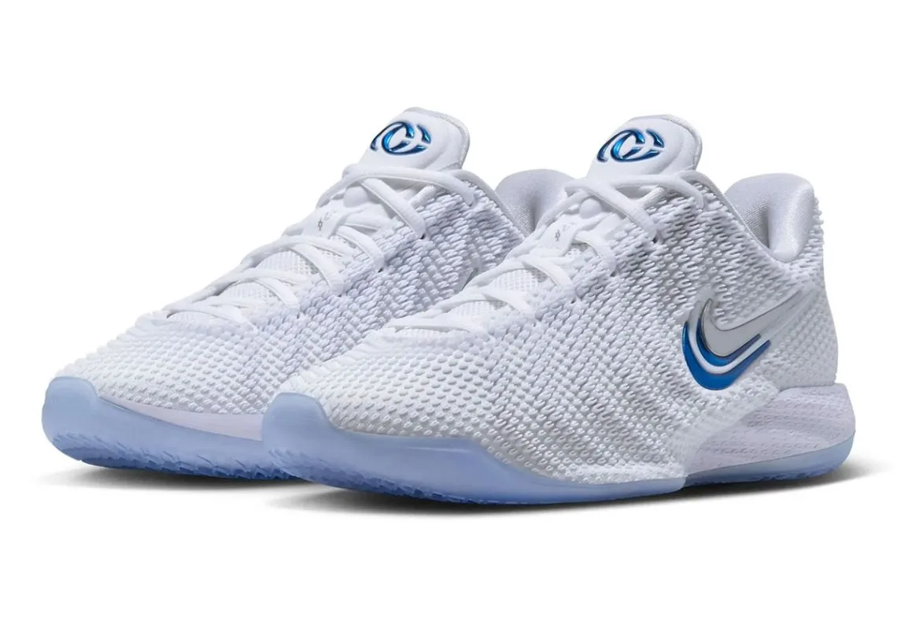
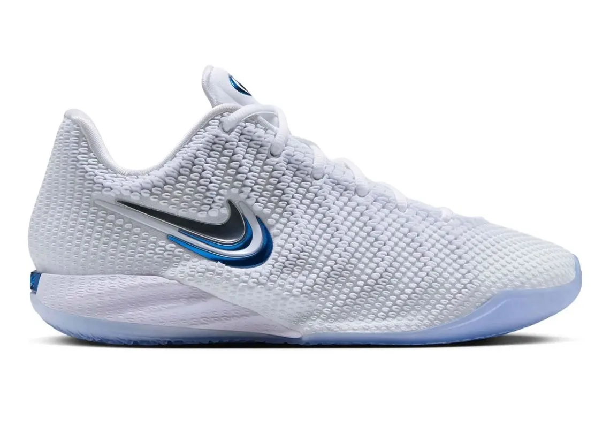
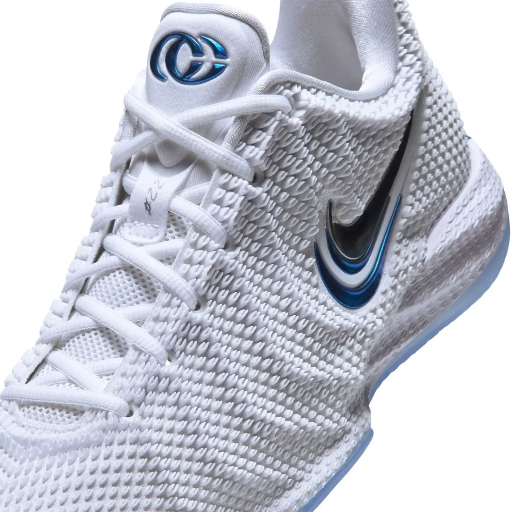
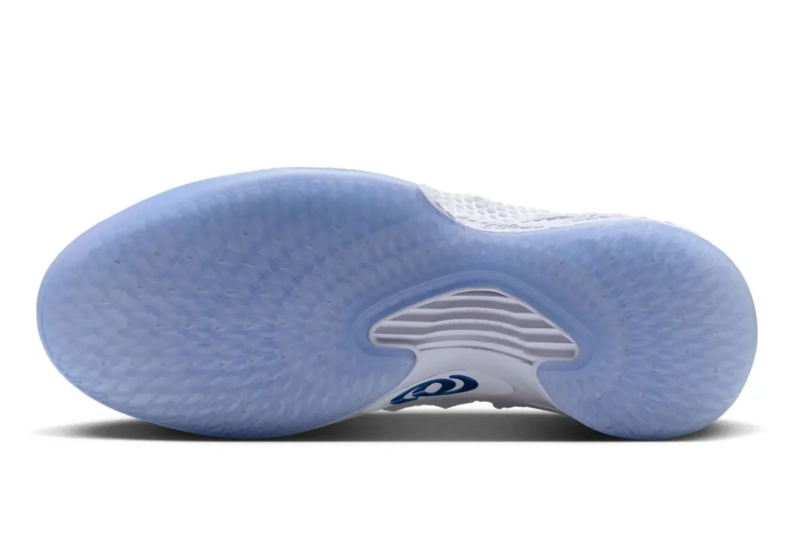
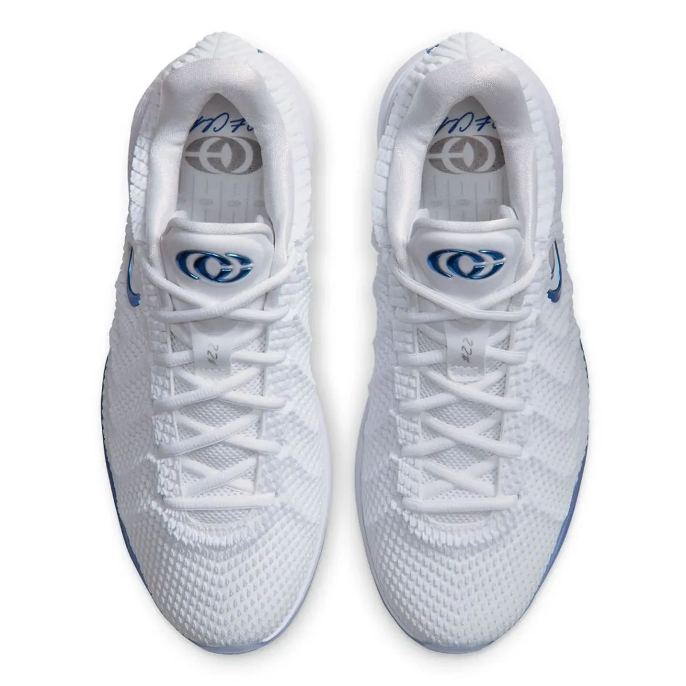
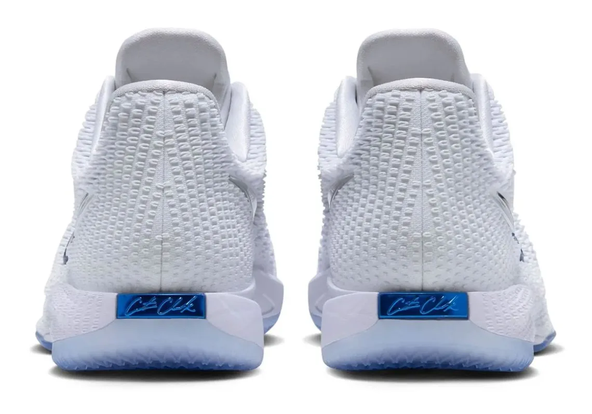
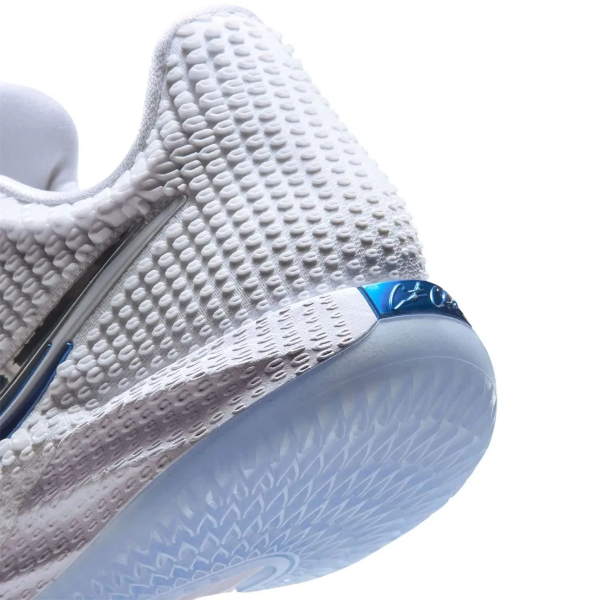

> [中文版 Chinese version](/life/nike-caitlin-1-ice-cold-zh/)

There is a specific kind of signature-shoe colorway that only works after the line has already proved itself. The debut pairs have to shout — they have to explain, in one glance, why this athlete deserves a shoe with her name on it. The fourth or fifth pair can afford to whisper. It can trust that you already know the story and just want the clean version.

The Nike Caitlin 1 "Ice Cold" (IH7423-100) is that whisper, and it arrives at exactly the right moment. It releases widely on Tuesday, November 24, 2026, for $140, two days after a small hometown early drop in Indiana — and it is, by the consensus of everyone covering it, the quietest Caitlin 1 to date. No story colorway, no costume, no holiday gimmick. White mesh, an icy blue outsole, and a texture that only reveals its secret when you lean in close.

That restraint is the story. And it is why this is the sneaker of the day: Grailify's Top Sneaker Releases for Week 48, published today, November 23, leads its list with this shoe, ahead of a Pharrell Jellyfish restock, a champagne-themed SB Dunk, a Kobe Elite and the Black Friday Air Jordan 4 "Bred." Sneaker News published its official-images breakdown on November 12; Athlon, the Indianapolis Star and Sneaker Shop Talk have all tracked the rollout; Foot Locker and Hibbett both carry it on their launch calendars. The heat here is not a raffle frenzy. It is the steady, measurable demand of the most-watched women's signature line Nike has ever launched, reaching the point where a plain white basketball shoe is a headline.

## The facts

| | |
|---|---|
| **Model** | Nike Caitlin 1 "Ice Cold" |
| **Style code** | IH7423-100 |
| **Colorway** | White / Racer Blue |
| **Release date** | Tuesday, November 24, 2026 — wide release via Nike, SNKRS, Foot Locker, Hibbett and select retailers |
| **Early release** | Saturday, November 21, 2026, 9:30 a.m. CT — limited supply on site at the Sneakers 4 Santa Shootout, Brownsburg High School, Brownsburg, Indiana (Hibbett) |
| **Retail price** | $140 adult — price snapshot as of November 23, 2026, subject to change (Grade School $115 / Preschool $105 for the model line) |
| **Sizing** | Unisex / adult sizing, per Athlon; full family sizing across the Caitlin 1 line |
| **Upper** | Mesh with Nike Opticast — cast polyurethane nodes at varying heights |
| **Cushioning** | Full-length Cushlon foam midsole, articulated forefoot Air Zoom Turbo unit |
| **Release type** | Standard / general release, not a raffle-only drop |

## What "Ice Cold" actually is — and what it was first called

Get the name right, because the shoe has already had two. When Caitlin Clark first wore this colorway during game action, early in the rollout cycle, it circulated under the nickname "Snow White." Sneaker News is explicit that the name has been left behind as official images arrived: this is not a Disney reference, and the shoe is not trying to be one. "Ice Cold" is the official name, and it fits better — the cold here is a color temperature, not a fairy tale.

The build is deliberately simple. White mesh covers most of the upper, layered with a white Opticast support structure. The tongue, sockliner and midsole stay white. The color lives in the branding and underfoot: a two-tone icy blue on the Caitlin tongue logo, a Swoosh that stacks white, silver and icy blue, and a two-tone blue outsole that carries the strongest hit of color on the whole shoe. The heel carries a metallic blue signature plate with Clark's signature. It is, as Athlon puts it, a shoe that "looks fairly simple until you notice" what is embedded in it — and what is embedded in it is the whole design idea.

*The pair: white mesh and Opticast, stacked Swooshes in white, silver and icy blue, and the translucent blue outsole. Image: Nike, via Sneaker News.*

*Lateral side: the Opticast nodes run the full length of the upper, under the stacked Swoosh. Image: Nike, via Sneaker News.*

## Opticast: the technology that is the shoe

Every signature shoe needs one idea you can explain in a sentence, and the Caitlin 1 has a genuinely new one. Nike Opticast is a cast polyurethane node system — raised bumps of different heights molded onto the upper — that Nike says reduces drag during movement while creating zones of support and containment. Clark said on the New Heights podcast that "the technology we're putting into my shoe isn't anything Nike has ever put into a basketball shoe before," and on Opticast, that claim is literal: it is the first Nike basketball shoe to use this construction.

The nodes are not decoration pasted onto a performance idea. They are the performance idea, and the decoration is what Nike did with them second. The pattern is drawn from the ripple of a three-point arc — the shot that defines Clark's game — and the nodes are arranged so that the lateral side forms a series of "C" shapes for her initials while the medial side repeats "2" shapes for her jersey number, No. 22. On the "Ice Cold," that matters more than on any other colorway, because the all-white upper makes the pattern the only texture you see. In the loud colorways — the black-and-green "Halloween," the red "Sea of Red" for her Kansas City Chiefs fandom, the "Friendship Bracelet" that nods to Taylor Swift — the color does the talking. Here the texture has to do it alone, and it can, because the nodes are doing real structural work: varying heights mean varying stiffness, which means the upper can be supportive where a guard plants and cuts and flexible where the foot needs to bend.

Look at the close-up and you can see the logic. The nodes are densest and tallest across the forefoot and midfoot, where containment matters most, and the mesh underneath stays visible between them, which is where the breathability comes from. It is a clever piece of engineering precisely because it does not look like engineering at first glance — it looks like a texture, and only on the second look does it resolve into initials and a number.

*Upper close-up: cast Opticast nodes over white mesh, the metallic blue "CC" logo on the tongue, and the small "22" on the lace keeper. Image: Nike, via Sneaker News.*

That is the design philosophy of the whole Caitlin 1 line, stated as plainly as possible: Clark gave the design team — Ben Nethongkome and Alex Zerzan, per SneakerFiles — three goals, to improve her first step, her step-back and her shot release. Everything on the shoe traces back to those three movements. The Opticast upper is built around speed and quick changes of direction. The cushioning is built around the pull-up. And the storytelling is built around the shot itself.

## Underfoot: Zoom Turbo, Cushlon, and the mantras you only see when you flip the shoe

Under the Opticast upper, the Caitlin 1 runs a full-length Cushlon foam midsole with an articulated forefoot Air Zoom Turbo unit — a pressurized-air bag tuned to sit close to the foot, designed to give responsive bounce on quick cuts and step-backs while the Cushlon keeps the ride smooth and controlled. A stabilizing midfoot plate ties the two together, and the rubber outsole uses a "C"-inspired traction pattern. The combination is guard-specific in a way that matters: this is a shoe tuned for a player whose game is range, pace and creating space off the dribble, not for a big who needs maximum impact protection under the rim.

The outsole is also where the shoe hides its personality. Flip any Caitlin 1 over and you find Clark's personal mantras molded into the rubber — "Shoot More Threes," "From Anywhere," and "It was never a long shot." On the "Ice Cold," the translucent icy-blue outsole makes the traction pattern itself the visual event: the C-inspired chevrons radiate across the forefoot and heel, and the midfoot shank — visible through the translucent rubber, carrying the "CC" mark — is the one place the shoe lets a piece of hardware show through. It is a restrained version of the same joke the line keeps telling: the loudest thing about this shoe is underneath it.

*The outsole: icy translucent rubber over the C-pattern traction, with the shank and "CC" mark visible at the midfoot. Image: Nike, via Sneaker News.*

## Why a plain white shoe is the right fourth act

Context is what makes this colorway interesting rather than just pretty. The Caitlin 1 debuted globally on October 1, 2026 — September 24 in China — in the "Racer Blue" and "Warning Code" launch pairs, at $140. Since then Nike has run the line the way Jordan Brand runs a retro line: every colorway is a chapter of Clark's life. "Sea of Red" for the Chiefs. "Friendship Bracelet" for Swift. "Halloween," released October 30 at $150, for a childhood story about a fear of black cats. "Midnight Fever" for a record night. "Cave Stone," which dropped November 21, for the tonal, almost workwear end of the spectrum.

"Ice Cold" is the palate cleanser after all of that — and the pricing quietly says so. At $140 it costs $10 less than the "Halloween" pair and matches the debut "Racer Blue" price. It is the line returning to its base price and its base idea after a month of storytelling colorways, and it is aimed at a different buyer: not the collector chasing the story, but the player, the parent buying for a kid who plays, and the fan who wants the signature shoe in the colorway that goes with everything.

That is a real commercial decision, and it is worth naming. The Caitlin 1 is the first women's basketball signature shoe in years with genuine R&D behind the performance story rather than a name on a lifestyle model — Opticast is new, the Zoom Turbo setup is guard-tuned, and the full family sizing (adult $140, Grade School $115, Preschool $105) treats it as a platform, not a one-off. A platform needs a white shoe. Every great signature line has one: the pair that is not about the story but about the shoe, the one you can wear to practice on Tuesday and to dinner on Friday. "Ice Cold" is Nike's bid for that slot in the Caitlin line, and the early evidence — the hometown drop selling through a limited on-site supply in Indiana on Saturday, the week-48 lists leading with it, the retailer calendars all carrying it — suggests the bet is working.

*Top view: "CC" on both tongues, "22" lace keepers, and Clark's signature printed inside the collar. Image: Nike, via Sneaker News.*

*Heel view: the Opticast texture wrapping the heel, over the metallic blue signature plate. Image: Nike, via Sneaker News.*

## The early drop in Brownsburg, and what it tells you

The "Ice Cold" did not wait for Tuesday to meet its audience. On Saturday, November 21, Hibbett gave it an early release at the Sneakers 4 Santa Shootout at Brownsburg High School in Brownsburg, Indiana — a limited supply, available on site only, from 9:30 a.m. CT. The Indianapolis Star reported the event on November 17, and Sneaker Shop Talk covered the early drop on November 20.

It is a small detail, and it is the most revealing one in this whole story. Brownsburg is not a flagship city. It is a high-school gym, a girls' basketball event, a charity shootout — and it is in Indiana, Clark's professional home. Nike and Hibbett chose to give the first pairs to the community that watches her play, at an event for high-school girls who play, rather than to a sneaker boutique in New York or Los Angeles. That is a distribution choice that matches the shoe's positioning: this is a performance signature for players first, a collectible second.

It also tells you something about demand. The early supply was described as limited, and it was on-site only — you had to be there. If the wide release tomorrow behaves like the line's earlier drops, expect the standard pattern for a general-release Caitlin 1: available at Nike, SNKRS, Foot Locker and Hibbett, with the most popular sizes moving first and restocks following in waves rather than a single sellout moment. This is not a raffle-only limited drop. It is a standard release of a very popular shoe, which is a different kind of hard to get — not impossible, but not something to sleep on either.

## How it actually plays: what the reviews of the platform say

One honest caveat before the buying advice: this specific colorway releases tomorrow. Nobody has published a wear test of the "Ice Cold" pair itself, and the upper materials and outsole compound are shared with the rest of the line — but treat what follows as a verdict on the Caitlin 1 platform, not on this pair's first week on court.

That platform has now been tested in its earlier colorways, and the picture is genuinely mixed in a useful way. SoleGrind's early review of the debut pairs is enthusiastic — "it feels like Nike actually tried" — praising the Opticast upper's containment, the Zoom Turbo's responsiveness on cuts and step-backs, and the decision to build a real performance shoe at $140 rather than a lifestyle tribute. WearTesters has the Caitlin 1 in its review rotation alongside its Jordan and Kobe coverage. And at least one independent video performance review of the line has been more skeptical, calling the on-court performance "honestly underwhelming" against very high expectations — a reminder that a new upper technology and a new cushioning tune do not automatically add up to the best-playing shoe of the year, and that the bar for a signature this hyped was always going to be unreasonable.

Hold those two accounts together and you get the honest picture. The technology is real and new. The fit and feel are guard-specific — snug, true to size for average widths, with wide feet advised to go up half a size, per the line's buying guides — and the shoe rewards players who move like its namesake: quick first step, hard stops, deep range. It is not a max-cushion shoe, and it is not trying to be one. If you want the softest ride Nike makes, this is the wrong line. If you want court feel, containment and a shoe that disappears on your foot while you shoot from further out than you should, it is exactly the right one.

*Heel detail: Opticast nodes at the heel, the blue signature plate, and the translucent outsole wrapping up the back. Image: Nike, via Sneaker News.*

## Where this sits in the week — and in the signature-shoe landscape

The "Ice Cold" does not arrive alone. It headlines a Thanksgiving week that is genuinely crowded: the Pharrell x adidas Adistar Jellyfish "Triple Black" restocks around Black Friday at $300, the Nike SB Dunk Low "Champagne" drops November 27, the Kobe Elite 9 "Multicolor" lands the same day, and the Air Jordan 4 "Bred" — the week's biggest retro — arrives on Black Friday, November 27, at $230. That is a lot of competition for attention and for wallets, and it is worth being clear about where the Caitlin 1 sits in it.

It is the cheapest shoe in that group by a wide margin, and the only one that is a current player's first signature line rather than a retro or a celebrity collaboration. At $140 it undercuts the Jordan 4 by $90 and the Jellyfish by $160, and it is the only one of the five that is built first as a performance basketball shoe you can actually play a season in. That is not a knock on the others — the "Bred" is a grail, the Jellyfish is a design object — but it is the reason the "Ice Cold" leads the week-48 lists. It is the shoe in this week's calendar that a kid can actually ask for, get, and wear to practice.

There is a bigger argument here, too, and it is worth making plainly. Women's signature shoes have historically been treated as a niche within a niche — a colorway of a men's line, a lifestyle shoe with a name attached, a limited run that disappears. The Caitlin 1 is the opposite of all three: a ground-up performance build, a new technology, a full colorway program running into 2027, full family sizing, and a launch that Nike put front and center rather than burying. Whether it becomes a classic depends on what happens over the next two seasons — whether the line keeps its performance credibility, whether the colorways keep finding new stories without repeating themselves, and whether the "Ice Cold" white pair becomes the staple it is designed to be. But the first two months have already answered the question that mattered most at launch: is this a real signature line, or a marketing moment? It is a real line. The white shoe proves it — only a real line gets a quiet one.

## Buying advice

Four points, in order. First, timing: the wide release is Tuesday, November 24, via Nike, SNKRS, Foot Locker, Hibbett and select retailers; if your size is gone at one, check the others before paying anyone a premium, because general-release Caitlin 1s have restocked in waves. Second, sizing: the line runs snug and true to size for average widths — go up half a size if you are wide-footed, and if you can try them on in store, do, because the Opticast upper does not stretch the way a knit does. Third, use case: this is an indoor guard shoe first — low cut, C-pattern traction, a Zoom Turbo forefoot tuned for cuts and pull-ups — and a clean white lifestyle rotation second; the white mesh will show wear, and the translucent outsole will pick up dust on outdoor courts, so keep it indoors if you want it to stay ice cold. Fourth, value: at $140 this is the line's base price and the right entry point — it is $10 less than the "Halloween" pair, it carries the same tech as every other Caitlin 1, and it is the colorway most likely to still be wearable in two years when the story colorways feel dated.

## The verdict

The Nike Caitlin 1 "Ice Cold" is the least dramatic shoe in the line, and that is its achievement. After a launch built on stories — the Chiefs, the friendship bracelet, the black cats — Nike has made the pair that needs no story at all: white mesh, icy blue underfoot, and a texture that spells out its owner's initials and number if you look closely enough. The technology is real, the price is the line's fairest, and the hometown early drop in Brownsburg was the right first audience.

It is not a shoe you buy for the story. It is a shoe you buy because the story is already told, and now you just want the shoe. For a first signature line two months into its life, that is the most encouraging thing that could happen to it.

*Price is a snapshot as of November 23, 2026, subject to change. Sources: Sneaker News (official-images breakdown of the Nike Caitlin 1 “White/Racer Blue,” November 12, 2026 — November 24 release, $140, “Snow White” nickname dropped, Clark wore the colorway in game action, stacked Swooshes); Athlon (Nike Caitlin 1 “Ice Cold” release guide, November 18, 2026 — IH7423-100, White/Racer Blue, Opticast nodes with “C” and “2,” Air Zoom Turbo and Cushlon, unisex sizing, Foot Locker and Hibbett calendars, $10 less than the “Halloween” pair); Indianapolis Star (November 17, 2026 — early release at the Sneakers 4 Santa Shootout, Brownsburg High School, limited on-site supply); Sneaker Shop Talk (November 20, 2026 — November 21 early release, 9:30 a.m. CT, Hibbett); SneakerFiles (Caitlin 1 colorway guide — October 1, 2026 global debut, September 24 China, designers Ben Nethongkome and Alex Zerzan, full family pricing $140/$115/$105); Grailify (Top Sneaker Releases Week 48, November 23, 2026 — “Ice Cold” leads the week, November 24); SoleGrind and Athlon launch coverage (Opticast as cast polyurethane nodes, Cushlon plus forefoot Air Zoom Turbo, outsole mantras “Shoot More Threes” / “From Anywhere” / “It was never a long shot,” Clark’s three design goals via the New Heights podcast). No wear test of the “Ice Cold” colorway itself existed at the time of writing; performance discussion reflects reviews of the Caitlin 1 platform in earlier colorways.*
