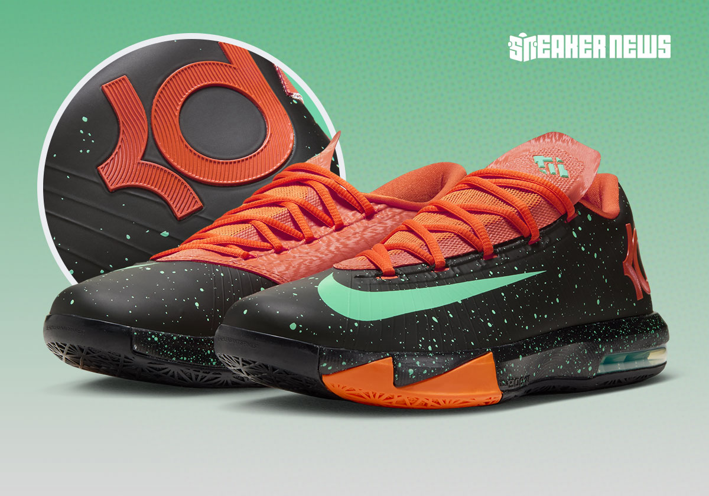
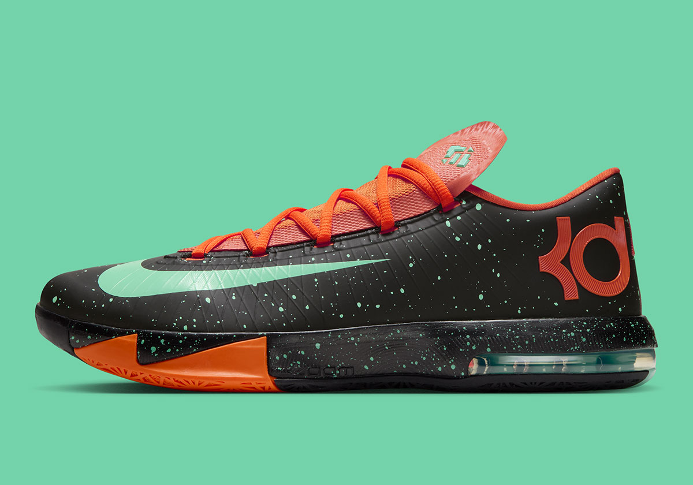
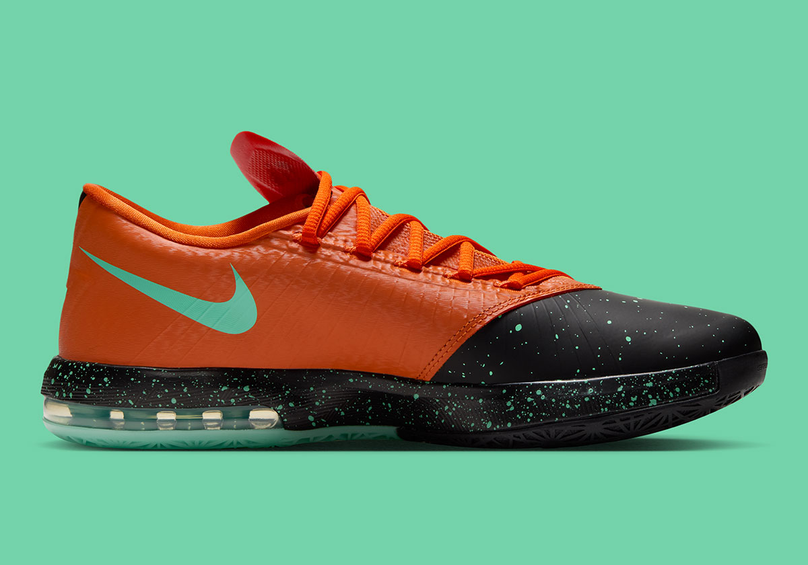
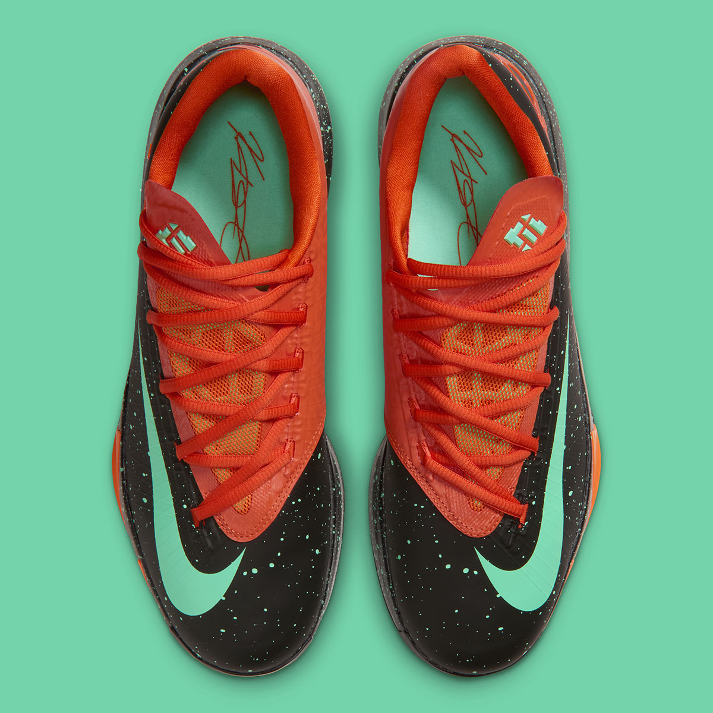
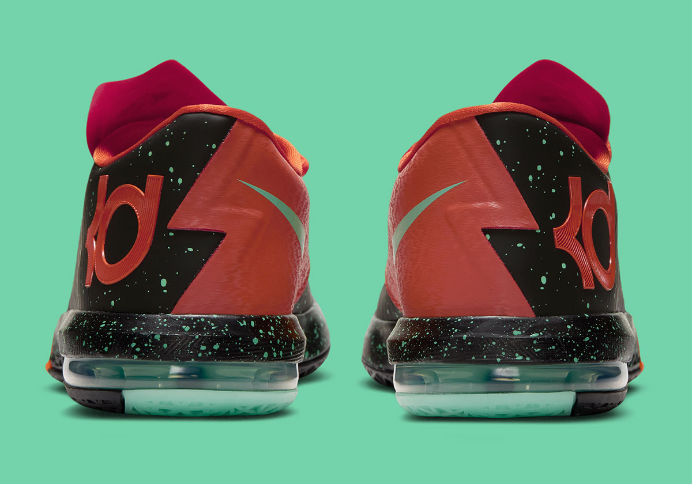
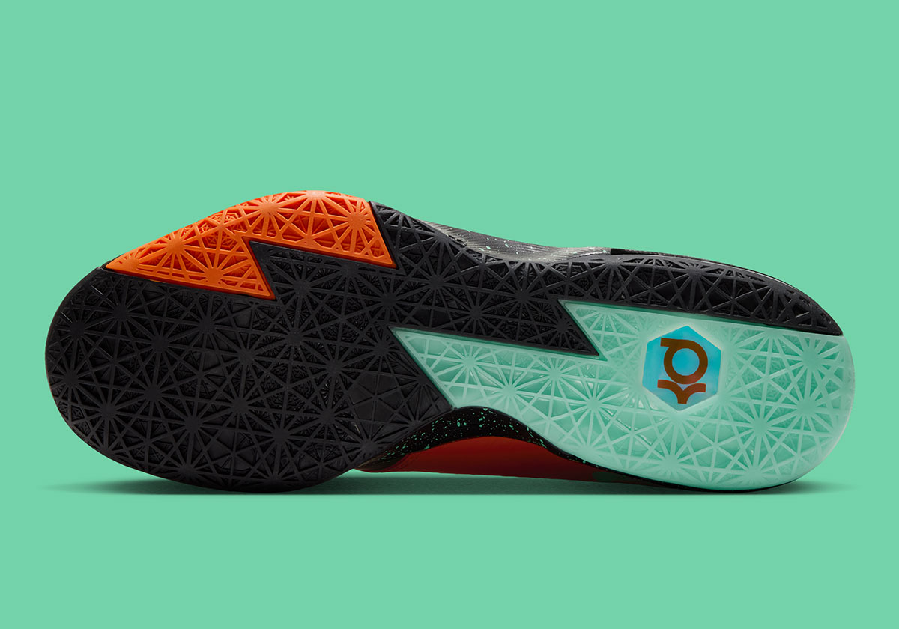
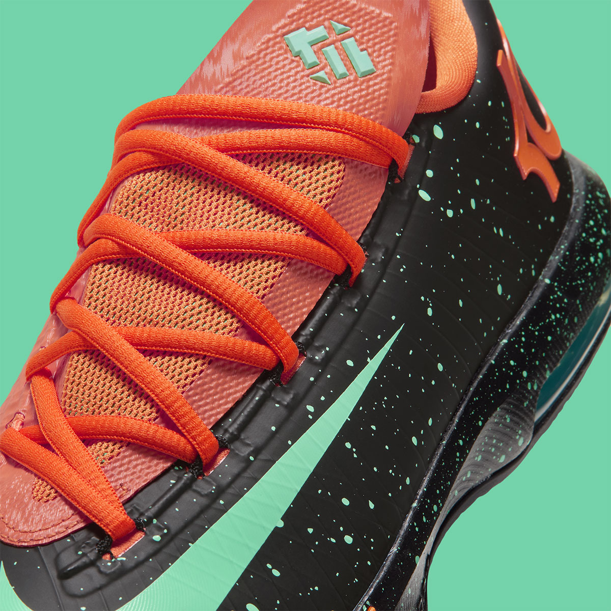
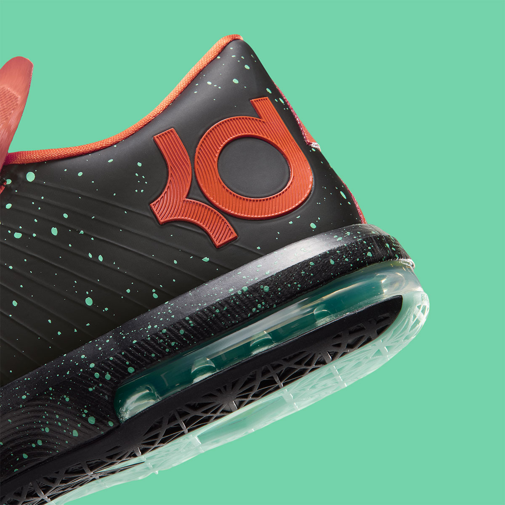
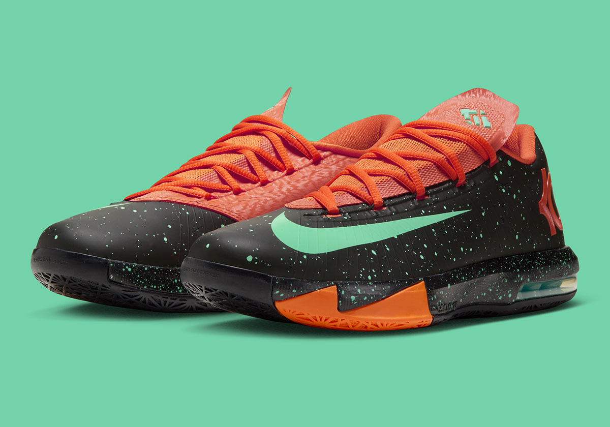

> [English version 英文版](/life/nike-kd-6-texas/)

有些鞋回归，是因为品牌需要一个凑数的配色。Nike KD 6 “Texas” 回归，是因为它背后的故事从来没有停止被讲述。它今天——2026 年 11 月 17 日——通过 Nike SNKRS 与指定零售商发售，售价 135 美元，黑、焦橙与夜光绿的配色与 2013 年原版一模一样。它成为今天主角的原因不是它新，而是它周围的一切都重新变新了：杜兰特正在开启第 20 个 NBA 赛季，身在休斯敦，穿着这双鞋所致敬的那所大学所在州的球衣；与此同时，Nike 的 KD 复刻计划正在全速推进——KD 4 “Texas” 已在 2025 年回归，KD 6 “Meteorology” 在今年 8 月回归，现在轮到了 KD 6 “Texas”。

先说一句实话：这不是这双 2026 年复刻的上脚评测。这双鞋今天才开卖，Nike 之外还没有人真正穿着它走过有意义的里程。但与大多数新发售不同，这个缺口在这里没那么重要——因为 KD 6 是一双被忠实复刻的鞋，一双在 2013 年与 2014 年被大量穿着、评测与争论过的鞋，包括一个 MVP 赛季。下面是一篇长篇初看：已确认的事实、配色到底在致敬什么、2013 年的技术在今天还剩多少、让这个配色成立的那个唯一的德州赛季，以及 2013 年的评测说了什么——能核实的与不能核实的会分开说清楚。

*Nike KD 6 “Texas” 官方图：黑色 Hyperfuse 鞋面缀着夜光绿星点、超大薄荷绿 Swoosh，以及后跟焦橙色的 KD 标志。图片：Nike，经 Sneaker News。*

## 基本事实

| | |
|---|---|
| **鞋款** | Nike KD 6 “Texas” |
| **货号** | JF6986-001 |
| **配色** | Black / Green Glow / Urban Orange（黑／夜光绿／城市橙） |
| **发售日期** | 2026 年 11 月 17 日星期一 |
| **发售价** | 135 美元，据 Nike 官方 listing 与 Sneaker News、Nice Kicks、Men’s Journal 的报道；Sole Retriever 的 listing 显示为 130 美元——2026 年 11 月 17 日查询的价格 snapshot，subject to change |
| **发售渠道** | Nike SNKRS 与指定零售商，男款／男女同款尺码 |
| **鞋款定位** | 2013 年 KD 6 “Texas” 配色的忠实复刻，杜兰特第六代签名鞋，由 Leo Chang 设计 |
| **原版** | 2013 年首次发售，售价 130 美元；2026 年回归，时隔 13 年 |

## 为什么是今天的主角

热度很容易证明，因为球鞋媒体把这双鞋当成了本周的头号篮球话题。Sneaker News 在 11 月 15–21 日的每周发售指南里把 KD 6 “Texas” 放在了首位——11 月 17 日星期一的头条，与 LeBron 24 “Stars” 并列——并在 11 月 4 日发布了附完整官方图集的详解。Sole Retriever、Nice Kicks、Men’s Journal 与 Sports Illustrated 的 FanNation 各自都做了专题，零售商 listing 提前数周就确认了发售日期。一双复刻能拿到整整一周的头条待遇、五家媒体各自做专题，不是悄悄补货，是一次市场在盯着的发售。

还有一个结构性的原因，让这次回归比一般的复刻更重要。杜兰特正在打第 20 个 NBA 赛季，而加盟休斯敦让他自大学以来第一次以职业球员的身份回到德州——这个配色所命名的州。这个时间点不是日历上的巧合，它就是重点。Nike 的 KD 复刻计划一直在为这样的时刻蓄力：KD 4 “Texas” 在 2025 年回归，KD 6 “Meteorology” 在 2026 年 8 月回归，现在 KD 6 “Texas” 在杜兰特于休斯敦打球的赛季落地。这个配色是一段归乡故事，而现在它终于有了可以依附的归乡。

鞋子本身也背着真实的历史。KD 6 是杜兰特穿着打完 2013–14 赛季的那双鞋，那个赛季他拿到了职业生涯唯一一座常规赛 MVP 和第四个得分王，场均 32.0 分。据研究机构 SportsOneSource 的数据，那个赛季 KD 6 在美国的销量暴涨了 400%——这条签名鞋线的商业突破，也是它从“卖得不错”变成旗舰的赛季。一双 MVP 赛季球鞋的复刻，用的是大学配色，出现在杜兰特回到德州的年份——这种对齐，正是复刻计划存在的意义。

## 设计：穿在篮球鞋上的德州夜空

“Texas” 配色同时在做两件事，两件都值得细读。第一件是大学致敬，很直白：焦橙色——Nike 命名为 Urban Orange——覆盖了鞋身内侧、鞋舌、后跟与内衬，大块、不加掩饰地铺上德州大学的标志性颜色。第二件更微妙，也是这双鞋看起来是现在这样、而不是一双普通的球队配色鞋的原因。据 Sports Illustrated 对这个配色的解析，设计师 Leo Chang 想让这双鞋“有孤星之州的感觉”，灵感来自德州广袤的、星光璀璨的夜空。绿色的部分就是为这个而来的。

鞋面是黑色的，上面撒满了 Green Glow 的星点——刻意做成的星空——并带有夜光处理，星点、超大 Swoosh 与中底在黑暗中会发光。Swoosh 是鞋上最响亮的单个元素：超大号，从外侧鞋头一直延伸到后跟，薄荷绿，在内侧还有一个小号版本。KD 标志以焦橙色出现在外侧后跟，鞋舌上有“35”，焦橙色还出现在 KD 品牌标志以及前掌中底与外底的一对三角上。鞋底的后跟气垫没有用校色，而是用了蓝绿色——一个小小的、刻意的偏离，让鞋子不至于读成纯粹的球队周边。

鞋子两侧的分野是这个设计的标志性手法。外侧是黑色配绿色星空与大 Swoosh；内侧则由焦橙色面板主导。从一边看是一双夜空鞋，从另一边看是一双德州大学鞋。这种不对称不是偶然——整双 KD 6 就是建立在不对称之上的，从鞋舌到系带都是——在这里它让配色同时承载两个想法，谁也不压倒谁。

*外侧轮廓：黑色鞋面、从鞋头延伸到后跟的超大薄荷绿 Swoosh，以及橙色的 KD 标志。夜光绿星点就是这个配色的星空。图片：Nike，经 Sneaker News。*

*内侧轮廓：焦橙色的中足与后跟面板、绿色 Swoosh，以及蓝绿色的可见式后跟气垫。图片：Nike，经 Sneaker News。*

## 技术：2013 年对“快”的理解，忠实重建

KD 6 由 Leo Chang 设计，围绕杜兰特提出的一个要求展开：他想感觉“像控卫一样快，像中锋一样稳”，而他的身高是 6 尺 10 寸（约 2.08 米）。答案是一双尽可能减重、并把缓震放在得分手真正需要的位置的鞋。

鞋面是两层 Hyperfuse 结构——2010 年代初 Nike 的减重答案，一种轻薄的熔合合成材料——内置 Dynamic Flywire 飞线提供锁定。思路是用线缆而不是多层材料来固定一双纸一样薄的鞋面，10.6 盎司（约 300 克）的 KD 6 在 2013 年的篮球鞋里确实算轻。分叉的、不对称的鞋舌是这双鞋最具辨识度的特征：它像足球鞋的鞋舌一样倾斜，上面带有一个视觉错觉标志，从负空间里能看出“35”与“6”。Chang 曾表示整双鞋的灵感来自腕表的精密工艺——细节的精调、中底、KD 标志与 Swoosh 上的放射状拉丝纹理——鞋舌就是这个想法最显眼的地方。

鞋底是 2010 年代初经典的 Nike 配方：前掌 Zoom Air 气垫，负责第一步的弹射；后跟可见式 Air 气垫，吸收落地冲击。外底的纹路基于杜兰特本人足部的压力图谱，是多层六边形几何构成的多向抓地纹——在 2026 年的照片里依然清晰可见，星芒状纹路包裹着前掌与后跟。2026 年的复刻保留了全部：同样的 Hyperfuse 鞋面、同样的 Flywire、同样的两段式缓震、同样的外底。Nike 没有对这双鞋做现代化改造，它是在原样复刻。

这种忠实既是这双复刻最大的卖点，也是它诚实的局限，而且两者是同一个事实。一双 2013 年的实战鞋，原样复刻，就是一件时代标本。2013 年感觉先进的缓震——前掌 Zoom 气垫加后跟 Air 气垫——在 2026 年只是一双 90 美元团队鞋的基线配置，而 KD 系列本身也早已进化到 KD 17、KD 18 与 KD 19 的全掌 Zoom 与 Cushlon 配置——KD 19 的 “Aunt Pearl” 配色四天前刚刚发售。没有人应该指望 KD 6 “Texas” 在性能上超过一双现役实战鞋，它不是为这个而存在的。

*俯视图：不对称鞋舌、焦橙色系带与鞋舌上的“35”标志，鞋垫上印着杜兰特的签名。图片：Nike，经 Sneaker News。*

*后跟视角：每只鞋后跟的橙色 KD 标志、缀着星点的黑色中底，以及蓝绿色的可见式气垫。图片：Nike，经 Sneaker News。*

## 让这个配色成立的、唯一的德州赛季

这个配色之所以存在，是因为一个大学赛季——2006–07 赛季——至今仍被视作史上最伟大的“打一年就走”赛季之一。杜兰特以 18 岁新生的身份来到奥斯汀，场均 25.8 分、11.1 个篮板——现代篮球里没有新生打出过这样的数据——拿下 Big 12 年度最佳球员，成为历史上第一位获得奈史密斯大学年度最佳球员奖的新生。德州大学那个赛季 25 胜 10 负，打进 NCAA 锦标赛第二轮；杜兰特一年后离校，以榜眼身份进入 NBA，再也没有打过一场大学比赛。这个赛季只持续了五个月，而这个配色断断续续已经卖了十三年。

这就是大学配色的奇特算术：一个球员在学校待的时间越短，鞋子要承载的东西就越多。杜兰特只在德州打了一个赛季，而 Nike 花了近二十年时间把那个赛季做成产品——KD 4、KD 6 以及更多型号上的 “Texas” 配色——因为这个故事干净，而且永远不会过时：那个大一新生已经是大学篮球里最好的球员。2026 年的复刻与之前几次不同，因为杜兰特终于真的以职业球员的身份回到了德州，穿着火箭队的球衣。这个配色不再只是对奥斯汀的回忆，它是一张标着他现在所在位置的地图。

还有一个时间点值得点出来。KD 6 “Texas” 原版发售于 2013 年，也就是杜兰特 MVP 赛季开始的那一年。这双鞋因此同时系着两个高峰——让他成名的大学赛季，与证明了他的职业赛季——而复刻要求买家同时 hold 住这两端。一双配色要承载这么多，这就是它能留存下来的原因：它其实不是关于一所学校，也不是关于一个赛季，它是关于两者之间的那条弧线。

*外底：基于杜兰特足部压力图谱的多层六边形抓地纹，黑与橙为主，前掌夜光绿，后跟带 KD 标志。图片：Nike，经 Sneaker News。*

## 2013 年的评测到底说了什么

因为 2026 年这双是忠实复刻，原版评测比任何发售日的报道都有用——而且它们并不都温和。Nice Kicks 在 2013 年对 KD 6 的实战评测称它“从美学上说很棒，但作为实战鞋并不算出色”，理由是锁定不足、鞋身贴合很难调到合适，缓震被描述为偏硬、回弹不足。让这双鞋看起来如此独特的不对称分叉鞋舌结构，也让它很难在全脚实现贴合。鞋重 10.6 盎司，货架上没有第二双长这样的鞋——而让它脱颖而出的设计风险，正是它在球场上丢分的地方。

买之前值得知道这一点，因为复刻没有修复任何一项。如果 2026 年这双确实忠实于原版——而所有报道都说它是——那么贴合与锁定上的 quirks 是套餐的一部分，不是复刻计划顺手修掉的 bug。对收藏者或日常穿着者来说，这只是个脚注。对真的打算穿它打篮球的人来说，这就是整篇评测：先试穿，预期一个偏窄、低帮、很难调到位的贴合，别指望现代缓震。诚实的比较对象不是一双 2026 年的实战鞋，而是一双 2013 年的鞋，售价 135 美元，只比原版的 130 美元贵了 5 美元——13 年只涨 5 美元，这个数字本身就说明 Nike 是把它当作档案款来定价的，而不是旗舰。

还有夜光的问题。夜光绿星点与 Swoosh 是夜光材质，而夜光处理有一个已知的弱点：会随着穿着、洗涤与日晒褪色，用过一个季度后可能看起来不均匀。星点是印在鞋面上的，不是做到材料里的，所以磨蹭会显出来。如果鞋子放在鞋架上或只是轻度穿着，这些都不重要；如果它成为日常主力鞋，就重要了。

*特写：分叉的不对称鞋舌、鞋面网眼上的橙色系带与“35”标志——Leo Chang 围绕腕表工艺所做的细节。图片：Nike，经 Sneaker News。*

*特写：星空之上的焦橙色后跟 KD 标志，以及嵌在缀星中底里的蓝绿色可见气垫。图片：Nike，经 Sneaker News。*

## KD 复刻潮处在什么位置

“Texas” 不是独自到来的。Nike 的 KD 复刻计划在 2026 年全速运转：KD 4 “Texas” 在 2025 年回归，KD 6 “Meteorology”——源自杜兰特儿时想当气象学家的梦想、带天气雷达图的配色——在 2026 年 8 月 8 日回归，三个月后轮到了 KD 6 “Texas”。与此同时，现役产品线也在向前走：KD 19 “Aunt Pearl” 在 11 月 13 日发售，就在这双复刻的四天前，用的是与 KD 6 的 2013 年配置毫无共同之处的全掌 Zoom 与 Cushlon 配置。Nike 正在让 KD 系列同时朝两个方向走——向前进入新缓震，向后挖掘档案——而 “Texas” 是向后那一半起作用的最清晰例子：一双复刻，它的故事在等待中变得更好了。

真正有意义的比较对象是另一双德州复刻，2025 年的 KD 4。KD 4 是这条签名鞋线历史上更受爱戴的鞋——杜兰特穿着它拿下第一个得分王、第一次打进总决赛——而它的 “Texas” 回归定下了模板：忠实复刻、同样的配色分区、同样的价格带。KD 6 “Texas” 沿用这个模板，但它复刻的鞋比 KD 4 更古怪、更有争议，而这可能正是重点。KD 4 是稳妥的复刻，KD 6 是有趣的那双——低帮足球鞋式鞋舌、腕表匠的细节、MVP 赛季的那双鞋，评测者爱看它、也争论它。只复刻稳妥鞋子的复刻计划是一座博物馆，而这个计划愿意把争论本身也复刻回来。

## 谁应该抢一双——以及怎么抢

KD 6 “Texas” 的购买理由比发售报道暗示的要窄，值得直说。如果你追过杜兰特的德州赛季、如果你 2013 年拥有过 KD 6、如果你收藏 KD 系列、想要 MVP 赛季球鞋的大学配色，这就是该拿的一双——135 美元买一双 13 年前的经典配色的忠实复刻，在它背后的故事终于重新应景的年份，价格公道，而一个知名配色的首次复刻往往是会被记住的那一双。如果你是德州大学的球迷，理由更简单：这是 Nike 在篮球鞋上做过的最耐穿的德州大学配色，因为黑色与星空压住了橙色，不让它喧宾夺主。

如果你想要一双打篮球的鞋，等一等——或者买现役款。KD 6 的 2013 年配置、贴合 quirks 与偏硬的缓震都有据可查，而 KD 19 存在是有原因的。如果你想要一双日常舒适的鞋，同样的建议：Hyperfuse 鞋面很薄、鞋帮很低，这双鞋是为一个 6 尺 10 寸得分手的第一步而做的，不是为全天穿着。如果你错过了发售，先别急着付溢价。这类复刻——忠实复刻、135 美元、处于 Nike 正在积极挖掘的系列里——正是那种如果计划继续就会补货的鞋，而一双 135 美元复刻、13 年前的配置，二手市场的价值不在这里。价值在故事里，而故事哪儿也不会去。

实操信息：发售就在今天，2026 年 11 月 17 日，通过 Nike SNKRS 与指定零售商，包括 Foot Locker 与 SNIPES，男款／男女同款尺码。SNKRS 上列出了从 M 7 / W 8.5 到 M 18 / W 19.5 的完整尺码。发售时以 SNKRS 的 listing 为准，别只信一个价格来源——Sole Retriever 的 listing 显示 130 美元，而 Nike 自己的 listing 是 135 美元。如果不试穿就买，记住原版以贴合偏紧、很难调到位著称，对尺码要留出新复刻常见的不确定性。

*一双鞋：黑与焦橙的配色分区、绿色星空，以及让 KD 6 成为杜兰特系列里最独特一双的低帮流线造型。图片：Nike，经 Sneaker News。*

## 结论

KD 6 “Texas” 是最好的那种复刻：一双在等待中故事变得更好的鞋。2013 年，它是 MVP 赛季球鞋上的一个大学配色。2026 年，它是一次归乡——杜兰特回到德州，第 20 个赛季，Nike 的复刻计划终于追上了他职业生涯的弧线。鞋子本身没有变，quirks 也都在：轻薄的 Hyperfuse 鞋面、分叉鞋舌、前掌 Zoom 与后跟 Air、按杜兰特足部绘制的抓地纹、入夜会发光的星空。13 年后，这个设计看起来依然独一无二，评测的结论也依然一样——好看，球场上值得争论。这不是这双复刻的缺陷，而是拥有它的理由：有些鞋值得复刻是因为它们完美，有些值得复刻是因为它们有趣。KD 6 “Texas” 是后一种，而在杜兰特回到德州的这一周，135 美元的定价说明它自己也知道这一点。

*价格为 2026 年 11 月 17 日查询的 snapshot，subject to change。来源：Sneaker News（官方图集与发售细节，2026 年 11 月 4 日；每周发售指南，2026 年 11 月 15 日）；Sole Retriever（发售细节，2026 年 11 月 4 日）；Nice Kicks（发售细节与 2013 年实战评测）；Men’s Journal（关键事实，2026 年 11 月 7 日）；Sports Illustrated / FanNation（配色历史，2026 年 11 月）；What Pros Wear 与 SportsOneSource（2013–14 赛季销量）；Kicksologists（KD 6 历史，2013 年）。这是一篇初看，不是上脚评测：复刻于 2026 年 11 月 17 日发售，写作时尚无针对 2026 年款的独立上脚测试；文中实战评价来自 2013 年针对同款鞋的原版评测。*
