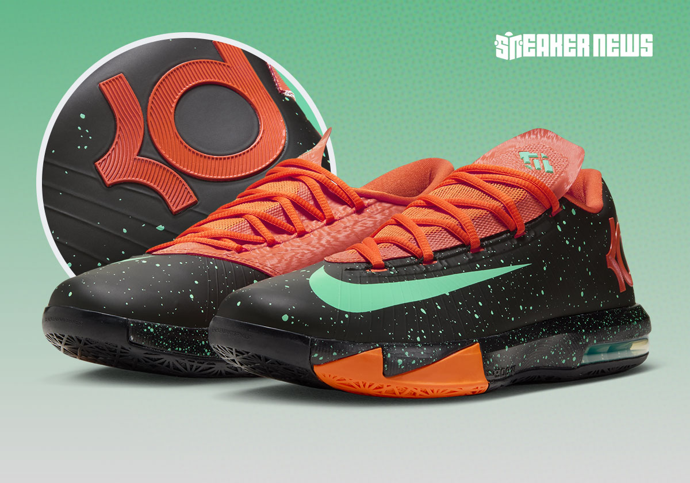
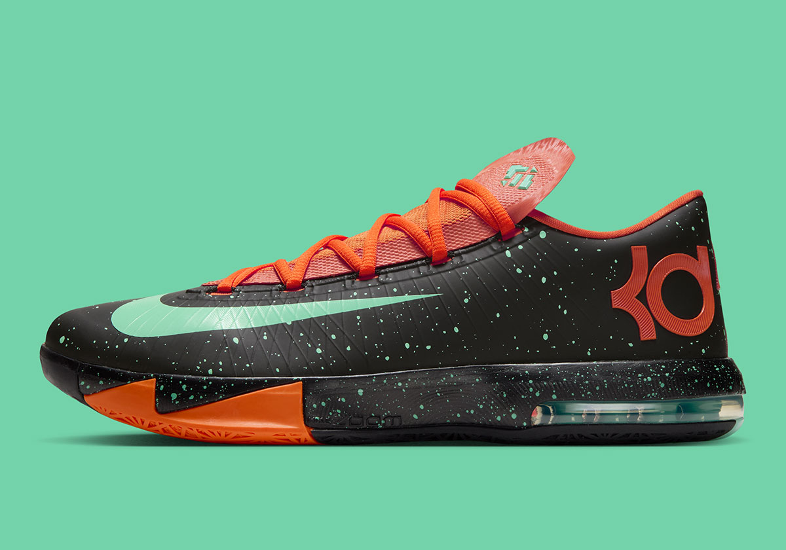
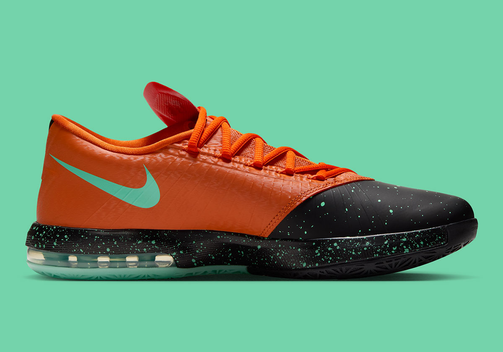
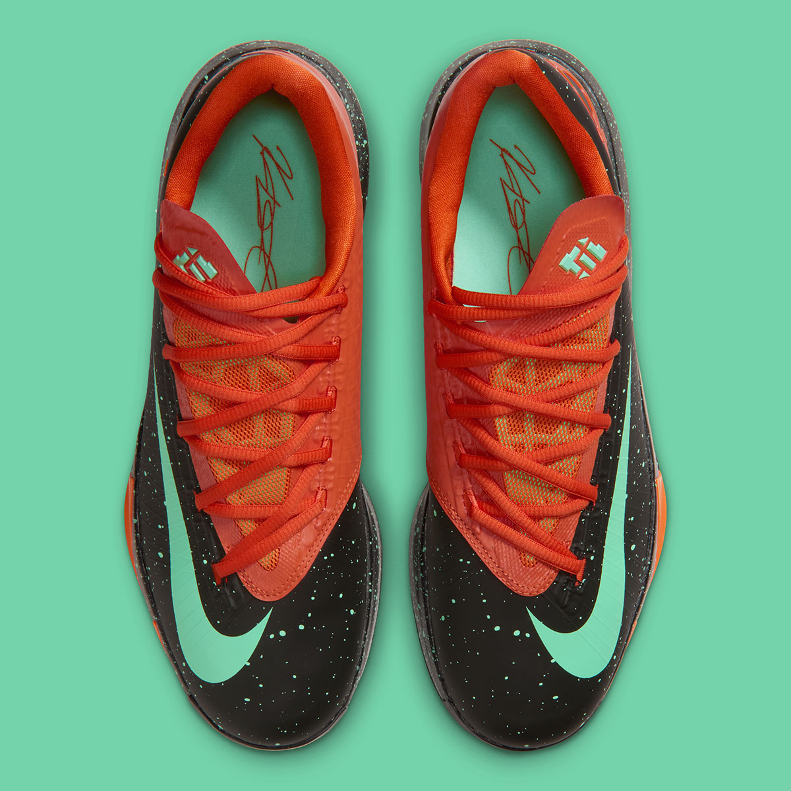
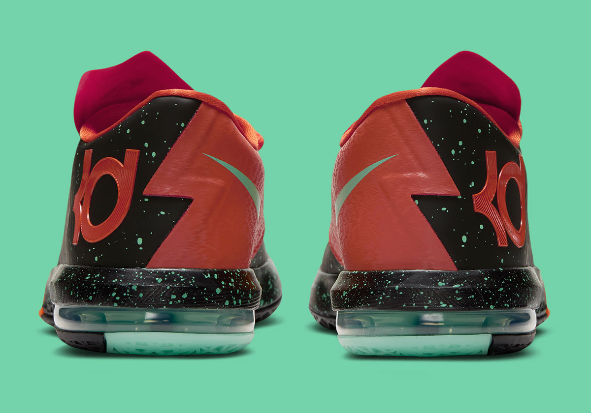
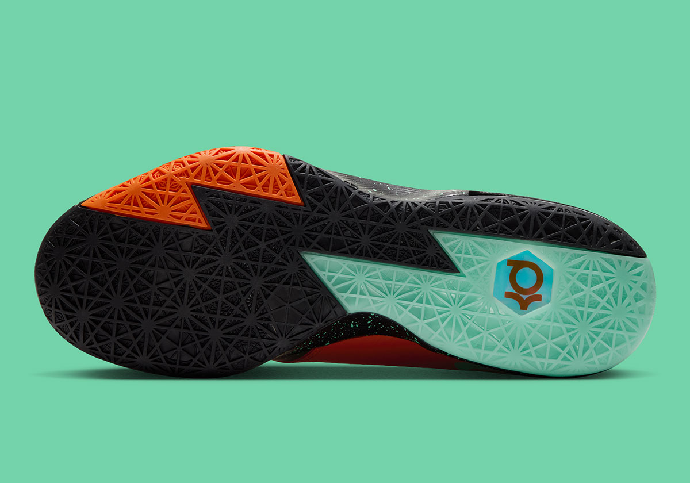
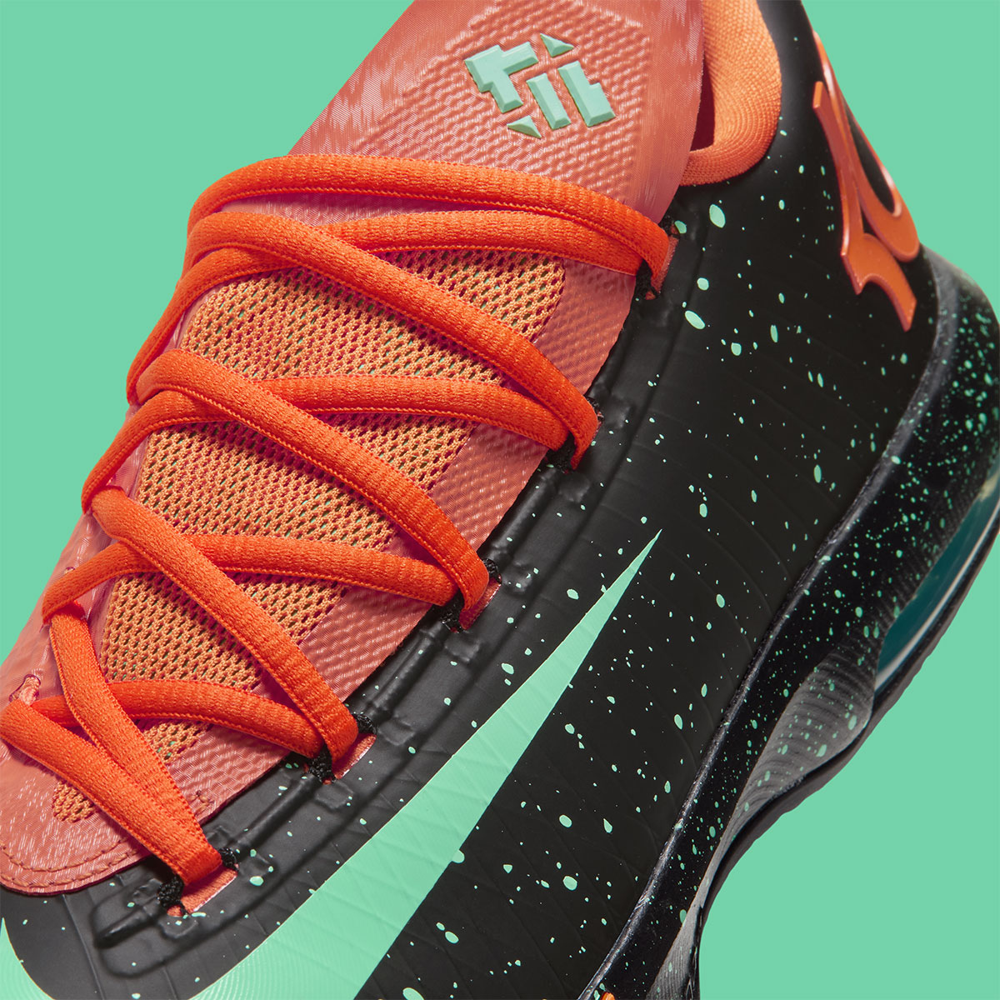
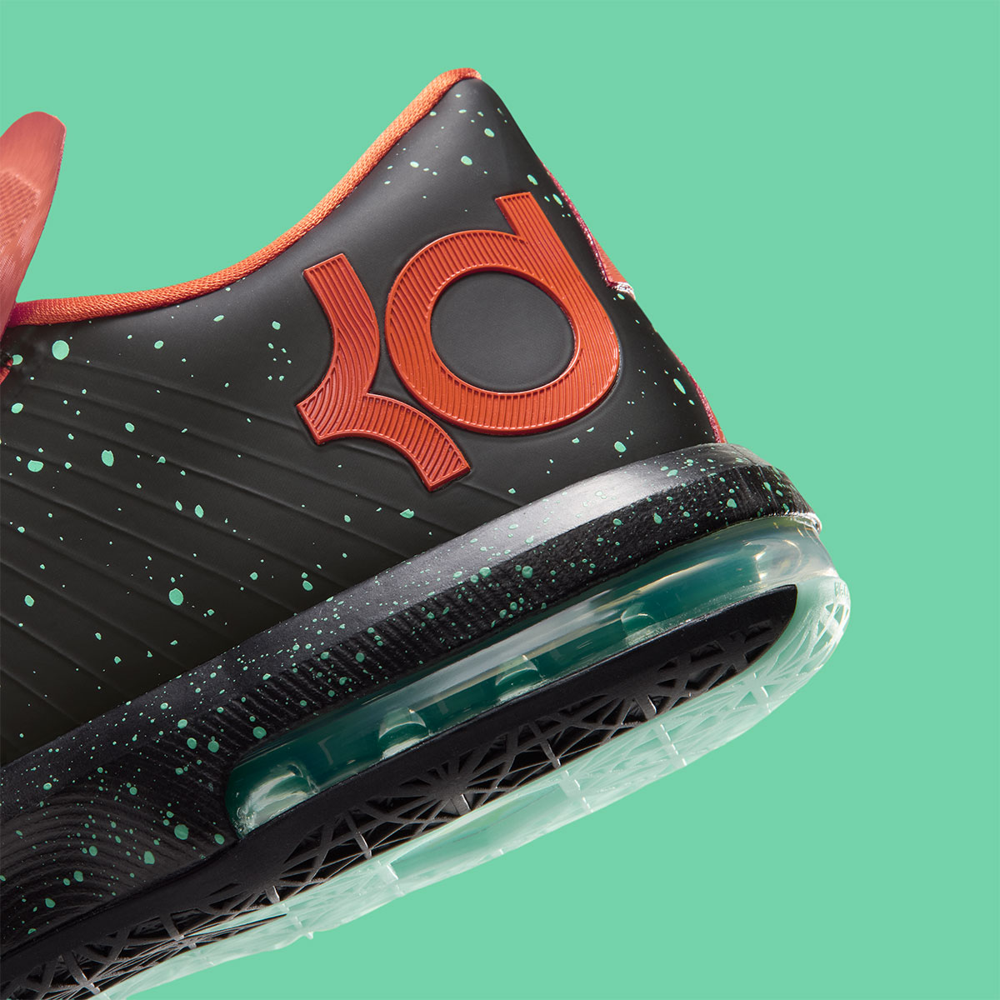
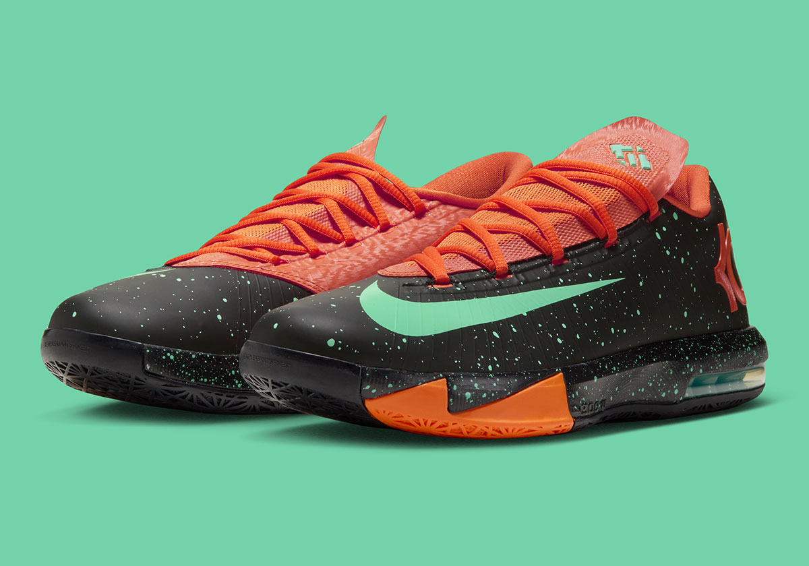

> [中文版 Chinese version](/life/nike-kd-6-texas-zh/)

Some shoes come back because a brand needs a filler colorway. The Nike KD 6 “Texas” comes back because the story around it has never stopped being told. It releases today, November 17, 2026, via Nike SNKRS and select retailers at $135 — thirteen years after the original, in the same black, burnt orange, and glow-in-the-dark green it wore in 2013. It is the shoe of the day not because it is new, but because everything around it is new again: Kevin Durant is starting his 20th NBA season, in Houston, in the state whose university colors this shoe wears, while Nike is deep into a full KD retro program that has already brought back the KD 4 “Texas” in 2025 and the KD 6 “Meteorology” in August of this year.

One honest note up front: this is not a wear test of the 2026 retro. The shoe goes on sale today, and nobody outside Nike has put meaningful miles on this exact pair. But unlike most releases, that gap matters less here than usual — because the KD 6 is a faithful reissue of a shoe that was worn, reviewed, and argued about extensively in 2013 and 2014, including through an MVP season. What follows is a long first look at the retro — the confirmed facts, the colorway and what it is actually referencing, the 2013 technology and how it holds up, the one season at Texas that made the colorway, and what the 2013 reviews said that the launch coverage will not — with the claims that can be checked separated from the ones that cannot.

*The Nike KD 6 “Texas” in Nike’s official imagery: a black Hyperfuse upper flecked with Green Glow, an oversized mint-green Swoosh, and the burnt-orange KD mark on the heel. Image: Nike, via Sneaker News.*

## The facts

| | |
|---|---|
| **Model** | Nike KD 6 “Texas” |
| **Style code** | JF6986-001 |
| **Colorway** | Black / Green Glow / Urban Orange |
| **Release date** | Monday, November 17, 2026 |
| **Retail price** | $135, per Nike’s listing as reported by Sneaker News, Nice Kicks, and Men’s Journal; Sole Retriever’s listing showed $130 — price snapshot as of November 17, 2026, subject to change |
| **Where** | Nike SNKRS and select retailers, in men’s/unisex sizing |
| **What it is** | A faithful retro of the 2013 “Texas” colorway of the KD 6, Kevin Durant’s sixth signature shoe, designed by Leo Chang |
| **Original** | First released in 2013 at $130; the 2026 return comes 13 years later |

## Why this release is the story of the day

The heat is easy to prove, because the sneaker press treated this as the week’s main basketball story. Sneaker News put the KD 6 “Texas” at the top of its November 15–21 weekly release guide — its lead item for Monday, November 17 — alongside the LeBron 24 “Stars,” and ran a dedicated breakdown with the full official photo set on November 4. Sole Retriever, Nice Kicks, Men’s Journal, and Sports Illustrated’s FanNation all ran their own pieces, and the shoe’s release date was confirmed across retailer listings weeks in advance. A retro that gets a full week’s lead billing, from five separate outlets, is not a quiet restock. It is a release the market is watching.

There is also a structural reason this one matters more than the average retro. Durant is in his 20th NBA season, and the move to Houston has put him back in Texas — the state this colorway is named for — for the first time since college. The timing is not a coincidence of the calendar; it is the point. Nike’s KD retro program has been building toward exactly this kind of moment: the KD 4 “Texas” returned in 2025, the KD 6 “Meteorology” came back in August 2026, and now the KD 6 “Texas” lands in the season Durant is playing in Houston. The colorway is a homecoming story that finally has a homecoming to attach to.

And the shoe itself carries real history. The KD 6 is the shoe Durant wore through the 2013–14 season, when he won his only league MVP award and his fourth scoring title, averaging 32.0 points per game. Sales of the KD 6 jumped 400% in the United States that season, according to research firm SportsOneSource — the line’s commercial breakthrough, and the season that turned the KD signature from a solid seller into a flagship. A retro of the MVP-season shoe, in the college colorway, in the year Durant returns to Texas, is the kind of alignment retro programs are built for.

## The design: a Texas night sky, worn on a basketball shoe

The “Texas” colorway is doing two things at once, and both are worth reading closely. The first is the university reference, which is straightforward: burnt orange — Urban Orange in Nike’s naming — covers the medial side, the tongue, the heel, and the inner lining, the Longhorns’ signature shade laid across the shoe in big, unmissable panels. The second is the subtler one, and it is the reason the shoe looks the way it does rather than the way a simple team-color shoe would. According to Sports Illustrated’s breakdown of the colorway, designer Leo Chang wanted the shoe to feel like the Lone Star State, and took his inspiration from the vast, star-lit Texas night sky. That is what the green is for.

The upper is black, and across it Nike scattered Green Glow speckles — a starfield, deliberately — with a glow-in-the-dark treatment that makes the speckles, the oversized Swoosh, and the midsole light up after dark. The Swoosh itself is the loudest single element on the shoe: oversized, running from the lateral toe all the way to the heel panel in a minty Green Glow, with a smaller version on the medial side. The KD logo sits on the lateral heel in burnt orange, the “35” appears on the tongue, and orange pops again on the KD branding and on the twin triangles on the forefoot midsole and outsole. Underneath, the heel Air unit takes on the teal-green shade instead of the school colors — a small, deliberate break from the orange-and-black scheme that keeps the shoe from reading as pure team merch.

The split between the two sides of the shoe is the design’s signature move. The lateral side is black with the green starfield and the big Swoosh; the medial side is dominated by the burnt-orange panel. Look at the shoe from one side and it is a night-sky shoe; from the other, it is a Longhorns shoe. That asymmetry is not an accident — the whole KD 6 is built on asymmetry, from the tongue to the lacing — and here it lets the colorway hold two ideas at once without either one winning.

*Lateral profile: the black upper, the oversized mint Swoosh stretching from toe to heel, and the orange KD mark. The Green Glow speckles are the starfield the colorway is built on. Image: Nike, via Sneaker News.*

*Medial profile: the burnt-orange midfoot and heel panel, the green Swoosh, and the visible heel Air unit in teal. Image: Nike, via Sneaker News.*

## The technology: 2013’s idea of fast, faithfully rebuilt

The KD 6 was designed by Leo Chang around a single brief from Durant: he wanted to feel as quick as a point guard but as stable as a center, at 6'10". The answer was a shoe that stripped weight everywhere it could and put the cushioning where a scorer actually needs it.

The upper is a two-layer Hyperfuse construction — a thin, fused synthetic that was Nike’s weight-saving answer in the early 2010s — with Dynamic Flywire cables integrated into it for lockdown. The idea was a paper-thin upper held together by cables rather than by layers of material, and at 10.6 ounces the KD 6 was genuinely light for a 2013 basketball shoe. The split, asymmetrical tongue is the shoe’s most recognizable feature: it leans like a soccer cleat’s, and it carries an optical-illusion logo that reveals “35” and “6” in negative space. Chang’s stated inspiration for the whole shoe was the precision craftsmanship of a wristwatch — fine-tuned details, radial brushed textures on the midsole, the KD logo, and the Swoosh — and the tongue is where that idea is most visible.

Underfoot, the setup is the classic early-2010s Nike formula: a forefoot Zoom Air unit for the snap on the first step, and a visible Air unit in the heel to absorb landings. The outsole carries a multi-directional traction pattern based on a pressure map of Durant’s own foot, built from a hexagonal, multi-layered geometry that is still visible in the 2026 photos — the starburst pattern wrapping the forefoot and heel. The 2026 retro keeps all of it: same Hyperfuse upper, same Flywire, same two-part cushioning, same traction. Nike is not modernizing the shoe. It is reissuing it.

That faithfulness is the retro’s strongest selling point and its honest limitation, and they are the same fact. A 2013 performance shoe, reissued unchanged, is a period piece. The cushioning that felt advanced in 2013 — a forefoot Zoom bag and a heel Air unit — is the baseline of a $90 team shoe in 2026, and the KD line itself has moved on to full-length Zoom and Cushlon-based setups in the KD 17, KD 18, and the KD 19 that released its “Aunt Pearl” colorway four days ago. Nobody should buy the KD 6 “Texas” expecting it to out-perform a current performance model. That is not what it is for.

*Top view: the asymmetrical tongue, the burnt-orange lacing, and the “35” mark on the tongue. The insole carries Durant’s signature. Image: Nike, via Sneaker News.*

*Heel view: the orange KD logo on each heel, the speckled black midsole, and the visible Air unit in teal-green. Image: Nike, via Sneaker News.*

## The one season at Texas that made the colorway

The reason this colorway exists at all is a single college season, 2006–07, that still reads as one of the great one-and-done campaigns in the sport’s history. Durant arrived in Austin as an 18-year-old freshman and averaged 25.8 points and 11.1 rebounds a game — numbers no freshman had put up in the modern era — won Big 12 Player of the Year, and became the first freshman ever to win the Naismith College Player of the Year award. Texas went 25–10 and reached the second round of the NCAA tournament; Durant left after one year, was drafted second overall, and never played another college game. The season lasted five months. The colorway has now been selling, on and off, for thirteen years.

That is the strange arithmetic of a college colorway: the less time a player spends at a school, the more the shoe has to carry. Durant played one season at Texas, and Nike has spent the better part of two decades turning that season into product — “Texas” colorways across the KD 4, the KD 6, and beyond — because the story is clean and it never gets old: the freshman who was already the best player in college basketball. The 2026 retro lands differently from the earlier ones because Durant is finally, actually, back in Texas as a professional, wearing a Rockets jersey. The colorway is no longer just a memory of Austin. It is a map of where he is.

There is a second piece of timing worth naming. The KD 6 “Texas” originally released in 2013, the same year Durant’s MVP season began. The shoe is therefore tied to two peaks at once — the college season that made his name and the professional season that confirmed it — and the retro asks the buyer to hold both. That is a lot for one colorway to carry, and it is why the shoe has lasted: it is not really about a school, and it is not really about a season. It is about the arc between them.

*Outsole: the multi-layered hexagonal traction pattern, built from a pressure map of Durant’s foot, in black and orange with the Green Glow forefoot and the KD mark at the heel. Image: Nike, via Sneaker News.*

## What the 2013 reviews actually said

Because the 2026 pair is a faithful reissue, the original reviews are more useful than any launch-day coverage — and they were not uniformly kind. Nice Kicks’ 2013 performance review of the KD 6 called it “an awesome shoe in terms of aesthetics, but not really a great shoe to play in,” citing poor lockdown and a fit that was hard to dial in, with cushioning it described as firm and low on energy return. The asymmetrical, split-tongue construction that made the shoe look so distinctive also made it difficult to achieve a snug fit throughout, in that review’s judgment. The shoe weighed 10.6 ounces and looked like nothing else on the shelf — and the same design risks that made it stand out were the ones that cost it on court.

That is worth knowing before buying, because the retro does not fix any of it. If the 2026 pair is truly faithful to the original — and every report says it is — then the fit and lockdown quirks are part of the package, not bugs the retro program ironed out. For a collector or a casual wearer, that is a footnote. For anyone planning to actually play basketball in these, it is the whole review: try them on first, expect a narrow, low-cut fit that runs true to the original’s reputation, and do not expect modern cushioning. The honest comparison is not to a 2026 performance shoe. It is to a 2013 one, priced at $135, which is five dollars more than the original’s $130 — a strikingly small increase for thirteen years, and a reminder that Nike is pricing this as an archive piece, not a flagship.

There is also the glow question. The Green Glow speckles and Swoosh are glow-in-the-dark, and glow treatments have a known failure mode: they fade with wear, wash, and sun exposure, and they can look uneven after a season of use. The speckles are printed onto the upper rather than built into the material, so scuffing will show. None of that matters if the shoe lives on a shelf or gets worn lightly. It matters if it becomes a daily driver.

*Close-up: the split, asymmetrical tongue, the orange lacing over the mesh, and the “35” mark — the watchmaking detail Leo Chang built the shoe around. Image: Nike, via Sneaker News.*

*Close-up: the heel KD logo in burnt orange over the starfield, and the visible teal Air unit set into the speckled midsole. Image: Nike, via Sneaker News.*

## Where the KD retro wave sits

The “Texas” does not arrive alone. Nike’s KD retro program has been running at full speed through 2026: the KD 4 “Texas” returned in 2025, the KD 6 “Meteorology” — the weather-radar colorway from Durant’s childhood dream of becoming a meteorologist — came back on August 8, 2026, and now the KD 6 “Texas” follows three months later. At the same time, the current line is moving forward: the KD 19 “Aunt Pearl” released on November 13, four days before this retro, on a full-length Zoom and Cushlon setup that has nothing in common with the KD 6’s 2013 tooling. Nike is running the KD line in both directions at once — forward into new cushioning, backward into the archive — and the “Texas” is the clearest example of the backward half working: a retro with a story that got better while it waited.

The comparison that matters is with the other Texas retro, the KD 4 from 2025. The KD 4 is the more beloved shoe in the line’s history — the model Durant wore for his first scoring title and his first Finals run — and its “Texas” return set the template: faithful reissue, same color blocking, same price band. The KD 6 “Texas” follows that template, but the shoe it is reissuing is a stranger, more divisive object than the KD 4, and that is arguably the point. The KD 4 is the safe retro. The KD 6 is the interesting one — the low-cut soccer-cleat tongue, the watchmaker’s details, the shoe of the MVP season that reviewers loved to look at and argued about playing in. A retro program that only reissues the safe shoes is a museum. This one is willing to reissue the argument, too.

## Who should try for a pair — and how

The buying case for the KD 6 “Texas” is narrower than the launch coverage suggests, and it is worth stating plainly. If you followed Durant’s Texas season, if you owned the KD 6 in 2013, or if you collect the KD line and want the MVP-season shoe in its college colorway, this is the pair to get — $135 for a faithful reissue of a thirteen-year-old grail, in a year when the story behind it is finally current again, is a fair price, and the debut retro of a colorway this well known is the one that tends to be remembered. If you are a Texas fan, the case is even simpler: the colorway is the most wearable version of the Longhorns palette Nike has ever put on a basketball shoe, because the black and the starfield keep the orange from taking over.

If you want a basketball shoe to play in, wait — or buy something current. The KD 6’s 2013 tooling, its fit quirks, and its firm cushioning are all documented, and the KD 19 exists for a reason. If you want a daily comfort shoe, the same advice applies: the Hyperfuse upper is thin, the collar is low, and the shoe was built for a 6'10" scorer’s first step, not for all-day wear. And if you miss the drop, do not pay a premium yet. Retros of this kind — a faithful reissue, priced at $135, in a line Nike is actively mining — are exactly the kind of shoe that gets restocked if the program continues, and the resale market for a $135 retro with a 13-year-old toolset is not where the value is. The value is in the story, and the story is not going anywhere.

Practically: the release is today, November 17, 2026, via Nike SNKRS and select retailers including Foot Locker and SNIPES, in men’s/unisex sizing. SNKRS listed the full size run from M 7 / W 8.5 through M 18 / W 19.5. Check the SNKRS listing at drop time rather than trusting a single price source — Sole Retriever’s listing showed $130 against Nike’s $135, and the $135 figure is the one Nike’s own listing carries. If you are buying without trying on, remember the original’s reputation for a snug, hard-to-dial-in fit, and be ready for the usual new-retro uncertainty on sizing.

*The pair: black and burnt orange, the green starfield, and the low, sleek silhouette that made the KD 6 the most distinctive shoe in Durant’s line. Image: Nike, via Sneaker News.*

## The verdict

The KD 6 “Texas” is the best kind of retro: a shoe whose story got better while it waited. In 2013 it was a college colorway on the shoe of an MVP season. In 2026 it is a homecoming — Durant back in Texas, in his 20th season, with Nike’s retro program finally catching up to the arc of his career. The shoe itself is unchanged, quirks and all: the thin Hyperfuse upper, the split tongue, the forefoot Zoom and heel Air, the traction pattern mapped from Durant’s own foot, the starfield that glows after dark. Thirteen years later, the design still looks like nothing else, and the reviews still say the same thing — beautiful to look at, argued about on court. That is not a flaw in the retro. It is the reason to own it: some shoes are worth reissuing because they were perfect, and some are worth reissuing because they were interesting. The KD 6 “Texas” is the second kind, and at $135, in the week Durant comes home to Texas, it is priced like it knows it.

*Price is a snapshot as of November 17, 2026, subject to change. Sources: Sneaker News (official imagery and release details, November 4, 2026; weekly release guide, November 15, 2026); Sole Retriever (release details, November 4, 2026); Nice Kicks (release details and 2013 performance review); Men’s Journal (key facts, November 7, 2026); Sports Illustrated / FanNation (colorway history, November 2026); What Pros Wear and SportsOneSource (2013–14 season sales); Kicksologists (KD 6 history, 2013). This is a first look, not a wear test: the retro releases November 17, 2026, and no independent wear testing of the 2026 pair was available at the time of writing; the performance notes above come from the original 2013 reviews of the same shoe.*
