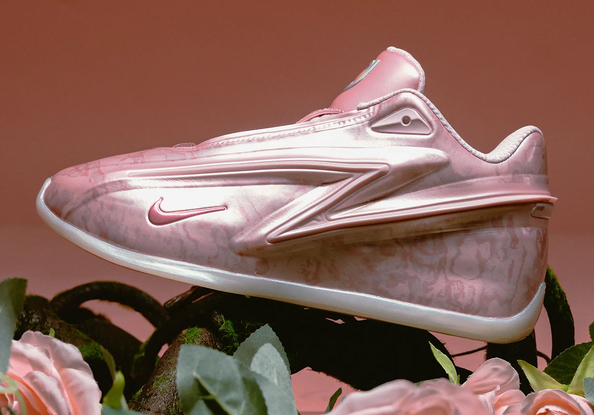
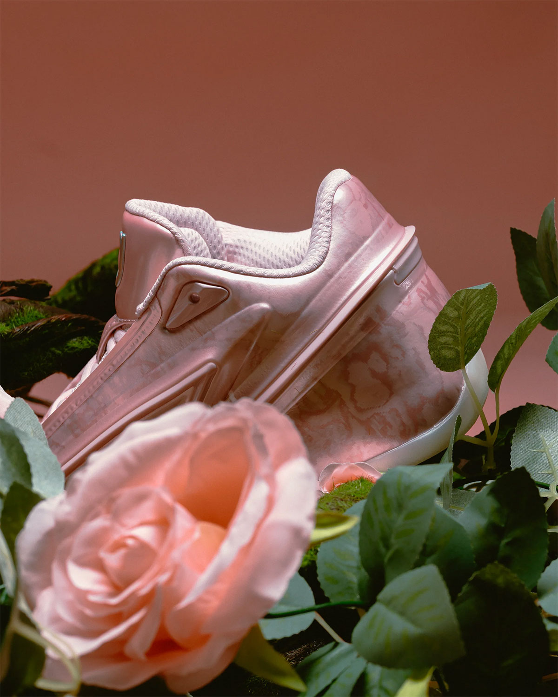
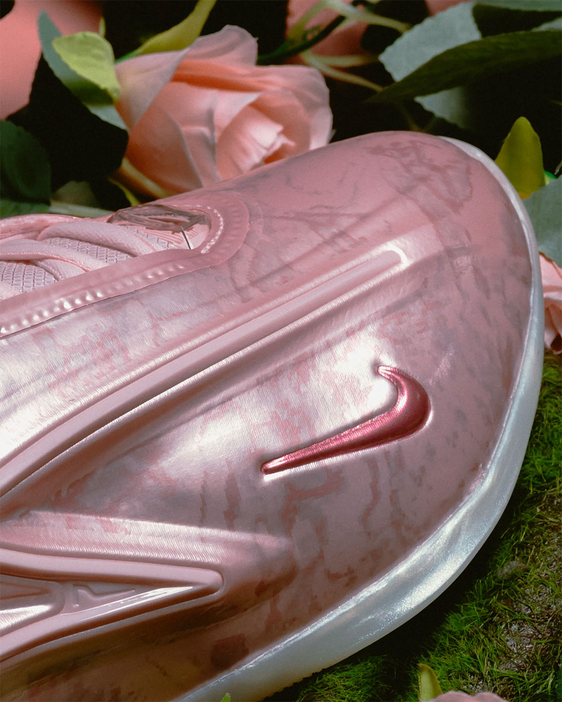
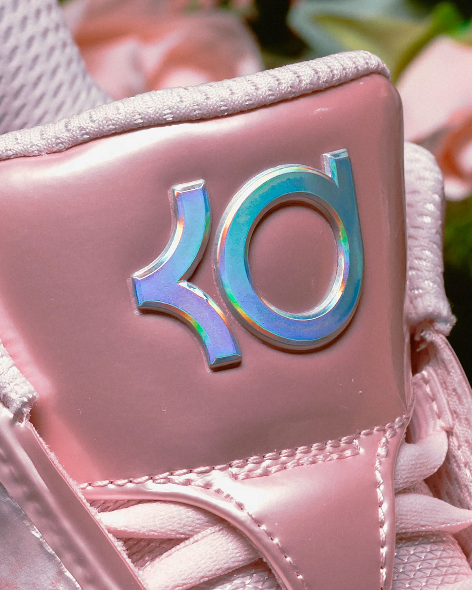
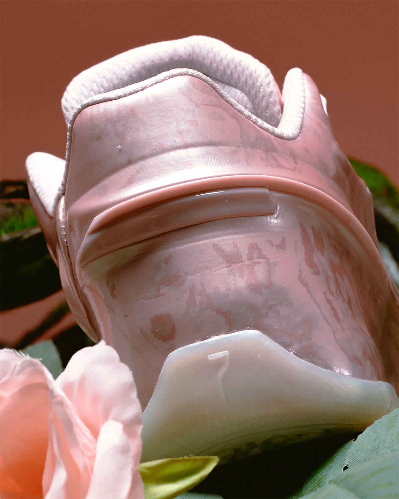
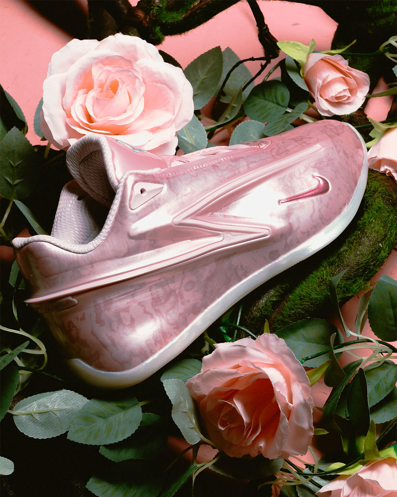

> [English version 英文版](/life/nike-kd19-aunt-pearl/)

今天发售的最有意思的一双鞋，不是本周日历上声音最大的那双。它是一双粉色篮球鞋，背后是一个十四年的故事，而它的主人正处在一个微妙的时刻：37 岁的 Kevin Durant，在休斯顿火箭打第二个赛季，得分是二十年来最低，却公开表示自己不在乎，因为球队在赢球。Nike KD 19 “Aunt Pearl”（IO8111-600）于 2026 年 11 月 13 日星期五发售，男码 170 美元，通过 Nike.com、SNKRS 以及一长串零售商发售。它是市售款，不用抽签。而它是多年来第一双值得作为篮球鞋、而不只是作为纪念品来讨论的 “Aunt Pearl”——因为它脚下的 KD 19，是 Durant 签名线自 KD 12 以来改动最大的一次，而且已经有了五个月的独立实测背书。

先说一句实在话：这不是 “Aunt Pearl” 这个配色本身的上脚评测。这双鞋今天才发售，Nike 之外没有人穿着这个配色打过有意义的场次。下面是一篇长篇首次深度解析——事实、让一双粉色 KD 值得被记住的十四年历史、Nike 实际做出来的设计与技术、KD 19 这个型号的实测结论到底说了什么，以及 170 美元到底买到了什么——能核实的说法和不能核实的说法会分开讲。

*KD 19 “Aunt Pearl” 的 Nike 官方图：粉色花岗岩大理石纹 TPU 外壳、深粉色小 Swoosh，以及定义这双鞋的匕首线条。图片：Nike，经 Sneaker News。*

## 事实一览

| | |
|---|---|
| **型号** | Nike KD 19 “Aunt Pearl” |
| **货号** | IO8111-600 |
| **配色** | Pink Foam / Metallic Summit White – Stadium Green（粉色泡沫／金属亮银白－球场绿） |
| **发售日** | 2026 年 11 月 13 日星期五，美东时间上午 10 点／美西时间上午 7 点 |
| **发售价** | 男码 170 美元（2026 年 11 月 13 日的价格快照，依据 Nike、Sneaker News、Sole Retriever 与 Nice Kicks 的报道；可能变动） |
| **发售渠道** | Nike.com / SNKRS、Foot Locker、Finish Line、Dick’s Sporting Goods、SNIPES US、Sneaker Politics |
| **这双鞋是什么** | 自 KD 4（2012 年）以来 “Aunt Pearl” 系列的第 15 个篇章，落在 Durant 第 19 代签名鞋上——全掌 Zoom Strobel、Cushlon 3.0、双料注塑 TPU 匕首结构 |

## 为什么这双鞋是本周的头条

热度很容易举证，因为整个球鞋媒体的报道是一波接一波来的。Sneaker News 在 10 月 22 日发了专门的发售文章，11 月 6 日更新，附上了覆盖 Nike、SNIPES US、Sneaker Politics、Foot Locker 的完整购买清单。Sole Retriever 在 11 月 9 日发了官方图解析。Nice Kicks、Sneaker Bar Detroit、Sneaker Files、HotNewHipHop 都在同一窗口跟进。而每周发售指南把它排进了本周前列：在 11 月 13 日至 19 日当周五大发售的排名里，它排第二，仅次于 Deion Sanders 的 Air Diamond Turf II 复刻，排在 LeBron 24 首发和 Air Jordan 11 “Green Screen” 之前——对手不弱，KD 19 排在其中两双前面。

对于一双不限量、非联名、非复刻的市售篮球鞋来说，这样的关注度已经很高了。原因在系列本身。在一个大多数“故事”都是发售前六个月在营销会上编出来的签名鞋市场里，“Aunt Pearl” 恰恰相反：一个真实的人、一次真实的失去，以及一段持续了十四年、十五个型号、从未中断的传统。球鞋文化对真实的东西记性一向很好，而这就是其中之一。

## 故事：Aunt Pearl 是谁

Pearl 是 Kevin Durant 的姑姑，是把他带大的人之一，2000 年因肺癌去世，那时 Durant 才十二岁。从 2012 年的 Nike KD 4 “Aunt Pearl” 开始，他几乎每年都会为签名线做一双专门的粉色配色来纪念她。粉色是癌症 awareness 的颜色，系列里的每一双都以粉色为主——有些年份轻柔、带花卉感，有些年份更大胆，但永远是粉色，永远是 Pearl。

十五个签名型号之后——从 KD 5 到 KD 19——这个系列已经成为整个体育界持续时间最长的设计传统之一，值得停下来想想它为什么能持续这么久。签名线通常到第五、第六双就把故事讲完了。Durant 这条线从来不需要编故事，因为故事不是营销资产，而是一个他至今仍会提起的人。鞋在变——KD 4 是一双低帮网面跑鞋，KD 19 是一双雕塑感的 TPU 外壳鞋——但自 2012 年以来的任务没有变过：做一双粉色的，做得漂亮，做成那一年这条线里最让人记住的一双。今年这一双，是很久以来对这个任务完成得最优雅的一次。

## 设计：粉色花岗岩

Sneaker News 在发布官方图时用的词是“粉色花岗岩”（pink granite），这个词很准。KD 19 的鞋面是一层注塑 TPU 外壳，在这个配色上，它呈现出大理石般的粉色纹理——深浅粉色像抛光花岗岩一样交织在一起，表面是亮面而不是哑面，光线扫过外壳的弧面时会流动。这比系列里某些年份那种柔软、花卉感的粉色要高级、克制得多，也很配 KD 19 本身的鞋型：这是一双线条凌厉、姿态前倾的鞋，而花岗岩处理让粉色读起来像一种材质，而不是一层喷漆。

细节都很克制，而这正是重点所在。Swoosh——前掌外侧的小 Swoosh——用的是略深一点的实色粉。鞋舌上的 KD 标志是银色的，近看带一点虹彩，近乎全息的效果，在光线下会泛蓝绿。鞋底收尾是淡粉色大底。官方配色名里的第三个颜色 Stadium Green（球场绿）只出现在很小的点缀上——整双鞋压倒性地是粉色，本该如此。

*从后跟看：花岗岩纹理的 TPU 包裹着鞋领，鞋舌是透气的织物，匕首线条贯穿整双鞋。图片：Nike，经 Sneaker News。*

更重要的设计决定是 Nike 没有做什么。没有印花、没有丝带、没有贴在后跟上的乳腺癌 awareness 图标。纪念只由颜色和名字来承担。这种克制正是这个系列能越穿越久的原因之一：鞋子不解释自己，也不需要解释。知道的人自然知道，不知道的人看到的只是一双很好看的粉色篮球鞋——而这在某种意义上正是重点。Pearl 的记忆不是一处图案，而是这双鞋存在的原因。

## 技术：Zoom Strobel 回来了

设计是纪念，技术是这双鞋超越纪念的原因。KD 19 的核心是全掌 Zoom Strobel 的回归——Nike 篮球的顶级缓震技术，最早出现在 KD 12 上，按 Nike 自己的发售通稿说法，是 KD 球迷点名要回来最多的配置。Strobel 是一块全掌 Zoom Air 气垫，直接缝在脚底下方，也就是说缓震层位于脚和中底之间，而不是埋在中底里面。理论上和实测里的效果是：回弹足、鞋身贴地，既给能量回馈，又让球员保持贴近地面的感觉。

它搭配的是 Nike 所说的“三层缓震系统”：最上面是全掌 Zoom Strobel，中间是 3D 立体成型的鞋垫，贴合足部，下方是柔软的 Cushlon 3.0 中底。再加一块中足支撑片（midfoot shank），在变向和急停时提供稳定性和抗扭转。这就是全部的脚下故事，而它和 KD 18 是有意的决裂——KD 18 几乎一比一复用了 KD 17 的鞋底：同一套缓震、同一个外底纹路，评测也公允地称它为扎实但保守的跟进款。KD 19 不是保守的跟进款，它是一双新鞋。

鞋面是 KD 19 最具辨识度、也最有争议的部分。它的外层 TPU 结构用双料注塑工艺做成：第一次注塑成型，负责后跟与中足的锁定；第二次注塑成型，做出鞋身标志性的匕首造型——那道沿着鞋侧延伸的、棱角分明的长 blade，定义了整双鞋的轮廓。匕首既呼应 Durant 的 “Slim Reaper” 外号和他赖以成名的关键球，也承担结构功能：TPU 就是包裹系统，包住脚，在横向移动中锁住它。鞋舌是透气织物，而大底的抓地纹路里织进了 Durant 的球衣号码 35 和 7。这些细节听起来像营销话术，直到你在照片里真的看到它们——35 和 7 确实就在橡胶里。

*鞋头特写：大理石纹粉色 TPU 外壳、深粉色小 Swoosh，以及让花岗岩效果成立的亮面处理。图片：Nike，经 Sneaker News。*

一个数字值得记在心里：KD 19 在六月首发时是 155 美元，“Aunt Pearl” 是 170 美元——比首发配色贵了 15 美元。Nike 没有解释过这个差价，说清楚一点比较好：鞋是同一双鞋，材料是同样的材料，这 15 美元买的是故事和特殊配色。值不值，是一个判断题，也是这次发售向买家提出的第一个真正的问题。

## 实测怎么说

KD 19 相比本周发售的其他鞋，有一个优势：它从六月就上市了，独立评测者真的穿着它打过球。“Aunt Pearl” 配色是今天新的，但型号已经五个月了，结论已经有了。

汇总来看，The Hoops Geek 四位专家评测的综合评分是 7.7 分（满分 10 分）——不错，但不是顶级，而且优点和缺点分得很清楚。缓震是最大亮点：专家评分 8.5 分，评测者称它柔软、弹、保护性强，Zoom Strobel 加 Cushlon 3.0 的组合提供了很好的冲击保护。抓地也是 8.5 分——多向纹路、粘性橡胶，在干净的场地上抓地力出色。支撑扎实：TPU 侧墙、后跟杯和硬质大底结构让这双鞋在横向和抗扭转上非常稳定，而这正是一双属于 6 尺 11 寸得分手的鞋该有的样子。

批评在各家评测里很一致，而且对购买决策来说比表扬更重要。鞋面偏硬、胶水感重、透气性差，需要一段磨合期才会变软。抓地力在干净球场上出色，但对灰尘敏感，需要经常擦拭。大底偏高、偏软，有人喜欢，有人觉得不如更低、更硬的设定直接。外底虽然厚，但磨损不均匀、有薄弱点——不适合高强度户外使用。

合起来读，结论是连贯的：KD 19 是一双真正不错的室内实战鞋，缓震是多年来 KD 线里最好的，但鞋面在开箱舒适度上做了取舍。如果你打室内、场地干净、愿意花时间磨合，它是 2026 年最好的签名鞋之一。如果你打户外，或者想要一双第一天就舒服的鞋，它不是。

*银色 KD 鞋舌标志特写——带虹彩，在光线下泛蓝绿，衬在粉色 TPU 上。图片：Nike，经 Sneaker News。*

## 时刻：Durant 在休斯顿，第二年

这双鞋还落在一个具体的职业时刻里，值得直说，因为它改变了这双鞋的含义。Durant 在休斯顿火箭打第二个赛季，37 岁，16 次入选全明星，扮演的角色和让他成名的那个角色已经不同。本赛季打了 12 场，他场均 20.9 分、6.1 个篮板、3.7 次助攻，出场 34.1 分钟——这是自新秀赛季以来的最低得分——真实命中率 63.2%。火箭 7 胜 1 负，排在西部榜首。九月份的媒体日上，他公开顶回了球队要控制他出场时间的计划：“我在场上更好，球队有我在场上也更好。”与此同时，他在打法上也接受了这支球队不再需要他每晚投二十五次篮。

这就是 2026 年 11 月一双粉色纪念鞋发售的背景：它不是一位巅峰期球员的鞋，而是一位已经变成另一种球员的老将的鞋——在一支赢球的球队里，依然致命，但不再是所有事情的中心。这其中有一种恰当的对称。“Aunt Pearl” 系列向来关乎记忆与延续，而不是当下，而今年这一点也契合球员本人。这双鞋不是要宣告未来，而是要致敬过去，落在一双本身就够格上场的型号上。

顺带一提球场上的时间点：火箭周六 11 月 14 日主场迎战犹他爵士，也就是这双鞋发售的第二天。Durant 会不会穿着 “Aunt Pearl” 上场——他有过在场上首穿有意义配色的历史——值得关注，但不能先假设。

## 同场：本周还有什么

没有一双鞋是在真空里发售的，而本周很挤。同一个星期五还有 Nike Air Diamond Turf II “Patent Black”，Deion Sanders 的复刻款，本周指南把它排在 KD 19 前面一位。11 月 17 日星期二有 Nike LeBron 24 “Stars”，号称史上最轻的 LeBron 签名鞋——这是本月另一个重磅实战故事，也是任何想花 170 美元以上买签名鞋的人自然会拿来比较的对象。星期六还有 Air Jordan 11 “Green Screen”，Jordan Brand Space Jam 30 周年系列的第二双。

诚实的比较对象是 LeBron 24，而不是 Jordan 11：两者都是当季的签名实战鞋，价格在同一区间，最终都要在球场上见分晓。KD 19 的优势是五个月的实测数据和一套已被验证的缓震配置；LeBron 24 的优势是新鲜感和 Nike 铺了几个月的轻量化故事。想要一个确定的选择，今天买 KD 19 更稳妥；想要最新的东西，等四天。

*后跟杯特写：花岗岩纹理贯穿 TPU，淡粉色大底在后跟处向上包起。图片：Nike，经 Sneaker News。*

## 购买建议

按星期五发售前的重要程度，说几条实际的。

**尺码。** 评测者说这双鞋的包裹是贴合、锁定式的——TPU 外壳本身就是包裹系统，会把脚牢牢固定——鞋面变软需要一段磨合期。评测里没有一致的“偏小”结论，所以默认按正常 Nike 篮球鞋码买；但如果你在两个尺码之间，或者脚偏宽，更稳妥的做法是去店里试穿再决定，因为偏硬的鞋面不像网面鞋那样会在第一天原谅一个错误的尺码。

**发售。** 11 月 13 日星期五，美东时间上午 10 点／美西时间上午 7 点，Nike.com 与 SNKRS 开售，Foot Locker、Finish Line、Dick’s Sporting Goods、SNIPES US、Sneaker Politics 同步。这是市售款，本周指南明确说它应该比本周榜单上的大多数鞋都好买——不用抽签、不用抢 raffle、不用拼限量手速。这是一个实实在在的优势，同时也是一个不要付加价的理由：发售前 Sole Retriever 的实时价格追踪显示这双鞋的价格是 154 美元，低于 170 美元的发售价——这就是市售款在市场知道货够分时的样子。不要为这双鞋付高于发售价的钱。

**适合谁。** 如果你在室内打球，想要多年来缓震最好的 KD，这是一次真正的实战购买，而 “Aunt Pearl” 是这条线目前最好看的配色。如果你收藏这个系列，这双是必收——花岗岩处理是自 KD 4 开启系列以来最有辨识度的 “Aunt Pearl” 做法，而且这个系列不跳年。如果你想要一双日常穿搭的鞋，也请对自己诚实：KD 19 是一双低帮篮球鞋，鞋面是偏硬的 TPU 外壳，粉色花岗岩再好看，它在球场上也比在街头更合适。

**唯一的提醒。** 170 美元比 KD 19 首发配色贵了 15 美元，鞋是同一双。如果故事对你重要——而对这个系列来说，故事就是产品本身——这 15 美元很容易接受。如果不重要，首发的 “University Red” 或 “Bright Ceramic” 是同一双鞋、更便宜，而且还有货。另外如果你打户外，评测者提到的灰尘敏感抓地力和外底磨损问题是真实存在的理由，换什么颜色都一样，值得另作选择。

*俯视：玫瑰主题官方拍摄里的整双鞋——匕首线条、小 Swoosh，以及覆盖整个鞋面的花岗岩质感。图片：Nike，经 Sneaker News。*

## 结论

KD 19 “Aunt Pearl” 难得地在三个层面同时成立，这就是它能领跑本周的原因。作为纪念，它是十四年系列里最优雅的一个篇章——粉色花岗岩而不是图案，克制而不是解释，一双相信观众知道它意味着什么的鞋。作为篮球鞋，它是多年来第一双真正有新缓震故事的 KD，而实测在关键项上支持了它：缓震和抓地出色，哪怕鞋面需要耐心。作为一次购买，它是今天就能原价买到的市售款，170 美元，不用抽签、不用付加价——而在 2026 年 11 月，这几乎和它背后的故事一样罕见。

十四年前，这个系列从一个承诺开始：每年一双粉色的，为了 Pearl。这个承诺比球队、比鞋底科技、比同期开始的大多数签名线都活得更久。今年这一双守住了它，而且守在了一双值得穿——而不只是值得记住——的鞋上。

*价格与发售信息为 2026 年 11 月 13 日的快照，依据 Nike、Sneaker News、Sole Retriever 与 Nice Kicks 的报道；两者均可能变动。Sole Retriever 的实时价格（154 美元）是市场快照，不是发售价。无 affiliate 链接。这是对 “Aunt Pearl” 配色的首次深度解析，不是该配色的上脚评测——但 KD 19 型号自 2026 年 6 月发售以来已有独立实测，本文引用的实战结论针对该型号。*

**来源：** Nike Newsroom——“Nike Basketball and Kevin Durant Hit the Dagger With the Launch of the KD19”（2026 年 3 月 16 日）；Sneaker News——“Nike KD 19 ‘Aunt Pearl’”（2026 年 10 月 22 日，11 月 6 日更新）；Sole Retriever——“The Nike KD 19 Aunt Pearl Drops This Week”（2026 年 11 月 9 日）；Nice Kicks——“Nike KD 19 ‘Aunt Pearl’”（2026 年 11 月）；The Hoops Geek——“Nike KD 19”实战评分（4 家专家评测）；WearTesters——“Nike KD 18: Small But Significant Improvements”；CourtFrame——“Kevin Durant Stats 2026–2027”（2026 年 11 月）；Bleacher Report——“Kevin Durant Pushes Back Against Rockets Limiting His Minutes”（2026 年 9 月 22 日）；iahhm——“Sneaker Releases This Week: Nov. 13–19, 2026”（2026 年 11 月 13 日）。
