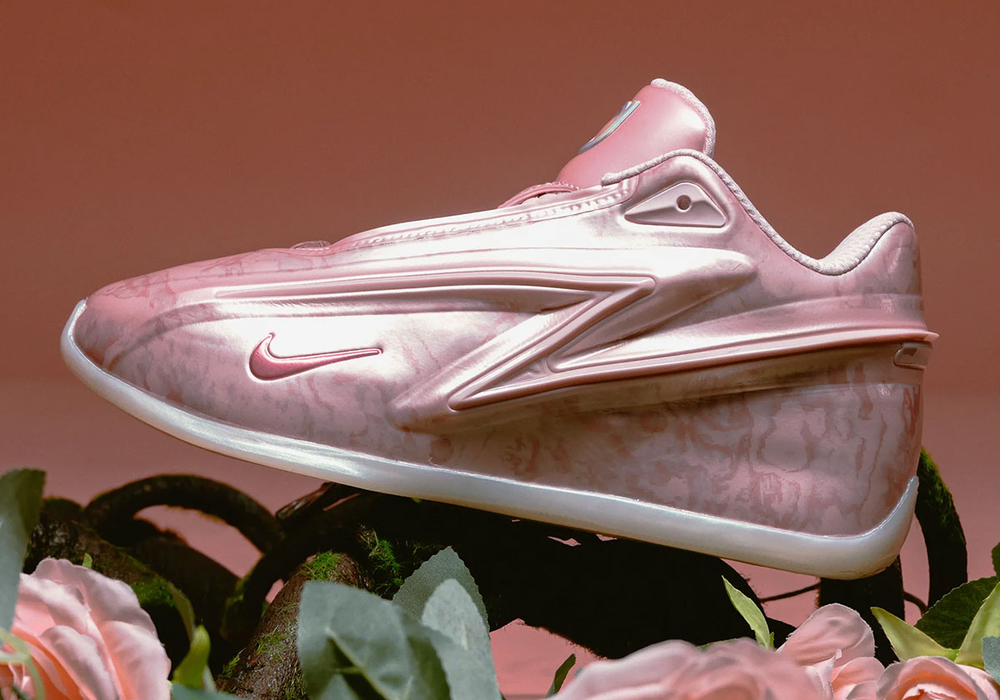
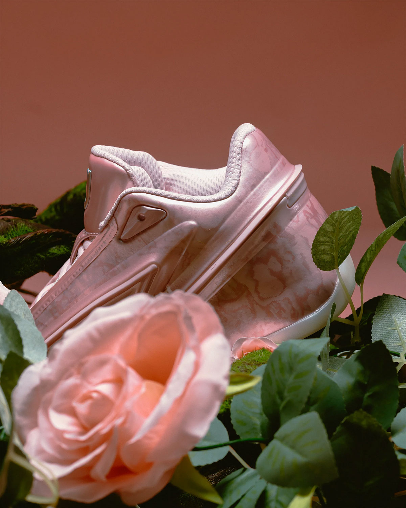
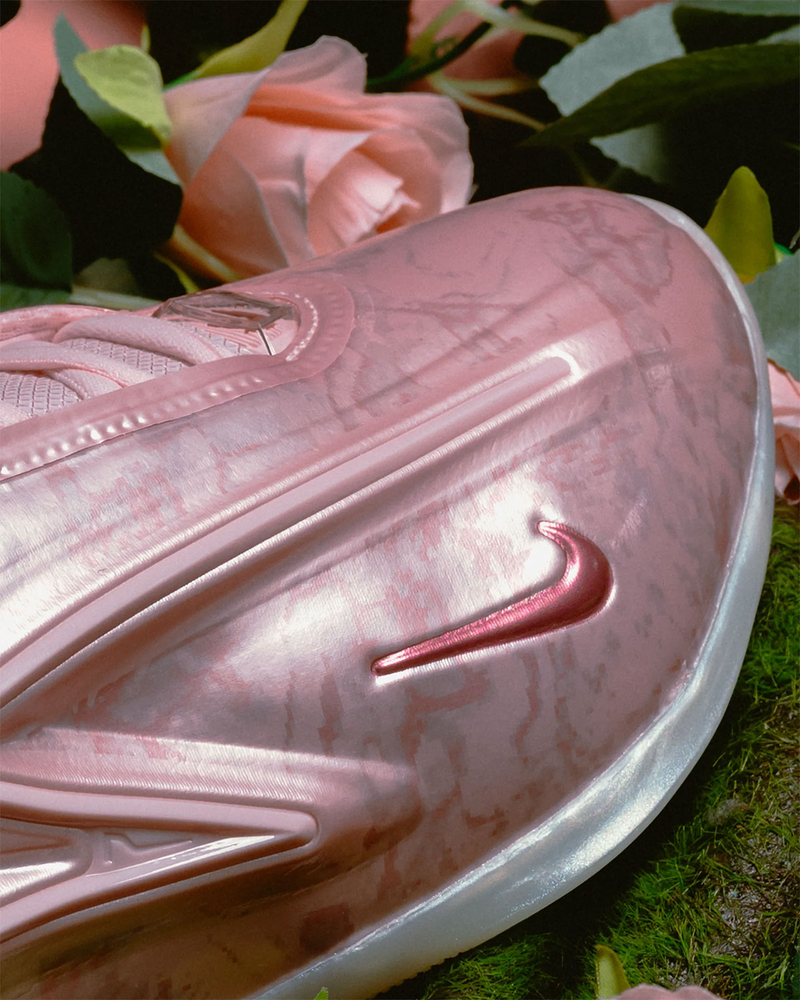
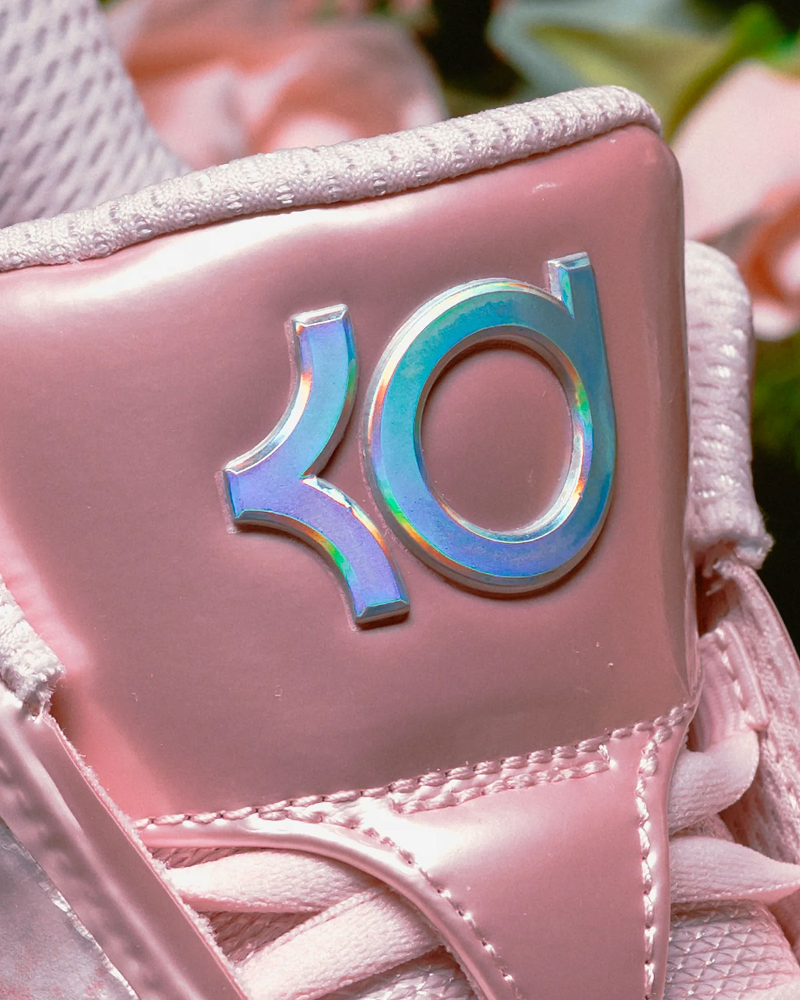
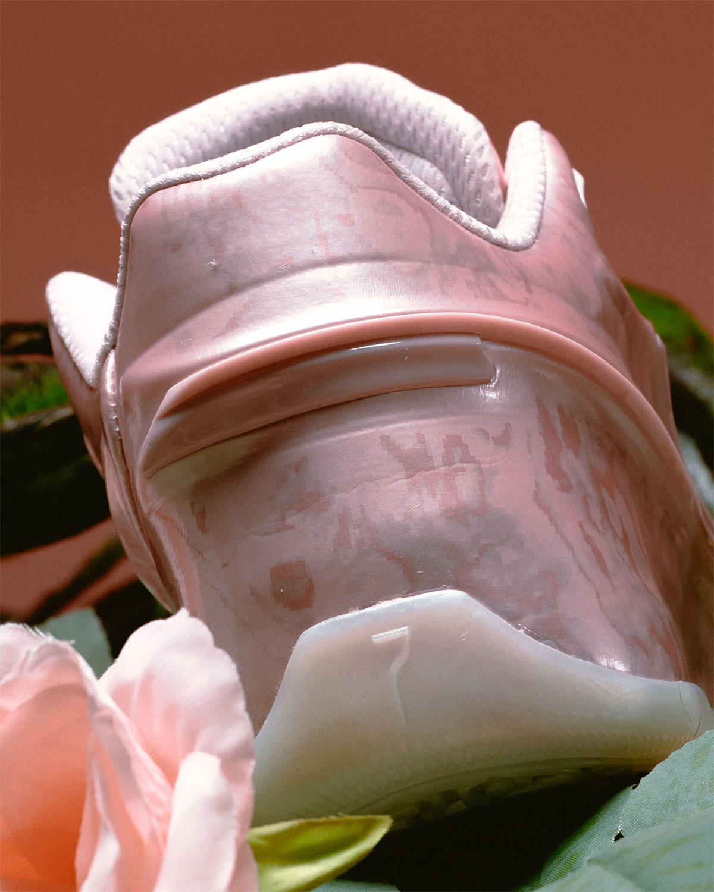
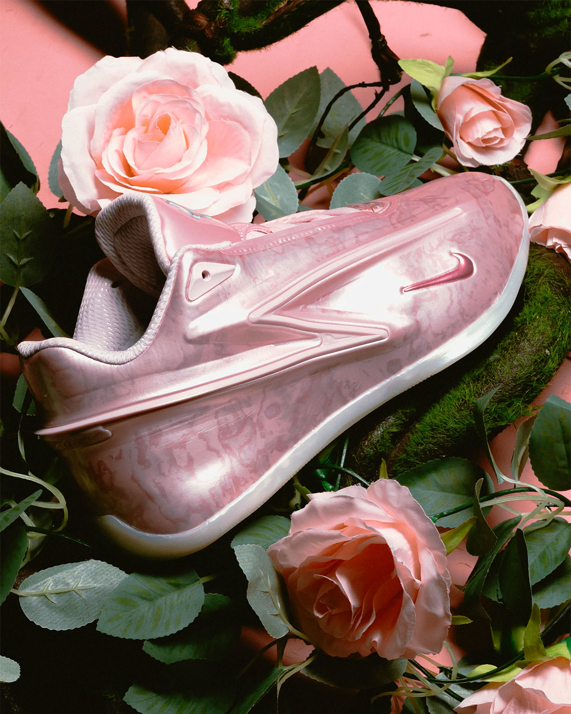

> [中文版 Chinese version](/life/nike-kd19-aunt-pearl-zh/)

The most interesting shoe releasing today is not the loudest one on the calendar. It is a pink basketball shoe with a fourteen-year-old story behind it, and it arrives at a strange moment for its namesake: Kevin Durant, 37, in his second season with the Houston Rockets, scoring less than he has in two decades and saying publicly that he does not care, because the team is winning. The Nike KD 19 “Aunt Pearl” (IO8111-600) drops Friday, November 13, 2026, for $170 in men’s sizing, through Nike.com and SNKRS and a wide list of retailers. It is a general release, not a raffle. And it is the first “Aunt Pearl” in years that is worth talking about as a basketball shoe, not just as a tribute — because the KD 19 underneath it is the most substantial redesign of Durant’s line since the KD 12, and it has five months of independent wear testing behind it.

One honest note up front: this is not a wear test of the “Aunt Pearl” colorway itself. The pair releases today, and nobody outside Nike has put miles on this exact colorway. What follows is a long first look — the facts, the fourteen-year history that makes a pink KD matter, the design and the technology as Nike built it, what the wear-test verdicts on the KD 19 model actually say, and what $170 is buying — with the claims that can be checked separated from the ones that cannot.

*The KD 19 “Aunt Pearl” in Nike’s official imagery: a pink granite-marbled TPU shell, a darker pink mini Swoosh, and the dagger line that defines the shoe. Image: Nike, via Sneaker News.*

## The facts

| | |
|---|---|
| **Model** | Nike KD 19 “Aunt Pearl” |
| **Style code** | IO8111-600 |
| **Colorway** | Pink Foam / Metallic Summit White – Stadium Green |
| **Release date** | Friday, November 13, 2026, 10:00 a.m. ET / 7:00 a.m. PT |
| **Retail price** | $170 men’s (price snapshot as of November 13, 2026, per Nike, Sneaker News, Sole Retriever and Nice Kicks; subject to change) |
| **Where** | Nike.com / SNKRS, Foot Locker, Finish Line, Dick’s Sporting Goods, SNIPES US, Sneaker Politics |
| **What it is** | The 15th “Aunt Pearl” chapter since the KD 4 (2012), on Durant’s 19th signature model — full-length Zoom Strobel, Cushlon 3.0, dual-injection TPU dagger |

## Why this release is the story of the week

The heat is easy to evidence, because the coverage arrived as a wave across the whole sneaker press. Sneaker News ran its dedicated release piece on October 22 and updated it on November 6 with a full where-to-buy list spanning Nike, SNIPES US, Sneaker Politics and Foot Locker. Sole Retriever filed its official-images breakdown on November 9. Nice Kicks, Sneaker Bar Detroit, Sneaker Files and HotNewHipHop all carried it in the same window. And the weekly release guides put it near the top of the week: it is the No. 2 pick in the November 13–19 guide ranking the week’s five biggest releases, behind only the Deion Sanders Air Diamond Turf II retro and ahead of the LeBron 24 debut and the Air Jordan 11 “Green Screen” — a strong field, and the KD 19 sits above two of them.

That is a lot of attention for a general-release basketball shoe in a colorway that is not limited, not a collaboration and not tied to a retro. The reason is the series itself. In a signature-shoe landscape where most “stories” are invented in a marketing meeting six months before launch, the “Aunt Pearl” line is the opposite: a real person, a real loss, and a run that has now lasted fourteen years and fifteen models without ever being interrupted. Sneaker culture has a long memory for the things that are genuine, and this is one of them.

## The story: who Aunt Pearl was

Pearl was Kevin Durant’s aunt, one of the people who helped raise him, and she died of lung cancer in 2000, when Durant was twelve. He has honored her with a dedicated pink colorway nearly every year of his signature line, starting with the Nike KD 4 “Aunt Pearl” in 2012. Pink is the color of cancer awareness, and every entry in the series has been anchored by a pink palette — some years delicate and floral, some years bolder, but always pink, always Pearl.

Fifteen signature models later — KD 5 through KD 19 — the series is now one of the longest-running design traditions in all of sports, and it is worth pausing on why it has lasted. Signature lines usually run out of stories by the fifth or sixth shoe. Durant’s has never needed to invent one, because the story is not a marketing asset; it is a person he still talks about. The shoes change — the KD 4 was a low-cut mesh runner, the KD 19 is a sculpted TPU shell — but the assignment has not changed since 2012: make the pink one, make it beautiful, and make it the one people remember from that year’s line. This year’s pair is the most elegant execution of that assignment in a long time.

## The design: pink granite

Sneaker News, which published the official images, describes the upper as “pink granite,” and that is the right word for it. The KD 19’s exterior is a molded TPU shell, and on this colorway it carries a marbled, stone-like pink finish — pale and dark pinks veined together like polished granite, glossy rather than matte, catching light across the curves of the shell. It is a classier, more sophisticated take on the series than the soft, floral pinks of some earlier years, and it suits the KD 19’s silhouette: this is a sleek, aggressive shoe, and the granite treatment makes the pink read as a material rather than a paint job.

The details are restrained, which is the point. The Swooshes — a mini Swoosh on the lateral forefoot — are done in a slightly darker, solid pink. The KD tongue branding stands out in silver, and in close-up the tongue logo has an iridescent, almost holographic finish that shifts blue-green in the light. Underfoot, a pale pink outsole rounds out the package. Stadium Green, the third color in the official colorway name, appears only in small accents — the colorway is overwhelmingly pink, as it should be.

*From the heel: the granite-marbled TPU wraps the ankle collar, with a padded textile tongue and the dagger line running the length of the shoe. Image: Nike, via Sneaker News.*

The important design decision is what Nike did not do. There is no floral print, no ribbon, no breast-cancer-awareness iconography stamped on the heel. The tribute is carried by the color and the name alone. That restraint is part of why the series has aged well: the shoe does not explain itself, and it does not need to. Anyone who knows, knows. Anyone who does not just sees a very good-looking pink basketball shoe — which is, in its own way, the point. Pearl’s memory is not a graphic. It is the reason the shoe exists.

## The tech: the Zoom Strobel is back

The design is the tribute. The technology is the reason this pair matters beyond the tribute. The KD 19 is built around the return of the full-length Zoom Strobel — Nike Basketball’s pinnacle cushioning technology, first introduced in the KD 12 and one of the most requested features among KD fans, according to Nike’s own launch release. A Strobel is a full-length Zoom Air unit stitched directly under the foot, so the cushioning sits between the foot and the midsole rather than buried inside it. The effect, in theory and in the wear tests, is a springy, low-profile ride that keeps the player close to the court while still giving back energy.

It is paired with a three-layer stack Nike describes as a “multi-layered cushioning system”: the full-length Zoom Strobel on top, a 3D-molded sockliner cradling the foot, and a plush Cushlon 3.0 midsole underneath. A midfoot shank adds stability and torsional support for cuts and changes of direction. That is the whole underfoot story, and it is a deliberate break from the KD 18, which reused the KD 17’s tooling almost one-to-one — same cushioning setup, same outsole pattern — and was reviewed, fairly, as a solid but safe follow-up. The KD 19 is not a safe follow-up. It is a new shoe.

The upper is where the KD 19 is most recognizable, and most argued about. It is defined by an exterior TPU structure built with a dual-injection molding process: the first injection creates the molding for heel and midfoot lockdown, and the second forms the silhouette’s distinctive dagger shape — the long, angular blade that runs along the side of the shoe and gives it its silhouette. The dagger is a reference to Durant’s “Slim Reaper” persona and to the shot-making the shoe is built for, and it is structural, not decorative: the TPU is the containment system, wrapping the foot and holding it through lateral movement. A textile tongue offers breathability, and the outsole’s traction pattern is built from Durant’s jersey numbers, 35 and 7, woven into the tread. Those are the kind of details that sound like marketing until you see them in the photos — the 35 and 7 really are in the rubber.

*Close-up on the forefoot: the marbled pink TPU shell, the darker pink mini Swoosh, and the gloss finish that makes the granite effect work. Image: Nike, via Sneaker News.*

One number to keep in view: the KD 19 launched in June at $155. The “Aunt Pearl” is $170 — a $15 premium over the launch colorways. Nike has not explained the difference, and it is worth naming plainly: the shoe is the same shoe, the materials are the same materials, and the $15 is the price of the story and the special colorway. Whether that is worth it is a judgment call, and it is the first real question this release asks of a buyer.

## What the wear tests say

Here is where the KD 19 has an advantage over almost every other shoe releasing this week: it has been out since June, and independent reviewers have actually played in it. The “Aunt Pearl” colorway is new today, but the model is five months old, and the verdicts are in.

The aggregated picture, from The Hoops Geek’s panel of four expert reviews, is an expert rating of 7.7 out of 10 — good, not great, with a clear split between what the shoe does well and what it does not. Cushioning is the standout: an 8.5 expert rating, with reviewers calling it plush, bouncy and protective, with strong impact protection from the Zoom Strobel and Cushlon 3.0 stack. Traction also scores 8.5 — a sticky, multidirectional pattern with excellent grip on clean courts. Support is solid: the TPU sidewalls, heel cup and rigid outsole casing make the shoe very stable laterally and torsionally, which is exactly what a 6-foot-11 scorer’s shoe should do.

The criticisms are consistent across reviewers, and they matter more than the praise for a buying decision. The upper is stiff and over-glued, with poor breathability, and it needs a break-in period before it softens. The traction, excellent on a clean court, is dust-sensitive and needs wiping. The ride is high and plush, which some reviewers loved and others found less responsive than a lower, firmer setup. And the outsole, thick as it is, shows uneven wear and weak spots — not the shoe for heavy outdoor use.

Read together, that is a coherent verdict: the KD 19 is a genuinely good indoor performance shoe with the best cushioning a KD has offered in years, held back by an upper that prioritizes structure over comfort out of the box. If you play indoors, on clean courts, and you are willing to break it in, it is one of the better signature shoes of 2026. If you play outdoors, or you want a shoe that feels good on day one, it is not.

*The silver KD tongue logo in close-up — iridescent, shifting blue-green in the light, against the pink TPU. Image: Nike, via Sneaker News.*

## The moment: Durant in Houston, year two

The shoe also lands at a specific moment in Durant’s career, and it is worth saying plainly because it changes what the shoe means. Durant is in his second season with the Houston Rockets, and he is 37 years old, a 16-time All-Star, playing a different role than the one that made him famous. Through twelve games this season he is averaging 20.9 points, 6.1 rebounds and 3.7 assists in 34.1 minutes — his lowest scoring average since his rookie year — on 63.2% true shooting. The Rockets are 7–1 and sitting at the top of the Western Conference. He has pushed back publicly against the team’s plan to manage his minutes, saying at media day in September: “I’m better on the court. The team is better when I’m on the court.” And he has also accepted, in the way he plays, that this team does not need him to take twenty-five shots a night.

That is the context in which a pink tribute shoe releases in November 2026: not as the shoe of a player at his peak, but as the shoe of a player who has already become something else — a veteran on a winning team, still lethal, no longer the center of everything. There is a neatness to it. The “Aunt Pearl” series has always been about memory and continuity rather than the present moment, and this year that fits the player, too. The shoe is not trying to announce the future. It is honoring the past, on a model that is good enough to justify itself on the court.

It is also worth noting the timing on the court: the Rockets host the Utah Jazz at home on Saturday, November 14, the day after this release. Whether Durant wears the “Aunt Pearl” in a game — he has a history of debuting meaningful colorways on court — is something to watch, not something to assume.

## The field: what else is happening this week

No release happens in a vacuum, and this week is crowded. The same Friday brings the Nike Air Diamond Turf II “Patent Black,” Deion Sanders’ retro, and the week’s guides rank it just above the KD 19. Tuesday, November 17, brings the Nike LeBron 24 “Stars,” billed as the lightest LeBron signature ever — the other big performance story of the month, and the natural comparison point for anyone weighing a $170-plus signature shoe. And Saturday brings the Air Jordan 11 “Green Screen,” the second shoe in Jordan Brand’s Space Jam 30th-anniversary run.

The honest comparison is with the LeBron 24, not the Jordan 11: both are current signature performance shoes, both are priced in the same range, and both will be judged on the court. The KD 19 has the advantage of five months of wear-test data and a proven cushioning setup; the LeBron 24 has the advantage of novelty and a weight story Nike has been building for months. If you want a known quantity, the KD 19 is the safer buy today. If you want the newest thing, wait four days.

*The heel counter in close-up: the granite veining running through the TPU, and the pale pink outsole wrapping up at the back. Image: Nike, via Sneaker News.*

## Buying advice

A few practical notes, in the order that matters before a Friday drop.

**Sizing.** Reviewers describe the fit as snug and locked-in by design — the TPU shell is a containment system, and it holds the foot firmly — with a break-in period before the upper softens. There is no consensus in the reviews that the shoe runs small, so the default is your normal Nike basketball size; but if you are between sizes, or you have wide feet, the safer move is to try it on in a store rather than guessing, because the stiff upper will not forgive a wrong size on day one the way a mesh shoe would.

**The drop.** Friday, November 13, 10:00 a.m. ET / 7:00 a.m. PT on Nike.com and SNKRS, plus Foot Locker, Finish Line, Dick’s Sporting Goods, SNIPES US and Sneaker Politics. This is a general release, and the weekly guides are explicit that it should be easier to grab than most pairs on this week’s list — no raffle, no draw, no limited-stock scramble. That is a real advantage, and it is also a reason not to pay resale: Sole Retriever’s live-price tracker was showing $154 for the pair before release, below the $170 retail, which is what a general release looks like when the market knows there are enough pairs. Do not pay above retail for this shoe.

**Who it is for.** If you play basketball indoors and you want the best-cushioned KD in years, this is a genuine performance buy, and the “Aunt Pearl” is the best-looking colorway of the line so far. If you collect the series, this is a mandatory one — the granite treatment is the most distinctive “Aunt Pearl” execution since the KD 4 started it, and the series does not skip years. If you want a lifestyle shoe, be honest with yourself: the KD 19 is a low-cut basketball shoe with a stiff TPU shell, and it will look better on a court than on the street, pink granite or not.

**The one caveat.** The $170 price is $15 more than the KD 19’s launch colorways, for the same shoe. If the story matters to you — and for this series, the story is the product — that is easy to accept. If it does not, the “University Red” or “Bright Ceramic” launch colorways are the same shoe for less, and they are still available. And if you play outdoors, the dust-sensitive traction and the outsole wear issues the reviewers flagged are a real reason to look elsewhere, whatever color you choose.

*Top-down: the full pair in the rose-styled official shoot — the dagger line, the mini Swoosh, and the granite finish across the whole shell. Image: Nike, via Sneaker News.*

## Verdict

The KD 19 “Aunt Pearl” is the rare release that works on three levels at once, and that is why it leads the week. As a tribute, it is the most elegant chapter of a fourteen-year series — pink granite instead of a graphic, restraint instead of explanation, a shoe that trusts the audience to know what it means. As a basketball shoe, it is the first KD in years with a genuinely new cushioning story, and the wear tests back it up where it counts: cushioning and traction are excellent, even if the upper asks for patience. And as a purchase, it is a general release at $170 that you can buy today, at retail, without a raffle or a resale markup — which, in November 2026, is almost as unusual as the story behind it.

Fourteen years ago, the series started with a promise: every year, a pink one, for Pearl. The promise has outlasted teams, shoe technologies, and most of the signature lines it started alongside. This year’s pair keeps it, and it does so on a shoe that is worth wearing — not just worth remembering.

*Price and availability are a snapshot as of November 13, 2026, based on Nike, Sneaker News, Sole Retriever and Nice Kicks reporting; both are subject to change. The Sole Retriever live-price figure ($154) is a market snapshot, not a retail price. No affiliate links. This is a first look at the “Aunt Pearl” colorway, not a wear test of this colorway — but the KD 19 model has been independently wear-tested since its June 2026 launch, and the performance verdicts cited here are for the model.*

**Sources:** Nike Newsroom — “Nike Basketball and Kevin Durant Hit the Dagger With the Launch of the KD19” (March 16, 2026); Sneaker News — “Nike KD 19 ‘Aunt Pearl’” (Oct 22, 2026; updated Nov 6); Sole Retriever — “The Nike KD 19 Aunt Pearl Drops This Week” (Nov 9, 2026); Nice Kicks — “Nike KD 19 ‘Aunt Pearl’” (Nov 2026); The Hoops Geek — “Nike KD 19” performance ratings (4 expert reviews); WearTesters — “Nike KD 18: Small But Significant Improvements”; CourtFrame — “Kevin Durant Stats 2026–2027” (Nov 2026); Bleacher Report — “Kevin Durant Pushes Back Against Rockets Limiting His Minutes” (Sept 22, 2026); iahhm — “Sneaker Releases This Week: Nov. 13–19, 2026” (Nov 13, 2026).
