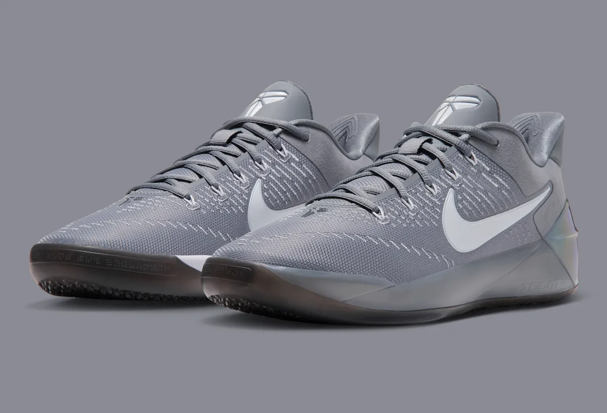
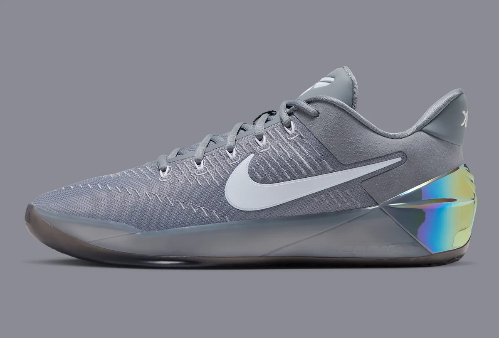
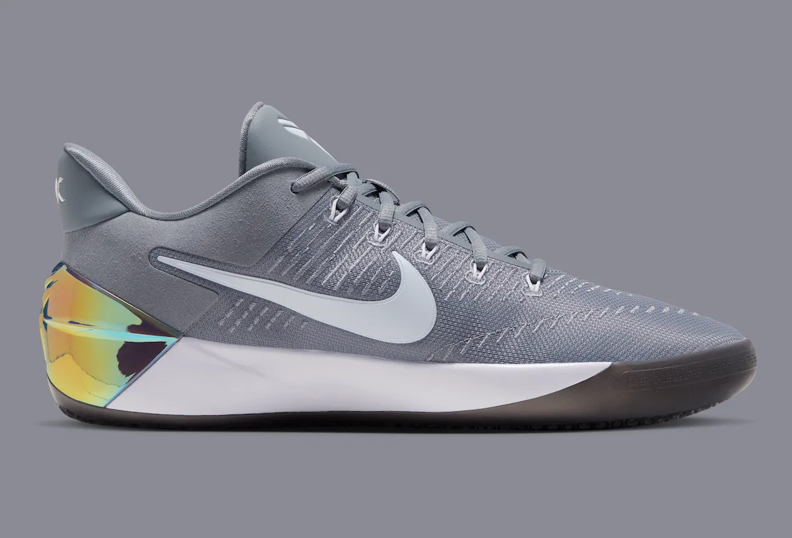
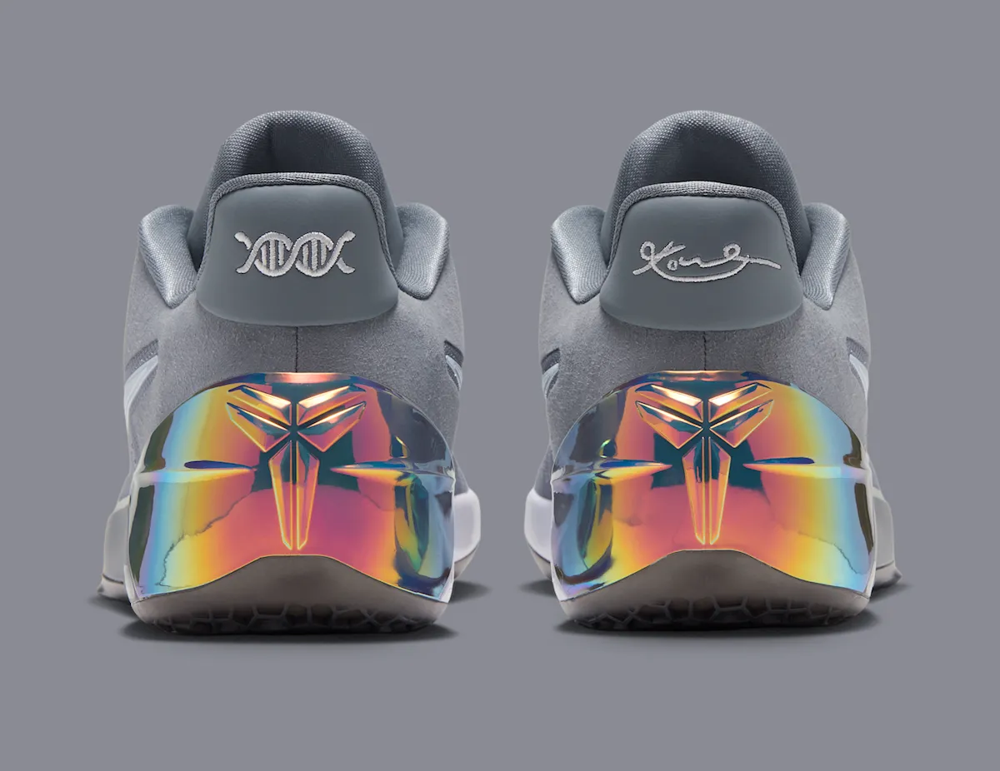
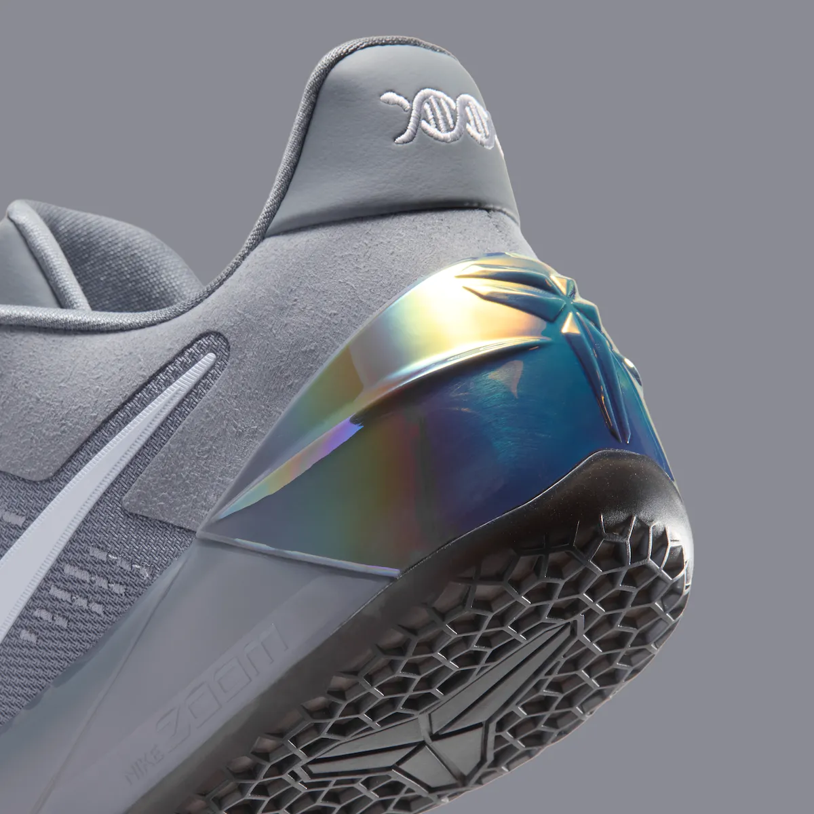
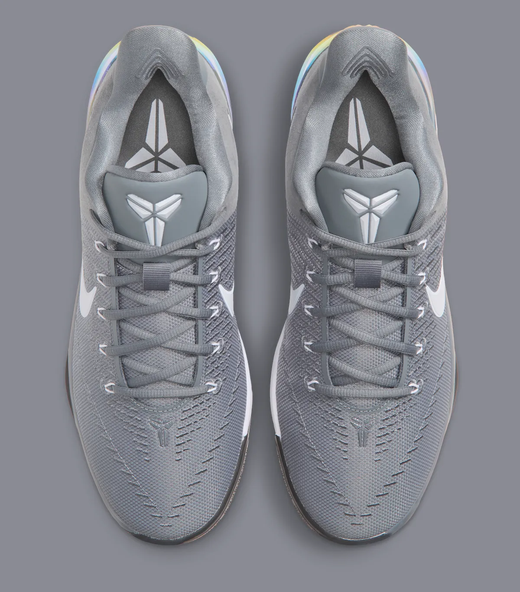
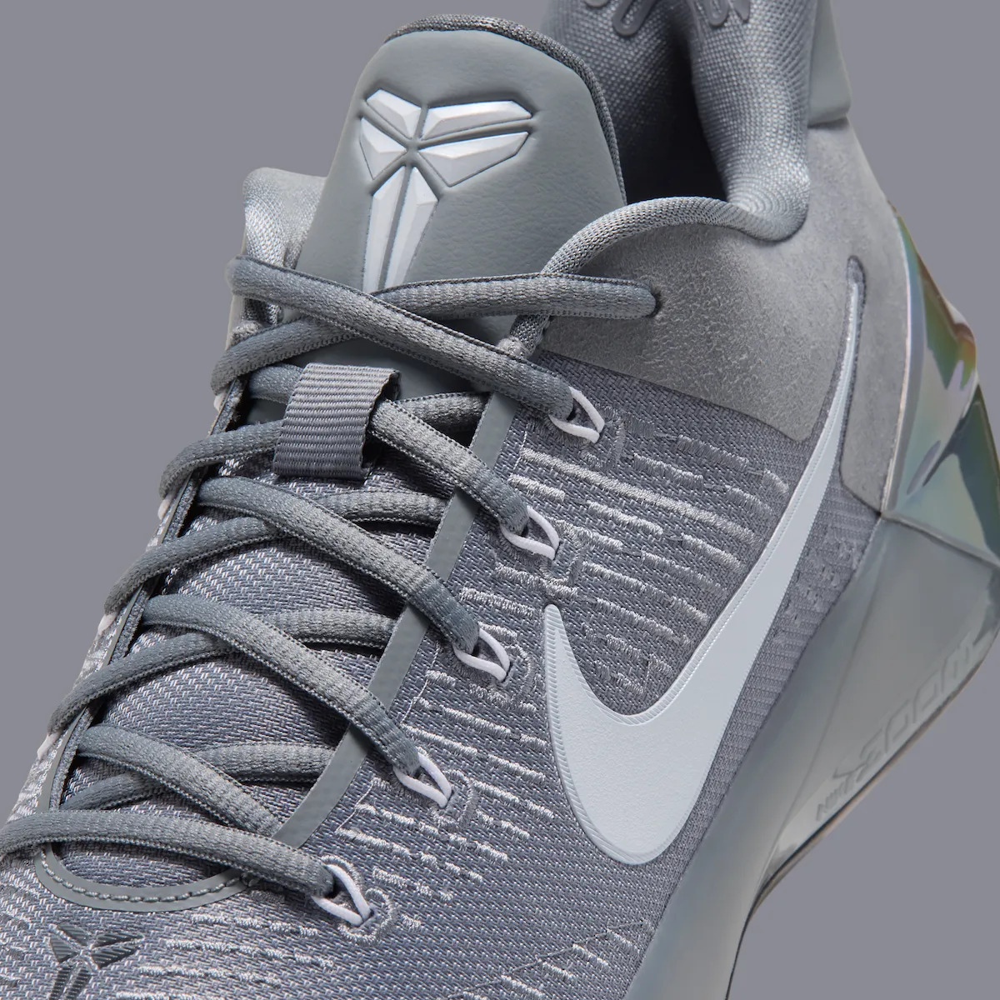
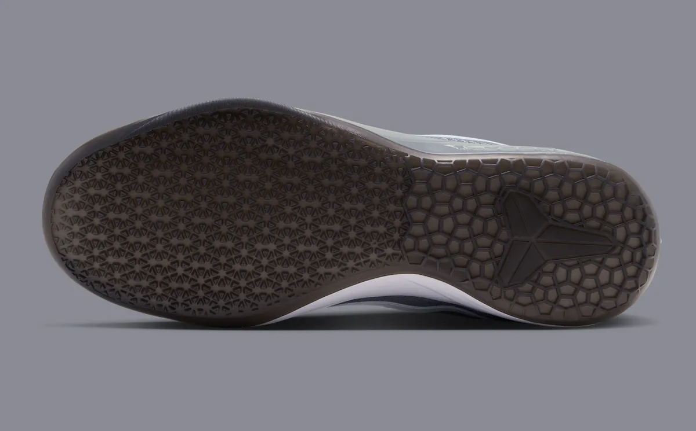

> [English version 英文版](/life/nike-kobe-ad-protro-ruthless-precision/)

有些纪念日是凑出来的整数，这双不是。初代 Nike Kobe A.D. 于 2016 年 11 月 22 日首发；Nike Kobe A.D. Protro "Ruthless Precision"（IO8233-001）今天——2026 年 11 月 22 日，周日——发售，整整十年，一天不差。它是科比·布莱恩特球员生涯结束之后发布的第一双签名鞋的初代配色回归，并按 Nike 的 Protro（Performance Retro，性能复刻）计划重做：外观照着 2016 年抄，鞋底里面的东西几乎全换了。

这种张力就是今天这篇的全部理由。Sneaker News 在 11 月 22–28 日当周发售综述里，把这双列为 11 月 22 日当天的领衔款，与 DIOS x adidas Adistar Control 5 同日；那一周真正的中心是黑五 11 月 27 日的 Air Jordan 4 "Bred"。Kobe 这双不是当周最大的复刻，却是当周最"精确"的一双：日期严丝合缝的周年、155 美元普通发售而非抽签，而且——对一双带纪念色彩的 Kobe 来说很难得——这个型号的独立实测已经先行存在：WearTesters 在它的首个配色 10 月 23 日发售时就做了完整性能评测。这双鞋打球到底怎么样，不用猜，已经有一份结论可以拿来对照、甚至反驳。

*整双：Cool Grey 冷灰网布、白色 Swoosh、鞋舌上的 Sheath 标志，以及后跟那块随光变色的鞋跟杯。图片：Nike，经 Sneaker Bar Detroit。*

## 基本信息

| | |
|---|---|
| **型号** | Nike Kobe A.D. Protro "Ruthless Precision" |
| **货号** | IO8233-001 |
| **配色** | Cool Grey / White – Black（Nike 官方标注 Cool Grey / Black / White） |
| **发售日期** | 2026 年 11 月 22 日（周日）——Nike.com 美西时间早上 7 点 / 美东 10 点上架，另有 Foot Locker 与部分 Nike Basketball 零售商 |
| **初代** | Kobe A.D. "Ruthless Precision"，2016 年 11 月 22 日发售 |
| **售价** | 155 美元——2026 年 11 月 22 日查询的价格 snapshot，subject to change |
| **缓震** | 全掌 React 中底、前掌 puck 状 ZoomX 泡棉块、后跟 Air Zoom 气垫、中足信用卡式稳定片 |
| **发售形式** | 普通发售（general release），男款与女款尺码 |

## A.D. 在 2016 年为什么重要——以及它为什么是一双"奇怪"的复刻对象

先说名字，因为 2016 年的新闻点就在名字里。此前二十年，Kobe 系列是数着代数走的——Kobe 1 到 Kobe 11，一个王朝可以数出来。A.D. 故意把计数打断："A.D."即 anno Domini、公元纪年里"之后"的那些年——Nike 和科比等于在宣布：这个系列会在它所纪念的生涯结束之后继续。科比已在 2016 年 4 月打完最后一场，对爵士 60 分的告别战把故事收得不能再圆。七个月后，品牌没有像大多数退役球星签名线那样收尾，而是用一个字面意思就是"接下来"的名称重新启动了它。

这让 A.D. 历史地位很高，当年在商业和口碑上却有点尴尬。它成了 2016–17 赛季 NBA 穿着率最高的球鞋之一——职业球员信任它；独立评测却对初代不冷不热。WearTesters 在 Protro 评测里回望时直言：初代是"我们当时就不太喜欢"的型号，抓地不稳定（实色外底与半透明外底表现两样），楦型偏紧、足弓处能夹疼人。A.D. 是一双挂着大名的实战工作鞋，而不是 Kobe 5、Kobe 8 那种被捧上神坛的经典。

这恰恰让它成为有意思的 Protro 对象。Protro 计划最好的状态不是收怀旧税，而是修订。Kobe 5 Protro、Kobe 6 Protro 之所以成立，是因为原作本就出色、改动克制。A.D. Protro 是更难的考试：这个计划能不能"修好"一双鞋，而不只是重印一双鞋？Nike 的答案是：保留 2016 年的那张照片，把照片底下的一切几乎全换掉。

## Protro 到底改了什么

初代 A.D. 用的是 Lunarlon 泡棉加后跟 Zoom Air——2016 年就已显旧的配置，放到今天近乎古董。Protro 把它整套扔掉。

取而代之：全掌 React 中底打底，前掌一块 puck（圆盘）状 ZoomX 泡棉，后跟 Air Zoom 气垫。三层各有分工，值得慢慢读：React 是耐用、回弹稳定的底盘，保证第三个月脚感不塌；ZoomX 块是头条——ZoomX 是 Nike 最轻、能量回馈最高的竞速泡棉，把一块放在前脚掌，正对后卫蹬地、变向、发力的那一瞬，Nike 官方文案也是这么写的：每一次蹬地、切入与进攻都有爆发回应；后跟 Air Zoom 负责步幅的另一端——落地与过渡，用从 Kobe 系列最初就有的气压回弹收尾。

围绕这套系统，改动还在继续。中足有一块信用卡大小的稳定片（shank plate），在 Nike 的说法里是为"突然、灵动的变向"保持稳定。前掌加宽了——Nike 明确写道加宽前掌"带来更舒适的贴合"，这是直接回应初代偏窄、夹足弓的楦型。后跟的 TPU 包边比初代更软、更灵活。前掌人字纹抓地升级，并向上翻包到侧墙——低重心后卫实际用到的倾斜角度上也能咬住地，而不只是平踩。鞋面是刺绣织物，Dynamic Flywire 飞线负责锁定，鞋领保持低帮——科比的鞋就该是低帮。

这些在产品图里都看不见。这正是 Protro 的本意，也是它的风险：你为看不见的工程买单，凭的是对计划名称的信任。所以 WearTesters 的评测才如此关键——它是收据。

*外侧：深灰中底、编织织物鞋面，以及随光变色的后跟稳定器。图片：Nike，经 Sneaker Bar Detroit。*

*内侧：白色中底。把鞋翻过来，颜色就翻面——这个鸳鸯细节是 2016 年初代原装的。图片：Nike，经 Sneaker Bar Detroit。*

## 设计：一身灰，只留一个大声的想法

作为配色，"Ruthless Precision"（无情精准）是克制的练习题，只留一个例外。Cool Grey 冷灰几乎覆盖一切：前掌透气网布与刺绣织物、后跟的灰色绒面、灰色鞋带、灰色鞋舌上一个白色 Sheath 标志。Swoosh 是白的，鞋头有一个小小的 Sheath。这双鞋是故意要"消失"的——那种只想让人看见球、不想让人看见穿搭的球员的配色。

走到后跟，克制结束。后跟杯是幻彩（iridescent）的，随光线在蓝、绿、金、红之间流转，Sheath 标志压印其中。它上方的后跟提环上，两只鞋刺绣还不一样：一只是一段 DNA 螺旋样式的标记，另一只是科比的签名。而中底是鸳鸯的——外侧深灰、内侧白色。这个手法科比以前玩过，最有名的是 Kobe 8 "What The"，在这里被收敛成一次安静的翻面，而不是拼贴大杂烩。Sneaker News 特别点出这个"转过来就变色"的翻转是这款配色的定义性细节，照片也确实如此：上面外侧与内侧两张图，乍看像两双不同的鞋。

还有一个细节是留给主人的，不是留给镜头的。BecauseSneakers 在今天的发售报道里提到：鞋舌内侧缝着一小块白色织唛，上面是年份的数字——一边 20、一边 26，中间站着 Sheath 标志。这双鞋设计于 2016 年，织唛标注的是重做的年份。它是一笔小小的、诚实的记账，藏在只有穿鞋的人系鞋带时才看得见的地方，也是整双鞋最"Protro"的一个细节：外面是过去，里面缝着现在。

*双脚后跟：幻彩后跟杯、压印的 Sheath，以及分开的刺绣——一只是 DNA、一只是签名。图片：Nike，经 Sneaker Bar Detroit。*

*后跟特写：后跟杯从金色流转到蓝色，中底上压着 "Nike Zoom" 字样。图片：Nike，经 Sneaker Bar Detroit。*

## 实战到底如何：WearTesters 的结论

因为 Protro 的首个配色已在 10 月 23 日以同样的 155 美元发售，WearTesters 已经把这套完全相同的鞋底系统做完了完整性能评测。他们的总评很克制：抓地与缓震比初代有改进，鞋面材料不错，支撑配置好——而贴合度"仍有不足"。

先说抓地，因为那是初代最弱的一环。纹路本身沿用，但这次覆盖整个外底；WearTesters 认为咬地比 2016 年款进步，那一代的抓地在实色与半透明外底之间飘忽不定。缓震上，他们确认参数落到了脚感上：前掌 ZoomX"明显比周围的 React 泡棉更软"，同时也诚实地校准——它没有围绕更完整 ZoomX 或 strobel 结构打造的现代后卫鞋那么弹，他们的对照点是 Ja 系列。支撑沿用了初代、且依然是强项：大块后跟稳定器、中足稳定片、宽而平的鞋底加上外侧防侧翻（outrigger）。他们的结论是：如果这双鞋合你的脚，支撑不会是你的问题。

评测提出异议的地方是贴合度——也是 Nike 声称修了、测试者的脚却不太认账的一处。Nike 加宽了前掌；WearTesters 仍然觉得它偏长、偏窄，和初代感觉相近。他们的建议具体、值得照字面执行：正码（true to size），宽脚上半码，能去店里试就先试。对一双在 Nike 与 Foot Locker 普通发售的鞋来说，最后一条是真实可行的——这正是非限量发售的实际好处之一。

把两种说法并排看，才是这双 Protro 的诚实画像。缓震与抓地的修订是真的、有实测背书的；贴合度的修订是声称了、部分兑现了、且仍然是这双鞋定义性的妥协。这比任何发售日热度都有用，而且只有在这个型号已经以另一配色上场一个月的前提下才可知。需要说明：冷灰这双本身是今天才发售的，还没有人发表过针对这一配色的上脚实测；它的鞋面材料与外底配方与受测款相同，所以上面的评测应理解为对"平台"的结论，而不是对这双配色第一周表现的结论。

*俯视图：鞋舌与鞋垫上的 Sheath 标志、系带系统，以及 Nike 声称已加宽的前掌轮廓——正是评测者仍在争论的贴合点。图片：Nike，经 Sneaker Bar Detroit。*

*鞋面特写：刺绣织物鞋面、系带与 Flywire 锁定系统、干净的白色 Swoosh。图片：Nike，经 Sneaker Bar Detroit。*

*外底：抓地纹路覆盖范围比初代扩展至全掌——WearTesters 认为咬地进步正源于此。图片：Nike，经 Sneaker Bar Detroit。*

## 在 Kobe 的这一周、与整个系列里的位置

A.D. Protro 在文化上并不孤单，尽管它独占今天的发售位。Kobe 系列在假日季的在场感已经成了一种年度结构——Protro 复刻踩着有意义的日子发，价格按现代签名鞋标准也算克制。155 美元是顶级普通发售后卫鞋的价格，不是纪念收藏品的价格，Nike 的分发方式也与之匹配：Nike.com、Foot Locker、部分篮球零售商，男女尺码都有，没有抽签机制的报道。SneakerFiles 的发售梳理直说它是普通发售、在大多数 Nike Basketball 零售商有售。

这种可得性是双刃的，值得把话说清。2026 年的普通发售 Kobe，不会按限量款的逻辑在二级市场走；谁把 "Ruthless Precision" 当投资品买，谁就看错了这场发售。它的价值主张是更老的那一种：一双用来打球的鞋，出自基本发明了现代低帮后卫鞋的那个系列，换上了定义 Nike 当前时代的两种泡棉——React 与 ZoomX。十年的对称是故事，鞋本身才是实体。

还有一个更安静的理由，说明 A.D. 为什么恰恰值得现在做 Protro。数字代数的经典们各有各的纪念碑；A.D. 是那座桥——它证明了这个系列可以活得比生涯更久，2016–17 赛季全联盟穿着它的，是看着它的名字长大的一代球员。把它按原日期带回来，并让当年点名它缺陷的评测者用实测确认修订，这个计划才算对得起自己的名字：Performance，retroactively——把性能，补回给过去。

## 选购建议

四点，按顺序。第一，尺码：标准脚正码，宽脚上半码，卡在两个码之间就去店里试——这是 WearTesters 实测平台后的指引，优先级高于产品页。第二，缓震预期：ZoomX 块是 React 底盘里的一块前掌点缀，比初代 Lunarlon 更软、更活，但不是全掌超级泡棉的体验；想要极致弹跳的人应横向比较，想要场地感加现代前掌的人会被服务得很好。第三，使用场景：这是一双室内后卫鞋——低帮、翻包侧墙的人字纹咬地、围绕后跟稳定器、稳定片与防侧翻的支撑包——半透明观感的外底与织物鞋面都不支持把它当室外日穿。第四，时机：普通发售，今天美西早上 7 点已在 Nike.com 上线，Foot Locker 亦在售；一个渠道没你的码，先查另一个再考虑加价，因为普通发售 Kobe Protro 的补货行为与限量款完全不是一回事。

## 结论

Kobe A.D. Protro "Ruthless Precision" 是一双罕见的、日期不是营销取舍的周年鞋——2016 年 11 月 22 日到 2026 年 11 月 22 日，整整十年；它的重做也不是化妆式的。Lunarlon 出局，React、前掌 ZoomX 块与后跟 Air Zoom 进场；不稳定的抓地出局，全覆盖、翻包侧墙的人字纹进场。灰色、幻彩后跟与鸳鸯中底留下来了，因为它们从来不是问题所在。

留下来的问题是贴合度：在实测过这个平台的评测者脚上，它依然偏长、偏窄，尽管 Nike 说加宽了。带着这个认知进去、按建议选码，155 美元换来的就是本季最诚实的一双 Kobe 复刻——一双退役之后的鞋，被给了它自己的第二段生涯。

*价格为 2026 年 11 月 22 日查询的 snapshot，subject to change。来源：Nike 官方产品页（Kobe A.D. Protro，IO8233-001——前掌 ZoomX 泡棉块、React 中底、后跟 Air Zoom、信用卡式稳定片、加宽前掌、更软的后跟 TPU 包边、人字纹抓地、Flywire、低帮鞋领）；Sneaker News（2026 年 11 月 2 日官方图解析与 11 月 22–28 日发售综述——十年日期对称、鸳鸯中底、幻彩后跟杯、155 美元、Nike 与 Foot Locker 渠道）；WearTesters（该型号 2026 年 10 月 23 日配色的 Kobe A.D. Protro 性能评测——抓地与缓震改进、偏长偏窄的楦型、正码且宽脚上半码、支撑配置）；SneakerFiles 与 Sneaker Bar Detroit（发售梳理——普通发售、2016 年 11 月 22 日初代首发、Lunarlon 到 React/ZoomX 的更替）；BecauseSneakers（2026 年 11 月 22 日发售日报道——Nike.com 美西早上 7 点上架、鞋舌内 2026 年织唛细节）。文中引用的性能评测针对的是 Kobe A.D. Protro 平台的先行配色；截至发稿，冷灰配色本身尚无上脚实测。*
