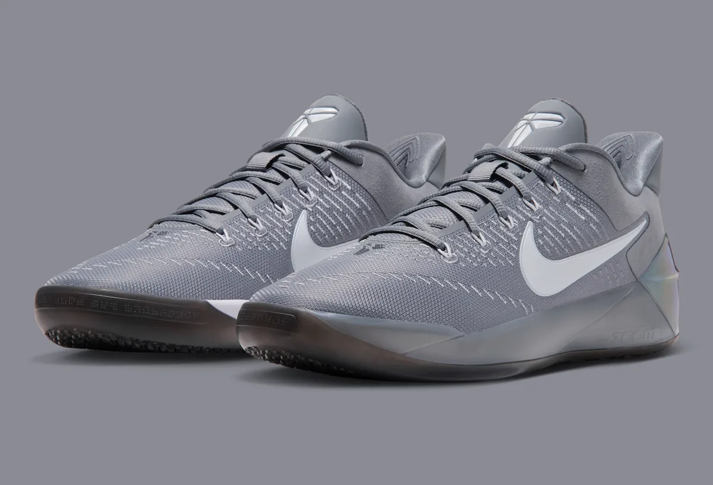
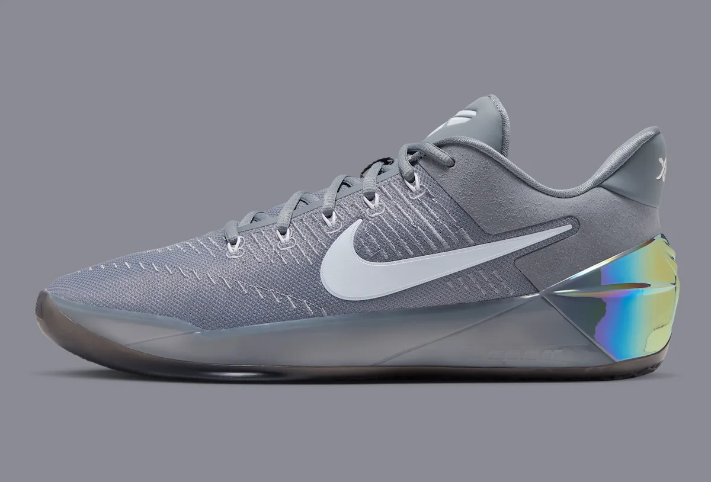
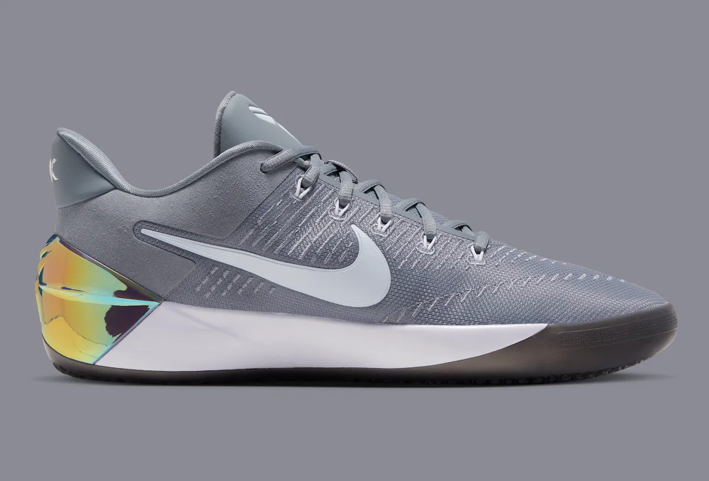
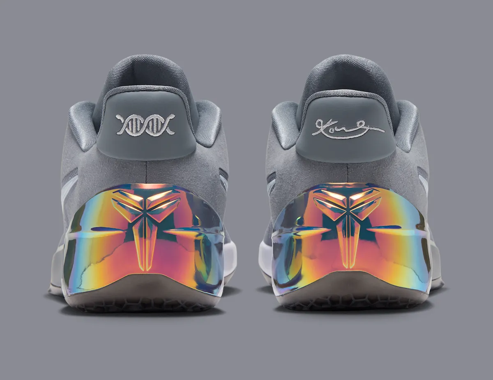
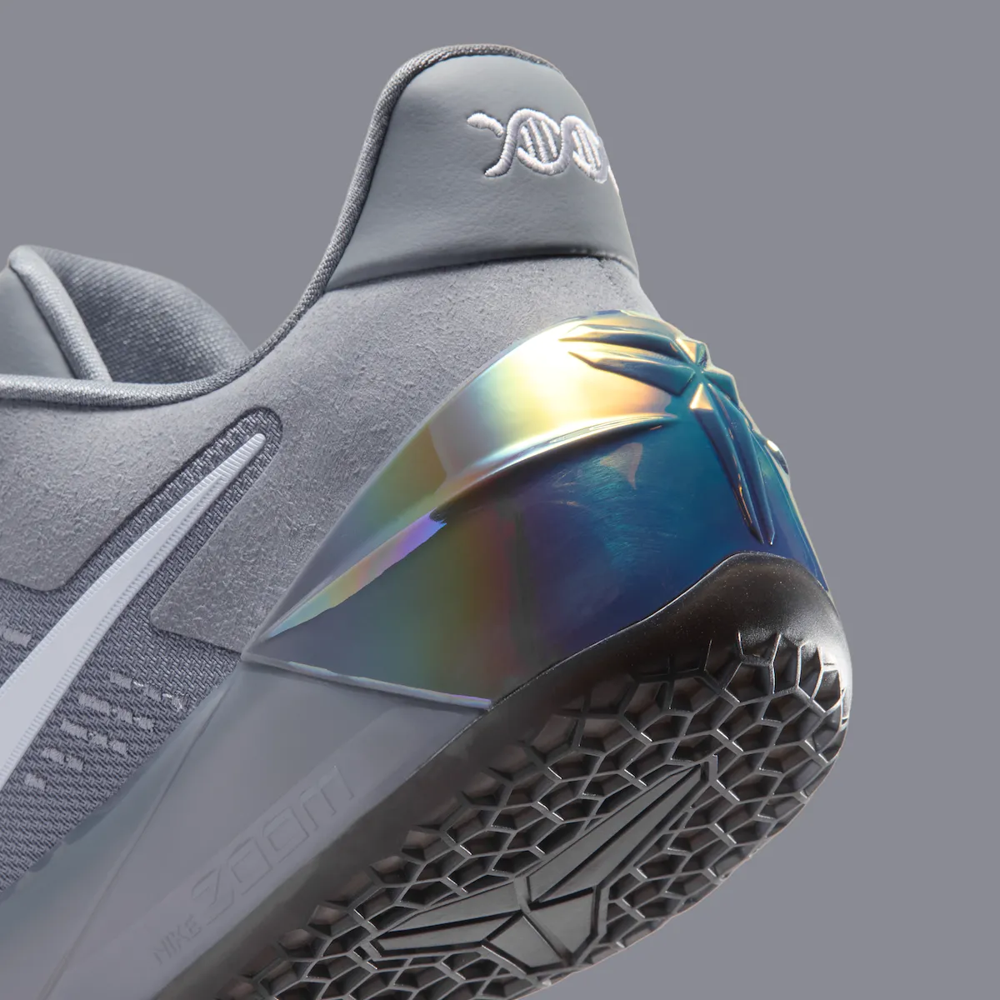
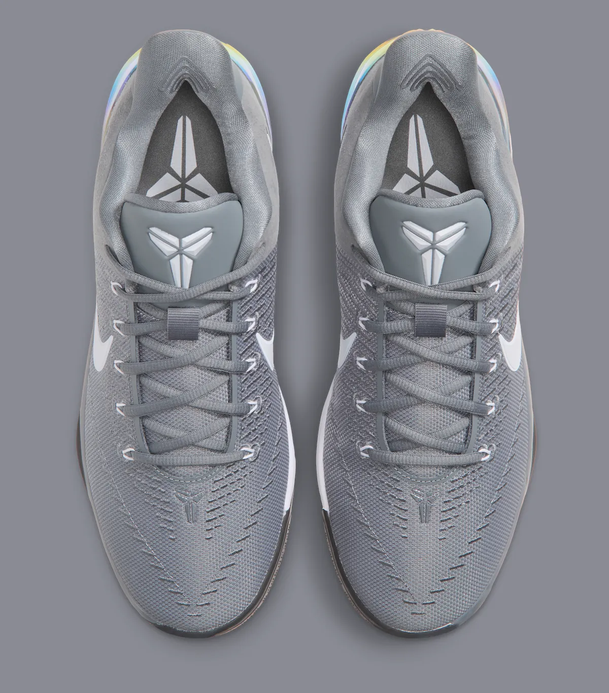
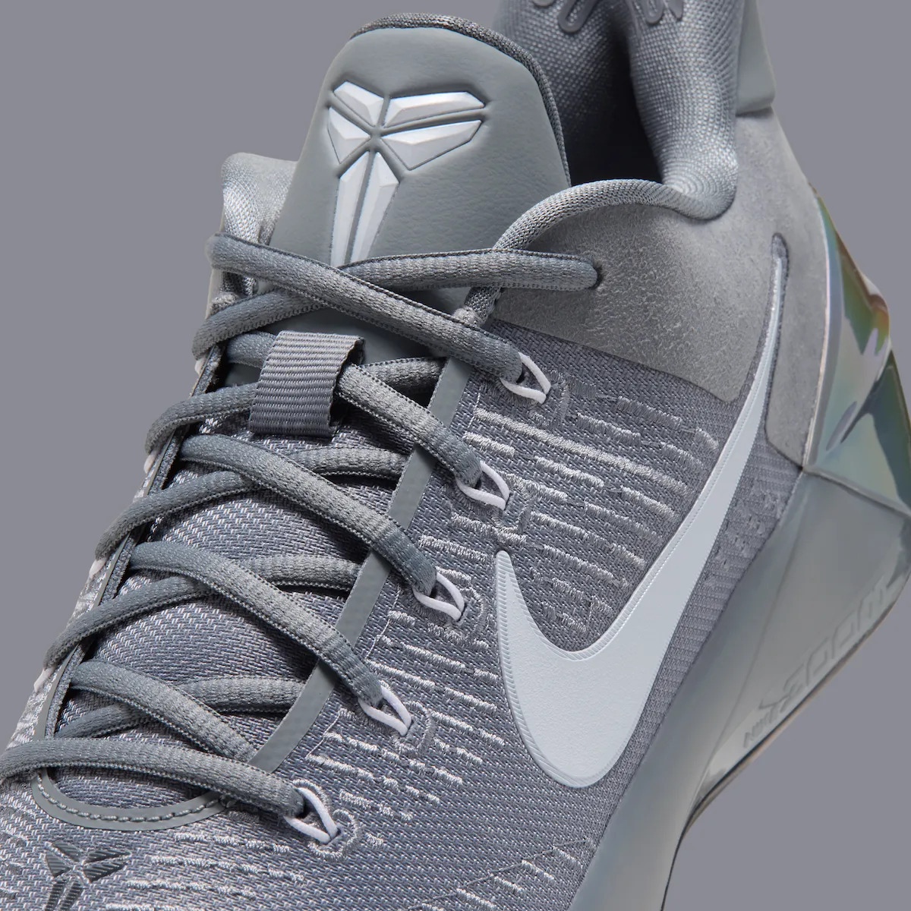
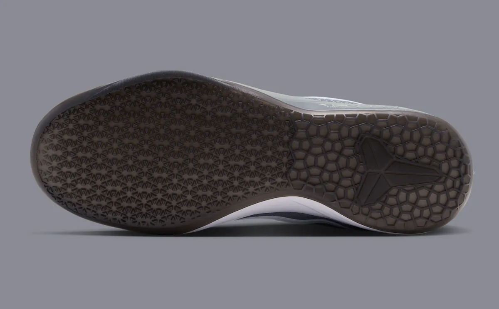

> [中文版 Chinese version](/life/nike-kobe-ad-protro-ruthless-precision-zh/)

Some anniversaries are rounded. This one is not. The original Nike Kobe A.D. debuted on November 22, 2016. The Nike Kobe A.D. Protro "Ruthless Precision" (IO8233-001) releases today, Sunday, November 22, 2026 — exactly ten years later, to the day. It is the return of an original colorway of the first signature shoe Kobe Bryant released after his playing career ended, rebuilt under Nike's Protro program — "performance retro" — with a cushioning stack that shares almost nothing with the shoe it is copying on the outside.

That tension is the whole story, and it is why this is the sneaker of the day. Sneaker News leads its November 22–28 release roundup with this drop for November 22, alongside the DIOS x adidas Adistar Control 5, in a week whose centerpiece is the Air Jordan 4 "Bred" on Black Friday, November 27. The Kobe is not the week's biggest retro. It is the week's most precise one: a date-exact anniversary, a general release at $155 rather than a raffle, and — unusually for a tribute-adjacent Kobe drop — an independent performance review of the model already on the record, because WearTesters tested the Kobe A.D. Protro when its first colorway arrived on October 23. You do not have to guess how this shoe plays. You can argue with a verdict that already exists.

*The pair: Cool Grey mesh, a white Swoosh, the Sheath on the tongue, and the color-shifting heel cup at the back. Image: Nike, via Sneaker Bar Detroit.*

## The facts

| | |
|---|---|
| **Model** | Nike Kobe A.D. Protro "Ruthless Precision" |
| **Style code** | IO8233-001 |
| **Colorway** | Cool Grey / White – Black (Nike lists Cool Grey / Black / White) |
| **Release date** | Sunday, November 22, 2026 — Nike.com from 7 a.m. PT / 10 a.m. ET, plus Foot Locker and select Nike Basketball retailers |
| **Original** | Kobe A.D. "Ruthless Precision," released November 22, 2016 |
| **Retail price** | $155 — price snapshot as of November 22, 2026, subject to change |
| **Cushioning** | Full-length React midsole, puck-shaped ZoomX foam pod in the forefoot, Air Zoom unit in the heel, credit-card-style midfoot shank plate |
| **Release type** | General release, men's and women's sizing |

## Why the A.D. mattered in 2016 — and why it was a strange shoe to bring back

Start with the name, because the name was the news in 2016. For two decades the Kobe line was numbered — Kobe 1 through Kobe 11, a dynasty you could count. The A.D. broke the count on purpose. "A.D." — anno Domini, the years after — was Nike and Bryant announcing that the line would continue past the end of the career it was named for. Bryant had played his last game in April 2016, the 60-point farewell against Utah that closed the story as neatly as a story can close. Seven months later, instead of ending the signature line the way most brands end a retired player's line, Nike relaunched it under a name that literally means "what comes after."

That made the A.D. historically important and, at the time, commercially and critically awkward. It became one of the most-worn shoes in the NBA during the 2016–17 season — professionals trusted it — while independent reviewers were lukewarm about the original. WearTesters, looking back in its Protro review, is blunt: the original model was one "we weren't too fond of," with inconsistent traction that depended on whether a colorway used a solid or translucent outsole, and a tight fit that could be painful in the arch. The A.D. was a working player's shoe with a famous name, not a beloved classic like the Kobe 5 or Kobe 8.

Which is exactly why it is an interesting Protro candidate. The Protro program, at its best, is not nostalgia tax — it is revision. The Kobe 5 Protro and Kobe 6 Protro worked because the originals were already great and the updates were careful. The A.D. Protro is a harder test: can the program fix a shoe, not just reissue one? Nike's answer is to keep the 2016 photograph and replace nearly everything underneath it.

## What Protro actually changed

The original A.D. ran on Lunarlon foam with a heel Zoom Air unit — a setup that was already feeling dated in 2016 and feels ancient now. The Protro discards it entirely.

In its place: a full-length React midsole as the carrier, a puck-shaped pod of ZoomX foam in the forefoot, and an Air Zoom unit in the heel. Read that stack slowly, because each layer has a job. React is the durable, responsive base — the foam that keeps the shoe from feeling dead in month three. The ZoomX puck is the headline: ZoomX is Nike's lightest, highest-return racing foam, and putting a pod of it under the ball of the foot targets the exact moment a guard plants, cuts and pushes off. Nike's own product copy frames it in those terms — responsiveness "every time you plant, cut and attack." The heel Air Zoom unit handles the other end of the stride, landing and transition, with the pressurized-air bounce that has defined the Kobe line since the beginning.

Around that stack, the changes continue. A credit-card-style shank plate runs through the midfoot for torsional stability on "sudden, shifty moves," in Nike's phrasing. The forefoot has been widened — Nike says explicitly that the widened forefoot "helps bring a more comfortable fit," a direct response to the original's narrow, arch-pinching last. The TPU rand around the heel is softer and more flexible than the original's. The herringbone traction pattern in the forefoot has been upgraded and now wraps up the sidewalls, so bite holds at the angles a low-to-the-ground guard actually uses, not just flat-footed. Dynamic Flywire cables handle lockdown over an embroidered textile upper, and the collar stays low-cut, as a Kobe should.

None of this is visible in the product photos. That is the point of Protro, and also its risk: you are paying for engineering you cannot see, on faith in a program name. Which is why the WearTesters review matters so much here — it is the receipt.

*Lateral side: the dark grey midsole, the woven textile upper, and the heel counter that shifts color with the light. Image: Nike, via Sneaker Bar Detroit.*

*Medial side: a white midsole. Turn the shoe over and the color flips — the mismatched detail is original to the 2016 pair. Image: Nike, via Sneaker Bar Detroit.*

## The design: grey, and then one loud idea

As a colorway, "Ruthless Precision" is an exercise in restraint with exactly one exception. Cool Grey covers essentially everything: the breathable mesh and embroidered textile through the forefoot, grey suede at the heel, grey laces, a grey tongue carrying a white Sheath logo. The Swoosh is white. The small Sheath mark sits at the toe. It is, deliberately, a shoe that disappears — the palette of a player who wanted the work, not the outfit, to be noticed.

Then you reach the heel, and restraint ends. The heel counter is iridescent, shifting through blue, green, gold and red depending on the light, with the Sheath logo molded into it. On the heel tabs above it, the two shoes split their embroidery: one carries a DNA-helix-style mark, the other Bryant's signature. And the midsoles mismatch — dark grey on the lateral side, white on the medial — a device Kobe had played with before, most famously on the Kobe 8 "What The," here reduced to a single quiet flip rather than a collage. Sneaker News singles out exactly this toggle, dark grey to white as you turn the shoe, as the colorway's defining trick, and the photos bear it out: the lateral and medial shots above could pass for two different shoes at a glance.

One more detail rewards the owners rather than the cameras. Reporting on today's release, BecauseSneakers notes a small white woven label sewn inside the tongue carrying the numerals of the year — 20 on one side, 26 on the other, with the Sheath standing in the middle. The shoe was designed in 2016; the label dates the remake. It is a tiny, honest piece of bookkeeping hidden where only the person lacing the shoe will see it, and it is the most Protro detail on the whole product: the past on the outside, the present stitched inside.

*Both heels: iridescent counters, the molded Sheath, and the split embroidery — DNA on one tab, the signature on the other. Image: Nike, via Sneaker Bar Detroit.*

*Heel close-up: the counter shifting from gold to blue, over the midsole's "Nike Zoom" callout. Image: Nike, via Sneaker Bar Detroit.*

## How it actually plays: the WearTesters verdict

Because the Protro's first colorway released on October 23 at the same $155, WearTesters has already put this exact tooling through a full performance review. Their summary is measured: improved traction and cushion over the original, nice upper materials, good support features — and a fit that "still leaves something to be desired."

Traction first, because it was the original's weakest point. The pattern itself is carried over but now covers the entire outsole, and WearTesters found the bite improved over the 2016 shoe, whose grip swung wildly between solid and translucent outsoles. On cushion, they confirm the spec translates: the forefoot ZoomX is "definitely softer than the React foam that surrounds it," though they add the honest calibration that it is not as bouncy as a modern guard shoe built around a fuller ZoomX or strobel setup — their comparison point is the Ja line. Support, they found, is carried over from the original and remains a strength: a large heel counter, the midfoot shank plate, a wide flat base and a lateral outrigger. If the shoe fits your foot, they conclude, support will not be your problem.

Fit is where the review pushes back, and it is the one place where Nike's stated fix and the tester's foot disagree. Nike widened the forefoot; WearTesters still found the shoe long and narrow, much like the original. Their advice is specific and worth following literally: go true to size, wide footers go up half a size, and if you can, try them on in store before deciding. For a general-release shoe at Nike and Foot Locker, that last option is actually available — one of the practical advantages of this not being a limited drop.

Hold those two accounts side by side and you get the honest picture of this Protro. The cushion and traction revisions are real and verified. The fit revision is claimed, partially delivered, and still the shoe's defining compromise. That is a more useful thing to know than any launch-day hype, and it is only knowable because the model has been on court for a month in another colorway. This colorway itself released today; nobody has published a wear test of the Cool Grey pair specifically, and the upper materials and outsole compound are shared with the tested shoe — but treat the review as a verdict on the platform, not on this pair's first week.

*Top view: Sheath marks on tongue and insole, and the forefoot shape Nike says it widened — the fit point reviewers still argue about. Image: Nike, via Sneaker Bar Detroit.*

*Upper close-up: the embroidered textile upper, the lacing and Flywire lockdown, and the clean white Swoosh. Image: Nike, via Sneaker Bar Detroit.*

*The outsole: traction coverage extended across the full sole versus the original — the change WearTesters credited for the improved bite. Image: Nike, via Sneaker Bar Detroit.*

## Where this sits in Kobe week, and in the Kobe line

The A.D. Protro does not arrive alone in the culture, even if it owns today's calendar slot. The Kobe line's holiday-season presence has become an annual structure — Protro reissues timed to dates that mean something, at prices that, by modern signature standards, are restrained. At $155, the A.D. Protro costs what a top-tier general-release guard shoe costs, not what a memorial collectible costs, and Nike is distributing it accordingly: Nike.com, Foot Locker, select basketball retailers, men's and women's sizing, no raffle mechanics reported. SneakerFiles' release breakdown calls it plainly a general release available at most Nike Basketball retailers.

That accessibility cuts both ways, and it is worth being clear-eyed about it. A general-release Kobe in 2026 will not behave like a limited one on the secondary market, and anyone buying "Ruthless Precision" as an investment is misreading the release. Its value proposition is the older one: a shoe to play in, designed by the line that more or less invented the modern low-top guard shoe, updated with the two foams — React and ZoomX — that define Nike's current era. The ten-year symmetry is the story; the shoe is the substance.

There is also a quieter argument for why the A.D., of all Kobes, deserved the Protro treatment now. The numbered classics have their monuments. The A.D. was the bridge — the shoe that proved the line could outlive the career, worn across the league in 2016–17 by players who had grown up idolizing its namesake. Bringing it back on the exact date, with its flaws addressed in print by the reviewers who named them, is the program working the way its name promises: performance, retroactively.

## Buying advice

Four points, in order. First, sizing: true to size for standard feet, half a size up for wide feet, in-store try-on if you are between — that is WearTesters' guidance after testing the platform, and it overrides the product page. Second, expectations on cushion: the ZoomX puck is a forefoot accent inside a React carrier, softer and livelier than the original's Lunarlon, but not a full-length super-foam experience; players who want maximum bounce should cross-shop accordingly, players who want court feel with a modern forefoot will be well served. Third, use case: this is an indoor guard shoe — low cut, herringbone bite that wraps the sidewalls, a support package built around a heel counter, shank and outrigger — and its translucent-look outsole and textile upper argue against making it an outdoor daily. Fourth, timing: it is a general release that went live at 7 a.m. PT today on Nike.com, with Foot Locker among the stockists; if your size is gone at one, check the other before paying anyone a premium, because restock behavior on general-release Kobe Protros is nothing like the limited pairs.

## The verdict

The Kobe A.D. Protro "Ruthless Precision" is the rare anniversary shoe whose date is not marketing rounding — November 22, 2016 to November 22, 2026, ten years to the day — and whose remake is not cosmetic. Lunarlon out; React, a ZoomX forefoot puck and heel Air Zoom in. Inconsistent traction out; full-coverage, sidewall-wrapping herringbone in. The grey, the iridescent heel and the mismatched midsoles stay, because they were never the problem.

The problem that remains is fit: long and narrow on the feet of the reviewers who tested the platform, Nike's widening notwithstanding. Know that going in, size accordingly, and what you get for $155 is the most honestly engineered Kobe reissue of the season — a post-career shoe, given a second career of its own.

*Price is a snapshot as of November 22, 2026, subject to change. Sources: Nike official product page (Kobe A.D. Protro, IO8233-001 — ZoomX forefoot puck, React midsole, heel Air Zoom, credit-card shank, widened forefoot, softer heel TPU rand, herringbone traction, Flywire, low-cut collar); Sneaker News (official-images breakdown, November 2, 2026, and the November 22–28 release roundup — the ten-year date symmetry, mismatched midsoles, iridescent heel cup, $155, Nike and Foot Locker stockists); WearTesters (Nike Kobe A.D. Protro performance review of the model's October 23, 2026 colorway — improved traction and cushion, long and narrow fit, true to size with wide footers up half a size, support features); SneakerFiles and Sneaker Bar Detroit (release breakdowns — general release, original November 22, 2016 debut, Lunarlon-to-React/ZoomX change); BecauseSneakers (release-day report, November 22, 2026 — 7 a.m. PT Nike.com launch, the 2026 woven tongue label). The performance review cited covers the Kobe A.D. Protro platform in an earlier colorway; no wear test of the Cool Grey pair itself existed at the time of writing.*
