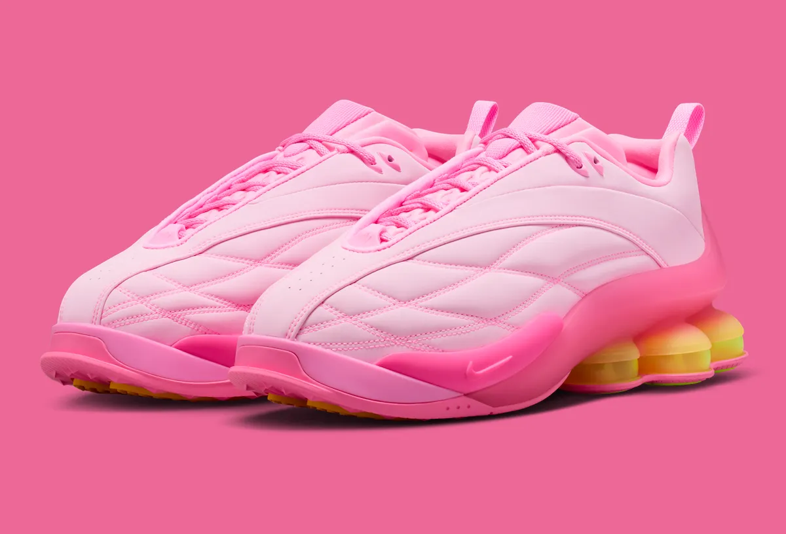
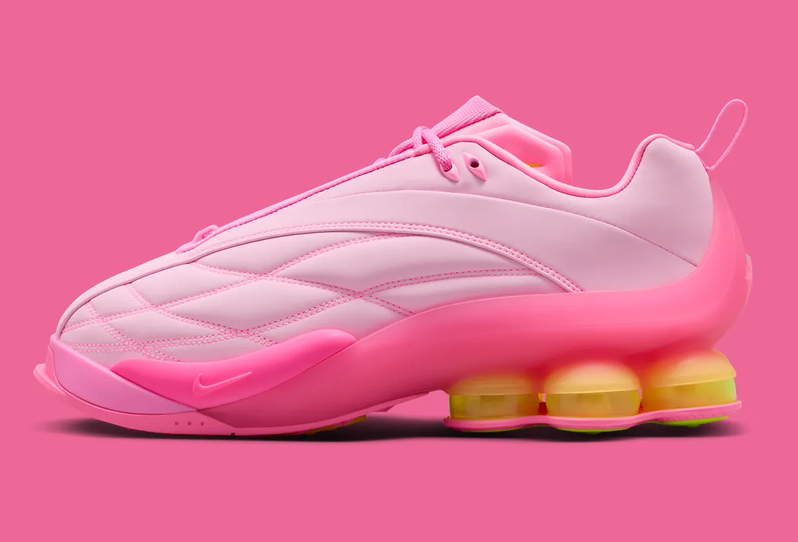
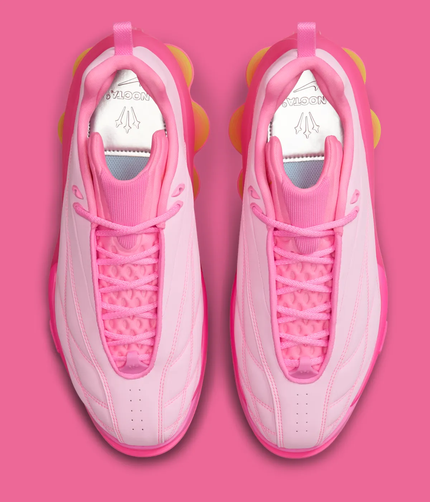
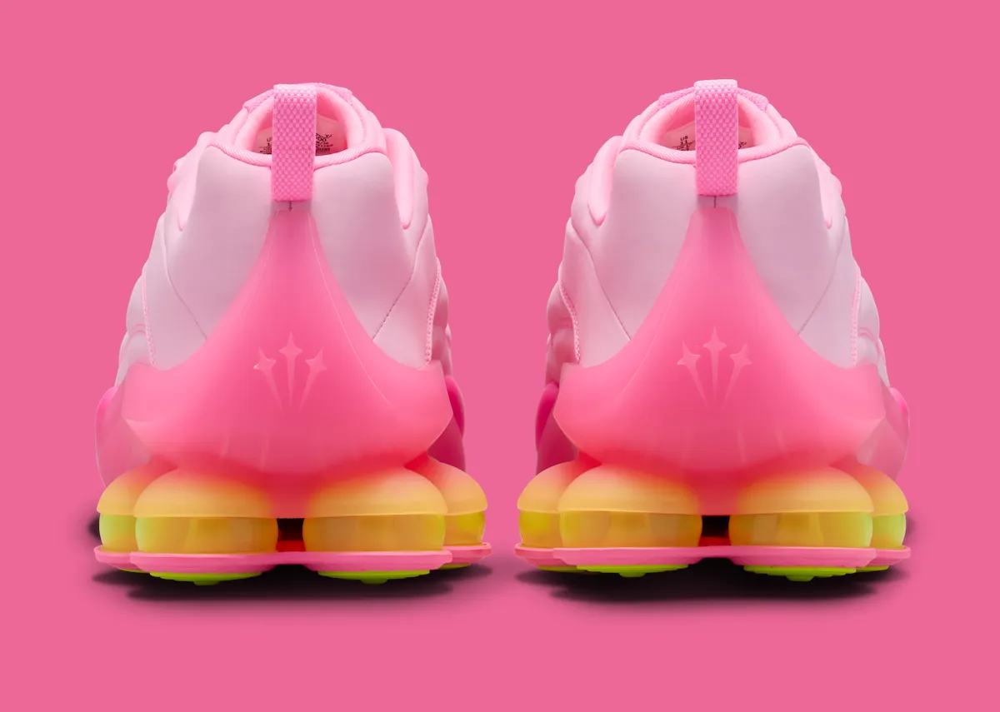
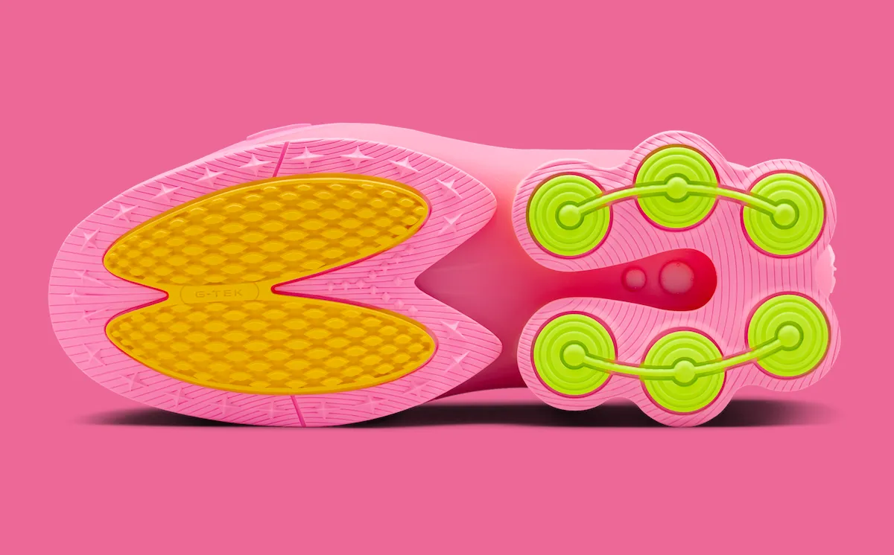
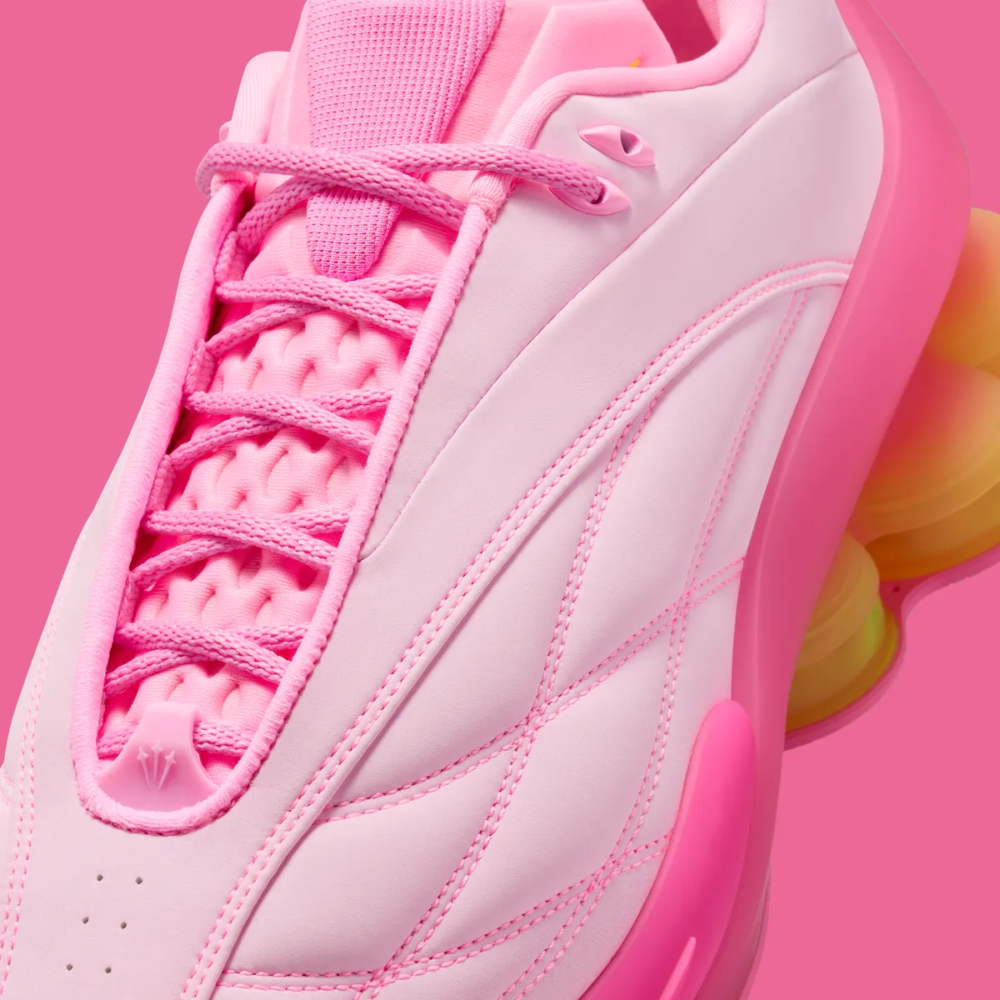
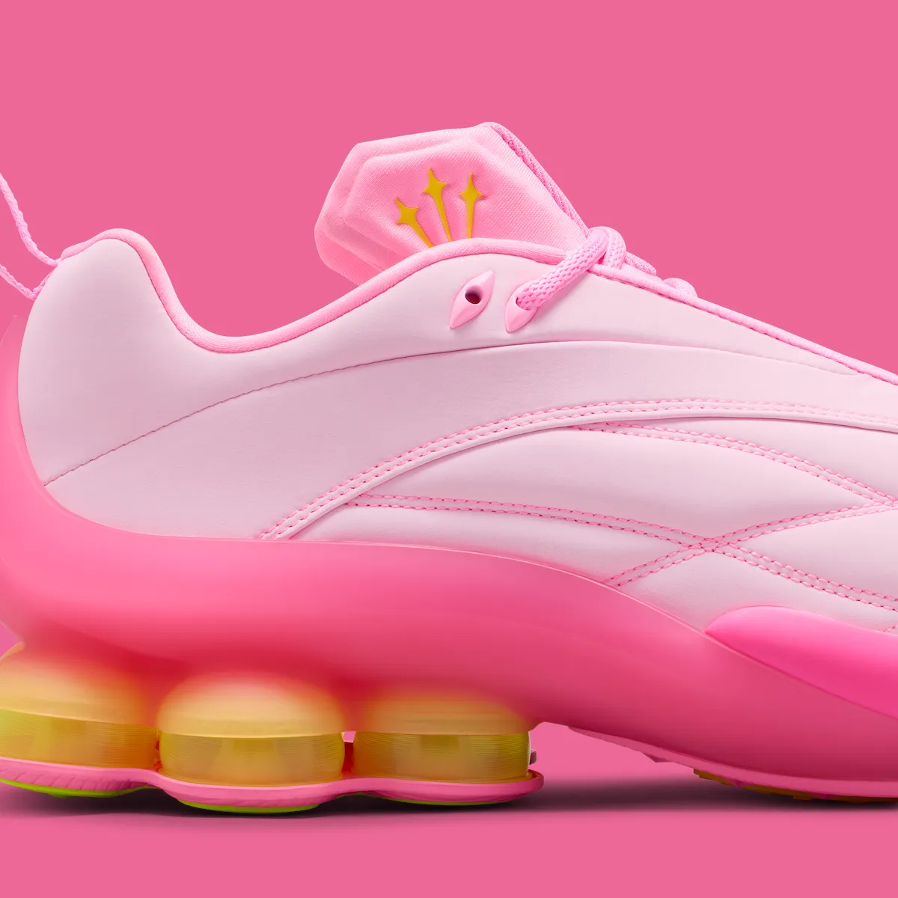
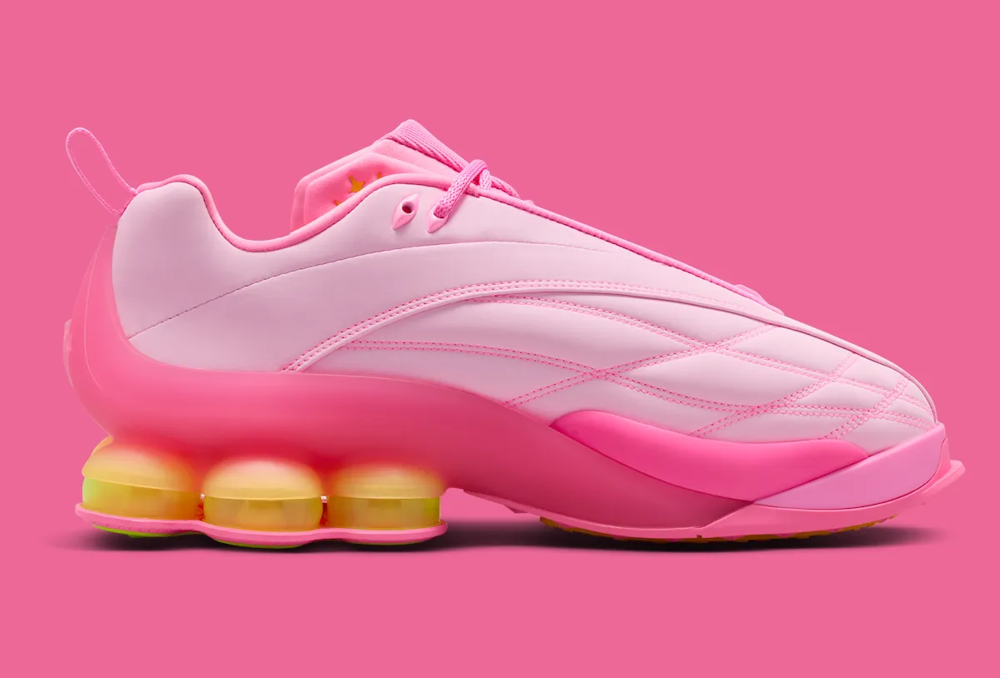
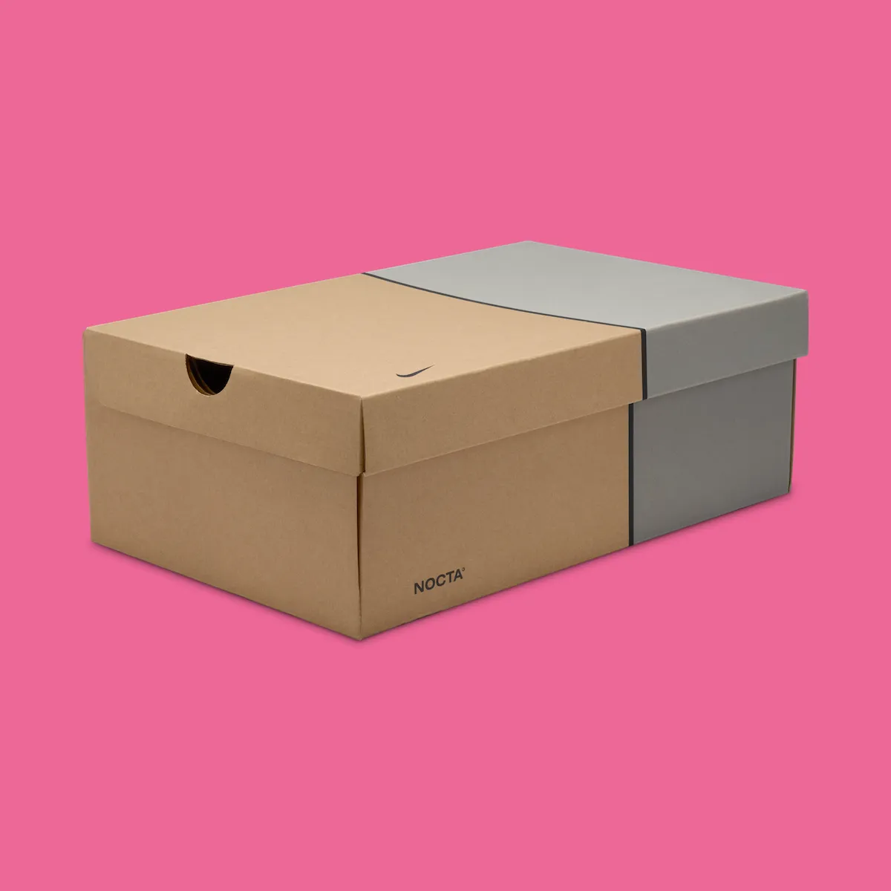

> [English version 英文版](/life/nocta-nike-air-modmax-pink-spell/)

近四十年来，Nike 一直在想新的办法让你看见脚下的气垫。从 1987 年 Air Max 1 后跟的那扇小窗开始，到整掌气垫，再到 2000 年 Shox 的立柱，以及最近 Air Max Dn 的双气室 Dynamic Air，思路始终没变：把缓震做给你看。2026 年 11 月 16 日通过 NOCTA 首发、11 月 17 日登陆 Nike SNKRS 与指定零售商的 NOCTA x Nike Air Modmax “Pink Spell”，把这个想法拆开重做了一遍：六颗独立的气垫。后跟四颗半透明气垫，每颗充压 17 psi；前掌另外两颗，7 psi。Nike 现有产品线里没有任何一双鞋长这样，Drake 的 NOCTA 也从没试过把技术放在第一位。

这就是它成为今天主角的原因——不是因为鞋盒上印着一位著名音乐人的名字，而是因为一个全新的缓震平台正在公开首发，带着价格和发售日期，直接上架。Nike 的新缓震系统通常要预热好几年，挂在一双旗舰跑鞋上登场。这双只用了五天：11 月 11 日由 NOCTA 设计师 Matte Babel 首次曝光，11 月 15 日官方公布并确认发售日期，第二天早上就开卖。

先说一句实话：这不是 Air Modmax 的上脚评测。这双鞋今天才开卖，Nike 和 NOCTA 之外还没有人真正穿着它走过有意义的里程。下面是一篇长篇初看——已确认的事实、六气垫系统到底是什么、不是什么，设计与 NOCTA 六年历史为何让这次发售重要，它在 Nike 缓震 lineage 里处在什么位置，以及新闻稿回答不了的那些问题——能核实的和不能核实的会分开说清楚。

*NOCTA x Nike Air Modmax “Pink Spell” 官方图：绗缝粉色鞋面、抬升的后跟，以及六颗琥珀色气垫撑起的视觉重心。图片：Nike，经 Sneaker Bar Detroit。*

## 基本事实

| | |
|---|---|
| **鞋款** | NOCTA x Nike Air Modmax “Pink Spell” |
| **货号** | IQ6711-600 |
| **配色** | Pink Spell / Volt / Amarillo / Cobalt Tint（粉咒／电光绿／阿马里洛黄／钴蓝） |
| **发售日期** | 2026 年 11 月 16 日星期一，通过 NOCTA；2026 年 11 月 17 日星期二，通过 Nike SNKRS 与指定零售商 |
| **发售价** | 160 美元，据 NOCTA 官网 listing 与 Hypebeast 对官方发布的报道；早期 listing 曾显示 180 美元——2026 年 11 月 16 日查询的价格 snapshot，subject to change |
| **发售渠道** | 11 月 16 日 nocta.com；11 月 17 日 Nike SNKRS 与指定零售商 |
| **鞋款定位** | 全新 NOCTA 鞋型，Nike Mod Max 模块化缓震系统的全球首发：六颗独立调压气垫、Cushlon 泡棉中底、G-Tek 橡胶外底 |
| **同步发售** | 同配色的 NOCTA x Nike “Cardinal Stock” 服饰系列，包括 track jacket 套装与 puffer 夹克 |

## 为什么是今天的主角

热度很容易证明，因为球鞋媒体几乎是同步行动的。Hypebeast 在 11 月 16 日发布了官方亮相与发售日期，Sneaker News 与 Sneaker Bar Detroit 都在 11 月 15 日做了附完整官方图集的详解，Men’s Journal 与一众发售追踪账号几小时内跟进。这个时间线本身就说明问题：11 月 11 日 Matte Babel 首次晒图，11 月 12 日预告报道出炉，11 月 15 日鞋子有了名字、货号、价格和两个发售日期。从第一张图到开卖只隔五天，对一个新平台来说快得反常，读起来像是自信——Nike 和 NOCTA 想让这双鞋直接进店、凭产品被评判，而不是被讨论一个赛季。

还有一个结构性的原因，让 Modmax 超出它自身的销量而重要。NOCTA 从来不是一个技术优先的品牌。自从 Drake 的 Nike 子品牌在 2020 年 12 月启动，它的鞋款讲的都是鞋型与克制：2022 年的 Hot Step Air Terra 借用了 1999 年 Air Terra Humara 的越野大底，Hot Step 2 做了 refinement，Glide 用的是 Cushlon 泡棉中底。三双都是好看的鞋，建立在借来的 Nike 平台上。Air Modmax 是第一双围绕一个此前不存在的缓震系统打造的 NOCTA 鞋——Nike 称之为首创的模块化设计。这实际上是一次晋升：从合作者变成共同开发者。它把 NOCTA 放进了一个 Nike 历史上只留给自家旗舰线和最大牌运动员签名鞋的类别。

而鞋子本身也毫不掩饰这一点。气垫没有藏进中底，而是成了中底的公开面孔，从侧面、后面、下面都看得见。在大多数生活方式球鞋都把技术藏起来的年代，Modmax 把工程穿在外面，就像超跑透过玻璃展示发动机。

## 技术：六颗气垫，两种气压，一个想法

Mod Max 系统是这双鞋的全部论点，值得按 Nike 自己的数字精确描述（据 Hypebeast 与 Sneaker News 的报道）。

后跟下方是四颗气垫，每颗充压 17 psi；前掌与中足下方另外两颗，7 psi。这个分配是刻意的、符合解剖学的：每一步中后跟承受最猛烈的冲击，所以用更硬、气压更高的气垫；前足负责从中足到脚趾的滚动过渡，所以用更软、气压更低的气垫，目标是让过渡顺滑，而不是吸收撞击。六颗气垫是各自独立调校的，不是一整块气室切成六份——每颗都有自己的任务，气压数字就是调校方式。

气垫周围，Nike 建了一套支撑结构，而不是让气垫单独工作。Cushlon 泡棉中底包裹着气垫——与 NOCTA Glide 同系列的泡棉——一块 TPU 承托把后跟稳定笼与中足支撑片合二为一，提供结构稳定性。TPU 缓冲块分布在内侧、外侧与鞋头区域，包裹气垫并在运动中保护它们。外底是 G-Tek 粘性橡胶——G-Tek 是 Nike 最早用在 Air Terra Humara 越野系列上的抓地配方，后来也出现在 Hot Step 上——纹路名为“Dynamic Alien Pod”，兼顾抓地与额外的缓冲。

这里要放两句提醒，因为这些数字很容易被过度解读。第一，psi 更高不自动等于脚感更硬，psi 更低也不自动等于更软；气压只是几个变量之一，还包括气垫体积、壁厚和周围的泡棉。17 和 7 这两个数字描述的是气垫之间的相对调校，不是一张舒适度评分表。第二，“模块化”描述的是缓震的构造方式——分割成独立气垫——不是承诺鞋主可以自己拆卸、更换或调节气垫。官方产品信息里没有任何内容表明气垫是用户可维护的，把这个名字读成 DIY 功能会是误解。

最诚实的类比是 Shox——上一次 Nike 把缓震做得这么可见、这么分段。2000 年的 Shox 在后跟放了四根立柱，让跑者去信任一个看得见工作过程的机械结构。Modmax 在整只脚下放了六颗气垫，问的是同一个问题，只是任务更精细：不只是回弹，而是让脚步的不同部位得到不同的气压。Shox 的类比也定下了赌注。Shox 之所以成为文化符号，正因为它看起来奇怪、机械；它也花了好几年对抗“噱头”的观感。Modmax 会受到同样的审判——看得见的机械结构是不是真的能让穿着者感受到差别。

*侧面：绗缝鞋面、雕塑感粉色中底，以及集中在后跟的六颗琥珀色气垫，外底露出 Volt 绿。图片：Nike，经 Sneaker Bar Detroit。*

## 设计：一双绗缝、充气的足球鞋

如果大底是工程故事，鞋面就是时尚故事——而且它有意借用了足球。鞋面以绗缝、车线拼接的鞋面呼应经典足球鞋，弧形缝线横贯鞋头与侧面，低帮加厚鞋领，后跟带提环。绗缝不是装饰填充；它给了鞋子体积感，让鞋面从上到下看起来都是充气的，与下方的气垫呼应。首次曝光这双鞋的 Matte Babel 曾表示，设计目标是按足部解剖优化吸震与稳定性——足球鞋的参照不是怀旧，而是一个为运动中的脚服务的造型。

“Pink Spell”配色把这个思路贯彻到底。粉色主导鞋面，分两个色调——绗缝面板上是近乎乳白的浅粉，中底与后跟是更热烈的粉色——Amarillo 黄色染在气垫本身，Volt 绿出现在外底气垫与抓地纹路里。官方配色名里的 Cobalt Tint（钴蓝）体现在足底的小面积蓝色点缀上。这是一双很吵的鞋，毫不掩饰，而吵就是目的：一个新技术的首发配色，本来就该让人无法忽视。相比之下 NOCTA 的品牌标识保持安静——鞋舌与后跟的三剑标志、鞋垫与鞋盒上的 NOCTA 字标——让鞋型与配色自己说话。

细节值得凑近看。鞋带穿过一条中央通道，鞋舌低而加厚。后跟有一块雕塑感粉色稳定笼，高出气垫，中央压印 NOCTA 标志。从下面看外底，是这双鞋最具图形感的角度：前掌一块黄色抓地垫，后跟一圈 Volt 绿气垫，粉色承托框住一切。

*俯视：绗缝面板、中央鞋带通道与低帮加厚鞋舌。图片：Nike，经 Sneaker Bar Detroit。*

*后跟视角：高出四颗 17 psi 气垫的雕塑感粉色稳定笼，中央是 NOCTA 标志。图片：Nike，经 Sneaker Bar Detroit。*

## NOCTA 的故事：六年，从服饰品牌到技术合作方

要理解这双鞋为什么重要，得先记得 NOCTA 刚启动时是什么样子。Drake 在 2020 年 12 月宣布这个 Nike 子品牌，名字取自拉丁语的“夜”——呼应他夜间创作的习惯——首发只有服饰：卫衣、抓绒裤、袜子，以及黑金配色的 puffer 夹克。鞋款等了一年多。第一双 NOCTA 鞋 Hot Step Air Terra 被预热了数月——它在 2020 年 8 月 Drake 的“Laugh Now Cry Later”MV 里出现，拍摄地是 Nike 俄勒冈总部——最终在 2022 年 3 月 3 日发售，Triple White 与 Triple Black 两个配色，180 美元，瞬间售罄。

Hot Step 确立了 NOCTA 的鞋款公式：取一个 Nike 档案里的想法，用克制重做，靠稀缺做营销。1999 年 Air Terra Humara 的大底给了鞋子粗犷的底座，2000 年代初的篮球鞋面给了它造型。Hot Step 2 在 2023 年跟进，Glide——一双以 Air Force 1 为基础、Cushlon 泡棉中底的生活方式鞋型——进一步扩展了产品线。贯穿始终，NOCTA 的鞋都是把品味施加在 Nike 的旧目录上。

Air Modmax 在两个方面打破了这个模式。第一，它不是复刻或重做；它下面没有任何一双档案鞋。第二，它是第一双把技术当头条、把明星当配角的 NOCTA 鞋。对一个花了六年证明只要印上 Drake 的名字什么都能卖光的品牌来说，这是一次有意义的升级。它表明 Nike 信任 NOCTA 不只是能走量，还能承载一个新平台；也表明 NOCTA 想凭产品被评判，而不只是凭入手难度。

发售结构强化了这种解读。鞋子先在 11 月 16 日通过 NOCTA 自有平台发售，11 月 17 日再通过 SNKRS 与指定零售商扩大发售——NOCTA 过去用过的两步走，给自己的社群优先入手权，再面向大众。同配色的“Cardinal Stock”服饰系列——track jacket 套装与 puffer 夹克——同步发售，把一次鞋款发售变成一个小型系列，这也一直是 NOCTA 偏好的运作方式。

## Mod Max 在 Nike 缓震史里的位置

Nike 的缓震史在很大程度上就是一部命名平台的历史，每个平台都随一双旗舰鞋登场，并承诺泡棉或气垫能带来不同的脚感。Air 在 1978 年出现，1987 年的 Air Max 1 让它可见；1990 年代是 Zoom Air；2000 年 Shox 带着立柱登场；然后是 React、ZoomX，再到 2024 年 Air Max Dn 的双气室 Dynamic Air——每一次都把缓震的工作切得更小、更专业。

Mod Max 是同一个方向的下一步：从一块大气垫，到两个气室，再到六颗气垫，每颗各自的气压。逻辑是一致的——把脚步的工作按区域划分、分别调校——而 Modmax 是迄今为止最直白的表达。它也是 Nike 第一次把这种级别的首发交给一个子品牌，而不是旗舰跑鞋或签名运动员的鞋款。这个选择说明了 Nike 现在如何看待 NOCTA：不是一条周边产品线，而是一个正当的产品渠道。

它也说明了 Nike 瞄准的市场。Air Modmax 不是性能篮球鞋或马拉松竞速鞋；它是一双生活方式鞋型，配一颗技术大底，定价 160 美元——比 Hot Step 首发时的 180 美元还低，落在许多热门生活方式鞋款 190–200 美元区间之下。这个定价把它定位成一件负担得起的宣言单品，而非一双 grail：贵到让人觉得经过考量，便宜到让人为技术本身、而不是转卖价值而买。

*外底：前掌黄色 G-Tek 抓地垫、后跟一圈 Volt 绿“Dynamic Alien Pod”纹路，粉色承托框住一切。图片：Nike，经 Sneaker Bar Detroit。*

*特写：足球鞋灵感的绗缝车线面板与中央鞋带通道。图片：Nike，经 Sneaker Bar Detroit。*

## 目前没人能告诉你的事

官方资料再详细，关于 Air Modmax 的重要问题仍未有答案，值得 plainly 点出来，而不是用热情把空缺填上。

**实际脚感如何？**六颗气垫、两种气压听起来很精确，但参数表上的精确不等于脚上的舒适。关键测试在于，从 17 psi 的后跟气垫过渡到 7 psi 的前掌气垫时，感觉是顺滑还是有台阶——脚是顺着鞋子滚动，还是能察觉到交接。Nike 之外还没有人穿着这双鞋走过路，早期的上脚印象一旦出现，会比任何发售报道都重要。

**外露气垫耐用吗？**气垫突出于中底，看得见，某种程度上也暴露在外。气垫一向怕刺穿、怕发黄；六颗小气垫意味着六个小目标，而不是一个大目标。TPU 缓冲块是为保护它们而设，但长期耐用性——磨损、变色、一颗气垫受损会不会改变整双鞋的脚感——仍未经证实。

**有多重？**Nike 没有公布重量，而这双鞋的构造——六颗气垫、TPU 承托、完整橡胶外底、加厚绗缝鞋面——表明它不会轻。对生活方式鞋来说，重量比竞速鞋没那么要紧，但它决定了一双鞋穿一整天的脚感，值得等一个数字。

**尺码如何？**撰写时官方资料未说明尺码与宽度细节；实际建议是发售时查看 NOCTA 与 SNKRS 的 listing，新鞋型第一次上脚总有不确定性，要有准备。绗缝鞋面看起来包容度不错，但那是从照片得出的推断，不是试穿结论。

**这个平台会扩散吗？**Nike 没有说明 Mod Max 会不会出现在其他鞋型上，也没有说明 Air Modmax 是一次性实验还是一条产品线。答案会告诉我们，这是一个真正的平台，还是一个单一宣言。历史经验是，Nike 不会为一个配色、一双鞋开发一套新缓震系统——但历史里也不乏一次性实验，Modmax 的命运将由售罄情况与上脚口碑决定，而不是发售新闻稿。

*特写：琥珀色后跟气垫、粉色 TPU 承托与 Volt 绿外底气垫。图片：Nike，经 Sneaker Bar Detroit。*

*内侧轮廓：同样的绗缝鞋面与气垫堆叠，后跟提环与低帮鞋领。图片：Nike，经 Sneaker Bar Detroit。*

## 谁该抢一双，怎么抢

Air Modmax 的购买理由是窄而真实的。如果你像有些人追发动机发展那样追 Nike 的缓震——如果你穿过 Shox，如果你对 Air Max Dn 的双气室感兴趣，如果你喜欢一双把自己的工作原理展示出来的鞋——这是本月最值得关注的 Nike 生活方式发售，160 美元是亲眼见证一个新平台的合理价格。如果你是 NOCTA 收藏者，这是自 Hot Step 以来品牌最重要的鞋款，而一个新系统的首发配色，往往是会被记住的那一双。

如果你想要一双经过验证的日常舒适鞋，那就等等。目前还没有上脚评测，没有长期耐用数据，也没有尺码共识。这双鞋现在的价值在于新颖与设计，而不是经过验证的性能，应该按这个标准来买。

实际操作上：11 月 16 日的 NOCTA 发售是第一个窗口，通过 nocta.com；11 月 17 日的 SNKRS 与指定零售商发售是更宽的窗口。NOCTA 过去的鞋款发售在原价段都很快售罄，两步走意味着 SNKRS 那天是第二次机会，而不是第一次。如果两次都错过，别急着加价买——等第一批上脚评测出来再说。这双鞋的真实价值在两周后会比今天清楚得多，而一个新平台的首发配色，恰恰是那种平台成功就会补货、失败就会被遗忘的鞋。

*鞋盒：克制、素色、安静——与盒子里的东西正相反。图片：Nike，经 Sneaker Bar Detroit。*

## 结论

Air Modmax “Pink Spell” 是最有意思的那种球鞋发售：一个真正的新想法，毫不掩饰地呈现，定价邀请好奇而不是投机。六气垫系统可能被证明是 Nike 调校缓震方式上真实的一步，也可能被证明是一个美丽的机械装置，正在寻找一种脚感——而这个差别将由双脚、而不是照片来决定。但野心是明确的。经过六年有品味的重做之后，NOCTA 把自己的名字押在了一项新技术上，Nike 把一个平台首发托付给了一个子品牌。无论气垫最终是否成立，这都是一次值得注意的晋升——也是一双粉色、绗缝、气垫底的鞋，值得持续关注。

*价格为 2026 年 11 月 16 日查询的 snapshot，subject to change。来源：Hypebeast（官方亮相与发售日期，2026 年 11 月 16 日）；Sneaker News 与 Sneaker Bar Detroit（官方图集与发售细节，2026 年 11 月 15 日）；Men’s Journal（关键事实，2026 年 11 月 13–14 日）；Luxe Digital（价格报道，2026 年 11 月）；JustFreshKicks 与 Sneaker News（NOCTA 历史：2020 年 12 月启动，Hot Step Air Terra，2022 年 3 月 3 日）。本文为初看，不是上脚评测：鞋款于 2026 年 11 月 16–17 日发售，撰写时尚无独立上脚测试。*
