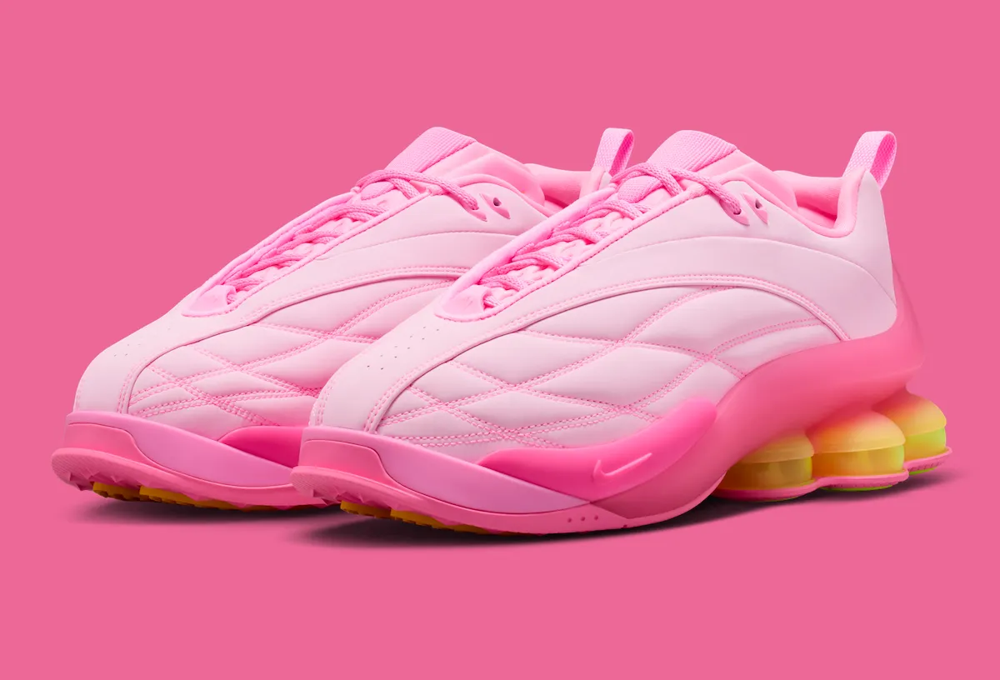
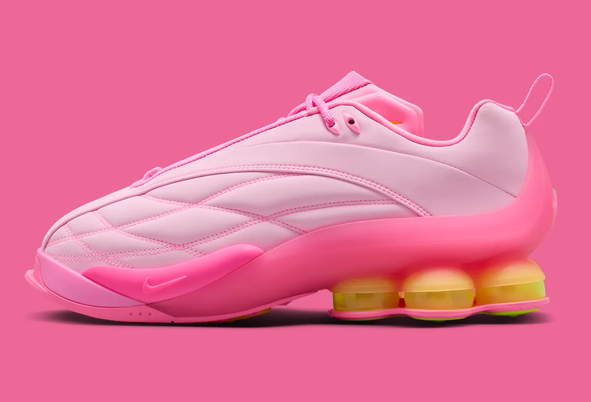
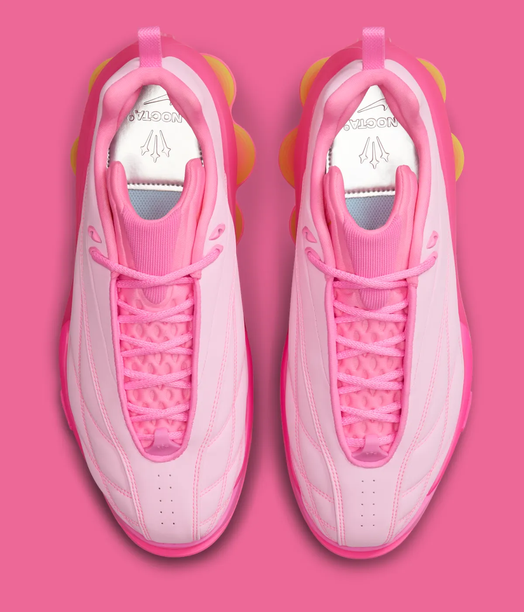
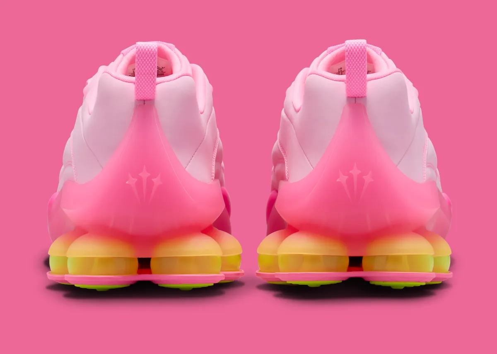
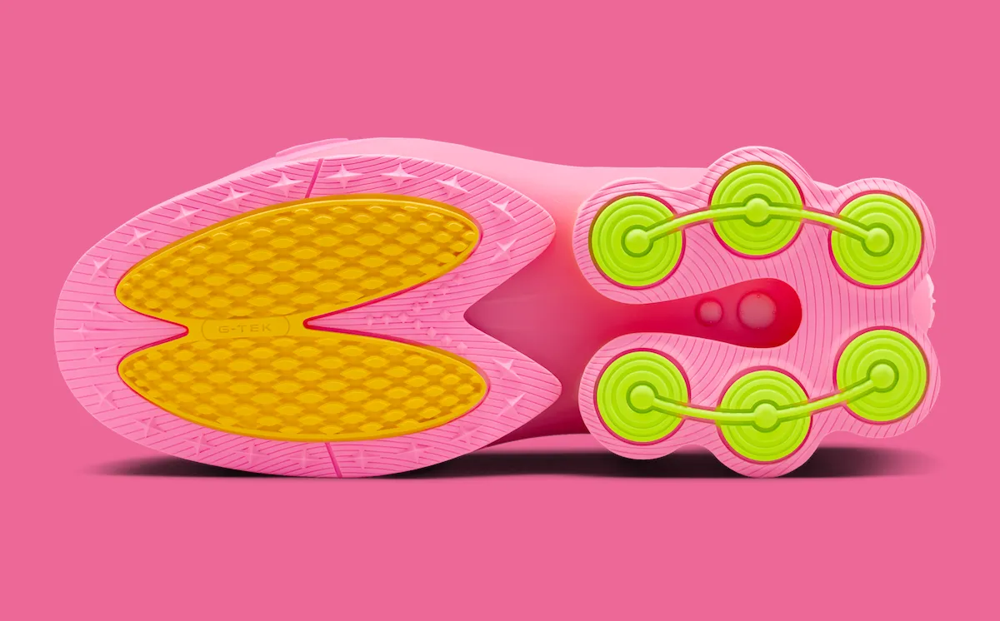
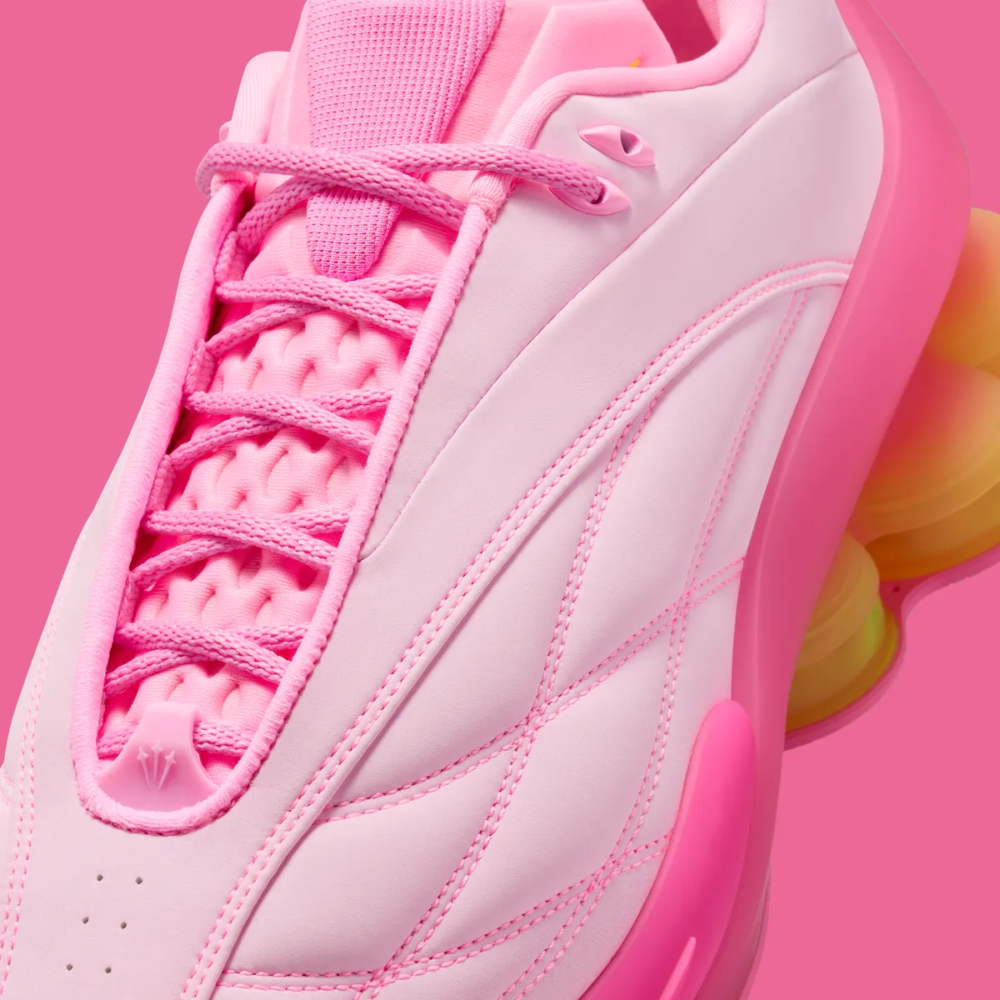
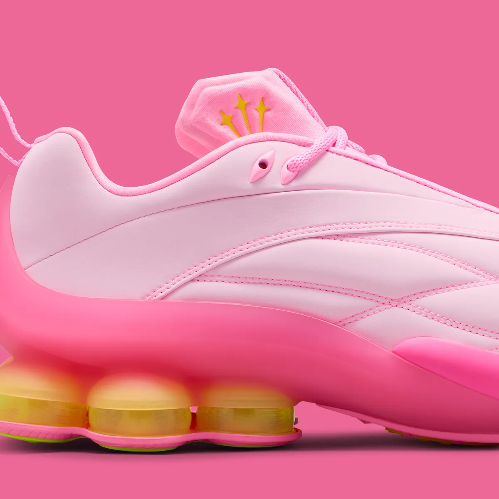
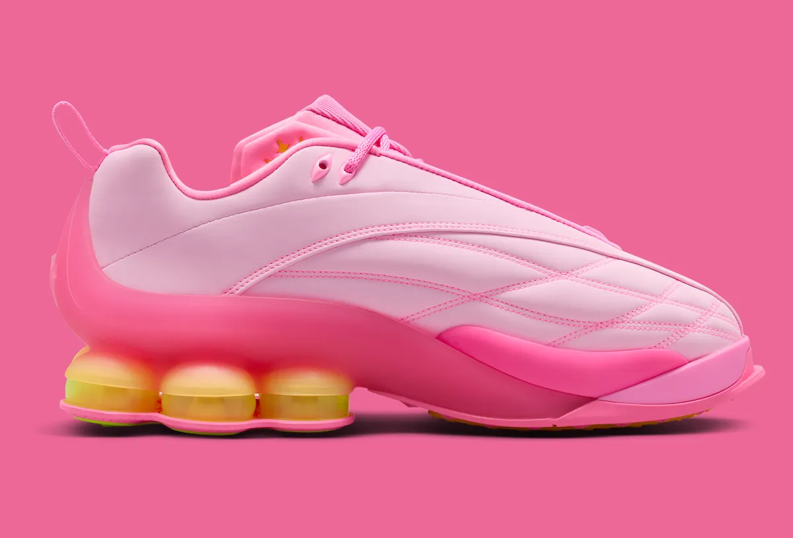
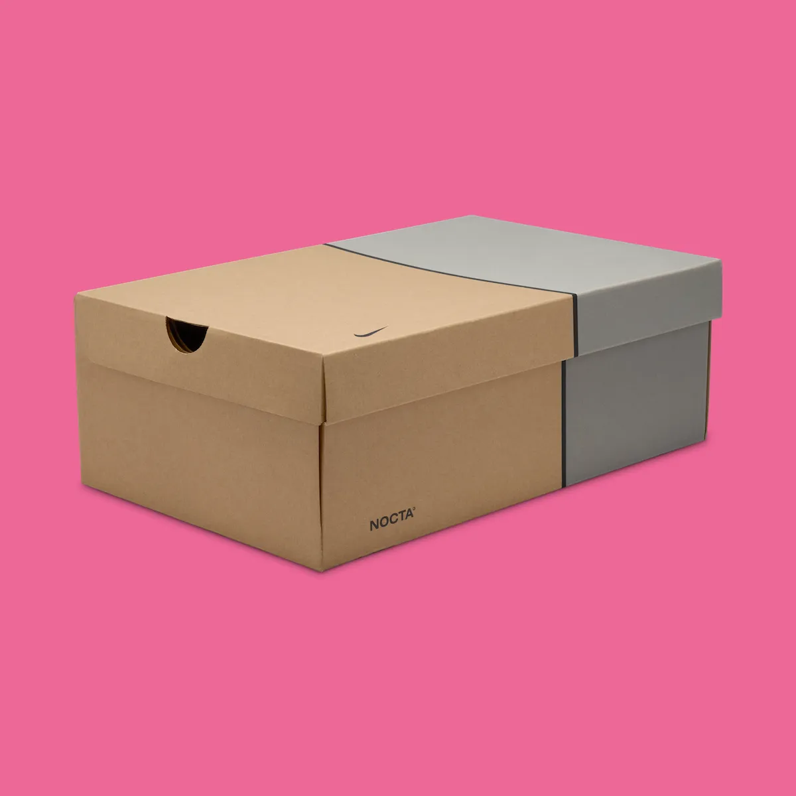

> [中文版 Chinese version](/life/nocta-nike-air-modmax-pink-spell-zh/)

Nike has spent almost forty years finding new ways to show you the air under your feet. It started with a window in the heel of the Air Max 1 in 1987, grew into full-length bags, then into the columns of Shox in 2000, and most recently into the twin-chamber Dynamic Air of the Air Max Dn. The NOCTA x Nike Air Modmax “Pink Spell,” which goes on sale today, November 16, 2026, through NOCTA and tomorrow, November 17, through Nike SNKRS and select retailers, takes that idea apart and rebuilds it as six separate pieces. Four translucent pods sit under the heel, each pressurized to 17 psi. Two more sit further forward, at 7 psi. Nothing else in Nike’s current line looks like it, and nothing else in Drake’s NOCTA line has ever tried to lead with technology first.

That is why this is the shoe of the day — not because a famous musician’s name is on the box, but because a brand-new cushioning platform is debuting in public, on a release-day shoe, with a price and a date attached. New Nike cushioning systems usually arrive after years of teasing, attached to a flagship runner. This one arrived in five days: first teased by NOCTA designer Matte Babel on November 11, officially unveiled with a release date on November 15, and on sale the next morning.

One honest note up front: this is not a wear test of the Air Modmax. The pair goes on sale today, and nobody outside Nike and NOCTA has put meaningful miles on this exact shoe. What follows is a long first look — the confirmed facts, what the six-pod system actually is and is not, the design and the six-year NOCTA history that makes this release matter, where the idea sits inside Nike’s cushioning lineage, and the questions no press release can answer yet — with the claims that can be checked separated from the ones that cannot.

*The NOCTA x Nike Air Modmax “Pink Spell” in Nike’s official imagery: a quilted pink upper, a raised heel, and six translucent amber Air pods doing the visual work. Image: Nike, via Sneaker Bar Detroit.*

## The facts

| | |
|---|---|
| **Model** | NOCTA x Nike Air Modmax “Pink Spell” |
| **Style code** | IQ6711-600 |
| **Colorway** | Pink Spell / Volt / Amarillo / Cobalt Tint |
| **Release date** | Monday, November 16, 2026, via NOCTA; Tuesday, November 17, 2026, via Nike SNKRS and select retailers |
| **Retail price** | $160, per NOCTA’s own listing and Hypebeast’s reporting of the official announcement; early listings had shown $180 — price snapshot as of November 16, 2026, subject to change |
| **Where** | nocta.com on November 16; Nike SNKRS and select retailers on November 17 |
| **What it is** | A brand-new NOCTA silhouette and the global debut of Nike’s Mod Max modular cushioning system: six individually tuned Air pods, a Cushlon foam midsole, and a G-Tek rubber outsole |
| **Alongside** | A matching NOCTA x Nike “Cardinal Stock” apparel range, including a track jacket and suit and a puffer jacket in the shoe’s color scheme |

## Why this release is the story of the day

The heat is easy to prove, because the sneaker press moved on this shoe in lockstep. Hypebeast published the official unveil and the release dates on November 16, Sneaker News and Sneaker Bar Detroit both ran dedicated breakdowns with the full official photo set on November 15, and Men’s Journal, Complex-adjacent outlets, and release trackers followed within hours. The cadence tells its own story: the first look came from NOCTA designer Matte Babel on November 11, the teaser coverage landed on November 12, and by November 15 the shoe had a name, a style code, a price, and two release dates. A five-day runway from first image to on-sale is unusually fast for a new platform, and it reads as confidence — Nike and NOCTA wanted this shoe judged on the product, in stores, immediately, rather than debated for a season.

There is also a structural reason the Modmax matters beyond its own sales. NOCTA has never been a technology-first label. Since Drake’s Nike sub-label launched in December 2020, its footwear has been about silhouette and restraint: the Hot Step Air Terra in 2022 borrowed a rugged trail sole from 1999’s Air Terra Humara, the Hot Step 2 refined it, and the Glide ran on a Cushlon foam midsole. All three were good-looking shoes built on borrowed Nike platforms. The Air Modmax is the first NOCTA shoe built around a cushioning system that did not exist before it — a system Nike describes as a first-of-its-kind modular design. That is a promotion, in effect, from collaborator to co-developer. It puts NOCTA in a category Nike has historically reserved for its own flagship lines and its biggest athlete signatures.

And the shoe itself refuses to be quiet about it. The pods are not hidden inside the midsole; they are the midsole’s public face, visible from the side, the back, and underneath. In an era when most lifestyle sneakers hide their technology, the Modmax wears its engineering the way a supercar wears its engine — through glass, in the open.

## The technology: six pods, two pressures, one idea

The Mod Max system is the whole argument of the shoe, so it is worth describing precisely, using Nike’s own numbers as reported by Hypebeast and Sneaker News.

Under the heel sit four Air pods, each pressurized to 17 psi. Under the forefoot and midfoot sit two more, at 7 psi. The split is deliberate and anatomical: the heel takes the hardest impact on every step, so it gets the firmer, higher-pressure pods; the front of the foot manages the roll from midfoot to toe-off, so it gets softer, lower-pressure pods that are meant to encourage a smooth transition rather than absorb a blow. The pods are individually tuned, not one continuous chamber cut into six — each does a specific job, and the pressure figures are the tuning.

Around the pods, Nike built a support structure rather than leaving the air to work alone. A Cushlon foam midsole wraps the pods — the same family of foam that carried the NOCTA Glide — and a TPU carrier merges the heel cage and the midfoot shank into one piece for structural stability. TPU bumpers sit at the medial, lateral, and toe regions to contain the pods and protect them during movement. Underneath, a G-Tek sticky rubber outsole — G-Tek is the traction compound Nike first used on the Air Terra Humara trail line, and it reappeared on the Hot Step — carries a lug pattern Nike calls “Dynamic Alien Pod,” shaped to add traction and a little extra cushioning of its own.

Two cautions belong here, because the numbers invite over-reading. First, a higher psi does not automatically mean a firmer-feeling shoe, and a lower psi does not automatically mean a softer one; pressure is one variable among several, including pod volume, wall thickness, and the foam around them. The 17 and 7 figures describe how the pods are tuned relative to each other, not a comfort score. Second, “modular” describes how the cushioning is constructed — segmented into separate pods — not a promise that owners can remove, replace, or adjust the pods themselves. Nothing in the official product details suggests the pods are user-serviceable, and it would be a mistake to read the name as a DIY feature.

The honest comparison is to Shox, the last time Nike made cushioning this visible and this segmented. The 2000 Shox put four columns under the heel and asked runners to trust a mechanism they could see working. The Modmax puts six pods under the whole foot and asks the same thing, with a much more refined brief: not just bounce, but a different pressure for a different part of the step. The Shox comparison also sets the stakes. Shox became a cultural object precisely because it looked strange and mechanical; it also spent years fighting the perception that it was a gimmick. The Modmax will be judged the same way — on whether the visible mechanism does something a wearer can actually feel.

*Lateral profile: the quilted upper, the sculpted pink midsole, and the six amber pods packed toward the heel, with Volt green showing at the outsole. Image: Nike, via Sneaker Bar Detroit.*

## The design: a soccer cleat, quilted and inflated

If the sole is the engineering story, the upper is the fashion story — and it is deliberately borrowed from football. The upper is quilted and stitched in panels that echo a classic soccer cleat, with curved seams running across the toe and the side, a low padded collar, and a pull tab at the heel. The quilting is not decorative filler; it gives the shoe its volume, puffing the upper out so the silhouette reads inflated from top to bottom, matching the pods below. Matte Babel, who shared the first look, has described the design goal as optimizing absorption and stability for the anatomy of the foot — the cleat reference is not nostalgia, it is a shape built around a foot in motion.

The “Pink Spell” colorway commits fully to the bit. Pink dominates the upper in two tones — a pale, almost milky pink on the quilted panels and a hotter pink on the midsole and heel — while Amarillo yellow tints the Air pods themselves and Volt green appears in the outsole pods and traction lugs. Cobalt Tint is listed in the official colorway name and shows in the small blue accents underfoot. It is a loud shoe, unapologetically so, and the loudness is the point: a debut colorway for a debut technology is supposed to be impossible to miss. The NOCTA branding stays quiet by comparison — the three-swords mark on the tongue and heel, the NOCTA wordmark on the insole and the box — letting the silhouette and the color do the talking.

The details reward a closer look. The lacing runs through a central channel with the tongue sitting low and padded. The heel carries a sculpted pink cage that rises above the pods, with the NOCTA mark debossed into it. The outsole, seen from below, is the most graphic view of the shoe: a yellow traction pad under the forefoot, a ring of Volt green pods around the heel, and the pink carrier framing it all.

*Top view: the quilted panels, the central lacing channel, and the low padded tongue. Image: Nike, via Sneaker Bar Detroit.*

*Heel view: the sculpted pink cage rising above the four 17 psi pods, with the NOCTA mark at the center. Image: Nike, via Sneaker Bar Detroit.*

## The NOCTA story: six years from apparel label to technology partner

To understand why this shoe matters, it helps to remember what NOCTA was when it started. Drake announced the Nike sub-label in December 2020, naming it for the Latin word for night — a nod to his nocturnal creative process — and launched with apparel only: hoodies, fleece pants, socks, and a puffer jacket in black and University Gold. Footwear took more than a year. The first NOCTA shoe, the Hot Step Air Terra, was teased for months — it appeared in Drake’s “Laugh Now Cry Later” video in August 2020, filmed at Nike’s Oregon campus — before finally releasing on March 3, 2022, in Triple White and Triple Black at $180, selling out immediately.

The Hot Step established NOCTA’s footwear formula: take an archival Nike idea, rebuild it with restraint, and let scarcity do the marketing. The Air Terra Humara sole from 1999 gave the shoe its rugged base; an early-2000s basketball upper gave it its shape. The Hot Step 2 followed in 2023, and the Glide — an Air Force 1-based lifestyle silhouette on Cushlon foam — extended the line further. Through all of it, NOCTA’s shoes were exercises in taste applied to Nike’s back catalog.

The Air Modmax breaks that pattern in two ways. First, it is not a retro or a rework; there is no archival shoe underneath it. Second, it is the first NOCTA shoe where the technology is the headline and the celebrity is the supporting cast. That is a meaningful escalation for a label that has spent six years proving it can sell out anything with Drake’s name on it. It suggests Nike trusts NOCTA not just to move units but to carry a new platform — and it suggests NOCTA wanted to be judged on product, not just on access.

The release structure reinforces that reading. The shoe drops first through NOCTA’s own platform on November 16, then wider through SNKRS and select retailers on November 17 — the same two-step pattern NOCTA has used before, giving its own community first access before the general release. A matching “Cardinal Stock” apparel range — a track jacket and suit and a puffer in the shoe’s colors — drops alongside, turning a shoe launch into a small collection, which is how NOCTA has always preferred to operate.

## Where Mod Max sits in Nike’s cushioning history

Nike’s cushioning story is, to an unusual degree, a history of named platforms, each arriving with a flagship shoe and a promise about what the foam or airbag underfoot would do differently. Air arrived in 1978 and became visible in the Air Max 1 in 1987. Zoom Air followed in the 1990s. Shox arrived in 2000 with its columns. React, then ZoomX, then the twin-chamber Dynamic Air of the Air Max Dn in 2024, each split the job of cushioning into smaller, more specialized pieces.

Mod Max is the next step in that same direction: from one big bag, to two chambers, to six pods, each with its own pressure. The logic is consistent — divide the foot’s work into zones and tune each zone separately — and the Modmax is the most literal expression of it yet. It is also the first time Nike has handed that kind of debut to a sub-label rather than to a flagship runner or a signature athlete’s shoe. That choice says something about how Nike now sees NOCTA: not as a merch line, but as a legitimate product channel.

It also says something about the market Nike is aiming at. The Air Modmax is not a performance basketball shoe or a marathon racer; it is a lifestyle silhouette with a technical sole, priced at $160 — above the Hot Step’s $180 debut only in the sense that it undercuts it, sitting below the $190–$200 range of many hyped lifestyle releases. The price positions it as an accessible statement piece rather than a grail: expensive enough to feel considered, cheap enough that the technology, not the resale value, is the reason to buy.

*Outsole: the yellow G-Tek traction pad up front, the ring of Volt green “Dynamic Alien Pod” lugs at the heel, and the pink carrier framing it all. Image: Nike, via Sneaker Bar Detroit.*

*Close-up: the quilted, stitched panels of the soccer-inspired upper and the central lacing channel. Image: Nike, via Sneaker Bar Detroit.*

## What nobody can tell you yet

For all the detail in the official materials, the important questions about the Air Modmax are still unanswered, and it is worth naming them plainly rather than filling the gap with enthusiasm.

**How does it actually feel?** Six pods at two pressures is a precise-sounding idea, but precision on a spec sheet is not the same as comfort on a foot. The key test is whether the transition from the 17 psi heel pods to the 7 psi forefoot pods feels smooth or stepped — whether the foot rolls through the shoe or notices the handoff. Nobody outside Nike has walked in these yet, and early wear-test impressions, when they come, will matter more than any launch coverage.

**How durable are exposed pods?** The pods sit proud of the midsole, visible and, to some degree, exposed. Air units have always been vulnerable to puncture and to yellowing; six small ones present six small targets instead of one big one. The TPU bumpers are there to protect them, but long-term durability — scuffing, discoloration, and whether a single damaged pod changes the feel of the whole shoe — is unproven.

**How heavy is it?** Nike has not published a weight, and the shoe’s construction — six pods, a TPU carrier, a full rubber outsole, and a padded quilted upper — suggests it will not be light. For a lifestyle shoe that matters less than it would for a runner, but weight shapes how a shoe feels on foot all day, and it is a number worth waiting for.

**Who is it for, sizing-wise?** Sizing and width details were not specified in the official materials at the time of writing; the practical advice is to check NOCTA and SNKRS listings at drop time and, if buying without trying on, to be ready for the usual new-silhouette uncertainty. The quilted upper looks forgiving, but that is an inference from photographs, not a fitting.

**Will the platform spread?** Nike has not said whether Mod Max will appear on other silhouettes, or whether the Air Modmax is a one-shoe experiment. The answer will tell us whether this is a real platform or a single statement. History suggests Nike does not develop a new cushioning system for one colorway of one shoe — but history also includes plenty of one-off experiments, and the Modmax’s fate will be decided by sell-through and wear-test reception, not by the launch press release.

*Close-up: the amber heel pods, the pink TPU carrier, and the Volt green outsole pods. Image: Nike, via Sneaker Bar Detroit.*

*Medial profile: the same quilted upper and pod stack from the inside, with the heel pull tab and low collar. Image: Nike, via Sneaker Bar Detroit.*

## Who should try for a pair — and how

The honest buying case for the Air Modmax is narrow but real. If you follow Nike cushioning the way some people follow engine development — if you owned Shox, if you watched the Air Max Dn’s twin chambers with interest, if you like the idea of a shoe that shows its work — this is the most interesting Nike lifestyle release of the month, and $160 is a fair price to see a new platform firsthand. If you are a NOCTA collector, it is the label’s most significant shoe since the Hot Step, and the debut colorway of a new system is the one that tends to be remembered.

If you want a proven daily comfort shoe, wait. There are no wear tests yet, no long-term durability data, and no consensus on sizing. The shoe’s value proposition right now is novelty and design, not proven performance, and it should be bought on those terms.

Practically: the NOCTA drop on November 16 is the first window, through nocta.com; the SNKRS and select-retailer release on November 17 is the wider one. NOCTA’s past footwear releases have sold through quickly at retail, and the two-step release means the SNKRS day is the second chance, not the first. If you miss both, resist paying a premium until the first wear tests land — the shoe’s real worth will be much clearer in two weeks than it is today, and a debut colorway of a new platform is exactly the kind of shoe that gets restocked if the platform succeeds and forgotten if it does not.

*The box: restrained, tonal, and quiet — the opposite of what is inside it. Image: Nike, via Sneaker Bar Detroit.*

## The verdict

The Air Modmax “Pink Spell” is the most interesting kind of sneaker release: a genuine new idea, presented without apology, at a price that invites curiosity rather than speculation. The six-pod system may prove to be a real step forward in how Nike tunes cushioning, or it may prove to be a beautiful mechanism in search of a feeling — and the difference will be decided by feet, not by photographs. But the ambition is unambiguous. After six years of tasteful reworks, NOCTA has put its name on a new technology, and Nike has trusted a sub-label with a platform debut. Whether the pods work or not, that is a promotion worth noticing — and a pink, quilted, pod-soled shoe worth watching.

*Price is a snapshot as of November 16, 2026, subject to change. Sources: Hypebeast (official unveil and release dates, November 16, 2026); Sneaker News and Sneaker Bar Detroit (official imagery and release details, November 15, 2026); Men’s Journal (key facts, November 13–14, 2026); Luxe Digital (price reporting, November 2026); JustFreshKicks and Sneaker News (NOCTA history: December 2020 launch, Hot Step Air Terra, March 3, 2022). This is a first look, not a wear test: the shoe goes on sale November 16–17, 2026, and no independent wear testing was available at the time of writing.*
