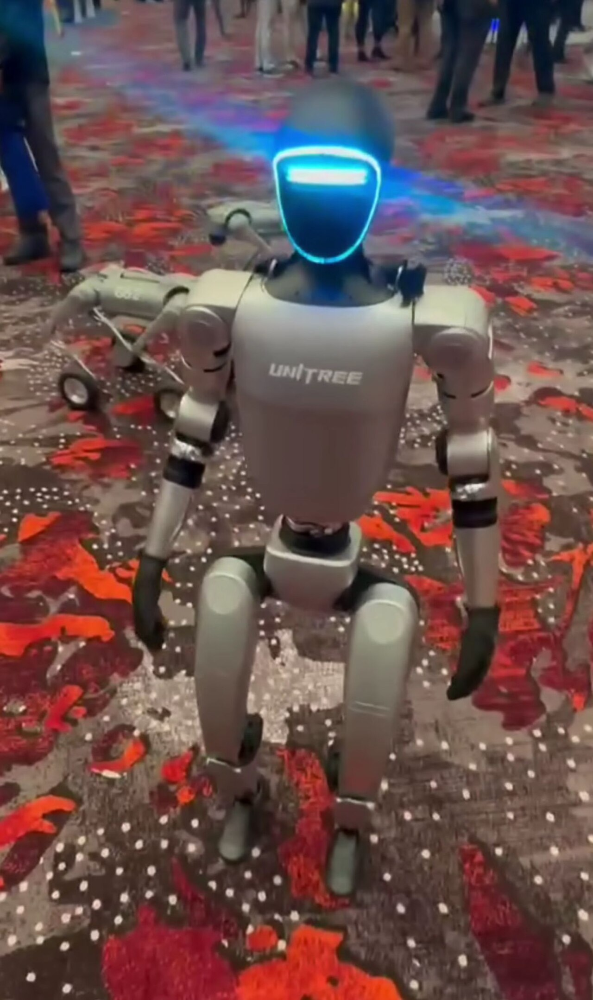
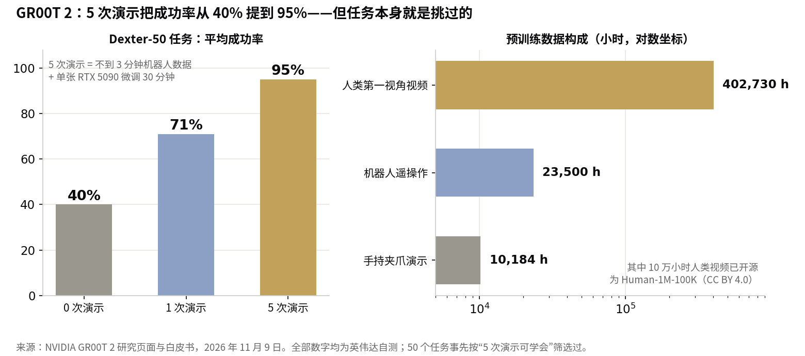

> [English version](/life/nvidia-gr00t-2-human-video-robots/)

*2024 年展会上的 Unitree G1 人形机器人。轻量版 GR00T 2 Turbo 直接运行在 G1 机身内。照片：Sayanesy，CC0，via Wikimedia Commons。*

## 发生了什么

11 月 9 日，在得克萨斯州奥斯汀举行的机器人学习大会（CoRL）上，英伟达发布了 GR00T 2——一个它称为"开放前沿世界动作模型"（open frontier world action model）的机器人基础模型，基于 NVIDIA Cosmos 构建。与传统的机器人策略（把观测直接映射为电机指令）不同，GR00T 2 用一个扩散 transformer 同时预测场景接下来会变成什么样、以及哪些动作能让它变成那样。它通过预测世界来学习物理，而不只是通过在世界里行动。

训练数据的构成才是重点。机器人演示数据的采集又慢又贵——得有人一台一台地遥操作机器、一个任务一个任务地录。而人类视频到处都是。于是英伟达用 **402,730 小时人类第一视角工作视频**预训练了 GR00T 2，此外还有 10,184 小时手持夹爪演示（覆盖 2,897 个任务）和 23,500 小时机器人遥操作数据。人类视频的量大约是机器人数据的 12 倍。

其中 10 万小时是真正开放的：英伟达已将其作为 Human-1M-100K 数据集发布在 Hugging Face 上，采用 CC BY 4.0 许可，允许商用。

## 两年时间：从一场 keynote 幻灯片到一条 scaling 曲线

GR00T 2 不是凭空冒出来的，它是英伟达从 2024 年 3 月开始公开推进的计划的第三幕。当时黄仁勋在 GTC 上发布了 Project GR00T——Generalist Robot 00 Technology（通用机器人 00 技术），同时发布的还有 Jetson Thor 机器人计算机。从一开始，它的定位就很明确：人形机器人需要一个像语言模型那样的基础模型——一个预训练好的大脑，可以微调适配多种机器人本体，而不是每个机器人、每个任务都单独写一个控制器。

第一个模型 Isaac GR00T N1 于 2025 年 3 月 18 日在 GTC 上发布，被称为"全球首个开放的、可全面定制的通用人形机器人推理与技能基础模型"。它的架构公开借鉴了人类认知：一个受丹尼尔·卡尼曼快慢思考启发而设计的双系统——视觉-语言-动作主干（System 2，慢思考、负责推理）搭配一个流匹配扩散 transformer（System 1，快思考、负责输出连续的电机动作）。2025 年 5 月的台北国际电脑展（Computex）上发布了 N1.5，加入了 GR00T-Dreams 流程生成的合成训练数据——一个 Cosmos 世界模型可以根据一张图片"梦见"新任务的视频，按英伟达的说法，这能把遥操作数据采集的需求降低约 20 倍。2025 年 9 月 29 日的 CoRL 大会上又发布了 N1.6，集成了 Cosmos Reason 作为机器人更深层的思考模块，让机器人可以完成更复杂的协调动作，比如一手开一扇沉重的门、同时另一手还拿着东西。

GR00T 2 是一次架构上的改变，而不只是 N1 的放大版。N1 是视觉-语言-动作模型——看场景、读指令、输出动作；GR00T 2 是世界-动作模型：它用一个扩散 transformer 同时预测场景未来的视频和动作。机器人通过学习想象接下来会发生什么来学习物理，而动作就是让想象中的未来成真的东西。这就是为什么训练数据的构成如此重要：一个世界模型的好坏，取决于它看过多少个世界，而人类多年来一直在以任何遥操作实验室都无法企及的数量，录制自己干活的视频。

这里还有一个常被忽略的点：英伟达并不造机器人。它提供的是训练机器人大脑的计算机、在虚拟世界里测试它的仿真环境、装在机器人身体里运行它的小型计算机（Jetson），以及开放的 AI 模型（GR00T 与 Cosmos）。这个定位决定了 GR00T 2 的商业逻辑——它不是要卖一台机器人，而是要成为所有机器人公司的软件层。谁的模型成为行业标准，谁就收到了整个行业的"税"。数据集的开放、代码的承诺、基准的建立，都是在为这个标准地位铺路，而不仅仅是学术慷慨。

## 英伟达宣称的数字

在 50 个灵巧操作任务上——这些任务只出现在人类视频或其他机器人的数据里，从未出现在目标机器人自己的数据中——英伟达报告：

- **零演示：平均成功率 40%**；50 个任务中有 40 个至少成功过一次
- **每个任务给 1 次演示：71%**
- **每个任务给 5 次演示：95%**——不到 3 分钟的机器人数据，再加单张 RTX 5090 上 30 分钟微调

跨本体迁移的宣称更引人注目。只看人类演示，双手机器人给实验室漏斗铺滤纸的成功率达 65%。只看手持夹爪的演示，另一台机械臂能从头到尾组装一辆玩具翻斗车，成功率 60%。再由一个推理模型通过 API 指挥，系统能完成 97–98/100 次玩具组装，中途掉了零件也能自己恢复。而轻量版 GR00T 2 Turbo（20 亿参数）直接运行在 Unitree G1 人形机器人身上——在其自带的 Jetson Thor 上每次预测 124 毫秒——舀爆米花并送上桌 48 次全部成功，清理桌面成功率 93%。

早期用户是真实的公司，不只是实验室：Nexuni 在测试它处理洗衣流程，富士康把它用于服务器制造自动化，西门子在评估工业场景。都还处在测试或评估阶段，没有一家投入生产。

*全部数字均为英伟达自测，来源：GR00T 2 研究页面与白皮书，2026 年 11 月 9 日。*

## 周围的战场：真实的试点、狭窄的任务、还没有量产

英伟达这次发布，落在一个 2026 年终于开始干实活、但活儿还很窄、规模还很小的人形机器人行业里。Figure AI 的机器人已在宝马斯帕坦堡工厂跑了 11 个月、搬运了超过 90,000 个零件，从 Figure 02 的钣金上料，升级到 2026 年 6 月 Figure 03 接手的零件排序工作。Agility Robotics 的 Digit 已在佐治亚州 GXO 的一个仓库里搬运了超过 100,000 个周转箱，依据的是 2024 年 6 月签署的一份多年期机器人即服务协议。这是全行业有据可查的两个最好的部署案例，而它们的形态完全相同：一个任务、一个地点、简单的夹爪、重复成千上万次。

名气更大的公司，实际进度比它们的头条要落后。特斯拉于 2026 年 10 月在弗里蒙特开始了 Optimus 的早期生产，但至今没有公布产量、价格或外部客户交付日期，其自己的 SEC 文件仍将 Optimus 的制造产能列为"在建"。波士顿动力在 2026 年 1 月的 CES 上发布了产品版 Atlas——56 个自由度、最大负重 50 公斤、可自行更换电池——但其 2026 年的全部产量已被现代汽车与谷歌 DeepMind 预订完毕，现代佐治亚州萨凡纳工厂的生产线部署要到 2028 年才开始；现代谈到未来要在自己的工厂里跑超过 25,000 台 Atlas，那是一个面向数年后的计划，不是一条生产线上正在工作的机器人数量。

这正是 GR00T 2 瞄准的缺口。试点证明了人形机器人能可靠地做好一份工作，但没有证明它能便宜地学会下一份工作。今天的每一个新任务，都要重新遥操作、重新微调、重新做安全评估。如果看人类视频能把这个成本压缩到 5 次演示加 30 分钟微调，整个行业的经济学就变了——不是因为机器人变强了，而是因为下一个任务的边际成本变便宜了。这就是这场赌注，而试点正是它现在重要、而不是五年后才重要的原因：机器人已经存在，工厂正在等待，瓶颈是教学，不是制造。

还有一个衡量标准值得记住：2026 年上半年全球出货的人形机器人超过 22,000 台，接近去年同期的四倍，但其中 60% 以上流向了娱乐、数据采集与研究，而不是工厂或仓库。风投的钱也印证了热情跑在部署前面的现实：2026 年前四个月，人形机器人领域的风投资金已达 51 亿美元，超过了 2025 年全年 48 亿美元的总额。钱和机器都在快速增加，真正进工厂干活的还是少数。GR00T 2 要解决的，正是把"少数"变成"多数"的那道坎。

## 95% 后面的星号

读白皮书，headline 数字就多了一个重要限定。英伟达自己的文字写道，50 个任务是"从那些模型用五个 episode 能够学会的任务（至少 80% 成功率）中挑选出来的，因此五 episode 的成功率部分是人为构造出来的。"换句话说，测试集事先就是从模型能快速学会的任务里挑出来的——而英伟达没有说明备选池子有多大。95% 是真实的，但它是一个经过筛选的集合上的数字，不是对随机任务的抽样。更诚实的 headline 其实是 40% 的零样本数字：全新的任务、零演示，大多数时候仍然会失败。

第二个星号在"开放"这个词上。10 万小时的数据集是开放的，模型目前还不能下载：英伟达研究页面写明代码将于 2026 年 12 月提供，而截至 11 月 10 日，权重既没有发布日期，也没有许可协议。GR00T 2 的"开放"指的是"开放研究"，不是开放权重——在代码真正发布之前，这个区别值得说清楚。

## 为什么这件事仍然重要

挺过这些保留意见的部分，是 scaling 的结果。英伟达分别用 0%、1%、10% 和 100% 的人类视频预训练了四个版本的模型，再在 72 个下游任务上测试。真实机器人的任务完成度每一步都在上升，从 50% 到 70%。人类视频越多，机器人越好——单调上升，在 40 万小时处看不到平台期。这是一条 scaling 曲线，它指向一个未来：能干活的机器人的瓶颈不是遥操作设备，而是和语言模型一样的东西——一大堆人干活的视频。

与 GR00T 2 同步发布的 Isaac Lab 3.0 是这场赌注的另一半：在技能触碰真实硬件之前，先在仿真里排练，训练吞吐量比上一代最高提升 2.5 倍；再加上两个新的工业基准（DexBench 与 VABAR），让整个领域能在共同的标准上争论结果，而不是各自拿厂商幻灯片说话。

## 为什么是视频，为什么是现在

GR00T 2 背后的机制，建立在一个关于机器人数据从何而来的简单观察上，而这正是机器人领域一直以来的 binding constraint。语言模型学习的是数十亿人出于其他目的生产的文本；机器人策略学习的是必须有人刻意执行的演示——穿着动捕设备，或者亲手遥操作机器人，一个任务一个任务地录。遥操作又慢、又累、又贵，而且它的扩展速度受限于人类工时，不像爬取互联网那样可以规模化。人类视频打破了这个约束，因为它已经以行星级别的规模存在：每一档烹饪节目、每一个装配教程、每一段某人干活的第一视角录像，都是一次演示，而且是免费的，呈现的恰好就是机器人摄像头看到的视觉格式。问题从来不是视频存不存在，而是模型能不能只靠看、不用亲手感受物体的重量，就学会运动技能——GR00T 2 的回答是：能学到足够在陌生任务上达到 40% 的程度，再用 5 次演示把缺口补上，达到 95%。

时间点重要的第二个原因是仿真赶上了数据。与 GR00T 2 同步发布的 Isaac Lab 3.0，是技能在接触真实硬件之前排练的地方，而 Cosmos 世界模型可以生成从未被拍摄过的任务的合成视频。现在的完整栈是三层——看人类、仿真里做梦、再用少数几次真实演示做微调——每一层都在弥补其他层的短板。视频提供广度，仿真提供数量，5 次演示提供在真实机器人身体里的 grounding。三者单独拿出来都不够，合在一起，才是十年来第一个看似可行的、针对机器人数据难题的答案。

当然，这个答案还有几个没有解决的硬问题。第一是安全：一个在仿真和视频里学会的动作，在真实工厂里碰到人时出了错，责任算谁的？目前的试点都把机器人与人隔离开来，或者限定在单一任务上，真正的混合作业场景还没有经过大规模验证。第二是泛化的边界：40% 的零样本成功率意味着 60% 的新任务仍然会失败，而失败在工厂里不是扣分，是停线。第三是成本：30 分钟微调需要一张 RTX 5090，而 Jetson Thor 开发套件的价格是 $3,499——对于要部署成百上千台机器人的工厂来说，单机算力成本仍然是一笔需要认真算的账。GR00T 2 没有回答这些问题，它只是把最难的那个问题——数据——从"不可能"变成了"有可能"。剩下的，要看 12 月的代码发布、看其他实验室的复现、看富士康和西门子的试点能不能走出评估阶段，变成一条真正运转的生产线。

## 40% 这个数字为什么比 95% 更重要

读这篇发布时，最容易犯的错误是盯着 95% 看。95% 是 headline，但 40% 才是这项技术的真实坐标。零演示、40% 成功率，意味着模型第一次见到一个任务，不需要任何人教它，就有四成的概率把它做成。这个数字放在机器人学三十年的历史里看，是一个分水岭：在此之前，机器人面对没见过的任务，成功率基本是零——它只会执行被明确编程或演示过的动作。一个能凭"看过人类做类似的事"就猜出个大概的机器人，与一个只能执行固定程序的机器人，是两种不同的物种。

反过来看，40% 也说明了这条路离"通用"还有多远。一个在工厂里十次有六次失败的机器人是不能上岗的，而在家庭里十次有六次打翻东西的机器人是不能进门的。GR00T 2 的真正贡献不是把成功率推到了 95%，而是把"从零到 40%"这段最难的路走通了——剩下的 55 个百分点，可以用 5 次演示、30 分钟微调来补。这是一个工程上可以接受的分工：基础模型负责举一反三，人类负责在最后关头纠偏。如果未来的模型能把零样本成功率从 40% 推到 60%、70%，每次新任务的演示次数就会从 5 次降到 2 次、1 次，直到某一天不再需要演示。那一天，才是人形机器人真正开始规模化的日子，而 GR00T 2 的 scaling 曲线——人类视频越多，机器人越好，在 40 万小时处看不到平台期——暗示那一天可能比大多数人预期的更近。

还有一个视角值得留意：这条曲线与语言模型的 scaling law 是同一类曲线。语言模型证明了，只要数据足够多、模型足够大，能力就会涌现；GR00T 2 在尝试证明，机器人领域也存在同样的涌现——只不过这里的数据是视频，能力是动手。如果这个类比成立，机器人行业的竞争逻辑会与大模型行业趋同：赢家不是拥有最好机械臂的公司，而是拥有最多视频数据、最强仿真栈和最大算力的公司。这正是英伟达下注的逻辑，也是它同时发布 Isaac Lab 3.0、开放 10 万小时数据集、承诺 12 月放出代码的原因：它在把三件东西同时变成行业标准，而标准制定者收的不是一台机器人的钱，是整个行业的钱。

## 一个中国的注脚：G1 与 Unitree

这篇发布里还有一个值得中国读者多看一眼的细节：轻量版 GR00T 2 Turbo 直接运行的那台机器人，是宇树（Unitree）的 G1。G1 是一台中国公司制造的人形机器人，而 Unitree 在 2026 年已成为一家在上海上市的公众公司。英伟达的模型跑在中国硬件上，这件事本身就说明了人形机器人供应链的现实：大脑可能是美国的，身体很可能是中国的，而把两者结合起来的集成工作，正在全球范围内发生。

对中国的人形机器人行业来说，GR00T 2 是一把双刃剑。一方面，开放的数据集与即将发布的代码降低了所有人的门槛——中国团队可以直接站在 40 万小时人类视频的肩膀上，而不必自己从头采集；另一方面，如果英伟达的模型成为事实标准，中国厂商的差异化空间就会被压缩到硬件与成本上，而软件层的定价权会落到标准制定者手里。这场竞争的下一幕，很可能不是"谁的机器人更灵活"，而是"谁的生态先把开发者圈进来"。GR00T 2 的发布，就是英伟达圈开发者的那一步。

## 如果 12 月的代码真的发布，会发生什么

英伟达研究页面写明代码将于 2026 年 12 月提供。这个日期值得认真对待，因为它将是 GR00T 2 从"宣称"变成"可验证"的分界线。代码发布之后，全球任何一个拥有机器人硬件的实验室都可以下载、复现、并在自己的任务上测试 5 次演示达到 95% 的说法。如果复现成功，英伟达的 scaling 曲线就从一家公司的内部结果，变成整个领域共享的事实；如果复现失败或大打折扣，95% 的星号就会从白皮书的脚注变成头条。

但代码发布还有第二层含义：许可协议。GR00T N1 系列的权重此前采用的是限制商用的 NVIDIA 许可，直到 N1.7 才转为允许商用的开放模型许可，代码则采用 Apache 2.0。GR00T 2 的权重至今既没有发布日期，也没有许可协议——如果 12 月只放出代码、不放出权重，研究者能读、能学、但不能直接用；如果权重以允许商用的许可发布，GR00T 2 就会在一夜之间成为全球人形机器人团队的默认起点。对 Nexuni、富士康、西门子这样的评估者来说，许可条款与代码本身同样重要，因为它决定了试点能不能变成产品，而不只是一次实验。12 月要看的不是一行发布公告，而是公告里的许可协议写了什么。

## 判断

GR00T 2 是迄今为止英伟达机器人论题最清晰的表述：未来的机器人大脑靠看人类学会手艺，而拥有最多人类视频——再加上仿真栈和 GPU——的公司会赢。机制是成立的，数据集的开源是真正有用的，富士康和西门子来试用是真实的信号。

如果要用一句话概括 GR00T 2 的位置，那就是：它解决了一个真问题，用了一个对的方法，给出了一个尚未被独立验证的答案。在机器人学里，这已经是很难得的组合——大多数发布连前两点都做不到。值得期待，但不值得现在就下结论。

但诚实的评分是"有前景、未经验证"。95% 部分是人为筛选的结果，权重还没发布，英伟达之外还没有人在自己的硬件上复现这些结果。盯住两件事：12 月的代码发布是否真的落地，以及富士康或西门子是否从评估走向生产线。在那之前，GR00T 2 是一个附带开放数据集的有力宣称——还不是一台你能买到的机器人。而对正在观望的读者来说，最实用的建议是：不必急着判断人形机器人什么时候进你家，先看它什么时候进工厂——工厂是第一个真正付费、真正计较停线成本的客户，机器人在那里的表现，比任何发布会都更能说明它到底行不行。
