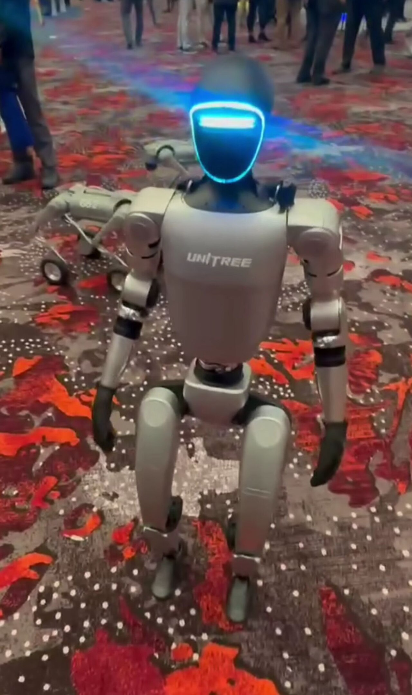
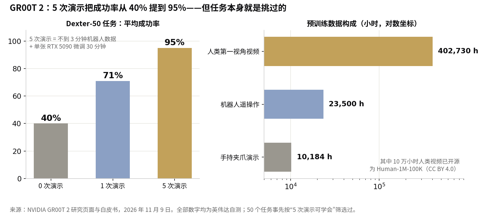

> [English version](/life/nvidia-gr00t-2-human-video-robots/)

*2024 年展会上的 Unitree G1 人形机器人。轻量版 GR00T 2 Turbo 直接运行在 G1 机身内。照片：Sayanesy，CC0，via Wikimedia Commons。*

## 发生了什么

11 月 9 日，在得克萨斯州奥斯汀举行的机器人学习大会（CoRL）上，英伟达发布了 GR00T 2——一个它称为"开放前沿世界动作模型"（open frontier world action model）的机器人基础模型，基于 NVIDIA Cosmos 构建。与传统的机器人策略（把观测直接映射为电机指令）不同，GR00T 2 用一个扩散 transformer 同时预测场景接下来会变成什么样、以及哪些动作能让它变成那样。它通过预测世界来学习物理，而不只是通过在世界里行动。

训练数据的构成才是重点。机器人演示数据的采集又慢又贵——得有人一台一台地遥操作机器、一个任务一个任务地录。而人类视频到处都是。于是英伟达用 **402,730 小时人类第一视角工作视频**预训练了 GR00T 2，此外还有 10,184 小时手持夹爪演示（覆盖 2,897 个任务）和 23,500 小时机器人遥操作数据。人类视频的量大约是机器人数据的 12 倍。

其中 10 万小时是真正开放的：英伟达已将其作为 Human-1M-100K 数据集发布在 Hugging Face 上，采用 CC BY 4.0 许可，允许商用。

## 英伟达宣称的数字

在 50 个灵巧操作任务上——这些任务只出现在人类视频或其他机器人的数据里，从未出现在目标机器人自己的数据中——英伟达报告：

- **零演示：平均成功率 40%**；50 个任务中有 40 个至少成功过一次
- **每个任务给 1 次演示：71%**
- **每个任务给 5 次演示：95%**——不到 3 分钟的机器人数据，再加单张 RTX 5090 上 30 分钟微调

跨本体迁移的宣称更引人注目。只看人类演示，双手机器人给实验室漏斗铺滤纸的成功率达 65%。只看手持夹爪的演示，另一台机械臂能从头到尾组装一辆玩具翻斗车，成功率 60%。再由一个推理模型通过 API 指挥，系统能完成 97–98/100 次玩具组装，中途掉了零件也能自己恢复。而轻量版 GR00T 2 Turbo（20 亿参数）直接运行在 Unitree G1 人形机器人身上——在其自带的 Jetson Thor 上每次预测 124 毫秒——舀爆米花并送上桌 48 次全部成功，清理桌面成功率 93%。

早期用户是真实的公司，不只是实验室：Nexuni 在测试它处理洗衣流程，富士康把它用于服务器制造自动化，西门子在评估工业场景。都还处在测试或评估阶段，没有一家投入生产。

*全部数字均为英伟达自测，来源：GR00T 2 研究页面与白皮书，2026 年 11 月 9 日。*

## 95% 后面的星号

读白皮书，headline 数字就多了一个重要限定。英伟达自己的文字写道，50 个任务是"从那些模型用五个 episode 能够学会的任务（至少 80% 成功率）中挑选出来的，因此五 episode 的成功率部分是人为构造出来的。"换句话说，测试集事先就是从模型能快速学会的任务里挑出来的——而英伟达没有说明备选池子有多大。95% 是真实的，但它是一个经过筛选的集合上的数字，不是对随机任务的抽样。更诚实的 headline 其实是 40% 的零样本数字：全新的任务、零演示，大多数时候仍然会失败。

第二个星号在"开放"这个词上。10 万小时的数据集是开放的，模型目前还不能下载：英伟达研究页面写明代码将于 2026 年 12 月提供，而截至 11 月 10 日，权重既没有发布日期，也没有许可协议。GR00T 2 的"开放"指的是"开放研究"，不是开放权重——在代码真正发布之前，这个区别值得说清楚。

## 为什么这件事仍然重要

挺过这些保留意见的部分，是 scaling 的结果。英伟达分别用 0%、1%、10% 和 100% 的人类视频预训练了四个版本的模型，再在 72 个下游任务上测试。真实机器人的任务完成度每一步都在上升，从 50% 到 70%。人类视频越多，机器人越好——单调上升，在 40 万小时处看不到平台期。这是一条 scaling 曲线，它指向一个未来：能干活的机器人的瓶颈不是遥操作设备，而是和语言模型一样的东西——一大堆人干活的视频。

与 GR00T 2 同步发布的 Isaac Lab 3.0 是这场赌注的另一半：在技能触碰真实硬件之前，先在仿真里排练，训练吞吐量比上一代最高提升 2.5 倍；再加上两个新的工业基准（DexBench 与 VABAR），让整个领域能在共同的标准上争论结果，而不是各自拿厂商幻灯片说话。

## 判断

GR00T 2 是迄今为止英伟达机器人论题最清晰的表述：未来的机器人大脑靠看人类学会手艺，而拥有最多人类视频——再加上仿真栈和 GPU——的公司会赢。机制是成立的，数据集的开源是真正有用的，富士康和西门子来试用是真实的信号。

但诚实的评分是"有前景、未经验证"。95% 部分是人为筛选的结果，权重还没发布，英伟达之外还没有人在自己的硬件上复现这些结果。盯住两件事：12 月的代码发布是否真的落地，以及富士康或西门子是否从评估走向生产线。在那之前，GR00T 2 是一个附带开放数据集的有力宣称——还不是一台你能买到的机器人。
