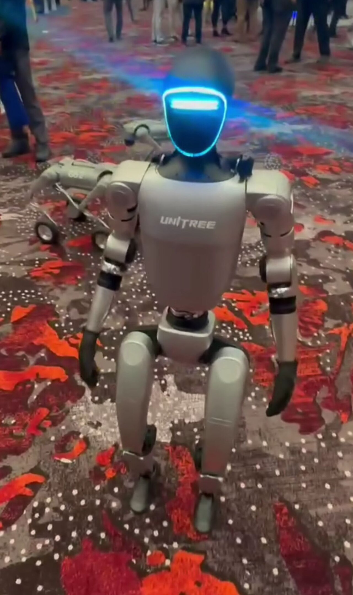
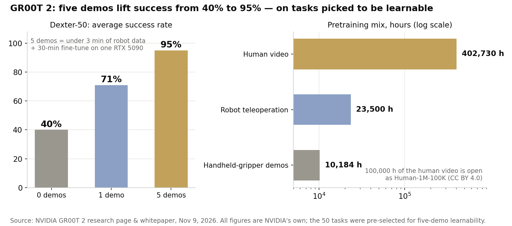

> [中文版 Chinese version](/life/nvidia-gr00t-2-human-video-robots-zh/)

*A Unitree G1 humanoid at an expo in 2024. GR00T 2 Turbo, the lightweight variant, runs onboard the G1 itself. Photo: Sayanesy, CC0, via Wikimedia Commons.*

## What happened

On November 9, at the Conference on Robot Learning (CoRL) in Austin, Texas, NVIDIA introduced GR00T 2, a robot foundation model it calls an "open frontier world action model," built on NVIDIA Cosmos. Unlike a conventional robot policy that maps observations straight to motor commands, GR00T 2 predicts what the scene will look like next *and* which actions get it there, in a single diffusion transformer. It learns physics by predicting the world, not just by acting in it.

The training mix is the story. Robot demonstrations are slow and expensive to collect — a person has to teleoperate the machine, task by task. Human video is everywhere. So NVIDIA pretrained GR00T 2 on **402,730 hours of first-person video of people at work**, alongside 10,184 hours of demonstrations with a handheld gripper (across 2,897 tasks) and 23,500 hours of robot teleoperation. Human video outweighs robot data roughly 12 to 1.

And 100,000 of those hours are now genuinely open: NVIDIA released them as Human-1M-100K on Hugging Face under a CC BY 4.0 license, which permits commercial use.

## The numbers NVIDIA is claiming

On 50 dexterous tasks that appear only in human video or on other robots — never in the target robot's own data — NVIDIA reports:

- **40%** average success with zero demonstrations; the model completed 40 of the 50 tasks at least once
- **71%** with one demonstration per task
- **95%** with five demonstrations per task — under three minutes of robot data — after a 30-minute fine-tune on a single RTX 5090

Cross-body transfer is the more striking claim. Shown a task only by humans, a two-handed robot lines a lab funnel with filter paper in 65% of trials. Shown only with a handheld gripper, a different robot arm assembles a toy dump truck end to end in 60% of trials. With a reasoning model directing it through an API, the system completes 97–98 of 100 toy assemblies, recovering from dropped parts along the way. And GR00T 2 Turbo, a smaller 2-billion-parameter variant, runs onboard a Unitree G1 humanoid — 124 ms per prediction on the robot's own Jetson Thor — scooping and serving popcorn in all 48 trials and clearing a table in 93%.

The early users are real companies, not just labs: Nexuni is testing it for laundry handling, Foxconn is applying it to server-manufacturing automation, and Siemens is evaluating industrial use cases. All testing or evaluating; none deployed.

*All figures are NVIDIA's own, from the GR00T 2 research page and whitepaper, November 9, 2026.*

## The asterisk on 95%

Read the whitepaper, and the headline number gets an important qualifier. NVIDIA's own text says the 50 tasks "were chosen among those the model learns with five episodes (at least 80% success), so the five-episode rate is high partly by construction." In other words, the test set was pre-selected from tasks the model can already learn quickly — and NVIDIA does not say how large the pool was that the 50 were drawn from. The 95% is real, but it is a selected-set number, not a random-sample one. The 40% zero-shot figure is the more honest headline: genuinely new tasks, no demonstrations, still failing most of the time.

The second asterisk is the word "open." The 100,000-hour dataset is open. The model is not downloadable yet: NVIDIA's research page lists code as available in December 2026, and as of November 10 there is no release date or license for the weights. GR00T 2 is open in the sense of "open research," not open weights — a distinction worth keeping straight until the code actually ships.

## Why this matters anyway

The scaling result is the part that survives the caveats. NVIDIA pretrained four versions of the model on none, 1%, 10%, and 100% of the human video, then tested each on 72 downstream tasks. Real-robot task progress rose at every step, from 50% to 70%. More human video, better robot — monotonically, with no plateau in sight at 400,000 hours. That is a scaling curve, and it points at a future where the bottleneck for capable robots is not teleoperation rigs but the same thing that scaled language models: a very large pile of video of people doing things.

Isaac Lab 3.0, released alongside GR00T 2, is the other half of the bet: simulation where skills are rehearsed before touching hardware, with up to 2.5× the training throughput of the previous version, plus two new industrial benchmarks (DexBench and VABAR) so the field can argue about results on shared ground instead of vendor slides.

## The verdict

GR00T 2 is the clearest statement yet of NVIDIA's robotics thesis: the robot brain of the future learns by watching humans, and the company that owns the most human video — plus the simulation stack and the GPUs — wins. The mechanism is sound, the dataset release is genuinely useful, and Foxconn and Siemens kicking the tires is real signal.

But the honest grade is "promising, unverified." The 95% is partly by construction, the weights are not out, and no one outside NVIDIA has replicated the results on their own hardware. Watch two things: whether the December code release actually lands, and whether Foxconn or Siemens moves from evaluation to a production line. Until then, GR00T 2 is a strong claim with an open dataset attached — not yet a robot you can buy.
