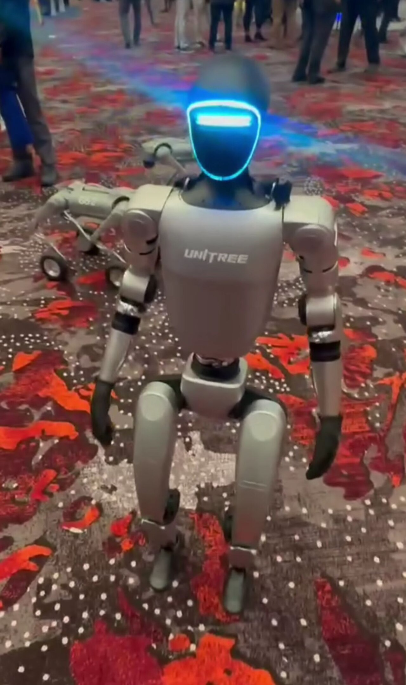
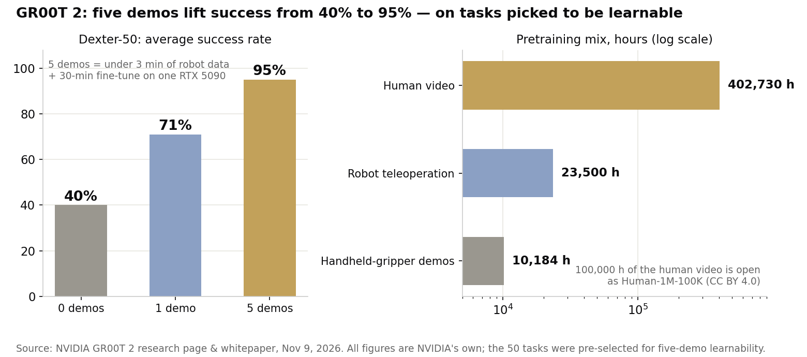

> [中文版 Chinese version](/life/nvidia-gr00t-2-human-video-robots-zh/)

*A Unitree G1 humanoid at an expo in 2024. GR00T 2 Turbo, the lightweight variant, runs onboard the G1 itself. Photo: Sayanesy, CC0, via Wikimedia Commons.*

## What happened

On November 9, at the Conference on Robot Learning (CoRL) in Austin, Texas, NVIDIA introduced GR00T 2, a robot foundation model it calls an "open frontier world action model," built on NVIDIA Cosmos. Unlike a conventional robot policy that maps observations straight to motor commands, GR00T 2 predicts what the scene will look like next *and* which actions get it there, in a single diffusion transformer. It learns physics by predicting the world, not just by acting in it.

The training mix is the story. Robot demonstrations are slow and expensive to collect — a person has to teleoperate the machine, task by task. Human video is everywhere. So NVIDIA pretrained GR00T 2 on **402,730 hours of first-person video of people at work**, alongside 10,184 hours of demonstrations with a handheld gripper (across 2,897 tasks) and 23,500 hours of robot teleoperation. Human video outweighs robot data roughly 12 to 1.

And 100,000 of those hours are now genuinely open: NVIDIA released them as Human-1M-100K on Hugging Face under a CC BY 4.0 license, which permits commercial use.

## Two years from a keynote slide to a scaling curve

GR00T 2 did not arrive as a bolt from the blue. It is the third act of a program NVIDIA has been building in public since March 2024, when Jensen Huang unveiled Project GR00T — Generalist Robot 00 Technology — at GTC, alongside the Jetson Thor robot computer. The framing from the start was that humanoids needed a foundation model the way language had one: a single pretrained brain that could be fine-tuned for many bodies, rather than a bespoke controller per robot per task.

The first model, Isaac GR00T N1, arrived at GTC on March 18, 2025, billed as the world's first open, fully customizable foundation model for generalized humanoid reasoning and skills. Its architecture borrowed openly from human cognition: a dual system inspired by Daniel Kahneman's fast and slow thinking, pairing a vision-language-action backbone (System 2, the slow reasoner) with a flow-matching diffusion transformer (System 1, the fast motor policy) that produces continuous motor commands.

GR00T 2 is a change of architecture, not just a bigger N1. Where N1 was a vision-language-action model — see the scene, read the instruction, output the motion — GR00T 2 is a world-action model: it predicts the future video of the scene and the actions jointly, in a single diffusion transformer. The robot learns physics by learning to imagine what happens next, and the action is the thing that makes the imagined future come true. That is why the training mix matters so much: a world model is only as good as the worlds it has watched, and humans have been recording themselves doing things for years, in quantities no teleoperation lab can match.

## The numbers NVIDIA is claiming

On 50 dexterous tasks that appear only in human video or on other robots — never in the target robot's own data — NVIDIA reports:

- **40%** average success with zero demonstrations; the model completed 40 of the 50 tasks at least once
- **71%** with one demonstration per task
- **95%** with five demonstrations per task — under three minutes of robot data — after a 30-minute fine-tune on a single RTX 5090

Cross-body transfer is the more striking claim. Shown a task only by humans, a two-handed robot lines a lab funnel with filter paper in 65% of trials. Shown only with a handheld gripper, a different robot arm assembles a toy dump truck end to end in 60% of trials. With a reasoning model directing it through an API, the system completes 97–98 of 100 toy assemblies, recovering from dropped parts along the way. And GR00T 2 Turbo, a smaller 2-billion-parameter variant, runs onboard a Unitree G1 humanoid — 124 ms per prediction on the robot's own Jetson Thor — scooping and serving popcorn in all 48 trials and clearing a table in 93%.

The early users are real companies, not just labs: Nexuni is testing it for laundry handling, Foxconn is applying it to server-manufacturing automation, and Siemens is evaluating industrial use cases. All testing or evaluating; none deployed.

*All figures are NVIDIA's own, from the GR00T 2 research page and whitepaper, November 9, 2026.*

## The field around it: real pilots, narrow jobs, no production yet

NVIDIA's announcement lands in a humanoid industry that, in 2026, is finally doing real work — in very narrow jobs, at very small scale. Figure AI's robots have moved more than 90,000 parts across an eleven-month run at BMW's Spartanburg plant, graduating from sheet-metal loading with Figure 02 to parts sequencing with Figure 03 in June 2026. Agility Robotics' Digit has moved over 100,000 totes inside a single GXO warehouse in Georgia, under a multi-year robots-as-a-service agreement signed in June 2024. Those are the two best-documented deployments in the field, and both are the same shape: one task, one place, simple grippers, repeated thousands of times.

The bigger names are further behind than their headlines suggest. Tesla began early Optimus production at Fremont in October 2026, but has published no unit count, price, or external customer date, and its own SEC filings still list Optimus manufacturing capacity as under construction. Boston Dynamics unveiled the product version of Atlas at CES in January 2026 — 56 degrees of freedom, up to 50 kg lift, swappable batteries — but its entire 2026 production run is already committed to Hyundai and Google DeepMind, with production-line deployment at Hyundai's Savannah plant not starting until 2028; Hyundai has talked about eventually running more than 25,000 Atlas units, a plan aimed years out, not a count of robots on a line today.

## The asterisk on 95%

Read the whitepaper, and the headline number gets an important qualifier. NVIDIA's own text says the 50 tasks "were chosen among those the model learns with five episodes (at least 80% success), so the five-episode rate is high partly by construction." In other words, the test set was pre-selected from tasks the model can already learn quickly — and NVIDIA does not say how large the pool was that the 50 were drawn from. The 95% is real, but it is a selected-set number, not a random-sample one. The 40% zero-shot figure is the more honest headline: genuinely new tasks, no demonstrations, still failing most of the time.

The second asterisk is the word "open." The 100,000-hour dataset is open. The model is not downloadable yet: NVIDIA's research page lists code as available in December 2026, and as of November 10 there is no release date or license for the weights. GR00T 2 is open in the sense of "open research," not open weights — a distinction worth keeping straight until the code actually ships.

## Why this matters anyway

The scaling result is the part that survives the caveats. NVIDIA pretrained four versions of the model on none, 1%, 10%, and 100% of the human video, then tested each on 72 downstream tasks. Real-robot task progress rose at every step, from 50% to 70%. More human video, better robot — monotonically, with no plateau in sight at 400,000 hours. That is a scaling curve, and it points at a future where the bottleneck for capable robots is not teleoperation rigs but the same thing that scaled language models: a very large pile of video of people doing things.

Isaac Lab 3.0, released alongside GR00T 2, is the other half of the bet: simulation where skills are rehearsed before touching hardware, with up to 2.5× the training throughput of the previous version, plus two new industrial benchmarks (DexBench and VABAR) so the field can argue about results on shared ground instead of vendor slides.

## Why video, why now — and what would prove it

The mechanism behind GR00T 2 rests on a simple observation about where robot data comes from, and why it has always been the binding constraint. A language model learns from text that billions of people produced for other reasons; a robot policy learns from demonstrations that someone had to perform deliberately, wearing a motion-capture rig or driving the robot by hand, one task at a time. Teleoperation is slow, tiring, and expensive, and it scales with human hours in a way that scraping the internet does not. Human video breaks that constraint because it already exists at planetary scale: every cooking show, every assembly tutorial, every first-person recording of someone doing a job is a demonstration, free for the taking, in the exact visual format a robot's cameras see. The question was never whether the video existed. It was whether a model could learn motor skills from watching alone, without ever feeling the weight of the object — and GR00T 2's answer is that it can learn enough to get to 40% on unseen tasks, and to 95% with five demonstrations to close the gap.

There is a second reason the timing matters: simulation has caught up with the data. Isaac Lab 3.0, released alongside GR00T 2, is where skills are rehearsed before touching hardware, and the Cosmos world models can generate synthetic video of tasks that were never filmed. The stack is now three layers — watch humans, dream variations in simulation, fine-tune on a handful of real demonstrations — and each layer covers for the others' weaknesses. Video gives breadth, simulation gives volume, and the five demonstrations give grounding in the real robot's body. None of the three alone would be enough; together they are the first plausible answer to the data problem that has limited robotics for a decade.

What would prove it is not another NVIDIA slide. It is a lab outside NVIDIA, with a robot NVIDIA did not build, reproducing the five-demonstration result on a task NVIDIA did not choose — and a Foxconn or Siemens pilot moving from evaluation to a production line, where the robot has to work a full shift, next to people, without an engineer standing by. Until then, the honest grade stands: promising, unverified, and pointed at exactly the right problem.

## The verdict

GR00T 2 is the clearest statement yet of NVIDIA's robotics thesis: the robot brain of the future learns by watching humans, and the company that owns the most human video — plus the simulation stack and the GPUs — wins. The mechanism is sound, the dataset release is genuinely useful, and Foxconn and Siemens kicking the tires is real signal.

But the honest grade is "promising, unverified." The 95% is partly by construction, the weights are not out, and no one outside NVIDIA has replicated the results on their own hardware. Watch two things: whether the December code release actually lands, and whether Foxconn or Siemens moves from evaluation to a production line. Until then, GR00T 2 is a strong claim with an open dataset attached — not yet a robot you can buy.
