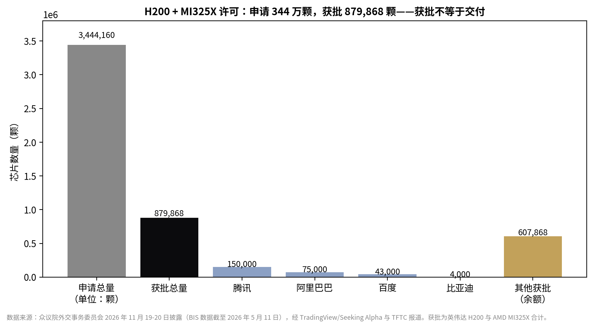
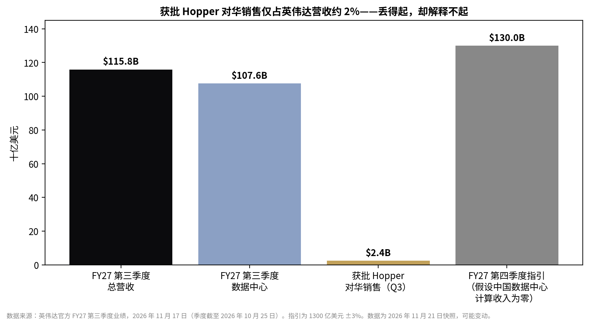

> [English version 英文版](/life/nvidia-halts-h200-china/)

*许可申请总量超过 344 万颗，其中 879,868 颗获批。数据来源：众议院外交事务委员会 2026 年 11 月 19—20 日披露，经 TradingView / Seeking Alpha 与 TFTC 报道。图表：作者自制。*

英伟达 2026 年 11 月 17 日财报电话会上最重要的一句话，与 1158 亿美元的季度营收无关，与 103% 的同比增速无关，也与 1300 亿美元的业绩指引无关。那是临时首席执行官兼首席财务官科莱特·克雷斯（Colette Kress）一句平淡的陈述："我们已不再向中国运送获批的 Hopper 数据中心产品"（We are no longer shipping licensed Hopper data center products to China）。

"获批"（licensed）这个词，承担了整句话的全部重量。克雷斯没有说英伟达失去了许可证，也没有说华盛顿吊销了许可证。她说的是：公司不再运送它有许可证可以运的产品——这一类产品涵盖 H200，即 Hopper 架构一代的加速器。这颗芯片，特朗普总统曾在 2025 年 12 月亲自批准对华销售，商务部在 2026 年 1 月为它专门写了一条正式规则，中国买家以巨大的数量下了订单。电话会上没有给出停运的原因，也没有给出持续时间。而两天之后，一份国会披露让这句话变得更加难以解释：工业与安全局（BIS）此前已经批准了 879,868 颗英伟达 H200 与 AMD MI325X 芯片，分布在 21 份许可申请之中。

也就是说，美国批准了这批芯片——大规模地、指名道姓地、一家买家一家买家地批准——而芯片却不动了。获批与交付之间的这道裂缝，才是 H200 时代真正的故事。而本文的判断是：这道裂缝出现的时刻，就是现行出口管制体制从一项"政策"变成一枚"有两票否决权的硬币"的时刻。

## 先看那笔让停运显得很小的账

先从算术开始，因为算术解释了英伟达为什么付得起这个代价——以及为什么几乎没有别的公司付得起。

英伟达 FY27 第三季度（截至 2026 年 10 月 25 日）营收 1158 亿美元，同比增长 103%。仅数据中心一项就是 1076 亿美元，同比增长 110%。获批 Hopper 对华运送在该季度贡献了 24 亿美元营收，约占总营收的 2%。第四季度指引为 1300 亿美元、上下浮动 3%，并且明确假设来自中国的数据中心计算收入为零。换句话说，英伟达一边把中国写成零，一边给出了公司历史上最大的季度指引；这只股票的问题（如果有的话）从来不是需求。

*获批 Hopper 对华销售在 FY27 第三季度为 24 亿美元，约占营收的 2%。第四季度 1300 亿美元指引假设中国数据中心计算收入为零。数据来源：英伟达官方 FY27 第三季度业绩，2026 年 11 月 17 日。数据为 2026 年 11 月 21 日快照，可能变动。图表：作者自制。*

2% 这个数字，解释了这场停运为何能如此轻描淡写。一家以 103% 速度增长、订单积压到做不完的公司，不需要一条只占 2%、却在政治上高度放射性的收入线。每一颗不运往中国的 H200，就是一份可以转给其他客户的晶圆与 HBM 产能——那些客户付款时不会附带一场国会听证。中国业务的机会成本早就塌了，声誉与监管成本却没有。克雷斯那句话，是一个理性的首席财务官在一项收入的风险成本超过其美元回报时，会说的话。

但请注意，2% 这个数字还做了另一件事：它让停运"宣布起来便宜，解读起来昂贵"。如果对华 Hopper 收入占总营收的 20%，停运会是一场原因明确的危机；只占 2% 时，停运可以是几乎任何东西——合规暂停、对北京的回应、一场静默谈判、对云端新规的反应——而英伟达没有任何财务上的动力去澄清。当钱很小的时候，模糊是免费的。这恰恰是外部观察者应当小心的原因：没有给出原因，不等于你偏好的那个原因就是证据。

## 那份改变了整个框架的披露

11 月 19—20 日，由布莱恩·马斯特（Brian Mast）担任主席的众议院外交事务委员会披露了 BIS 的许可数据，重新框定了整整一年。截至 2026 年 5 月 11 日，BIS 已在 21 份许可申请中批准 879,868 颗英伟达 H200 与 AMD 的 MI325X 芯片。申请总量超过 340 万颗——据 TFTC 的统计为 3,444,160 颗。被点名的获批包括：腾讯 150,000 颗、阿里巴巴 75,000 颗、百度 43,000 颗、比亚迪 4,000 颗。

这组数字头上必须压着三条注意事项，任何诚实的叙述都得把它们一直放在那里。第一，879,868 这个数字是两家公司芯片的合计——英伟达的 H200 加上 AMD 的 MI325X——不是英伟达一家的数量。第二，获批不等于销售：许可证是许可，不是采购订单，不是发货单，更不是收入。英伟达该季度实际确认的对华 Hopper 收入是 24 亿美元，是真金白银，但只是这些许可证若全部交付所隐含规模的一个零头。第三，这份获批数据是截至 2026 年 5 月 11 日的快照；它没有告诉我们那之后又批准了什么、修改了什么、或者任其失效了什么。

即便压上这三条注意事项，这份披露依然重要，因为它杀死了最简单的那个故事——"华盛顿其实从来没有真正放行 H200"。它放行了。近 88 万颗高端加速器获批卖给中国买家，其中包括中国最大的三家云平台。无论是什么停住了发货，都不是一个说了"不"的美国许可流程。它说了"是"，用书面形式，说了几十万次。

这正是克雷斯那句话如此难读的原因。各种可能性并不互相排斥，而且指向相反的方向。北京一直在限制 H200 进口、推动中国买家转向国产芯片——如果行使否决权的是中国一方，那么这次停运意味着英伟达在承认一扇从对面关上的门。另一种可能：BIS 在 11 月 16 日出台的临时最终规则封堵了云端与远程访问的漏洞——中国公司此前可以不进口芯片、改为在海外租用先进芯片的算力——这改变了每一笔与中国相邻的发货周围的合规气候，一家谨慎的发货方可能会暂停下来，等律师重画地图。再一种可能：停运本身就是筹码。一场公开的、没有解释的停运，是一种同时向两个首都喊话、又不留下任何可以被对方引用原话的方式。英伟达没有提供任何东西来区分这几种可能，本文也不会假装能区分。

## 两票否决，一张许可证

往后退一步，结构性的要点比一个季度大得多。在 2025 与 2026 两年间搭建起来的 H200 体制，要求每一笔发货都活过两道主权否决和一道商业否决。

美国这一票是分层行使的。特朗普在 2025 年 12 月批准 H200 对华销售；2026 年 1 月 13 日的商务部规则将其正式化，并附加了一项通过美国境内转运收取的 25% 费用——这一安排在一定程度上把出口许可证当成了一件收入工具。随后 BIS 大规模批准了具体许可证，正如委员会披露所示。而到了 11 月，BIS 再次出手，这一次针对的是绕行方案：11 月 16 日的临时最终规则封堵了远程访问漏洞，给既有安排留了 90 天申请期，并要求发往包括新加坡、马来西亚、印度尼西亚、泰国、巴西等国在内的一系列国家的相关货物需要许可证（据 Memeburn 与 TFTC 报道）。财政部长斯科特·贝森特（Scott Bessent）随后在 CNBC 上宣称，对较老芯片的进一步限制"已无必要"，"适当的芯片限制已经到位"。把 11 月的这两个动作放在一起读，这一届政府的立场按其自身的逻辑是自洽的：实体 H200 卖给获批的中国买家，可以；中国不受限制地通过远程租赁获取先进算力，不行；再对更老的芯片加码禁令，没必要。

中国的否决更安静，但同样真实。北京限制 H200 进口，并引导其头部企业转向国产加速器。从北京的视角看，每一颗进口的 H200 既是能力，也是依赖；而 2026 年的政策一贯地偏好一颗自己能控制的较弱芯片，而不是一颗华盛顿可以关掉的较强芯片。关于约 60 万颗 H200 滞留在香港等待批准的报道——由 TweakTown 报道——与这幅图景吻合：通过了美国流程的硬件，躺在仓库里，被第二票否决拦住。需要强调：这 60 万的数字是未经证实的报道，不是确认过的数字；但它的方向，与北京说过和做过的一切都一致。

商业否决是英伟达自己的，而克雷斯刚刚要么行使了它，要么承认别人行使了它。无论哪种，留给每一个旁观的买家、卖家和政策制定者的教训都是同一条：2026 年的一张 BIS 许可证，是发货的必要条件，而不是充分条件。它可以被买家的政府推翻，被卖家的风险委员会推翻，或者被下一份临时最终规则推翻。出口管制的信誉，过去建立在这样一种观念之上：规则无论多严，都是可读的——你可以读它、按它申请、按它做计划。而一个 879,868 颗获批与发货停摆同时存在的体制，可以是很多东西，唯独不是"可读的"。

## 需求没有消失——它改道了

如果许可证没有变成交付，需求去了哪里？两组都需要小心对待的证据，勾勒出了答案的轮廓。

路透社 11 月 13 日的调查（由 TFTC 汇总）发现了 150 多份中国采购公告，涉及约 32 亿美元围绕受限的 H100、H200 与 H800 硬件设计的项目。这不能证明英伟达有非法销售——采购文件描述的是买家想建什么，而不是每一颗芯片的来源；一份公告不是一次交付。它能证明的是规模化的意图：中国机构在管制实施多年之后，仍在正式采购文件中指定英伟达的受限芯片。需求不是理论上的，也没有被"设计"掉。

另一条通道在本月之前是合法的：远程访问。芯片进不来，就租算力。11 月 16 日规则的存在，本身就说明那条路曾经走得通。杰富瑞（Jefferies）在一份经 Zacks 与 Yahoo Finance 转引的估算中认为，远程访问限制可能使下一年的数据中心收入减少 440 亿至 620 亿美元——这是分析师估算，不是英伟达的预测；而且它与"假设中国计算收入为零、仍给出 1300 亿美元季度指引"放在一起看颇为别扭。诚实的读法是：杰富瑞定价的是全球涟漪——受限的离岸算力影响的不只是中国买家——而不是英伟达账上曾经存在过的一条中国收入线。无论如何，方向是清楚的：每关闭一条通道，剩下的通道就更值钱，而剩下的通道越来越灰。

## AMD 这条注脚，不是注脚

这份披露里几乎被埋掉的一点是：AMD 也在里面。879,868 颗获批中包含 MI325X，与 H200 并列——这意味着这波许可潮是一次行业事件，不是对某一家公司的照顾。这一点重要有两个原因。第一，它推翻了"获批是为一家公司量身定做的安排"这类叙事：BIS 当时在执行的是一项政策，不是一笔交易。第二，它意味着停运的逻辑——无论它是什么——现在必须同样拿去问 AMD：如果获批的 Hopper 发货停了，获批的 MI325X 发货是什么状态？截至 2026 年 11 月 21 日，本文依据的来源中没有 AMD 的同等公开表态。这是一个开放问题，不是一个答案——而且是接下来第一个要盯的东西。

英伟达自己则把这种压力制度化了：其董事会已经成立了国家安全与出口管制监督委员会。公司不会为一个预期会消退的话题设立董事会级别的委员会。无论 H200 停运最终被证明是暂停、转向还是永久，英伟达都在为这样一个世界组织自己：在那个世界里，出口管制是董事会的常设议程，而不是季度的意外。另外别忘了，Blackwell 与 Rubin 对中国仍然是完全禁运的；H200 之争从头到尾争的都是华盛顿认定"可以安全出售"的那一档。而那一档，现在获批了、许可了、然后不发货了。

## 补上背景：H200 是怎么走到"可以卖"这一步的

要理解这次停运的分量，必须先理解 H200 的位置。Hopper 是英伟达在 Blackwell 之前的一代架构，H100 是这一代的旗舰，H200 是同一颗芯片的显存升级版——更大的 HBM 容量、更高的带宽，计算核心基本不变。在管制框架里，H200 从一开始就属于"受限"的一档：它的性能明显超过为中国市场特制的降规型号，又低于华盛顿决意完全封锁的 Blackwell。换句话说，H200 天然就是一道政策题：它恰好坐在"卖了会不会实质性地提升中国 AI 能力"这条线的正上方，任何一届政府都必须对它单独表态，而每一次表态都会得罪一半人。

过去几年，这条线被反复重画。对华特供型号被一代代推出又一代代被堵，买家的应对则是囤货、改道和寻找替代通道。到了 2025 年 12 月，特朗普亲自拍板：H200 可以卖。2026 年 1 月 13 日，商务部的规则把这一决定落成文本，并附加了一个在出口管制史上相当罕见的设计——25% 的费用，通过美国境内转运收取。这一设计值得单独停留一下：它把一张安全许可证同时变成了一张收据。支持者说，这让美国在放行交易的同时分享收益、并把物理货流拉回美国境内可视的通道；批评者说，一旦许可证开始产生收入，发放许可证的机构就有了继续发放的财政动机，安全审查的纯粹性从此要打一个问号。无论站在哪一边，有一点是确定的：当许可证与收入挂钩，"批准"这个动作的含义就变了——它不再只是安全判断，也是一笔财政判断。这为后来的一切埋下了伏笔：一个被两重逻辑驱动的批准流程，其产出天然更容易被第三重逻辑（外交、国内政治、买家政府的反制）推翻。

还要注意时间线的密度。从 2025 年 12 月的总统批准，到 2026 年 1 月的规则，到 5 月 11 日为止近 88 万颗的许可证获批，再到 11 月 16 日封堵远程访问、11 月 17 日英伟达宣布停运、11 月 19—20 日国会披露获批数据——不到一年里，这套体制经历了放行、收费、规模化批准、堵漏、停运、曝光六个阶段。任何一个阶段单独看都有其内部逻辑；连起来看，它呈现出的不是一条政策线，而是一个多方博弈的均衡点在不停地移动。身处其中的企业——无论是英伟达、AMD，还是腾讯、阿里——面对的不是"规则是什么"的问题，而是"规则下个季度还是不是这个样子"的问题。供应链计划通常以年为单位做，而这套规则的有效期看起来以季度计、甚至以月计。

## 许可证的机制：为什么"获批"离"交付"那么远

非业内读者容易把出口许可证想象成一张通行证：拿到，就能走。实际机制要碎得多。一张 BIS 许可证通常绑定特定的出口商、特定的最终用户、特定的产品型号与数量上限、特定的有效期，并且附带条件——包括最终用途核查的配合义务。许可证批的是"可以向这个买家卖这么多颗这个型号"，而不是"这批货已经卖了"。从获批到交付之间，还隔着买家下订单、卖家排产、付款安排、物流路线、以及两边在发货时点的再确认。每一步都是一个新的决策点，每一个决策点都可以因为环境变化而暂停。

这正是这次停运在技术上如此"容易"发生的原因：它不需要任何一方撕毁任何文件。英伟达不需要交回许可证，BIS 不需要吊销许可证，北京不需要发布一份点名 H200 的新禁令——任何一方的"暂缓"都足以让物理货流归零，而且各方都可以诚实地声称自己什么都没改变。克雷斯那句话的措辞精确地反映了这一点：她陈述的是一个发货状态（no longer shipping），不是一个法律状态。这种"无法规变化、无人负责、结果归零"的停摆，是多层否决体制的固有产物。它对政策制定者或许方便——没有人需要为叫停 88 万颗已获批芯片承担政治成本；但对市场而言，它是最坏的一种不确定性：你无法通过读规则来预测它，只能通过读财报电话会来发现它。

还要看到硬币的另一面：许可证是有有效期的，获批数量是有上限的。一份获批 15 万颗的许可证，如果在有效期内只交付了零头，剩余的额度并不会自动变成某种"欠账"。买家为获得许可证投入的合规成本、为预期产能做的配套投资（机房、电力、网络、配套服务器的其他部件），在停运面前都没有对冲工具。这就是为什么停运的真实成本并不落在英伟达的损益表上——它的 2% 已经证明了这一点——而是落在所有按"获批即供给"做了规划的买家资产负债表上，以及落在"美国许可证"这四个字在全球采购部门心中的信用评级上。

## 北京的那一票：国产替代的逻辑与代价

把北京的否决单独拆开看，它的逻辑并不难理解，而且不能简单归结为情绪。一颗进口的先进芯片，对买家而言同时意味着三件事：即刻可用的算力、一个可能被远程关停的依赖、以及一笔本可以投给国产供应链的外汇支出。2026 年北京的选择——限制 H200 进口、推动头部买家转向国产加速器——本质上是在用短期的算力效率，交换长期的供给自主。这个交换是否划算，取决于两个经验问题：国产芯片与 H200 的实际差距有多大、以及这个差距在以多快的速度收窄。这两个问题本文没有可靠的一手数据可以引用，因此不下定量结论；但可以指出一个定性的事实：停运事件本身会改变这两个问题的答案。每一颗被拦下的 H200，都会转化为国产厂商的一笔订单、一轮真实负载下的迭代机会、以及一份"进口供给不可靠"的内部论证材料。换句话说，华盛顿与英伟达的每一次停供，都在为北京的国产替代政策提供它最稀缺的资源：时间和需求。

反过来，北京的限制也有它的代价，而且代价同样真实。中国最大的几家云平台正处在全球 AI 竞赛最吃算力的阶段，腾讯获批 15 万颗、阿里获批 7.5 万颗这个量级本身就说明，买家对 H200 的需求不是象征性的，而是建设计划级别的。用国产芯片替代，意味着同样的模型训练与推理任务要消耗更多的芯片、更多的电力和更长的工程调优时间——这些成本最终会体现在中国 AI 产品与服务的竞争力上。北京显然判断这个代价值得付，或者判断不付不行：当供给的开关握在对手手里时，效率就不再是第一变量。这个判断对不对，要由未来几年中国 AI 产业的实际产出回答，而不是由任何一方的声明回答。但有一点现在就可以说：H200 停运让这个判断变得更容易坚持了。如果芯片本来就在源源不断地交付，限制进口在国内是要付出说服成本的；当芯片自己停了，限制就成了对既成事实的追认。

## 三种情景：接下来最可能发生什么

把各种可能性收拢，未来几个季度大致有三条路径。第一条是"条件化恢复"：在某种附加条件——更严的最终用途核查、更小的单批规模、特定的买家白名单——之下，一部分获批数量重新开始流动。这条路径对各方都最省事：华盛顿可以宣称管制有效，英伟达可以恢复那 2% 的收入，买家可以拿到一部分算力。但它的前提是各方对"条件"的理解一致，而过去一年的记录表明，这种一致从未维持超过一个季度。第二条是"冻结成事实"：没有人宣布禁令，也没有人恢复发货，许可证在有效期里慢慢过期，H200 对华销售以"曾经获批、从未成规模交付"的状态进入历史。这条路径的概率被低估了，因为它不需要任何人做任何决定——在多方否决的体制里，什么都不做恰恰是最容易达成的均衡。第三条是"替代加速"：中国买家彻底按"美国芯片不可得"重做规划，国产替代与灰色通道（经第三国的转运、离岸算力租赁的变体）同时扩张，而 11 月 16 日规则与后续执法则疲于追赶层出不穷的新通道形状。需要注意，这三条路径并不互斥：完全可能出现对某些买家条件化恢复、对其他买家冻结成事实、同时替代在整体层面加速的混合局面。真正的观察指标因此不是某一方的某句表态，而是可验证的物理量：实际交付的芯片数量、中国头部云厂商资本开支中进口与国产的构成、以及离岸算力租赁价格的走势。表态会互相矛盾，物理量不会。

## 对旁观者的含义：云厂商、投资者与"许可证溢价"的消失

这件事的辐射范围不止于中美两国政府与两家芯片公司。先看全球云厂商与算力租赁商：11 月 16 日的规则把新加坡、马来西亚、印度尼西亚、泰国、巴西等国都拉进了许可证的范围，意味着过去两年在这些地方以"服务全球客户"名义建设的先进算力集群，现在必须逐一回答客户是谁、算力最终被谁使用的问题。这类合规审查的成本不会停留在纸面上——它会进入租赁价格、交付周期与合同条款，最终由所有租用离岸算力的客户分摊，无论其国籍。再看投资者：英伟达的财报已经把结论写在了指引里——一家能在假设中国为零的情况下给出 1300 亿美元季度指引的公司，其估值逻辑里本来就不剩多少中国期权；真正被重新定价的，是那些把"获批许可证"计入收入预期的中间环节——分销商、服务器集成商、以及按 H200 到货时间表签了交付合同的二线云服务商。停运的损益表冲击沿着供应链向下传导，离芯片越远、议价能力越弱的环节，承受的比例越大。

更深一层的影响，是"许可证溢价"的消失。在管制体制运行顺畅的年代，一张获批的出口许可证本身是有市场价值的：它意味着确定的供给、可以据此融资的订单、可以写进招股书的产能规划。企业并购与项目融资中，评估师会认真对待"已获批未交付"这个状态。而 2026 年的 H200 经验给这个状态打上了一个永久的折扣：获批只说明某个时点的某个机构说了可以，它对现金流的预测价值必须再乘上买家政府、卖家意愿与规则稳定性三个系数，每一个都可能在一夜之间变成零。这不是说许可证制度失效了——恰恰相反，封堵远程访问的规则说明这套体制仍在主动扩张它的管辖形状——而是说它的功能正在从"分配供给的凭证"退化为"参与博弈的入场券"：拿到它，你只是获得了继续谈判的资格。这个转变对全球高科技贸易的影响，会比 H200 这一颗芯片的命运长久得多。今后任何跨越管制边界的大额硬件交易，合同里都会多出几页关于"政府行为导致无法交付"的条款，而这些条款的价格，最终还是由买家支付。

## 判断

我的看法，直说。这次 H200 停运，对英伟达在财务上微不足道，对其他所有人在战略上都极其重大。对英伟达：2% 的营收，一份已经假设为零的指引，以及一本产能受限的订单簿，能吸收每一颗改道的芯片。对中国买家：这证明了即便是一张已经到手的美国许可证——腾讯那个量级是 15 万颗——也不是供应安全；这是北京的国产芯片政策所能得到的、最有力的论据，而且是由事件而不是宣传送上的。对华盛顿：一个自找的信誉问题。一套管制体制赢得服从，靠的是它的"是"就是"是"、"不"就是"不"。而现在，它的"是"意味着"也许吧，还要看第二个政府和卖家的胃口"——系统里的每一个行动者，从阿里的采购团队到 AMD 的董事会，都在据此重新定价一张批准到底值多少钱。

最可能的近期结局不是戏剧性的反转，而是一场缓慢的分拣：一部分获批数量最终在更严的条件下流动；远程访问算力在 11 月 16 日规则下收缩；中国需求在"国产芯片能做的事"和"灰色通道才能做的事"之间分裂。贝森特那句"已无必要"和克雷斯那句"不再运送"可以同时为真——这正是问题所在。已经到位的限制，可能正是华盛顿想要的那些限制。发货还是停了。

最后还有一个常被忽略的观察点：英伟达董事会的国家安全与出口管制监督委员会第一次以任何形式出现在公司披露里时，它讨论的议题清单将告诉外界，这家公司究竟把出口管制当作一次性的危机公关，还是当作未来十年每一代产品——Blackwell 的继任者、Rubin 的继任者——在发布之前就必须先回答的问题。如果是后者，那么 H200 停运就不是一个季度的新闻，而是整个 AI 硬件行业商业模式重写的第一页：产品路线图从此要同时画两条线，一条是性能曲线，另一条是"哪一档性能可以卖给谁"的管制曲线，而第二条曲线的斜率，不由工程师决定。

接下来要盯的：英伟达在第四季度电话会上关于持续时间的任何措辞变化；AMD 关于 MI325X 发货的表态；香港库存的报道是否会被某个具名方证实；以及 BIS 是否会发布任何东西，把 879,868 颗获批与一条停摆的管道对上账。在其中任何一件落地之前，准确的标题既不是"美国禁了 H200"，也不是"中国拒绝了 H200"，而是：两个政府共同建成了一台机器，在这台机器里，这颗芯片被所有人批准、被所有人交付不了——而这台机器，正在完全按它的设计运转。

*本文营收与指引数字为英伟达已公布的 FY27 第三季度业绩与第四季度展望，为 2026 年 11 月 21 日快照，可能变动。许可数字来自众议院外交事务委员会 2026 年 11 月 19—20 日披露。香港库存数字为未经证实的报道（TweakTown）。杰富瑞的收入数字为分析师估算（经 Zacks / Yahoo Finance 转引）。本文为基于公开报道的外部视角分析；完整来源清单见暂存文件夹中的 SOURCES.md。*
