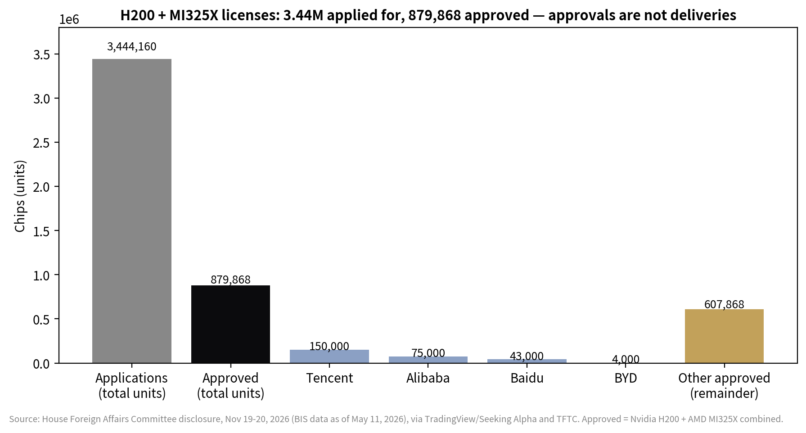
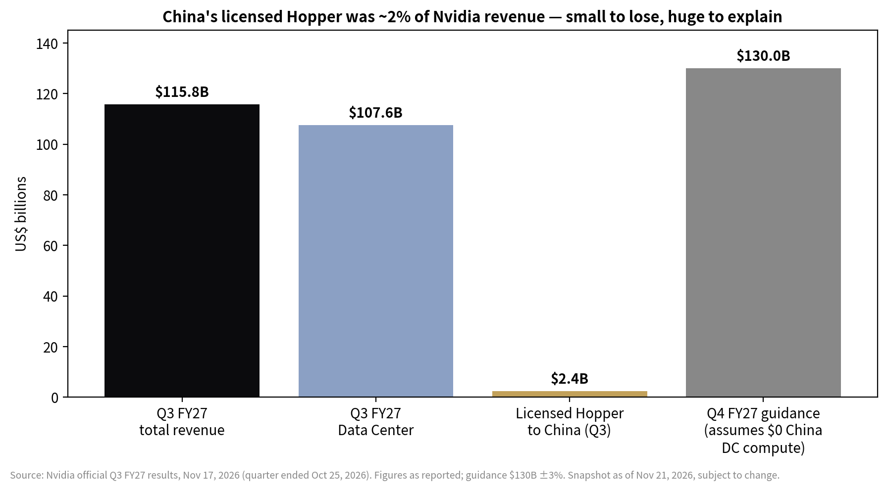

> [中文版 Chinese version](/life/nvidia-halts-h200-china-zh/)

*License applications totaled more than 3.44 million units; 879,868 were approved. Source: House Foreign Affairs Committee disclosure, November 19–20, 2026, via TradingView/Seeking Alpha and TFTC. Chart: author's own.*

The most important sentence in Nvidia's November 17, 2026 earnings call was not about the $115.8 billion quarter, the 103% growth, or the $130 billion guide. It was a single, flat statement from interim CEO and CFO Colette Kress: "We are no longer shipping licensed Hopper data center products to China."

Licensed. That word is doing all the work. Kress did not say Nvidia had lost its licenses, or that Washington had revoked them. She said the company is no longer shipping products it is licensed to ship — a category that covers the H200, the Hopper-generation accelerator that President Trump personally approved for sale to China in December 2025, that the Commerce Department wrote a formal rule for in January 2026, and that Chinese buyers ordered in enormous quantities. No reason was given on the call. No duration was offered. And two days later, a congressional disclosure made the sentence stranger still: the Bureau of Industry and Security (BIS) had approved 879,868 Nvidia H200 and AMD MI325X chips across 21 license applications.

So the United States approved the chips, at scale, by name, buyer by buyer — and the chips are not moving. That gap, between approval and delivery, is the real story of the H200 era. It is also, I will argue, the moment the current export-control regime stopped being a policy and became a coin flip with two vetoes.

## First, the quarter that makes this look small

Start with the arithmetic, because the arithmetic is why Nvidia can afford to do this — and why almost nobody else could.

Nvidia's fiscal Q3 FY27, the quarter ended October 25, 2026, produced $115.8 billion in revenue, up 103% year over year. Data Center alone was $107.6 billion, up 110%. Licensed Hopper shipments to China generated $2.4 billion of that — roughly 2% of total revenue. The Q4 guide, $130 billion plus or minus 3%, explicitly assumes no Data Center compute revenue from China at all. In other words, Nvidia guided to its largest quarter in history while writing China down to zero, and the stock's problem, to the extent it has one, is not demand.

*Licensed Hopper sales to China were $2.4 billion in Q3 FY27 — about 2% of revenue. Q4 guidance of $130 billion assumes zero China Data Center compute revenue. Source: Nvidia official Q3 FY27 release, November 17, 2026. Figures are a snapshot as of November 21, 2026, subject to change. Chart: author's own.*

Two percent is the number that explains the shrug. A company growing at 103% with a backlog it cannot fill does not need a politically radioactive 2%. Every H200 not shipped to China is an H200 — or, more precisely, wafer and HBM capacity — that can be redirected to customers who pay without generating congressional hearings. The opportunity cost of the China business had already collapsed; the reputational and regulatory cost had not. Kress's sentence is what a rational CFO says when a revenue line costs more in risk than it returns in dollars.

But notice what the 2% figure also does: it makes the halt cheap to announce and expensive to interpret. If China Hopper revenue were 20% of the total, a halt would be a crisis with a clear cause. At 2%, a halt can be almost anything — a compliance pause, a response to Beijing, a quiet negotiation, a reaction to the new cloud rules — and Nvidia has no financial incentive to clarify. Ambiguity is free when the money is small. That is precisely why outsiders should be careful: the absence of a reason is not evidence for whichever reason you prefer.

## The disclosure that changed the frame

On November 19–20, the House Foreign Affairs Committee, chaired by Brian Mast, disclosed BIS licensing data that reframes the entire year. As of May 11, 2026, BIS had approved 879,868 Nvidia H200 and AMD MI325X chips across 21 license applications. Applications in total covered more than 3.4 million units — 3,444,160, per TFTC's tally. Named approvals included Tencent at 150,000 units, Alibaba at 75,000, Baidu at 43,000, and BYD at 4,000.

Three cautions belong on top of those numbers, and any honest account has to keep them there. First, the 879,868 figure combines two companies' chips — Nvidia's H200 and AMD's MI325X — so it is not an Nvidia-only count. Second, approvals are not sales: a license is permission, not a purchase order, a shipment, or revenue. Nvidia's actual recognized China Hopper revenue for the quarter was $2.4 billion, which is real money but a fraction of what full delivery against those licenses would imply. Third, the approval data is a snapshot as of May 11, 2026; it does not tell us what was approved, amended, or allowed to lapse after that date.

Even with all three cautions, the disclosure matters, because it kills the simplest story — that Washington never really let the H200 go. It did. Nearly 880,000 high-end accelerators were approved for Chinese buyers including the three largest Chinese cloud platforms. Whatever stopped the shipments, it was not a US licensing process that said no. It said yes, in writing, hundreds of thousands of times.

That is what makes Kress's sentence so hard to read. The possibilities are not mutually exclusive, and they point in opposite directions. Beijing has been restricting H200 imports and pushing Chinese buyers toward domestic chips — a Chinese veto would mean the halt is Nvidia acknowledging a door closed from the other side. Alternatively, the November 16 BIS interim final rule closing the cloud and remote-access loophole — under which Chinese firms could rent advanced-chip capacity offshore instead of importing it — changed the compliance weather around every China-adjacent shipment, and a cautious shipper might pause while its lawyers redraw the map. Or the halt is leverage: a public, unexplained stoppage is a way to be heard in two capitals at once without saying anything either capital can quote back. Nvidia has offered nothing to discriminate among these, and this article will not pretend otherwise.

## Two vetoes, one license

Step back, and the structural point is bigger than one quarter. The H200 regime, as built across 2025 and 2026, required every shipment to survive two sovereign vetoes and one commercial one.

The American veto was exercised in layers. Trump approved H200 sales in December 2025; the Commerce rule of January 13, 2026 formalized them with a 25% fee collected via routing through the United States — an arrangement that treated an export license partly as a revenue instrument. BIS then approved specific licenses at scale, as the committee disclosure shows. And in November, BIS moved again, this time against the workaround: the November 16 interim final rule closed the remote-access loophole, giving existing arrangements 90 days to apply and requiring licenses for relevant shipments to a list of countries including Singapore, Malaysia, Indonesia, Thailand, and Brazil, per reporting by Memeburn and TFTC. Treasury Secretary Scott Bessent, on CNBC, then declared further restrictions on older chips "no longer necessary," saying "proper chip restrictions are in place." Read those two November moves together and the administration's position is coherent on its own terms: physical H200 sales to approved Chinese buyers, yes; unrestricted Chinese access to advanced compute by remote rental, no; more bans on older silicon, unnecessary.

The Chinese veto was quieter but just as real. Beijing restricted H200 imports and steered its champions toward domestic accelerators. From Beijing's perspective, every imported H200 is both a capability and a dependency, and 2026 policy has consistently preferred a weaker chip it controls over a stronger one Washington can switch off. The reports — and they are reports, not confirmed figures — of roughly 600,000 H200s held in Hong Kong awaiting approval, carried by TweakTown, fit that picture: hardware that cleared the American process sitting in a warehouse, stopped by the second veto. Treat the 600,000 number as unverified; treat the direction as consistent with everything Beijing has said and done.

The commercial veto is Nvidia's own, and Kress just exercised it, or acknowledged someone else's. Either way, the lesson for every buyer, seller, and policymaker watching is the same: a BIS license in 2026 is a necessary condition for a shipment, not a sufficient one. It can be overridden by the buyer's government, by the seller's risk committee, or by the next interim final rule. Export-control credibility used to rest on the idea that the rules, however strict, were legible — you could read them, apply, and plan. A regime in which 879,868 approvals and a shipping halt coexist is many things, but legible is not one of them.

## The demand did not disappear — it rerouted

If the licenses did not produce deliveries, where did the demand go? Two bodies of evidence, both requiring care, sketch the answer.

Reuters' November 13 investigation, as summarized by TFTC, found more than 150 Chinese procurement notices covering roughly $3.2 billion in projects designed around restricted H100, H200, and H800 hardware. That does not prove illegal Nvidia sales — procurement documents describe what buyers want to build, not where every chip came from, and a notice is not a delivery. What it does prove is intent at scale: Chinese institutions are still specifying Nvidia's restricted silicon in formal purchasing documents, years into the controls. The demand is not theoretical and it has not been designed away.

The other route was legal until this month: remote access. If you cannot import the chip, rent the compute. The November 16 rule exists because that route worked. Jefferies, in an estimate carried by Zacks and Yahoo Finance, put the potential cost of the remote-access restrictions at $44–62 billion in next-year Data Center revenue — an analyst estimate, not a forecast from Nvidia, and one that sits awkwardly next to a $130 billion quarterly guide that assumes zero China compute revenue anyway. The honest reading is that Jefferies is pricing the global ripple — restricted offshore capacity affects more buyers than China alone — not a China line item Nvidia ever booked. Either way, the direction is clear: each closed channel raises the value of the remaining ones, and the remaining ones are increasingly gray.

## The AMD footnote that is not a footnote

Almost lost in the disclosure is that AMD is in it. The 879,868 approvals include MI325X chips alongside H200s, which means the licensing wave was an industry event, not an Nvidia favor. That matters for two reasons. First, it undercuts any narrative that the approvals were a bespoke arrangement for one company — BIS was running a policy, not a deal. Second, it means the halt's logic, whatever it is, now has to be asked of AMD too: if licensed Hopper shipments have stopped, what is the status of licensed MI325X shipments? As of November 21, 2026, there is no equivalent on-the-record statement from AMD in the sources behind this article. That is an open question, not an answer — and it is the first thing to watch.

Nvidia, for its part, has institutionalized the pressure: its board has formed a National Security & Export Control Oversight Committee. Companies do not create board-level committees for topics they expect to fade. Whatever the H200 halt turns out to be — pause, pivot, or permanent — Nvidia is organizing itself for a world in which export control is a standing board agenda item, not a quarterly surprise. Blackwell and Rubin, it should be remembered, remain banned for China outright; the H200 fight has always been about the tier Washington decided was safe to sell. That tier is now licensed, approved, and not shipping.

## Judgment

Here is my read, stated plainly. The H200 halt is financially trivial for Nvidia and strategically enormous for everyone else. For Nvidia: 2% of revenue, a guide that already assumes zero, and a capacity-constrained order book that absorbs every redirected chip. For Chinese buyers: proof that even a granted US license, at 150,000-unit scale for Tencent, is not supply security — which is the strongest argument Beijing's domestic-chip policy could ever receive, delivered by events rather than propaganda. For Washington: a credibility problem of its own making. A control regime earns compliance when its yes means yes and its no means no. Right now, its yes means "perhaps, pending a second government and the seller's appetite" — and every actor in the system, from Alibaba's procurement team to AMD's board, is repricing what an approval is worth accordingly.

The likeliest near-term outcome is not a dramatic reversal but a slow sorting: some licensed volume eventually moving under tighter conditions, remote-access capacity shrinking under the November 16 rule, and Chinese demand splitting between domestic chips for what they can do and gray channels for what they cannot. Bessent's "no longer necessary" line and Kress's "no longer shipping" line can both be true at once — that is exactly the problem. The restrictions in place may be the ones Washington wants. The shipments stopped anyway.

What to watch next: any Nvidia language change on the Q4 call about duration; an AMD statement on MI325X shipments; whether the Hong Kong inventory reports are ever confirmed by a named party; and whether BIS publishes anything that reconciles 879,868 approvals with a halted pipeline. Until one of those lands, the accurate headline is not that America banned the H200, or that China rejected it. It is that both governments built a machine in which the chip was approved by everyone and delivered by no one — and the machine is working exactly as built.

*Revenue and guidance figures are Nvidia's reported Q3 FY27 results and Q4 FY27 outlook, a snapshot as of November 21, 2026, subject to change. License figures are from the House Foreign Affairs Committee disclosure of November 19–20, 2026. The Hong Kong inventory figure is an unconfirmed report (TweakTown). The Jefferies revenue figure is an analyst estimate (via Zacks/Yahoo Finance). This article is an external perspective based on public reporting; see SOURCES.md in the staging folder for the full source list.*
