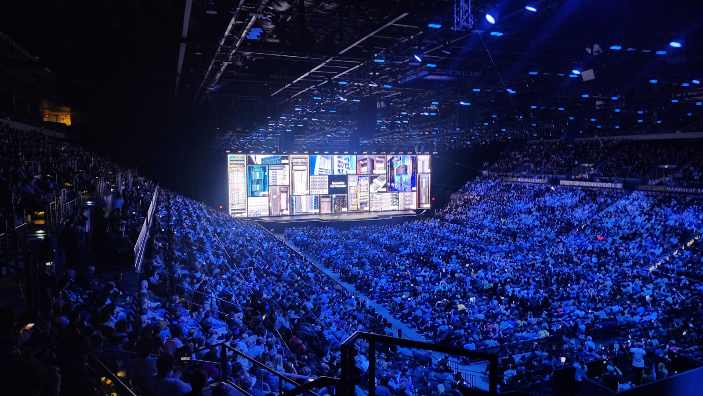
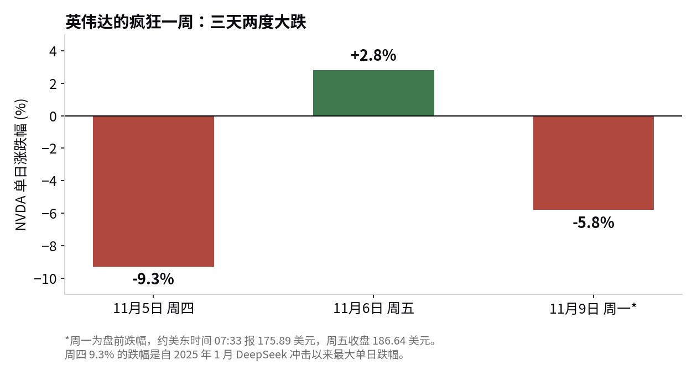

> [English version](/life/nvidia-huang-board-investigation/)

*黄仁勋在英伟达 CES 2025 主题演讲上。图片：Joseph Zadeh，CC BY-SA 4.0，来自 Wikimedia Commons。*

## 周日发生了什么

11 月 8 日周日，英伟达董事会发布了一份简短声明：鉴于"有报道称创始人兼 CEO 黄仁勋成为外国情报行动的目标"，董事会"正在启动一项独立调查"。调查将由独立董事组成的委员会负责，并有外部独立律师协助。董事会同时表示，"没有理由相信美国国家安全或英伟达的机密遭到泄露"，黄仁勋"完全支持这次审查并承诺配合"，董事会"对黄仁勋及其领导团队有信心"。

同一天，黄仁勋向全体员工发送备忘录，承认自己对妻子不忠并"承担全部责任"——据 CNBC 报道，该媒体公布了邮件全文。公司表示，黄仁勋将继续担任 CEO，不会中断履职。

两份文件、同一天，传递的却是一个分裂的信息：董事会一方面为 CEO 背书、称未发现任何不当行为，另一方面又就他是否成为间谍行动目标启动正式调查。这种矛盾本身就是新闻。

## 三十三年，一位 CEO

要理解市场为什么这样反应，先看组织架构。黄仁勋于 1993 年 4 月与电气工程师 Curtis Priem、Chris Malachowsky 在北加州一家 Denny's 餐厅里勾画出创办英伟达的计划；公司从游戏显卡芯片起步，1999 年上市。33 年来，黄仁勋是公司唯一的 CEO——这个职位从来没有换过人——而他正是围绕自己搭建了这家公司：著名的扁平化结构，约 60 名直接下属；公开场合从不谈接班计划；公司自己的年报则用直白的语言提示了风险，称公司"高度依赖长期管理团队的服务"，且"未能确保有效的接班规划"可能损害长期前景。

这种结构也是英伟达优势的来源。CUDA 软件平台是黄仁勋在 AI 成为主流之前多年就力推的，它把快速芯片变成了一个竞争对手至今无法复制的生态系统。而黄仁勋本人就是公司的分销策略：他亲自与超大规模客户谈判、向各国政府推销 AI 基础设施、向投资者论证世界需要更多的算力。他与客户、供应商和各国政府之间的私人关系不是这份工作的附带好处——按英伟达自己的组织方式，这就是工作本身。

还有一个结构性事实很重要：与硅谷其他创始人巨头不同，英伟达没有双层股权结构，黄仁勋只持有公司约 3% 的股份。他靠业绩与个人威望掌控公司，而不是靠选票——这意味着董事会如果决定采取行动，是可以行动的；同时也意味着，他的权威一旦受到质疑，没有任何法律后盾。

## 哪些是指控，哪些尚未证实

调查背后的报道来自《纽约时报》。该报 10 月报道称，美国情报机构认定，中国籍商人黄某（Alice Huang，又名 Huang Le，新加坡公司 Megaspeed 前高管）被中国情报机构招募；她与黄仁勋关系密切；一份 2025 年春季的高度机密备忘录曾警告决策者，她的任务是了解更多美国 AI 芯片的情况，并可能推动英伟达让最先进的芯片在中国制造。两位黄姓人士并无亲属关系。

商业线索是可以核查的，而且规模不小：一家与 Megaspeed 关联的马来西亚公司在 2024 年 6 月至 2026 年 2 月期间购买了至少 48 亿美元的 AI 硬件，其中包括英伟达芯片——平均每月约 2.4 亿美元。美国当局一直在审查 Megaspeed，怀疑其帮助北京获取被禁运的先进 AI 芯片。

尚未证实的部分：NBC 新闻表示尚未独立核实《纽约时报》的报道，中国方面也在周一批驳了这些指控。间谍指控目前仍是来自一份未公开情报备忘录的说法，而非结论。董事会声明的措辞同样谨慎——它说的是黄仁勋是情报行动的"目标"，而非参与者，并称没有理由相信机密遭到泄露。这个区分很关键，而调查存在的意义正是验证它。

国会也已进入倒计时。11 月 4 日，三位众议院委员会主席——外交事务委员会的 Brian Mast、对华特别委员会的 John Moolenaar、情报委员会的 Rick Crawford——联名致信黄仁勋，要求他在 11 月 18 日参加闭门简报，并于 11 月 11 日前回复是否出席。

## 董事会声明的两面性

董事会的声明同时在做两件事，两半都值得细读。前半句——"没有理由相信"机密泄露、"对黄仁勋有信心"——是在调查开始之前就给出了结论；后半句——独立董事委员会、外部律师——是得出结论的机器。同一口气里既宣布结论又宣布启动调查，正是治理专家最难自洽的地方。

但形式本身是标准的：由独立董事、配备自己的外部律师来主导调查，是董事会在这类危机中能采取的最常规的步骤。不常规的是调查对象。科罗拉多大学的公司治理教授 Ann Lipton 与芝加哥大学的 Todd Henderson 指出，CEO 卷入疑似"美人计"行动、同时又牵涉国家安全，在历史上没有真正的先例——有过婚外情案、性骚扰案，但没有同时涉及情报泄露可能的案子。Lipton 认为调查有三条主线：有没有违法、黄仁勋有没有违反公司内部政策、董事会是否被误导——包括他到底有多坦白、以及他什么时候知情的。

董事会的另外两个特点也值得盯住。第一，英伟达 10 人董事会一向以忠诚与顺从黄仁勋著称，而这恰恰让委员会的独立性成为最值得观察的东西：正如 Lipton 所说，一项调查"有多彻底"，完全取决于主持调查的董事想让它有多彻底。第二，董事会在声明里没有公布委员会成员名单、没有公布外部律师人选、也没有设定时间表。检验标准不是声明，而是调查最终能否拿出董事会在第一天没说过的新东西。

股东诉讼是另一只靴子。一项拟议中的集体诉讼指控英伟达与黄仁勋在把与 Megaspeed 的往来描述为例行公事的同时，隐瞒了这段关系，涉嫌误导投资者。而根据特拉华州法律（英伟达注册地）提出的经营失当索赔要难得多：代表公司起诉的股东必须先证明董事会自己处理不了这个问题，而一场由独立董事主导的调查让这一点很难成立——麦当劳案就是律师们会援引的先例，当时法院认为没有理由相信董事会不能自己处理不当行为。

## 市场的回答

投资者没有等调查结果。英伟达上周五（11 月 6 日）收于 186.64 美元，周一隔夜及盘前交易中跌至约 175.89 美元——跌幅约 6%，隔夜报价区间约为 178.81 至 180.30 美元，盘中低点接近 174.49 美元。据 Invezz 报道，该股已较 10 月高点下跌约 25%，此前一周极为动荡：周四单日下跌 9.3%，创下自 2025 年 1 月 DeepSeek 冲击以来最差单日表现，周五反弹 2.8%。

*本节价格为 2026 年 11 月 9 日周一上午的快照，价格随时可能变化。*

*三天两度大跌，周一为盘前跌幅。图表：本站根据下文引用的价格制作。*

这次抛售不是对指控本身的裁决，而是对不确定性的定价。英伟达市值约 4.5 万亿美元，其溢价建立在两样难以分割的东西上：全球最好的 AI 芯片，以及一位 CEO 本人与客户、供应商和各国政府之间的私人关系——后者本身就是分销策略的一部分。治理调查改变不了芯片，但会改变后者，而市场没有模型可以衡量它，于是先打折。

值得注意的是，分析师尚未恐慌。伯恩斯坦（Bernstein）在 11 月 9 日维持"跑赢大盘"评级与 400 美元目标价，分析师平均目标价约为 327 美元，较上周五收盘高出约 75%。华尔街目前的态度是：业务没出问题之前，先当作噪音处理。但这种判断有个限度：英伟达约占标普 500 指数权重的 7%，所以对英伟达的治理折价不是个股故事——它是对整个指数的折价，每个指数投资者都持有它的一份。

## 出口管制的背景

指控之所以关于芯片与中国，而不只是关于婚外情，是有原因的。美国四年来一直在收紧对华先进 AI 芯片的出口管制，而英伟达正处在这项政策的中心：其最先进的 GPU 被禁止运往中国，什么能卖、卖给谁、通过哪些中间商，都是正在执行的执法问题。《纽约时报》报道核心的那份 2025 年春季备忘录，据称警告 Alice Huang 的任务是了解美国 AI 芯片的情况，并可能推动英伟达让最先进的芯片在中国制造——换句话说，是要推动政策，而不只是搬运硬件。

这正是 Megaspeed 商业线索之所以关键的原因。如果一家关联公司在 20 个月里买了 48 亿美元的 AI 硬件，问题不在于采购是否发生——发票是可以核查的——而在于这些硬件的用途，以及其中有没有流向管制本想拦住的买家。黄仁勋本人则是业内最公开主张对华多卖、而不是少卖的人，理由是限制销售只会把市场拱手让给中国本土竞争对手。这是一个正当的政策立场，同时也是在当前氛围里最容易被怀疑"私人关系影响了立场"的那一个。调查最难的工作，就是把这两件事分开：一位 CEO 公开的商业战略，与一位 CEO 的私人生活。

## 决定走向的三个日期

- **11 月 11 日：**黄仁勋须回复三位众议院主席，确认是否出席 11 月 18 日的简报。
- **11 月 17 日：**英伟达公布 2027 财年第三季度财报——指引收入 1080 亿美元，上下浮动 2%，电话会于太平洋时间下午 2 点举行。作为参照，第二季度收入为 962 亿美元，同比增长 106%，其中数据中心收入增长 117% 至 890 亿美元。
- **11 月 18 日：**拟议中的国会闭门简报，就在财报公布次日。

调查本身没有公布时间表，董事会也没有公布委员会成员名单和外部律师人选。检验标准不是声明，而是调查最终能否拿出董事会在第一天没说过的新东西。

## 关键人物风险：华尔街早就知道

"关键人物风险"（key-man risk）不是这件事发明的新词，而是华尔街的老概念：当一家公司的价值过度依赖某一个人，投资者就要为这个人的健康、声誉与去留单独定价。苹果经历过乔布斯时代，特斯拉至今仍被按马斯克的去留定价，伯克希尔的股东每年都要问巴菲特的接班问题。英伟达的情况比这些例子更极端：乔布斯离开后苹果有库克，特斯拉有完整的运营团队，而英伟达 33 年来只有一个 CEO、没有公开的接班计划、没有董事会主席制衡他——连年报自己都承认了这种依赖。

关键人物风险的定价方式也很特别：它平时几乎不体现在股价里，因为市场默认这个人不会出事；一旦出事，它会一次性体现在股价里，而且没有人知道该打几折。周一盘前 6% 的跌幅，就是市场在没有模型的情况下给出的第一口价。分析师的目标价——伯恩斯坦 400 美元、平均约 327 美元——之所以还能维持，是因为它们定价的是芯片业务，而芯片业务没有变；但股价里有一部分从来就不是芯片业务，而是"黄仁勋在"这件事本身。这次调查第一次把这两部分分开了。

还有一个细节值得注意：关键人物风险与公司规模是相乘关系，而不是相加关系。英伟达约占标普 500 指数权重的 7%，意味着任何一个持有指数基金的美国投资者，都间接持有这份风险。个人投资者可能没有意识到，自己退休账户里的一小部分，正押在一位 63 岁 CEO 的个人生活不出问题上。这不是危言耸听，而是这次事件把平时看不见的结构摆到了台面上。

## 国会简报会问什么

11 月 18 日的闭门简报值得单独讲一讲，因为它与调查问的是不同的问题。董事会的调查问的是"有没有东西泄露"；国会的简报问的是"美国的芯片管制有没有被绕过"。三位众议院委员会主席——外交事务、对华特别委员会、情报委员会——联名发信，本身就是一个信号：这件事同时涉及外交、产业竞争与情报三个维度，不是任何一个委员会单独能覆盖的。

闭门简报与公开听证会的区别也很重要。闭门意味着黄仁勋可以谈论涉密信息而不必担心公开泄露，委员会也可以问得更直接：他什么时候认识 Alice Huang 的、知不知道她的背景、有没有向她透露过英伟达的产品路线图、Megaspeed 的 48 亿美元采购英伟达是否知情、以及英伟达对中间商的合规审查到底做到哪一步。闭门也意味着公众看不到过程，只能看到结果——委员会事后可以选择公开一份声明，也可以选择什么都不说。对市场来说，最坏的结果不是简报本身，而是简报之后出现新的披露、新的调查、或者新的立法动议。11 月 18 日这一天之所以关键，不是因为它会给出答案，而是因为它可能提出新的问题。

## 如果调查拖下去，会发生什么

调查本身没有时间表，这一点比调查本身更值得盯住。三种节奏对应三种结局。第一种，快速收尾：委员会在几周内完成审查，结论是"未发现机密泄露"，董事会重申对黄仁勋的信心，股价收复失地——市场会把这当作一次性的治理噪音，就像伯恩斯坦目前定价的那样。第二种，拖进财报季：调查延续到 11 月 17 日财报电话会之后，分析师在电话会上追问进展，管理层只能以"调查进行中"回应，每一次"无可奉告"都会重新点燃不确定性。第三种，出现新披露：简报会上、国会调查中或者诉讼取证里，出现董事会第一天声明里没有的东西——那时"没有理由相信"这句话本身就会成为问题。

客户与供应商的反应是另一个风向标。超大规模客户采购英伟达芯片，买的不只是硬件，还有路线图的确定性：如果 CEO 的去留成为悬念，客户在签长期采购协议时会要求更多的保障条款，或者把一部分订单分给 AMD、谷歌 TPU 等备选方案——不是因为芯片变了，而是因为不确定性本身就是成本。供应商也一样：台积电的产能分配、SK 海力士的 HBM 供应，这些合作都建立在黄仁勋个人谈判的基础上。调查拖得越久，这些关系里的"人"的部分就越会被重新定价。而这正是市场在周一早上 6% 跌幅里已经开始计价的东西。

## 董事会声明的措辞课

这份只有几句话的声明，值得逐词读一遍，因为每一个词都是律师过目的。第一，"target of a foreign intelligence effort"——"目标"，而不是"参与者"。这个词把黄仁勋放在被动位置：他是被针对的人，不是配合的人。第二，"has no reason to believe"——"没有理由相信"，而不是"没有证据表明"。前者是关于董事会当前认知状态的陈述，后者是关于事实的陈述；前者留了余地，后者没有。第三，"fully supports the review and has committed to cooperating"——"完全支持并承诺配合"，这句话的潜台词是：CEO 没有阻挠调查，调查不需要强制手段。第四，"has confidence in Jensen and his leadership team"——"对黄仁勋及其领导团队有信心"，注意是"及其领导团队"，不是只对他一个人。

把这四句话放在一起，声明的真实含义是：董事会在没有发现问题的情况下启动调查，同时提前为两种结局都留了后路。如果调查结论是清白，声明里的"有信心"就是先见之明；如果调查发现问题，声明里的"没有理由相信"可以解释为"当时没有理由"，而不是"我们保证没有"。这不是批评董事会——任何董事会在这种情况下都会这样写。值得注意的只是：这份声明不是结论，而是一份措辞精密的占位符，真正的结论还在后面。

## 判断

剥离这个故事的小报色彩，治理层面的问题其实很窄：全球市值最高公司的 CEO 是否成为外国情报行动的目标，有没有东西泄露？董事会说没有理由相信泄露了。市场说：证明它，在此之前先为怀疑付费。

这件事与普通 CEO 丑闻的不同之处在于"关键人物"的算术。英伟达的护城河不只是硅片——还在于黄仁勋能同时把所有超大规模客户、主权买家和供应商留在英伟达的帐篷里。一项以"未发现泄露"收尾的调查不会动摇这一点；一项拖进财报季的调查，或者一场简报会上出现的新披露，则会。未来十天会告诉我们是哪一种。在此之前，诚实的立场恰恰是董事会自己无意中采取的那个：有信心，外加一项调查。

更深层的教训是结构性的，无论调查结果如何，它都会比这轮新闻周期活得更久。一家 4.5 万亿美元的公司围绕一个人搭建，没有具名的接班人、没有 60 人扁平汇报结构之外的制衡，集中了一种任何治理框架都没设计好如何定价的风险：不是 CEO 失败的风险，而是 CEO 本人成为新闻的风险。调查会回答有没有东西泄露，但它不会回答一家这么大的公司应不应该如此依赖一个人——而市场既然已经被迫问了这个问题，就不太可能忘记它曾经被问过。

最后值得把视线拉远一点：这件事的真正遗产可能不是调查结论，而是它第一次让市场给创始人依赖明码标价。过去三十年，科技行业默认创始人就是公司，公司就是创始人——乔布斯之于苹果，马斯克之于特斯拉，黄仁勋之于英伟达。英伟达的案例把这种默认推到了极致：一家 4.5 万亿美元的公司、一个 33 年唯一的 CEO、约 60 人的扁平汇报结构、年报里白纸黑字的接班风险提示。市场在周一早上给出的 6%，就是这份依赖第一次被定价的数字。无论调查结果如何，这个数字已经被看见，就很难再被忘记。
*来源：英伟达董事会声明，2026 年 11 月 8 日（nvidianews.nvidia.com）；CNBC，2026 年 11 月 8 日（黄仁勋员工备忘录、董事会声明、众议院信函）；《纽约时报》2026 年 10 月报道，经 NBC 新闻 / BusinessWorld / Dexerto 转述（Alice Huang 相关报道；NBC 注明尚未独立核实）；路透社经 BusinessWorld，2026 年 11 月 9 日；Invezz 与 InvestingLive，2026 年 11 月 9 日（盘前价格、上周五收盘 186.64 美元、较 10 月高点下跌约 25%）；OrbitLens，2026 年 11 月 9 日（盘前低点 175.89 美元、周四 −9.3%、周五 +2.8%）；BeInSure，2026 年 11 月 9 日（伯恩斯坦 400 美元目标价、平均目标价 327.14 美元、第二季度收入数据）；英伟达新闻稿，2026 年 10 月 28 日（第三季度财报日期、1080 亿美元指引）。扩写部分新增来源：CNN / MarketWatch，2026 年 11 月（1993 年 4 月在 Denny's 与 Curtis Priem、Chris Malachowsky 创办、1999 年上市、33 年唯一 CEO、约 60 名直接下属、无公开接班计划、持股约 3%、无双层股权结构）；Motley Fool，2026 年 11 月 10 日（年报关于依赖管理团队与接班规划的警告、约占标普 500 指数 7%）；TechCrunch，2026 年 11 月（Ann Lipton 与 Todd Henderson 两位教授关于"美人计加国家安全"无先例的判断、三条调查主线、麦当劳案先例、拟议中的证券集体诉讼、10 人董事会一向顺从黄仁勋）。*
