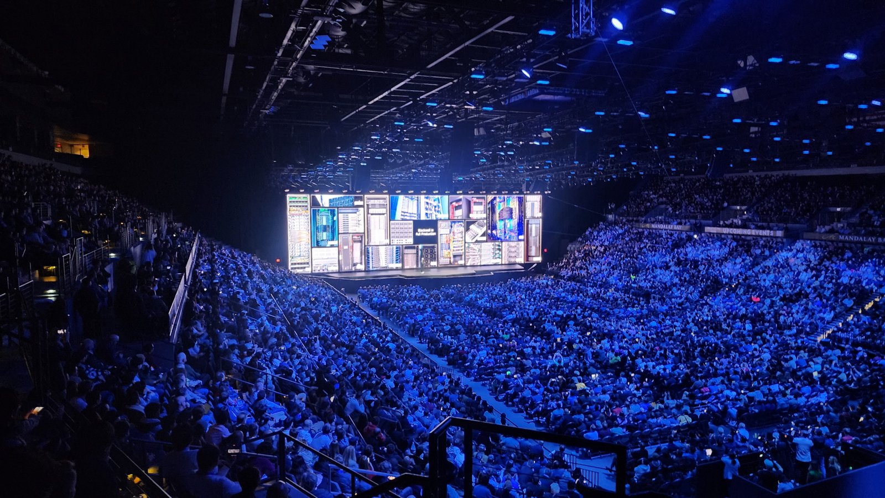
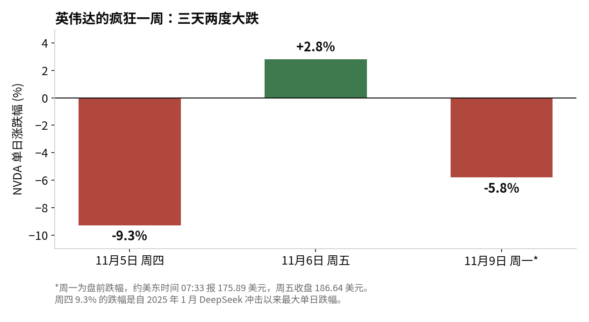

> [English version](/life/nvidia-huang-board-investigation/)

*黄仁勋在英伟达 CES 2025 主题演讲上。图片：Joseph Zadeh，CC BY-SA 4.0，来自 Wikimedia Commons。*

## 周日发生了什么

11 月 8 日周日，英伟达董事会发布了一份简短声明：鉴于"有报道称创始人兼 CEO 黄仁勋成为外国情报行动的目标"，董事会"正在启动一项独立调查"。调查将由独立董事组成的委员会负责，并有外部独立律师协助。董事会同时表示，"没有理由相信美国国家安全或英伟达的机密遭到泄露"，黄仁勋"完全支持这次审查并承诺配合"，董事会"对黄仁勋及其领导团队有信心"。

同一天，黄仁勋向全体员工发送备忘录，承认自己对妻子不忠并"承担全部责任"——据 CNBC 报道，该媒体公布了邮件全文。公司表示，黄仁勋将继续担任 CEO，不会中断履职。

两份文件、同一天，传递的却是一个分裂的信息：董事会一方面为 CEO 背书、称未发现任何不当行为，另一方面又就他是否成为间谍行动目标启动正式调查。这种矛盾本身就是新闻。

## 哪些是指控，哪些尚未证实

调查背后的报道来自《纽约时报》。该报 10 月报道称，美国情报机构认定，中国籍商人黄某（Alice Huang，又名 Huang Le，新加坡公司 Megaspeed 前高管）被中国情报机构招募；她与黄仁勋关系密切；一份 2025 年春季的高度机密备忘录曾警告决策者，她的任务是了解更多美国 AI 芯片的情况，并可能推动英伟达让最先进的芯片在中国制造。两位黄姓人士并无亲属关系。

商业线索是可以核查的，而且规模不小：一家与 Megaspeed 关联的马来西亚公司在 2024 年 6 月至 2026 年 2 月期间购买了至少 48 亿美元的 AI 硬件，其中包括英伟达芯片——平均每月约 2.4 亿美元。美国当局一直在审查 Megaspeed，怀疑其帮助北京获取被禁运的先进 AI 芯片。

尚未证实的部分：NBC 新闻表示尚未独立核实《纽约时报》的报道，中国方面也在周一批驳了这些指控。间谍指控目前仍是来自一份未公开情报备忘录的说法，而非结论。董事会声明的措辞同样谨慎——它说的是黄仁勋是情报行动的"目标"，而非参与者，并称没有理由相信机密遭到泄露。这个区分很关键，而调查存在的意义正是验证它。

国会也已进入倒计时。11 月 4 日，三位众议院委员会主席——外交事务委员会的 Brian Mast、对华特别委员会的 John Moolenaar、情报委员会的 Rick Crawford——联名致信黄仁勋，要求他在 11 月 18 日参加闭门简报，并于 11 月 11 日前回复是否出席。

## 市场的回答

投资者没有等调查结果。英伟达上周五（11 月 6 日）收于 186.64 美元，周一隔夜及盘前交易中跌至约 175.89 美元——跌幅约 6%，隔夜报价区间约为 178.81 至 180.30 美元，盘中低点接近 174.49 美元。据 Invezz 报道，该股已较 10 月高点下跌约 25%，此前一周极为动荡：周四单日下跌 9.3%，创下自 2025 年 1 月 DeepSeek 冲击以来最差单日表现，周五反弹 2.8%。

*本节价格为 2026 年 11 月 9 日周一上午的快照，价格随时可能变化。*

*三天两度大跌，周一为盘前跌幅。图表：本站根据下文引用的价格制作。*

这次抛售不是对指控本身的裁决，而是对不确定性的定价。英伟达市值约 4.5 万亿美元，其溢价建立在两样难以分割的东西上：全球最好的 AI 芯片，以及一位 CEO 本人与客户、供应商和各国政府之间的私人关系——后者本身就是分销策略的一部分。治理调查改变不了芯片，但会改变后者，而市场没有模型可以衡量它，于是先打折。

值得注意的是，分析师尚未恐慌。伯恩斯坦（Bernstein）在 11 月 9 日维持"跑赢大盘"评级与 400 美元目标价，分析师平均目标价约为 327 美元，较上周五收盘高出约 75%。华尔街目前的态度是：业务没出问题之前，先当作噪音处理。

## 决定走向的三个日期

- **11 月 11 日：**黄仁勋须回复三位众议院主席，确认是否出席 11 月 18 日的简报。
- **11 月 17 日：**英伟达公布 2027 财年第三季度财报——指引收入 1080 亿美元，上下浮动 2%，电话会于太平洋时间下午 2 点举行。作为参照，第二季度收入为 962 亿美元，同比增长 106%，其中数据中心收入增长 117% 至 890 亿美元。
- **11 月 18 日：**拟议中的国会闭门简报，就在财报公布次日。

调查本身没有公布时间表，董事会也没有公布委员会成员名单和外部律师人选。这是值得盯住的部分：一项在宣布启动的同时就宣布结论（"对黄仁勋有信心"）的调查，其独立性能有多大，本身就是个问题。检验标准不是声明，而是调查最终能否拿出董事会在第一天没说过的新东西。

## 判断

剥离这个故事的小报色彩，治理层面的问题其实很窄：全球市值最高公司的 CEO 是否成为外国情报行动的目标，有没有东西泄露？董事会说没有理由相信泄露了。市场说：证明它，在此之前先为怀疑付费。

这件事与普通 CEO 丑闻的不同之处在于"关键人物"的算术。英伟达的护城河不只是硅片——还在于黄仁勋能同时把所有超大规模客户、主权买家和供应商留在英伟达的帐篷里。一项以"未发现泄露"收尾的调查不会动摇这一点；一项拖进财报季的调查，或者一场简报会上出现的新披露，则会。未来十天会告诉我们是哪一种。在此之前，诚实的立场恰恰是董事会自己无意中采取的那个：有信心，外加一项调查。

*来源：英伟达董事会声明，2026 年 11 月 8 日（nvidianews.nvidia.com）；CNBC，2026 年 11 月 8 日（黄仁勋员工备忘录、董事会声明、众议院信函）；《纽约时报》2026 年 10 月报道，经 NBC 新闻 / BusinessWorld / Dexerto 转述（Alice Huang 相关报道；NBC 注明尚未独立核实）；路透社经 BusinessWorld，2026 年 11 月 9 日；Invezz 与 InvestingLive，2026 年 11 月 9 日（盘前价格、上周五收盘 186.64 美元、较 10 月高点下跌约 25%）；OrbitLens，2026 年 11 月 9 日（盘前低点 175.89 美元、周四 −9.3%、周五 +2.8%）；BeInSure，2026 年 11 月 9 日（伯恩斯坦 400 美元目标价、平均目标价 327.14 美元、第二季度收入数据）；英伟达新闻稿，2026 年 10 月 28 日（第三季度财报日期、1080 亿美元指引）。*
