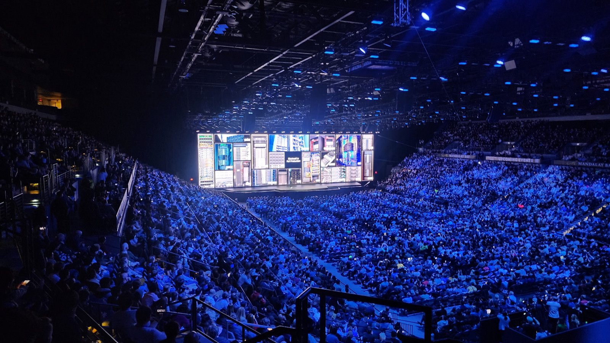
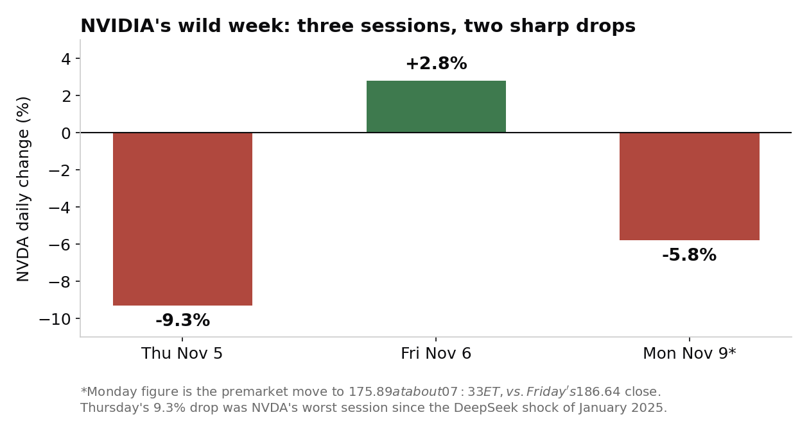

> [中文版 Chinese version](/life/nvidia-huang-board-investigation-zh/)

*Jensen Huang at NVIDIA's CES 2025 keynote. Photo: Joseph Zadeh, CC BY-SA 4.0, via Wikimedia Commons.*

## What happened on Sunday

On Sunday, November 8, NVIDIA's board of directors issued a short statement: it is "initiating an independent investigation in light of recent reporting that founder and CEO Jensen Huang has been the target of a foreign intelligence effort." A committee of independent directors, assisted by outside independent counsel, will run it. The board added that it "has no reason to believe that either national security or NVIDIA secrets were compromised," that Huang "fully supports the review and has committed to cooperating with it," and that it "has confidence in Jensen and his leadership team."

The same day, Huang sent a memo to employees in which he said he had been unfaithful to his wife and took "full responsibility" for his actions, according to CNBC, which published the full email. The company said Huang will continue to lead NVIDIA as CEO without interruption.

Two documents, one day, and a split-screen message: the board is simultaneously clearing its CEO of any known wrongdoing and opening a formal inquiry into whether he was the target of an espionage operation. That contradiction is the story.

## What is alleged — and what is not yet proven

The reporting behind the investigation comes from The New York Times, which reported in October that U.S. intelligence agencies had concluded that Alice Huang (also known as Huang Le), a Chinese businesswoman and former executive of Singapore-based Megaspeed, was recruited by Chinese intelligence. The Times reported that she had a close relationship with Jensen Huang, and that a highly classified spring 2025 memo warned policymakers she had been tasked with learning more about U.S.-made AI chips and possibly influencing NVIDIA to push for the most advanced chips to be made in China. The two Huangs are not related.

The commercial thread is checkable, and it is large: a Megaspeed-linked company in Malaysia bought at least $4.8 billion in AI hardware including NVIDIA chips between June 2024 and February 2026 — about $240 million a month. U.S. authorities have scrutinized Megaspeed over suspicions it helped Beijing gain access to advanced AI chips barred from shipment to China.

What has *not* been established: NBC News has said it has not independently confirmed the Times' reporting, and China rejected the allegations on Monday. The espionage claims remain allegations from an unpublished intelligence memo, not findings. The board's own statement is carefully worded in the same direction — it speaks of Huang being the *target* of an intelligence effort, not a participant in one, and says it has no reason to believe secrets were compromised. The distinction matters, and it is the one the investigation exists to test.

Congress is now on the clock too. On November 4, three House committee chairs — Brian Mast (Foreign Affairs), John Moolenaar (Select Committee on China) and Rick Crawford (Intelligence) — wrote to Huang requesting a closed-door briefing on November 18, and asked him to respond by November 11.

## The market's answer

Investors did not wait for the investigation. NVIDIA closed Friday, November 6, at $186.64. In overnight and premarket trading on Monday it fell to about $175.89 — down roughly 6% — with overnight quotes ranging from about $178.81 to $180.30, and an intraday low near $174.49 reported later in the session. The stock was already down about 25% from its October high, per Invezz, after a brutal week: a 9.3% drop on Thursday — its worst single session since the DeepSeek shock of January 2025 — followed by a 2.8% rebound on Friday.

*Prices in this section are a snapshot of Monday morning, November 9, 2026, and are subject to change.*

*Three sessions, two sharp drops. The Monday figure is the premarket move. Chart: this site, from the prices cited below.*

The sell-off is not a verdict on the allegations — it is a price on uncertainty. NVIDIA is worth about $4.5 trillion, and its premium rests on two things that are hard to separate: the best AI chips in the world, and a CEO whose personal relationships with customers, suppliers and governments are part of the distribution strategy. A governance probe does not change the chips. It changes the second thing, and the market has no model for that, so it discounts it.

Notably, the analysts are not panicking yet. Bernstein maintained its Outperform rating and $400 price target on November 9, and the average analyst target stands at about $327 — roughly 75% above Friday's close. The Street is treating this as noise until the business says otherwise.

## The three dates that decide it

- **November 11:** Huang must tell the three House chairs whether he will attend the November 18 briefing.
- **November 17:** NVIDIA reports third-quarter fiscal 2027 results — guided revenue of $108.0 billion, plus or minus 2% — with the call at 2 p.m. PT. For context, second-quarter revenue was $96.2 billion, up 106% year over year, with data center revenue up 117% to $89 billion.
- **November 18:** the proposed closed-door congressional briefing, the day after earnings.

The investigation itself has no announced timetable, and the board has named no committee members and no outside counsel. That is the part worth watching: a probe that announces its verdict ("confidence in Jensen") in the same breath as its opening invites the question of how independent it can be. The test is not the statement. The test is whether the inquiry produces anything the board did not already say on day one.

## The judgment

Strip away the tabloid half of this story and the governance question is narrow: was the CEO of the world's most valuable company targeted by a foreign intelligence operation, and did anything leak? The board says it has no reason to think so. The market says: prove it, and meanwhile we will charge you for the doubt.

What makes this different from an ordinary CEO scandal is the key-man arithmetic. NVIDIA's moat is not only silicon — it is Huang's ability to keep every hyperscaler, sovereign buyer and supplier inside the NVIDIA tent at the same time. A probe that ends with "no compromise found" leaves that intact. A probe that drags into earnings season, or a briefing that produces new disclosures, does not. The next ten days will tell us which one we are in. Until then, the honest position is the one the board itself took, accidentally: confidence, plus an investigation.

*Sources: NVIDIA Board of Directors statement, November 8, 2026 (nvidianews.nvidia.com); CNBC, November 8, 2026 (Huang's staff memo, board statement, House letter); The New York Times, October 2026, via NBC News / BusinessWorld / Dexerto (Alice Huang reporting; NBC notes it has not independently confirmed the reports); Reuters via BusinessWorld, November 9, 2026; Invezz and InvestingLive, November 9, 2026 (premarket prices, Friday close of $186.64, ~25% below October high); OrbitLens, November 9, 2026 (premarket low $175.89, Thursday −9.3%, Friday +2.8%); BeInSure, November 9, 2026 (Bernstein $400 target, average target $327.14, Q2 revenue figures); NVIDIA press release, October 28, 2026 (Q3 results date, $108B guidance).*
