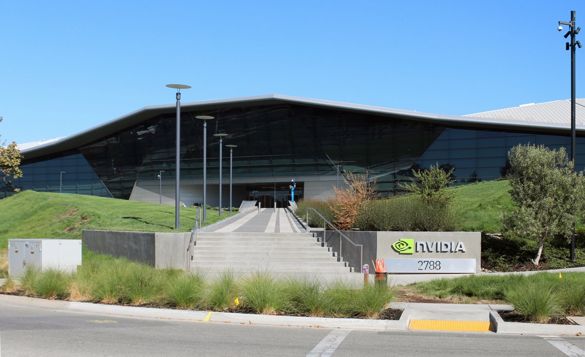
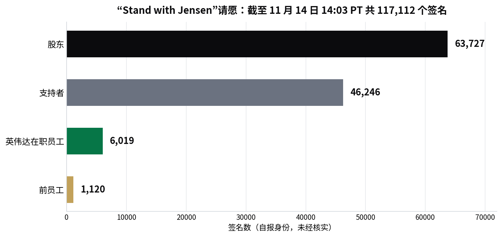
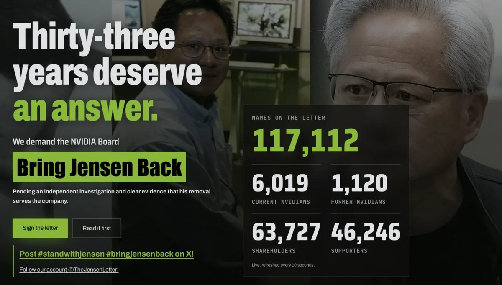

> [English version](/life/nvidia-huang-petition-update/)

> **更新——2026 年 11 月 15 日。** 本文接续我们 11 月 13 日的报道《[黄仁勋离开英伟达](/life/nvidia-huang-resigns-nov-12-zh/)》，以下全部是辞职之后的新进展。

*英伟达位于加州圣克拉拉的总部。照片：Coolcaesar，经 Wikimedia Commons（CC BY-SA 4.0）。*

## 请愿：117,112 个签名，和一个可信度问题

黄仁勋辞去英伟达 CEO 两天后，一个名为 **“Stand with Jensen”** 的独立运动要求董事会在外部调查查清事实之前恢复他的职务。计数器显示，**11 月 14 日星期六 14:03 PT，签名数为 117,112**——当天早上约 108,000，到下午已超过 115,000（据 TechCrunch）。

按该运动自己公布的构成：

*“Stand with Jensen”请愿按自报身份划分，截至 2026 年 11 月 14 日 14:03 PT。来源：Stand with Jensen / Implicator。*

看这张图时要带上它的前提：**身份全是自报、未经核实**。里面出现了假名，包括“Tim Cruise，好莱坞演员”和“Xi Jingping”，组织者周六表示正在“积极处理”删除假签名。该网站可搜索的公开名单只显示了 77,669 个名字，而标题计数器更大——签名者可以选择是否公开姓名。

该运动自己的截图说的也是同一回事：

*11 月 14 日星期六的“Stand with Jensen”运动页面：117,112 个签名，包括 6,019 名自称英伟达在职员工。截图经 Implicator。*

这封信的诉求是程序性的，不是煽情的：恢复黄仁勋职务、等待独立调查；或者给出具体、有证据的解释，说明他的缺席为何符合英伟达的利益——同时公开调查的范围、独立性和时间表，并给黄仁勋回应的机会。“Jensen deserves due process, not mob justice（黄仁勋应得到正当程序，而不是群体的审判）”，信中写道。该运动称自己是志愿者行动，未得到英伟达或黄仁勋的背书。

## 谁签了名：让董事会不得不听的名字

重要的不是数字，而是上面的名字。**埃隆·马斯克**周五签了名——“A petition is underway to reinstate Jensen and I'm signing it too（正在征集恢复黄仁勋职务的请愿，我也签了）”，他在 X 上写道——他不只是个旁观者：特斯拉和 SpaceX 都是英伟达的大客户，马斯克周六还表示，英伟达的许多供应链交易都是与黄仁勋握手达成的、而非书面合同，没有他，一些关键交易将会流失。公开名单上还有：Epic Games CEO **Tim Sweeney**、Y Combinator CEO **Garry Tan**、Replit CEO **Amjad Masad**，以及 11 月 13 日签名的英伟达资深杰出工程师 **Erwin Coumans**。

随后股东单独发了声。**Brad Gerstner**，Altimeter Capital CEO——该基金截至 6 月 30 日披露持有 940 万股英伟达股票、价值近 19 亿美元，是其最大持仓——和 Atreides Management 管理合伙人 **Gavin Baker**（持有 120 万股，约 2.5 亿美元），周五致信董事会。他们的信比请愿书谨慎得多：要求进行审慎的遴选、为黄仁勋可能的回归留一扇门，表示临时 CEO Colette Kress 能够胜任领导，并且没有要求立即恢复职务。

公司内部，情绪真实但并不一致。一位员工在辞职前提交的内部建议帖——要求董事会在行动前考虑员工情绪——收获了**超过 1,600 条评论**，此后数量又翻了一倍多。但英伟达副总裁 Bryan Catanzaro 称另一份流传的内部信是假的，并重申支持 Kress。而且，并非所有为回归欢呼的人都是出于公司治理的考虑：Cowboy Ventures 投资人 Aileen Lee 质疑了背后的经济动机——“Jensen has made people a ton of money, and they want him to keep doing it（黄仁勋让大家赚了很多钱，他们想让他继续赚下去）。”前 Google 高管 Tara Sharp 则称 Kress 接手的是个“glass cliff（玻璃悬崖）”：男人制造了危机，女人来收拾残局。

## 董事会：还在选猎头公司

尽管噪音很大，英伟达董事会至今没有公开回应这封信。董事会**仍在选择猎头公司**，周五表示尚未正式接触候选人。据《金融时报》报道，董事会已接触 Arm CEO **Rene Haas**——他 2013 年加入 Arm 之前在英伟达工作了约七年。Arm 的回应是：“不予置评。”特朗普总统则提出了自己的候选人——苹果执行董事长 Tim Cook：“A Legend replaces a Legend!（传奇取代传奇！）”他在 Truth Social 上写道。

## 华盛顿和法院的动作更快

董事会还在商议时，其他几只时钟已经在走：

- **国会：** 商务部长 Howard Lutnick 已同意于 **12 月 10 日**出席参议院银行委员会，就商务部在阻止中国获得先进 AI 芯片方面的作用作证。众议院情报委员会的民主党人周五致信，要求他就 Megaspeed 作证。黄仁勋本人也被要求作证。
- **诉讼：** 散户投资者 Mark Kistenmacher 于 **11 月 9 日**在加州提起集体诉讼，指控英伟达和黄仁勋就其与 Alice Huang 的关系及相关的国家安全风险误导投资者。当天英伟达股价下跌 4.3%，市值蒸发约 **1,900 亿美元**。而且英伟达只持有 **Side A 董事及高管责任险**——只保高管个人资产和辩护费用——没有 Side B 或 Side C，一旦公司与高管一起被起诉，公司自身没有保障。
- **路透社的报道：** 路透社独家披露，10 月的通信显示，黄仁勋误导了总法律顾问 Tim Teter 和首席营销官 Alison Wagonfeld，把他与 Alice Huang 的往来描述为常规客户往来。
- **反方证据：** 司法部长 Todd Blanche 周四表示，司法部**尚未得出** Alice Huang 是否为间谍的结论。新加坡内政部正式否认了《华尔街日报》关于当地官员曾以间谍嫌疑调查她的说法。北京否认这一指控，Megaspeed 也否认相关说法并与 Alice Huang 划清界限。《华尔街日报》另有报道称，Megaspeed 在 2024–2025 年为中国公司安排了近 **120 亿美元**的英伟达芯片订单；美国情报部门据称认为 Alice Huang 协助向中国转移了 **24 万枚**被禁的英伟达芯片，主要是 H100 和 H200——这两项说法目前仍是报道中的指控，而非已确认的事实。

## 三十三年的浓缩

要理解为什么 117,000 人会为一个他们不认识的 CEO 签名，得先知道这 33 年里装了什么。黄仁勋于 1993 年 4 月 5 日与两位 Sun Microsystems 的工程师 Chris Malachowsky 和 Curtis Priem 共同创立英伟达，此前他们在圣何塞一家 Denny's 的卡座里策划了多次。他当时 30 岁，从第一天起就是 CEO。三位创始人一共投入了约 4 万美元。他们的想法是，个人电脑总有一天需要专用芯片来绘制 3D 图形，从电子游戏开始——这个赌注在 1993 年看起来很古怪，当时大多数电脑都用主处理器画图。

公司早期的生存靠运气与固执各占一半，随后分三幕建起了帝国。第一幕是游戏：GeForce 系列让英伟达成为 PC 玩家的默认显卡。第二幕是 CUDA，2006 年推出的并行计算平台，把游戏芯片变成了通用处理器——这个决定多年来看起来像个副业，直到 AI 到来，它成了公司的核心。第三幕就是 AI 本身：英伟达的芯片成为训练与运行几乎所有大型 AI 模型的硬件，公司在 2023 年市值突破一万亿美元，2025 年成为首家市值达到 5 万亿美元的公司。在 Kress 担任 CFO 期间，公司收入从 2014 财年的 41.3 亿美元增长到 2025 财年的 1,305 亿美元，市值从约 90 亿美元增长到近 4 万亿美元。黄仁勋在上周之前是半导体行业任职时间最长的 CEO，也是美国商界任职时间最长的创始人之一——而关键在于，他从未有过继任计划。没有过渡期，没有告别巡演，据《财富》报道，也没有公开披露的继任计划。《爱尔兰时报》报道称，约有 60 名高管直接向他汇报，没有任何一位领导者能够接手他的全部职责。这份请愿，从某种意义上说，也是一次公开承认：公司内部也没有人准备好了。

## Colette Kress 是谁

请愿要求董事会（至少暂时）搁置的那个人，值得按她自己的条件来认识。Colette Kress，59 岁，于 2013 年 9 月加入英伟达，担任执行副总裁兼首席财务官，此前在微软、思科与德州仪器担任财务职务，任职已有 13 年。她在担任临时 CEO 的同时保留 CFO 职务。在她任职期间，她是公司财报电话会上的声音，逐季向华尔街解释英伟达的数字——包括那些数字翻倍再翻倍的季度。截至 11 月 11 日收盘，她持有的英伟达股票价值约 7.5 亿美元，低于 10 月峰值时的 10 亿多美元，这意味着在这个故事里，她个人财富的损失仅次于黄仁勋本人。

董事会还任命了 Harvey C. Jones——自 1993 年英伟达创立以来一直担任董事、前 Synopsys CEO——为公司有史以来第一位董事会主席。在上周之前，黄仁勋同时兼任创始人、总裁与 CEO，董事会从未设过独立主席。设立主席职位是一项将超越当前危机的治理变革：它第一次把董事会的领导权与 CEO 分开了。Kress 在实际工作上行动也很快：据路透社报道，她在给员工的备忘录中写道，公司将于 11 月 18 日举行会议，也就是财报发布后的第二天。请愿的支持者与董事会的辩护者在一点上是一致的——Kress 能够胜任领导。分歧只在于，对一家价值建立在一个人判断之上的公司来说，"胜任"是否足够。

## 创始人回归：先例与问题

请愿隐含的模式是创始人回归，而笼罩着每一次这类讨论的先例只有一个：史蒂夫·乔布斯。乔布斯 1976 年共同创立苹果，1985 年被迫离开，1997 年回归——先是在苹果以约 4.27 亿美元收购他的公司 NeXT 时担任顾问，随后在 CEO Gil Amelio 辞职后，于 1997 年 9 月出任临时 CEO。苹果在 1997 财年亏损 10.45 亿美元，据多方说法，离破产只有 90 天。乔布斯砍掉了 70% 的产品线，宣布了微软 1.5 亿美元的投资，到 1998 财年，苹果报告利润 3.09 亿美元。他一直担任 CEO 直到 2011 年，建成了世界上最有价值的公司。这是美国商业史上最伟大的一次回归，也是每一份要求创始人回归的请愿真正在讲的故事。

但先例是双刃剑，差异比相似之处更重要。乔布斯回归的是一家商业上正在失败的公司，通过一桩收购回到了内部；他的回归是一个商业决定，由一个已经别无选择的董事会批准。黄仁勋的情况正好相反：英伟达的商业并没有失败——它的芯片、客户与路线图都没有变——问题不是业务是否运转，而是创始人在接受行为调查之后是否还值得信任。董事会可以为了拯救一家失败的公司而恢复创始人的职务；要为了让一家成功的公司摆脱一个未解决的国家安全问题而恢复创始人职务，难度要大得多。乔布斯的先例还需要请愿无法提供的东西：时间。乔布斯用了数年时间重建苹果。而黄仁勋的调查由前联邦代理检察官 Joon H. Kim 牵头，没有公布时间表，董事会的决策点——11 月 17 日的财报——在几天后就到了，不是以年计的。

## Side A 保险到底意味着什么

诉讼部分的那个细节值得细看，因为它解释了为什么集体诉讼的重要性超出了股价。董事及高管责任险（D&O 保险）分三部分，叫 Side A、B、C。Side A 保的是董事与高管个人的资产与辩护费用，适用于公司无法或不愿为他们赔偿的情况。Side B 是公司为高管赔偿后，保险公司再补偿公司。Side C 保的是公司本身在与高管一起被起诉时的责任——正如英伟达在 Kistenmacher 集体诉讼中的处境。英伟达只有 Side A，没有 Side B 或 Side C。这意味着高管的个人资产受到了保护，但公司自身在作为被告与高管一起被起诉的诉讼中，没有任何保险。

实际后果很直接：如果集体诉讼或任何类似诉讼导致针对公司的和解或判决，英伟达要从自己的资产负债表里掏钱，没有保险公司分担成本。对英伟达这样的现金储备来说，这是可以承受的——风险以数亿美元计，而不是以公司的存亡计。但它以一种特定的方式改变了董事会的激励。有 Side C 的董事会可以把诉讼当作有保险覆盖的经营成本；没有 Side C 的董事会，每一个诉讼决定都要对照公司自己的钱来权衡，这让和解更有吸引力、让旷日持久的公开争斗更昂贵。这也意味着调查结论的重要性不只是声誉上的，更是财务上的：如果外部调查澄清了国家安全问题，诉讼风险会缩小；如果没有澄清，公司将在法庭与国会两条战线上同时为自己辩护，而且没有保险。

## 董事会的手牌：猎头、候选人与时间表

董事会至今没有公开回应请愿信，但"没有回应"本身也是一种回应：它说明董事会还没有做出决定，而做出决定需要的信息它还没有。董事会目前仍在选择猎头公司，周五表示尚未正式接触候选人。这听起来像拖延，实际上是 CEO 遴选的标准流程：猎头公司先定义职位、列出长名单、逐一接触、再把短名单交给董事会。跳过这一步、直接任命一位候选人，在上市公司治理中几乎是不可想象的——尤其是在前任 CEO 刚刚因调查辞职的情况下，任何仓促的任命都会被解读为董事会早有预谋，或者根本不在乎程序。

《金融时报》报道的接触对象 Arm CEO Rene Haas 值得单独说一句。Haas 在 2013 年加入 Arm 之前在英伟达工作了约七年，了解这家公司的文化与技术，也了解黄仁勋本人——他是少数几个既在英伟达内部工作过、又在另一家芯片公司当过 CEO 的人。Arm 的回应是"不予置评"，这在 CEO 猎头中是最常见的回应，既不否认也不确认。但 Haas 的履历揭示了董事会面临的两难：它需要的是一位懂 AI 芯片的人，而全世界懂 AI 芯片、又能管理一家 4 万亿美元公司的人，屈指可数。内部候选人了解公司但可能被视为黄仁勋的延续；外部候选人带来新鲜血液但需要数月时间才能理解公司的技术路线图。

特朗普总统提出的候选人——苹果执行董事长 Tim Cook，"A Legend replaces a Legend!"（传奇取代传奇！）——则属于另一类提名：政治表态而非认真的建议。Cook 是苹果的灵魂人物之一，离开苹果去执掌英伟达的可能性微乎其微，而总统在 Truth Social 上的提名更多是在表达一种态度：他认为英伟达需要一位传奇人物，而不是一位职业经理人。但董事会的真正时间表不是由提名决定的，而是由财报与调查决定的。11 月 17 日的财报是第一个硬性时间点，11 月 18 日的员工大会是第二个，12 月 10 日的参议院听证会是第三个。在这三个时间点之间，董事会必须同时做三件事：安抚市场、推进调查、找到一位 CEO。而请愿的签名数每过一天都在增加，董事会的沉默也就每过一天变得更难维持。

## 请愿的数字游戏：117,112 到底意味着什么

117,112 这个数字本身值得拆开看。它不是一次投票，没有选民登记、没有身份验证、没有"一人一票"的保证。公开名单上只有 77,669 个名字，剩下的近 4 万个签名选择了不公开姓名；6,019 人自称是英伟达在职员工，但这个身份也是自报的。组织者承认里面混入了假名——"Tim Cruise，好莱坞演员"与"Xi Jingping"——并且正在"积极处理"删除。这意味着计数器的真实含义不是"117,112 个人"，而是"117,112 次点击，其中一部分是真的、一部分是假的、一部分无法核实"。任何把这个数字当作民意测验来引用的人，都是在误读它。

但数字的软，并不意味着请愿没有分量。它的分量从来不在计数器上，而在签名栏里：马斯克、Tim Sweeney、Garry Tan、Amjad Masad、Erwin Coumans——这些名字每一个都代表着一家公司、一个基金或一段职业生涯。Brad Gerstner 与 Gavin Baker 的信则更进一步：他们不是请愿者，而是股东，持有近 19 亿美元与约 2.5 亿美元的股票，他们的信是写给董事会的正式文件，不是社交媒体上的表态。董事会可以忽略一个计数器，但它很难忽略持有 940 万股的股东。真正的问题不是"有多少人签名"，而是"签名的人掌握着多少英伟达的未来"——而这个问题的答案，比计数器上的数字要严肃得多。

## 结论：请愿是施压，不是决定

去掉计数器，请愿不是投票——它是一个施压工具，而且数字本身是软的：自报身份、掺有假名、细节无法核实。它真正的分量在于背后的联盟：AI 领域最大的客户、最大的股东和数千名员工公开告诉董事会，他们投资的这家公司和一个人分不开。

但董事会的案卷还有请愿回答不了的另一半。路透社关于黄仁勋误导自家总法律顾问的报道、集体诉讼、12 月 10 日的听证会，方向都相反——签名解决不了其中任何一个。真正的决定点是 11 月 10 日聘请的外部调查，由前联邦代理检察官 Joon H. Kim 牵头：如果它能澄清国家安全问题，董事会有回旋余地；如果不能，再多的签名也没用。

下一个硬性时间点是 11 月 17 日星期二，英伟达发布财报——后黄仁勋时代的第一份数字，由一位临时 CEO 向市场交代，而这个故事已经让市场蒸发了数千亿美元。那份财报，而不是计数器，才是董事会真正等的东西。
