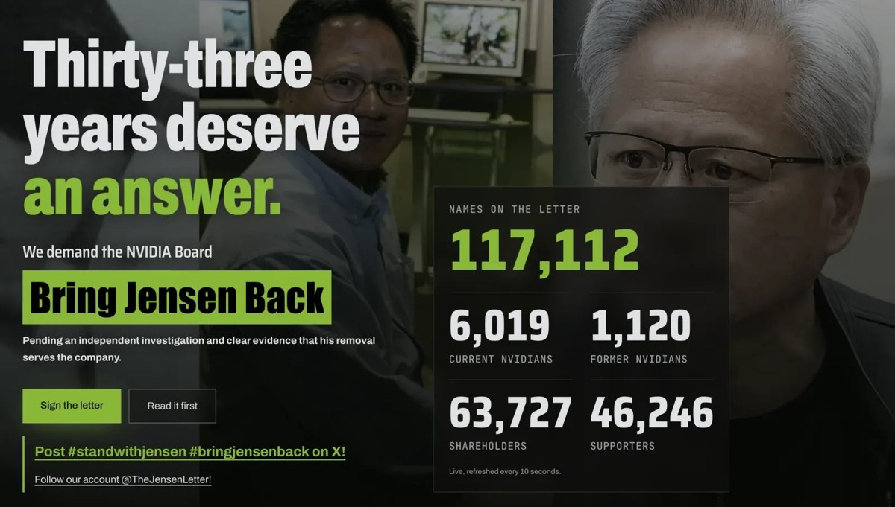

> [中文版 Chinese version](/life/nvidia-huang-petition-update-zh/)

> **Update — November 15, 2026.** This post follows up our November 13 report, [Jensen Huang Is Out at Nvidia](/life/nvidia-huang-resigns-nov-12/). Everything below is new since the resignation.

*Nvidia's headquarters in Santa Clara, California. Photo: Coolcaesar, via Wikimedia Commons (CC BY-SA 4.0).*

## The petition: 117,112 names, and a credibility problem

Two days after Jensen Huang resigned as Nvidia's CEO, an independent campaign called **"Stand with Jensen"** is asking the board to reinstate him while an outside investigation establishes the facts. The counter read **117,112 names at 2:03 PM PT on Saturday, November 14** — up from about 108,000 that morning, and past 115,000 by Saturday afternoon, according to TechCrunch.

The breakdown, as the campaign reports it:

*Stand with Jensen petition by claimed affiliation, as of 2:03 PM PT, November 14, 2026. Source: Stand with Jensen / Implicator.*

Read the chart with the caveat attached: **affiliations are self-reported and not verified**. Fake entries appeared, including "Tim Cruise, Hollywood actor" and "Xi Jingping," and organizers said Saturday they were "actively working" to remove them. The site's searchable public list showed 77,669 names against the larger headline counter — signers can choose whether their names appear publicly.

The campaign's own screenshot tells the same story, in its own words:

*The Stand with Jensen campaign page on Saturday, November 14: 117,112 names, including 6,019 self-described current Nvidia employees. Screenshot via Implicator.*

The letter's demand is procedural, not sentimental: reinstate Huang pending an independent inquiry, or give a specific, evidence-based explanation of why his absence serves Nvidia — plus disclosure of the investigation's scope, independence, and timeline, and a chance for Huang to respond. "Jensen deserves due process, not mob justice," it says. The campaign says it is a volunteer effort endorsed by neither Nvidia nor Huang.

## Who signed: the names that make the board listen

The count matters less than the signatures on it. **Elon Musk** signed on Friday — "A petition is underway to reinstate Jensen and I'm signing it too," he posted on X — and he is not just a bystander: Tesla and SpaceX are major Nvidia customers, and Musk said Saturday that many of Nvidia's supply-chain deals were handshakes with Huang rather than written contracts, and that without him some critical deals will be lost. Also on the public list: Epic Games CEO **Tim Sweeney**, Y Combinator CEO **Garry Tan**, Replit CEO **Amjad Masad**, and Nvidia senior distinguished engineer **Erwin Coumans**, who signed November 13.

Then the shareholders spoke separately. **Brad Gerstner**, CEO of Altimeter Capital — which disclosed 9.4 million Nvidia shares worth nearly $1.9 billion as of June 30, its largest holding — and **Gavin Baker**, managing partner of Atreides Management (1.2 million shares, about $250 million), wrote to the board on Friday. Their letter is more careful than the petition: it calls for a deliberate search that leaves open Huang's potential return, says interim CEO Colette Kress would lead capably, and stops short of demanding immediate reinstatement.

Inside the company, the sentiment is real but not unanimous. An employee suggestion-box post asking the board to consider sentiment before acting drew **more than 1,600 comments** before the resignation — and has since more than doubled. But Nvidia vice president Bryan Catanzaro dismissed a separate circulating internal letter as fake and reaffirmed his backing for Kress. And not everyone cheering the comeback is doing so for governance reasons: Cowboy Ventures investor Aileen Lee questioned the financial interests behind it — "Jensen has made people a ton of money, and they want him to keep doing it." Former Google executive Tara Sharp called Kress's assignment a "glass cliff": a woman handed the cleanup after a man created the crisis.

## The board: still choosing a search firm

For all the noise, Nvidia's board has not publicly answered the letter. It is **still choosing a search firm** and said Friday it had not formally engaged candidates. The Financial Times reported an approach to Arm CEO **Rene Haas** — who spent about seven years at Nvidia before joining Arm in 2013. Arm's response: "It's a no comment from us." President Donald Trump offered his own candidate, Apple executive chair Tim Cook: "A Legend replaces a Legend!" he wrote on Truth Social.

## Washington and the courts are moving faster

While the board deliberates, the other clocks are running:

- **Congress:** Commerce Secretary Howard Lutnick has agreed to appear before the Senate Banking Committee on **December 10** over the department's role in preventing China from obtaining advanced AI chips. House Intelligence Committee Democrats sent a letter Friday seeking his testimony about Megaspeed. Huang himself has been asked to testify.
- **The lawsuit:** Retail investor Mark Kistenmacher filed a proposed class action in California on **November 9**, accusing Nvidia and Huang of misleading investors about the relationship with Alice Huang and the associated national security risks. Nvidia shares fell 4.3% that day, erasing about **$190 billion** in market value. And Nvidia holds **only Side A directors' and officers' insurance** — covering executives' personal assets and defense costs — with no Side B or Side C coverage, leaving the company itself exposed when sued alongside its officers.
- **The Reuters account:** A Reuters exclusive described October correspondence in which Huang misled general counsel Tim Teter and chief marketing officer Alison Wagonfeld, presenting his interactions with Alice Huang as routine customer dealings.
- **The counter-evidence:** Attorney General Todd Blanche said Thursday the Justice Department had **not concluded** whether Alice Huang was a spy. Singapore's Home Affairs ministry formally rejected the Wall Street Journal's account that local officials had investigated her as a suspected spy. Beijing denies the allegation, and Megaspeed has rejected the claims and distanced itself from Alice Huang. The Journal has separately reported that Megaspeed arranged nearly **$12 billion** in Nvidia chip orders for Chinese companies in 2024–2025, and US intelligence reportedly believes Alice Huang helped move **240,000** banned Nvidia chips into China, mostly H100s and H200s — both claims remain reported allegations, not established findings.

## Thirty-three years in one paragraph

To understand why 117,000 people signed a petition for a CEO they do not know, it helps to know what the 33 years contained. Huang co-founded Nvidia on April 5, 1993, with Chris Malachowsky and Curtis Priem, two engineers from Sun Microsystems, after planning sessions in a booth at a Denny's in San Jose. He was 30 years old, and he became chief executive on day one. The three founders put in about $40,000 between them. The idea was that personal computers would one day need dedicated chips to draw 3D graphics, starting with video games — a bet that looked eccentric in 1993, when most computers drew graphics with their main processor.

The company survived the early years by luck and stubbornness in roughly equal measure, then built its empire in three acts. The first was gaming: the GeForce line made Nvidia the default graphics card for PC gamers. The second was CUDA, the parallel-computing platform launched in 2006, which turned those gaming chips into general-purpose processors — a decision that looked like a side project for years and then became the company's core when AI arrived. The third was AI itself: Nvidia's chips became the hardware that trains and runs nearly every large AI model, and the company passed a trillion-dollar valuation in 2023 and became the first company to reach $5 trillion in 2025. Under Kress's tenure as CFO, revenue grew from $4.13 billion in fiscal 2014 to $130.5 billion in fiscal 2025, and market value went from about $9 billion to nearly $4 trillion. Huang was, until last week, the longest-serving CEO in the semiconductor industry and one of the longest-serving founders in American business — and, crucially, he had never had a succession plan. There was no transition period, no ceremonial farewell tour, and no publicly disclosed succession plan, as Fortune reported. The Irish Times reported that about 60 executives had reported directly to him, leaving no single leader positioned to assume all his responsibilities. The petition is, among other things, a public admission that nobody inside the company was ready either.

## Who Colette Kress is

The person the petition is asking the board to set aside, at least temporarily, is worth knowing on her own terms. Colette Kress, 59, joined Nvidia in September 2013 as executive vice president and chief financial officer, after finance roles at Microsoft, Cisco, and Texas Instruments, and she has held the post for 13 years. She retains her CFO job while serving as interim CEO. During her tenure, she was the voice on the company's earnings calls, the person who explained Nvidia's numbers to Wall Street quarter after quarter — including the quarters when those numbers doubled and tripled. Her shares in Nvidia were valued at roughly $750 million as of the November 11 close, down from more than $1 billion at the stock's October peak, which means she has lost more personal wealth on this story than almost anyone except Huang himself.

The board also appointed Harvey C. Jones, a director since Nvidia's founding in 1993 and a former Synopsys CEO, as the company's first-ever Chair of the Board. Until last week, Huang had combined the roles of founder, president, and CEO, and the board had never had a separate chair. The creation of the chairmanship is a governance change that will outlast the current crisis whatever happens next: it separates the board's leadership from the chief executive's for the first time in the company's history. Kress has also moved fast on the practical front: she wrote in a memo to employees that the company will hold a meeting on November 18, according to Reuters, the day after earnings. The petition's supporters and the board's defenders agree on one thing — that Kress would lead capably. The disagreement is only about whether "capably" is enough for a company whose value was built on one man's judgment.

## Founder comebacks: the precedent and the problem

The petition's implicit model is the founder's return, and there is exactly one precedent that looms over every such conversation: Steve Jobs. Jobs co-founded Apple in 1976, was forced out in 1985, and returned in 1997 — first as an adviser when Apple bought his company NeXT for about $427 million, then as interim CEO in September 1997 after CEO Gil Amelio resigned. Apple had lost $1.045 billion in fiscal 1997 and was, by several accounts, within 90 days of bankruptcy. Jobs cut 70 percent of the product line, announced a $150 million investment from Microsoft, and by fiscal 1998 Apple reported a $309 million profit. He remained CEO until 2011 and built the most valuable company in the world. It is the greatest comeback in the history of American business, and it is the story every petition for a founder's return is really telling.

But the precedent cuts both ways, and the differences matter more than the similarities. Jobs returned to a company that was failing commercially, through an acquisition that brought him back inside the tent; his return was a business decision ratified by a board that had run out of alternatives. Huang's case is the opposite: Nvidia is not failing commercially — its chips, customers, and roadmap have not changed — and the question is not whether the business works but whether its founder can be trusted after an investigation into his conduct. A board can reinstate a founder to save a failing company; it is much harder to reinstate a founder to save a successful one from an unresolved national-security question. The Jobs precedent also required something the petition cannot supply: time. Jobs had years to rebuild Apple. Huang's investigation, led by former acting US attorney Joon H. Kim, has no published timeline, and the board's decision point — the earnings report on November 17 — arrives in days, not years.

## What Side A insurance actually means

One detail in the lawsuit section deserves a closer look, because it explains why the class action matters beyond the share price. Directors' and officers' insurance — D&O insurance — comes in three parts, called Sides A, B, and C. Side A covers the personal assets and defence costs of individual directors and officers when the company cannot or will not indemnify them. Side B reimburses the company when it does indemnify its officers. Side C covers the company itself when it is sued alongside its officers, as Nvidia is in the Kistenmacher class action. Nvidia holds only Side A coverage. That means the executives' personal assets are protected, but the company itself has no insurance for its own liability in a lawsuit where it is named as a defendant alongside them.

The practical consequence is straightforward: if the class action, or any similar suit, results in a settlement or judgment against the company, Nvidia pays it from its own balance sheet, with no insurer sharing the cost. For a company with Nvidia's cash reserves, that is survivable — the exposure is measured in hundreds of millions, not in the company's existence. But it changes the board's incentives in a specific way. A board with Side C coverage can treat litigation as an insured cost of doing business. A board without it has to weigh every litigation decision against the company's own money, which makes settlement more attractive and a prolonged public fight more expensive. It also means the investigation's findings matter financially, not just reputationally: if the outside investigation clears the national-security question, the litigation exposure shrinks; if it does not, the company is defending itself, uninsured, on two fronts at once — in court and in Congress.

## The verdict: the petition is pressure, not a decision

Strip away the counter and the petition is not a vote — it is a pressure instrument, and its numbers are soft: self-reported, partly fake, and unverifiable in the details. Its real weight is the coalition behind it: the biggest customer in AI, the biggest shareholders, and thousands of employees telling the board, in public, that the company they invested in is inseparable from one man.

But the board's file has a second half that the petition does not answer. The Reuters account of Huang misleading his own general counsel, the class action, and the December 10 hearing all point in the opposite direction — and none of them is resolved by signatures. The decision point is the outside investigation led by former acting US attorney Joon H. Kim, retained November 10: if it clears the national-security question, the board has room to maneuver; if it does not, no petition will matter.

The next hard deadline is Tuesday, November 17, when Nvidia reports earnings — the first numbers of the post-Huang era, delivered by an interim CEO, to a market that has already erased hundreds of billions on this story. That report, not the counter, is what the board is really waiting for.

<!-- rebuild trigger 2026-11-15b -->
