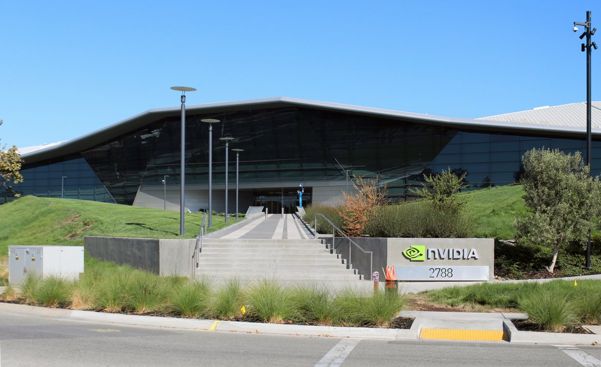
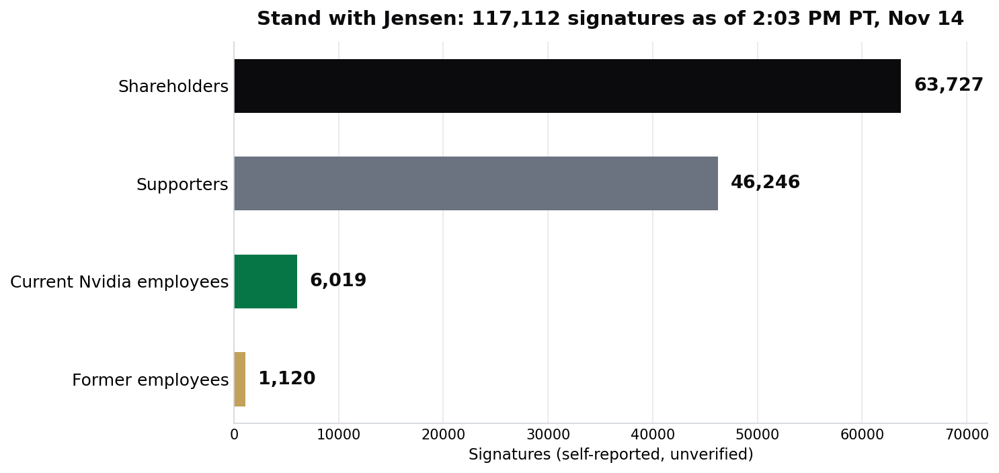

> [中文版 Chinese version](/life/nvidia-huang-petition-update-zh/)

> **Update — November 15, 2026.** This post follows up our November 13 report, [Jensen Huang Is Out at Nvidia](/life/nvidia-huang-resigns-nov-12/). Everything below is new since the resignation.

*Nvidia's headquarters in Santa Clara, California. Photo: Coolcaesar, via Wikimedia Commons (CC BY-SA 4.0).*

## The petition: 117,112 names, and a credibility problem

Two days after Jensen Huang resigned as Nvidia's CEO, an independent campaign called **"Stand with Jensen"** is asking the board to reinstate him while an outside investigation establishes the facts. The counter read **117,112 names at 2:03 PM PT on Saturday, November 14** — up from about 108,000 that morning, and past 115,000 by Saturday afternoon, according to TechCrunch.

The breakdown, as the campaign reports it:

*Stand with Jensen petition by claimed affiliation, as of 2:03 PM PT, November 14, 2026. Source: Stand with Jensen / Implicator.*

Read the chart with the caveat attached: **affiliations are self-reported and not verified**. Fake entries appeared, including "Tim Cruise, Hollywood actor" and "Xi Jingping," and organizers said Saturday they were "actively working" to remove them. The site's searchable public list showed 77,669 names against the larger headline counter — signers can choose whether their names appear publicly.

The campaign's own screenshot tells the same story, in its own words:

*The Stand with Jensen campaign page on Saturday, November 14: 117,112 names, including 6,019 self-described current Nvidia employees. Screenshot via Implicator.*

The letter's demand is procedural, not sentimental: reinstate Huang pending an independent inquiry, or give a specific, evidence-based explanation of why his absence serves Nvidia — plus disclosure of the investigation's scope, independence, and timeline, and a chance for Huang to respond. "Jensen deserves due process, not mob justice," it says. The campaign says it is a volunteer effort endorsed by neither Nvidia nor Huang.

## Who signed: the names that make the board listen

The count matters less than the signatures on it. **Elon Musk** signed on Friday — "A petition is underway to reinstate Jensen and I'm signing it too," he posted on X — and he is not just a bystander: Tesla and SpaceX are major Nvidia customers, and Musk said Saturday that many of Nvidia's supply-chain deals were handshakes with Huang rather than written contracts, and that without him some critical deals will be lost. Also on the public list: Epic Games CEO **Tim Sweeney**, Y Combinator CEO **Garry Tan**, Replit CEO **Amjad Masad**, and Nvidia senior distinguished engineer **Erwin Coumans**, who signed November 13.

Then the shareholders spoke separately. **Brad Gerstner**, CEO of Altimeter Capital — which disclosed 9.4 million Nvidia shares worth nearly $1.9 billion as of June 30, its largest holding — and **Gavin Baker**, managing partner of Atreides Management (1.2 million shares, about $250 million), wrote to the board on Friday. Their letter is more careful than the petition: it calls for a deliberate search that leaves open Huang's potential return, says interim CEO Colette Kress would lead capably, and stops short of demanding immediate reinstatement.

Inside the company, the sentiment is real but not unanimous. An employee suggestion-box post asking the board to consider sentiment before acting drew **more than 1,600 comments** before the resignation — and has since more than doubled. But Nvidia vice president Bryan Catanzaro dismissed a separate circulating internal letter as fake and reaffirmed his backing for Kress. And not everyone cheering the comeback is doing so for governance reasons: Cowboy Ventures investor Aileen Lee questioned the financial interests behind it — "Jensen has made people a ton of money, and they want him to keep doing it." Former Google executive Tara Sharp called Kress's assignment a "glass cliff": a woman handed the cleanup after a man created the crisis.

## The board: still choosing a search firm

For all the noise, Nvidia's board has not publicly answered the letter. It is **still choosing a search firm** and said Friday it had not formally engaged candidates. The Financial Times reported an approach to Arm CEO **Rene Haas** — who spent about seven years at Nvidia before joining Arm in 2013. Arm's response: "It's a no comment from us." President Donald Trump offered his own candidate, Apple executive chair Tim Cook: "A Legend replaces a Legend!" he wrote on Truth Social.

## Washington and the courts are moving faster

While the board deliberates, the other clocks are running:

- **Congress:** Commerce Secretary Howard Lutnick has agreed to appear before the Senate Banking Committee on **December 10** over the department's role in preventing China from obtaining advanced AI chips. House Intelligence Committee Democrats sent a letter Friday seeking his testimony about Megaspeed. Huang himself has been asked to testify.
- **The lawsuit:** Retail investor Mark Kistenmacher filed a proposed class action in California on **November 9**, accusing Nvidia and Huang of misleading investors about the relationship with Alice Huang and the associated national security risks. Nvidia shares fell 4.3% that day, erasing about **$190 billion** in market value. And Nvidia holds **only Side A directors' and officers' insurance** — covering executives' personal assets and defense costs — with no Side B or Side C coverage, leaving the company itself exposed when sued alongside its officers.
- **The Reuters account:** A Reuters exclusive described October correspondence in which Huang misled general counsel Tim Teter and chief marketing officer Alison Wagonfeld, presenting his interactions with Alice Huang as routine customer dealings.
- **The counter-evidence:** Attorney General Todd Blanche said Thursday the Justice Department had **not concluded** whether Alice Huang was a spy. Singapore's Home Affairs ministry formally rejected the Wall Street Journal's account that local officials had investigated her as a suspected spy. Beijing denies the allegation, and Megaspeed has rejected the claims and distanced itself from Alice Huang. The Journal has separately reported that Megaspeed arranged nearly **$12 billion** in Nvidia chip orders for Chinese companies in 2024–2025, and US intelligence reportedly believes Alice Huang helped move **240,000** banned Nvidia chips into China, mostly H100s and H200s — both claims remain reported allegations, not established findings.

## The verdict: the petition is pressure, not a decision

Strip away the counter and the petition is not a vote — it is a pressure instrument, and its numbers are soft: self-reported, partly fake, and unverifiable in the details. Its real weight is the coalition behind it: the biggest customer in AI, the biggest shareholders, and thousands of employees telling the board, in public, that the company they invested in is inseparable from one man.

But the board's file has a second half that the petition does not answer. The Reuters account of Huang misleading his own general counsel, the class action, and the December 10 hearing all point in the opposite direction — and none of them is resolved by signatures. The decision point is the outside investigation led by former acting US attorney Joon H. Kim, retained November 10: if it clears the national-security question, the board has room to maneuver; if it does not, no petition will matter.

The next hard deadline is Tuesday, November 17, when Nvidia reports earnings — the first numbers of the post-Huang era, delivered by an interim CEO, to a market that has already erased hundreds of billions on this story. That report, not the counter, is what the board is really waiting for.

<!-- rebuild trigger 2026-11-15b -->
