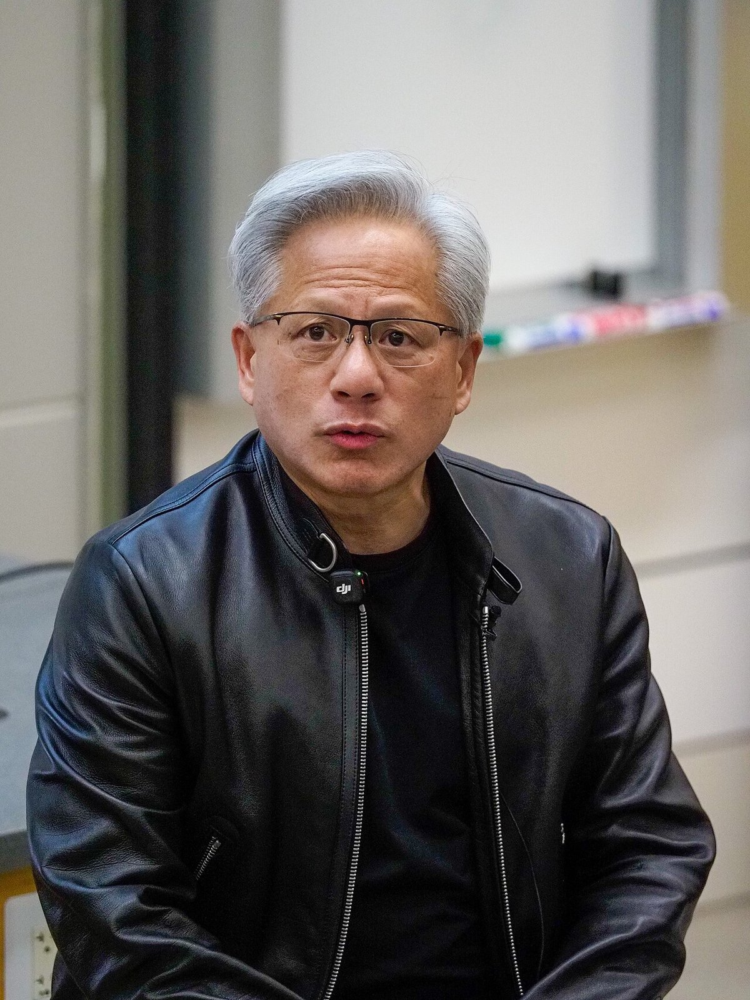
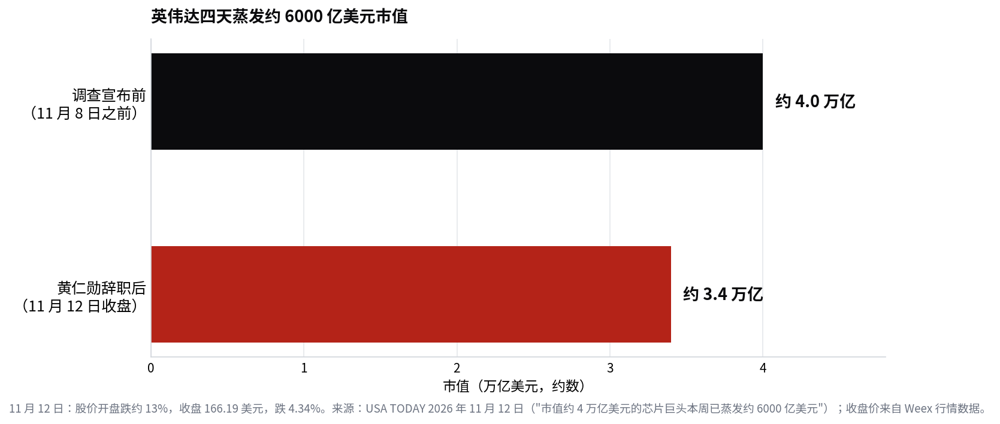

> [English version](/life/nvidia-huang-resigns-nov-12/)

*2026 年 4 月 30 日，黄仁勋在斯坦福大学。照片来自 Wikimedia Commons（CC BY 4.0）。*

## 发生了什么

11 月 12 日周四，英伟达宣布黄仁勋已辞去总裁、首席执行官及董事会成员职务，即刻生效。根据公司向美国证交会提交的 8-K 文件，董事会已于前一天（11 月 11 日）接受了他的辞呈。首席财务官 Colette Kress（59 岁，自 2013 年 9 月起担任英伟达 CFO）将出任临时 CEO，同时继续兼任 CFO。董事会还任命自 1993 年起担任董事的 Harvey C. Jones 为公司首任董事长，并表示将从内部和外部物色正式 CEO 人选。

公司公告**没有说明辞职原因**，黄仁勋本人也没有在公告中发声。这种沉默本身就很说明问题，因为辞职之前是四天不断升级的报道：

- **11 月 8 日：** 英伟达宣布，由独立董事在外部律师协助下调查黄仁勋是否成为外国情报行动的目标。当时董事会表示，没有理由认为美国国家安全利益或英伟达机密已遭泄露，并对黄仁勋表示信任。
- **随后那个周末：** 《纽约时报》报道，黄仁勋可能成为外国间谍行动的目标，核心是他与一名新加坡科技高管 Alice Huang 的关系——美国情报官员怀疑此人替中国从事间谍活动。美方称她参与协助向中国公司转运英伟达芯片，并认定购买英伟达芯片的新加坡公司 Megaspeed 是中国情报资产。彭博社 11 月 11 日报道，她已返回中国，现居北京。
- **11 月 11 日：** 《纽约时报》报道，黄仁勋还与英伟达医疗业务副总裁 Kimberly Powell 有婚外情，消息来源为五名公司前员工或现员工。同日，《华尔街日报》报道董事们正准备撤换黄仁勋，股价盘后跌约 8%。黄仁勋在给员工的备忘录中承认对妻子不忠，表示承担"全部责任"，并向家人和同事道歉。
- **11 月 12 日：** 辞职公布。股价开盘跌约 13%，收盘 166.19 美元，跌 4.34%。

以上均为媒体报道，并非公司确认的结论：辞职是一个已确认的公司治理结果，不是对间谍行为、出口管制或职场行为的定论。英伟达没有公布任何调查结论。特朗普总统 11 月 9 日表示他与黄仁勋通过话、FBI 正在调查此事，随后在 Truth Social 上建议由 Tim Cook 接任。黄仁勋还可能面临国会传票——如果他不配合闭门简报的要求。

## 关键数字

据 USA TODAY 报道，自董事会宣布调查以来，这家市值约 4 万亿美元的芯片巨头本周已蒸发约 **6000 亿美元市值**。黄仁勋现年 63 岁，持有英伟达约 3.6% 的股份；用 USA TODAY 的话说，他"没有明显的接班人"。

*英伟达本周前后的市值。来源：USA TODAY 2026 年 11 月 12 日；收盘价来自行情数据。*

## 为什么这不只是一则 CEO 新闻

黄仁勋 1993 年联合创办英伟达，执掌公司 33 年。这不是普通的任期，而是这家上市公司作为公众公司的全部历史。过去三年，英伟达的投资逻辑与创始人本人几乎无法区分：他是产品战略家，是向超大规模客户和各国元首推销的人，是 keynote 一场就能让公司市值波动数千亿美元的人。市场现在正在给"英伟达这家公司"和"英伟达这位创始人"之间的差价定价——6000 亿美元这个答案说明，投资者之前给创始人溢价打了很高的价。

接下来看三件事：

**1. 五天后的财报电话会。** 英伟达将于 11 月 17 日周二美西时间约 13:20 发布 2027 财年第三季度财报，14:00 召开电话会——时间表在辞职前就已确定，没有改变。这将是英伟达上市以来第一次没有黄仁勋的财报电话会，Kress 既要主持电话会、又要管财务。届时数字会被放在一个新问题下评判：不是"AI 需求增长有多快"，而是"这家公司现在由谁掌舵、能掌舵多久"。

**2. 接班人选拔。** 董事会说将考虑内部和外部人选，潜台词是没有现成答案。内部的明显人选都只管英伟达内部的一块业务，而非整家公司；外部人选则要同时驾驭芯片帝国、软件生态和地缘政治。无论哪条路都要花数月时间，而过渡期正是竞争对手和客户采取行动的窗口。

**3. 进行中的交易。** 英伟达已同意以 129 亿美元收购 Hugging Face，交易预计 2027 年上半年完成；Hugging Face 的 CEO 已表态将"比以往更坚定地"捍卫开源 AI。创始人 CEO 任内宣布的交易，到了看守 CEO 手里会被买卖双方重新审视。

这件事令人不适的部分在于，董事会自己的调查至今没有公布任何结论，而且可能永远不会公布。辞职结束了公司治理危机，却没有解决它背后的问题：是否有英伟达的技术通过美方描述的渠道流向中国，以及董事会 11 月 8 日的信任表态是否过早。这些问题现在属于调查人员和国会，不属于财报电话会。财报电话会要回答的问题更简单、也更难：黄仁勋打造的这台机器，没有他还能不能继续运转。

*本文数字为截至 2026 年 11 月 13 日上午（美西时间）的报道快照，可能随时变化。文中指控均注明来源（《纽约时报》、彭博社、《华尔街日报》、USA TODAY）；英伟达自己的文件与公告未说明辞职原因。*
