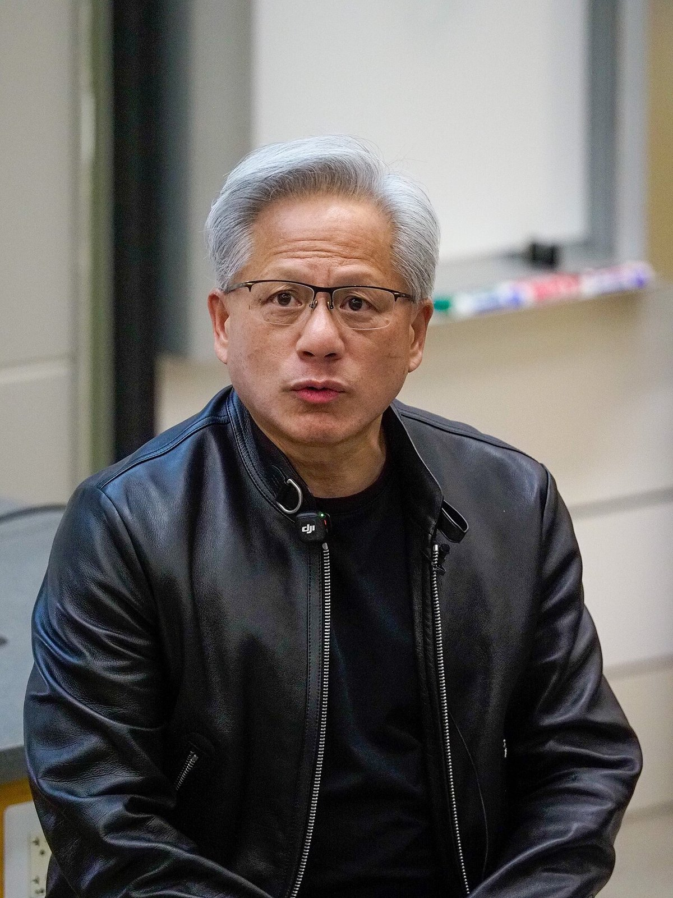
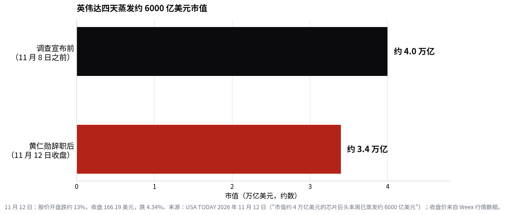

> [English version](/life/nvidia-huang-resigns-nov-12/)

*2026 年 4 月 30 日，黄仁勋在斯坦福大学。照片来自 Wikimedia Commons（CC BY 4.0）。*

## 发生了什么

11 月 12 日周四，英伟达宣布黄仁勋已辞去总裁、首席执行官及董事会成员职务，即刻生效。根据公司向美国证交会提交的 8-K 文件，董事会已于前一天（11 月 11 日）接受了他的辞呈。首席财务官 Colette Kress（59 岁，自 2013 年 9 月起担任英伟达 CFO）将出任临时 CEO，同时继续兼任 CFO。董事会还任命自 1993 年起担任董事的 Harvey C. Jones 为公司首任董事长，并表示将从内部和外部物色正式 CEO 人选。

公司公告**没有说明辞职原因**，黄仁勋本人也没有在公告中发声。这种沉默本身就很说明问题，因为辞职之前是四天不断升级的报道：

- **11 月 8 日：** 英伟达宣布，由独立董事在外部律师协助下调查黄仁勋是否成为外国情报行动的目标。当时董事会表示，没有理由认为美国国家安全利益或英伟达机密已遭泄露，并对黄仁勋表示信任。
- **随后那个周末：** 《纽约时报》报道，黄仁勋可能成为外国间谍行动的目标，核心是他与一名新加坡科技高管 Alice Huang 的关系——美国情报官员怀疑此人替中国从事间谍活动。美方称她参与协助向中国公司转运英伟达芯片，并认定购买英伟达芯片的新加坡公司 Megaspeed 是中国情报资产。彭博社 11 月 11 日报道，她已返回中国，现居北京。
- **11 月 11 日：** 《纽约时报》报道，黄仁勋还与英伟达医疗业务副总裁 Kimberly Powell 有婚外情，消息来源为五名公司前员工或现员工。同日，《华尔街日报》报道董事们正准备撤换黄仁勋，股价盘后跌约 8%。黄仁勋在给员工的备忘录中承认对妻子不忠，表示承担"全部责任"，并向家人和同事道歉。
- **11 月 12 日：** 辞职公布。股价开盘跌约 13%，收盘 166.19 美元，跌 4.34%。

以上均为媒体报道，并非公司确认的结论：辞职是一个已确认的公司治理结果，不是对间谍行为、出口管制或职场行为的定论。英伟达没有公布任何调查结论。特朗普总统 11 月 9 日表示他与黄仁勋通过话、FBI 正在调查此事，随后在 Truth Social 上建议由 Tim Cook 接任。黄仁勋还可能面临国会传票——如果他不配合闭门简报的要求。

## 33 年的历程

要理解刚刚离开的是什么，得先回看这 33 年建起了什么。黄仁勋 1963 年生于台湾台南，幼年被送到美国；1992 年底，他与 Sun Microsystems 的工程师 Chris Malachowsky 和 Curtis Priem 坐在圣何塞 Berryessa 路一家 Denny's 的卡座里，草拟了一家公司——这家店他很熟悉，少年时他曾在 Denny's 洗过盘子。英伟达于 1993 年 4 月 5 日成立，启动资金是三位创始人凑的 4 万美元。第一款芯片 NV1 于 1995 年出货，押注了一种全行业都不采用的渲染路线，公司两次濒临倒闭，直到 1997 年的 RIVA 128 才站稳脚跟。1999 年 1 月 22 日公司上市，发行价 12 美元。

真正决定一切的是 2006 年的 CUDA：一个让开发者用英伟达图形芯片做通用计算的平台。多年来它看起来像个昂贵的爱好——英伟达花了近十年时间搭建别人没有的软件生态，而芯片本身主要还是卖给游戏玩家。然后 2023 年，AI 热潮一下子全来了，生态系统成了护城河。英伟达市值 2023 年 5 月突破 1 万亿美元，2024 年 2 月突破 2 万亿，同年 6 月突破 3 万亿，2025 年 7 月 9 日突破 4 万亿——人类历史上第一家，2025 年 10 月 29 日又突破 5 万亿。截至今年 1 月的 2026 财年，公司收入 2,159 亿美元、净利润 1,201 亿美元，其中数据中心收入 1,937 亿美元。就在突破 5 万亿美元前几天，黄仁勋在华盛顿的一场演讲中说，英伟达已拿到 5,000 亿美元的 Blackwell 与 Rubin 芯片订单（截至 2026 年）。

这就是市场如今正在重新定价的"创始人溢价"的规模：33 年、一位 CEO、一家从路边餐馆卡座走到全球市值第一、期间从未易手的公司——直到四天的报道终结了它。

## 关键数字

据 USA TODAY 报道，自董事会宣布调查以来，这家市值约 4 万亿美元的芯片巨头本周已蒸发约 **6000 亿美元市值**。黄仁勋现年 63 岁，持有英伟达约 3.6% 的股份；用 USA TODAY 的话说，他"没有明显的接班人"。

*英伟达本周前后的市值。来源：USA TODAY 2026 年 11 月 12 日；收盘价来自行情数据。*

6000 亿美元这个数字值得换算一下：它大约相当于一家标准普尔 500 强中型公司的全部市值，在四天之内从一家公司身上抹掉。更重要的是它的结构——下跌不是因为需求消失或财报爆雷，而是因为"创始人"这个变量被拿掉了。英伟达的订单、产能与客户一夜之间没有变化，变化的是市场对"没有黄仁勋的英伟达值多少钱"的判断。这正是创始人溢价的定义：投资者为一个人支付的价格，而这个价格只有在他离开时才会被精确量出来。还有一个角度：6000 亿美元的蒸发发生在英伟达刚刚突破 5 万亿美元市值之后——也就是说，市场在短短两周内，先给了这家公司人类历史上最高的估值，又拿走了其中超过一成。估值的顶峰与崩塌之间只隔了十几天，这本身就说明，5 万亿美元的估值里有多少是建立在"黄仁勋会一直在"这个假设之上的。而这个假设，如今已经不存在了。市场接下来要回答的问题只有一个：没有黄仁勋的英伟达，到底值多少钱？

## Colette Kress 是谁

如今掌管全球市值最高的芯片公司的人，是过去十三年里一直掌管它账本的人。Kress 于 2013 年 9 月加入英伟达，任执行副总裁兼 CFO，当时公司年收入 41.3 亿美元；2026 财年收入 2,159 亿美元。加入英伟达之前，她在德州仪器做了约八年财务工作，1997 年至 2010 年在微软工作十三年——2006 年起任服务器与工具事业部 CFO，2010 年至 2013 年在思科任高级副总裁兼业务技术与运营财务 CFO。她拥有亚利桑那大学金融学士学位与南卫理公会大学 MBA。她是自 1993 年黄仁勋创办英伟达以来，第一位执掌公司的非黄仁勋人士，并在 11 月 12 日的 8-K 文件上以临时 CEO 的身份签了字，同时保留 CFO 头衔。

这份履历要从两面看。Kress 十三年来主持了英伟达每一次季度财报电话会，所以 11 月 17 日那场电话会——辞职五天之后——从某种意义上说她很熟悉：财务那一半她从 2013 年起就在主持。但她从未经营过公司、从未制定过产品战略，也从未成为超大规模客户 CEO 与各国元首想要更多芯片时打电话的那个人。她 2026 财年的薪酬为 1,430 万美元，大部分是股票，持有约 444 万股。市场的问题不是她能不能管好账——而是一位财务负责人能不能在董事会寻找正式 CEO 的期间，把创始人维系的客户、供应商与政府关系维系住。

还有一个细节值得注意：Kress 是董事会能找到的最"连续"的选择。她不是空降的外部救火队员，而是公司内部最了解这台机器运转方式的人。在创始人突然离场的危机里，董事会优先选择了连续性而非变革——这本身就是一个信号：董事会的当务之急是稳住局面，而不是重新定义公司。但连续性也有代价：一位临时 CEO 很难做出长期的战略承诺——她不能轻易叫停 Hugging Face 的收购，也不能轻易启动新的产品线，因为继任者可能有不同的想法。过渡期越长，公司的战略就越像"维持现状"，而竞争对手最擅长的，就是在对手维持现状的时候抢走它的客户与人才。

## 新加坡这条线

间谍报道还有另一条线索，它独立于黄仁勋的个人行为，却同样重要：新加坡，以及英伟达最先进的芯片如何流向中国的问题。美国自 2022 年起限制向中国出口英伟达最先进的 AI 处理器。但新加坡在英伟达收入中的占比却从 2023 年的 8% 上升到截至 2025 年 7 月那个财季的 22%，而新加坡贸易部估计，实际运抵该国的芯片不到英伟达总收入的 1%。这个缺口就是故事本身：新加坡是一个开票与中转枢纽，合法卖给当地或马来西亚买家的芯片可以被转售或再出口，违反美国的规定。

新加坡自己的执法记录揭示了这套机制的运作方式。2025 年 2 月，新加坡警方在一宗欺诈案中起诉了四人，涉案服务器可能含有英伟达芯片、被出口到马来西亚，整个案件涉及的交易额约 3.9 亿美元。警方于 2025 年 6 月问询了 Alice Huang——当时她是 Megaspeed 的 CEO、董事长与关键控制人。Megaspeed 从一家中国游戏公司分拆出来，已成为英伟达在东南亚最大的客户。新加坡内政部的立场是，该国不执行其他国家单方面实施的出口管制——但在该国运营的公司应考虑外国的出口法规。

这条转运链的运作方式值得拆开来看。第一步，芯片合法地卖给新加坡或马来西亚的买家——这些地方不在禁令名单上，交易本身完全合规。第二步，装有芯片的服务器以"出口到马来西亚"等名义报关，实际最终目的地却是别处；报关文件上的最终用户与真实用户不一致，这就是新加坡警方以欺诈罪名起诉的切入点。第三步，芯片在第三地被拆机、重组，进入训练集群。整个链条里，每一家经手公司都可以说自己只做了合法的那一步，而管制的漏洞恰恰在于没有人对"最终目的地"负全责。据报道，美国商务部一直在调查 DeepSeek 是否使用了被禁止出口到中国的美国芯片进行训练——如果属实，说明这条链路输送的算力已经足以训练出震动全球市场的大模型，而不只是一批零散的显卡。

这一切都不能证明黄仁勋做错了什么，英伟达董事会 11 月 8 日也表示没有理由认为公司机密已泄露。但它解释了调查为什么落在这个点上。出口管制问题——先进芯片是否正通过新加坡流向中国——是一宗有真实被告与真实指控的在办执法案件，它会比公司治理危机活得更久。辞职终结的是 CEO 的故事，终结不了新加坡的故事。

对英伟达而言，这条线还有一层商业含义。出口管制收紧的每一步，都会直接影响公司最大的增长市场之一的准入；而新加坡模式的存在，恰恰说明管制体系存在结构性漏洞——芯片可以合法地卖给 A 国，再"不合法"地出现在 B 国。无论黄仁勋的继任者是谁，他都要在华盛顿的管制要求与全球客户的采购需求之间走钢丝，而这根钢丝在过去三年里一直是黄仁勋本人用个人关系在维持。

## 为什么这不只是一则 CEO 新闻

黄仁勋 1993 年联合创办英伟达，执掌公司 33 年。这不是普通的任期，而是这家上市公司作为公众公司的全部历史。过去三年，英伟达的投资逻辑与创始人本人几乎无法区分：他是产品战略家，是向超大规模客户和各国元首推销的人，是 keynote 一场就能让公司市值波动数千亿美元的人。市场现在正在给"英伟达这家公司"和"英伟达这位创始人"之间的差价定价——6000 亿美元这个答案说明，投资者之前给创始人溢价打了很高的价。

接下来看三件事：

**1. 五天后的财报电话会。** 英伟达将于 11 月 17 日周二美西时间约 13:20 发布 2027 财年第三季度财报，14:00 召开电话会——时间表在辞职前就已确定，没有改变。这将是英伟达上市以来第一次没有黄仁勋的财报电话会，Kress 既要主持电话会、又要管财务。届时数字会被放在一个新问题下评判：不是"AI 需求增长有多快"，而是"这家公司现在由谁掌舵、能掌舵多久"。

**2. 接班人选拔。** 董事会说将考虑内部和外部人选，潜台词是没有现成答案。内部的明显人选都只管英伟达内部的一块业务，而非整家公司；外部人选则要同时驾驭芯片帝国、软件生态和地缘政治。无论哪条路都要花数月时间，而过渡期正是竞争对手和客户采取行动的窗口。最接近的先例是 2011 年的苹果：Tim Cook——一位运营负责人，而非产品 visionary——接替了 Steve Jobs，市场花了数年时间怀疑没有创始人的公司还能不能创新。Cook 的回答是做一个不同类型的 CEO。英伟达的董事会必须决定，它想要自己的 Cook，还是认为创始人这份工作仍然是一份只有芯片架构师才能做的产品工作。

**3. 进行中的交易。** 英伟达已同意以 129 亿美元收购 Hugging Face，交易预计 2027 年上半年完成；Hugging Face 的 CEO 已表态将"比以往更坚定地"捍卫开源 AI。创始人 CEO 任内宣布的交易，到了看守 CEO 手里会被买卖双方重新审视。Hugging Face 同时也是对"没有黄仁勋的英伟达是什么"的一次测验：这笔收购押注的是，芯片公司应当拥有 AI 开发者实际工作的开源平台。看守 CEO 不太可能叫停它——但她也不太可能像黄仁勋那样为它站台，而卖方很清楚这一点。

## 市场接下来怎么定价

6000 亿美元的跌幅已经发生，接下来的问题是市场会不会把这笔钱要回来——以及在什么条件下。定价将围绕三个时间点展开。

第一个是 11 月 17 日的财报。如果三季度数字与指引依然强劲，Kress 又能在电话会上给出清晰的四季度展望，市场会得到一个"机器还在转"的证据，创始人溢价的一部分可能回吐。但如果指引转弱、或 Kress 对 Rubin 的出货节奏含糊其辞，跌幅就可能被解读为"机器本身出了问题"，而不仅仅是"换了司机"。财报电话会从来不只是报数字，它是管理层可信度的现场考试，而 Kress 这次是第一次以 CEO 身份参加。

第二个是接班人选拔的时间表。董事会说"考虑内部与外部人选"，但没有给出时间表。市场最怕的不是选错人，而是长时间选不出来：过渡期每延长一个月，竞争对手就多一个月挖客户、挖人才，客户就多一个月把订单分给 AMD 或自研芯片。每一次"董事会仍在物色"的表态，都会被解读为不确定性本身。如果董事会在数周内就锁定人选，跌幅可能部分修复；如果拖到 2027 年，折价就会常态化。

第三个是调查与国会。董事会的调查至今没有公布结论，国会的闭门简报要求还悬在空中。任何新的披露——无论是指向黄仁勋个人、还是指向芯片流向——都会重新定价。反过来说，如果调查最终以"无违规发现"收尾，而国会简报也没有掀起波澜，市场会把这四天当作一次过度反应。但"无结论"本身也是一种结论：它意味着问题没有答案，只有时间能冲淡。还有一个变量是特朗普总统的表态：他公开建议由 Tim Cook 接任，又说 FBI 正在调查。总统的介入让这件事不再只是公司治理问题，而是带上了政治维度——而政治维度的走向，是市场最难定价的东西。

这件事令人不适的部分在于，董事会自己的调查至今没有公布任何结论，而且可能永远不会公布。辞职结束了公司治理危机，却没有解决它背后的问题：是否有英伟达的技术通过美方描述的渠道流向中国，以及董事会 11 月 8 日的信任表态是否过早。这些问题现在属于调查人员和国会，不属于财报电话会。财报电话会要回答的问题更简单、也更难：黄仁勋打造的这台机器，没有他还能不能继续运转。

*本文数字为截至 2026 年 11 月 13 日上午（美西时间）的报道快照，可能随时变化。文中指控均注明来源（《纽约时报》、彭博社、《华尔街日报》、USA TODAY）；英伟达自己的文件与公告未说明辞职原因。*

## 来源

- 英伟达 8-K 文件，2026年11月12日（11 月 11 日接受辞呈；Kress 出任临时 CEO；Harvey C. Jones 任首任董事长；未说明原因）。
- 《纽约时报》/ 彭博社 / 《华尔街日报》，2026年11月8–12日（11 月 8 日宣布董事会调查；Alice Huang 与 Megaspeed；Kimberly Powell；董事准备撤换黄仁勋；股价盘后跌约 8%）。
- USA TODAY，2026年11月12日（自调查宣布以来市值蒸发约 6000 亿美元；黄仁勋持股约 3.6%；"没有明显的接班人"；收盘 166.19 美元，跌 4.34%）。
- 维基百科 / SW Architect / Thomasnet，2026年（1993 年 4 月 5 日由黄仁勋、Malachowsky 与 Priem 创办；Berryessa 路 Denny's 卡座；启动资金 4 万美元；NV1 1995 年；RIVA 128 1997 年；1999 年 1 月 22 日上市，发行价 12 美元；CUDA 2006 年；2023 年 5 月市值破 1 万亿；2025 年 7 月 9 日首破 4 万亿；2025 年 10 月 29 日破 5 万亿；2026 财年收入 2,159 亿美元、净利润 1,201 亿美元、数据中心 1,937 亿美元；Blackwell 与 Rubin 芯片订单 5,000 亿美元）。
- 路透社 / BusinessDay / Inc. / MLQ，2026年11月12–13日（Kress：德州仪器约八年；微软 1997–2010 年，2006 年起任服务器与工具事业部 CFO；思科 2010–2013 年；2013 年 9 月起任英伟达 CFO；加入当年财年收入 41.3 亿美元；2026 财年薪酬 1,430 万美元；持股约 444 万股；1993 年以来首位非黄仁勋的掌舵人）。
- Internewscast / FL Postwire / Nortex Media，2026年11月（美国自 2022 年起限制先进 AI 芯片对华出口；新加坡占英伟达收入比例：截至 2025 年 7 月财季 22%，2023 年为 8%；实际运抵新加坡的芯片不到总收入 1%；2025 年 2 月起诉四人，涉案交易约 3.9 亿美元；2025 年 6 月问询 Alice Huang；Megaspeed 为英伟达东南亚最大客户；新加坡不执行单方面出口管制）。

[END EXTERNAL CONTENT: source=file file=~/workspace/stage/nvidia-huang-resigns-nov-12/article-zh.md tool_name=read]
