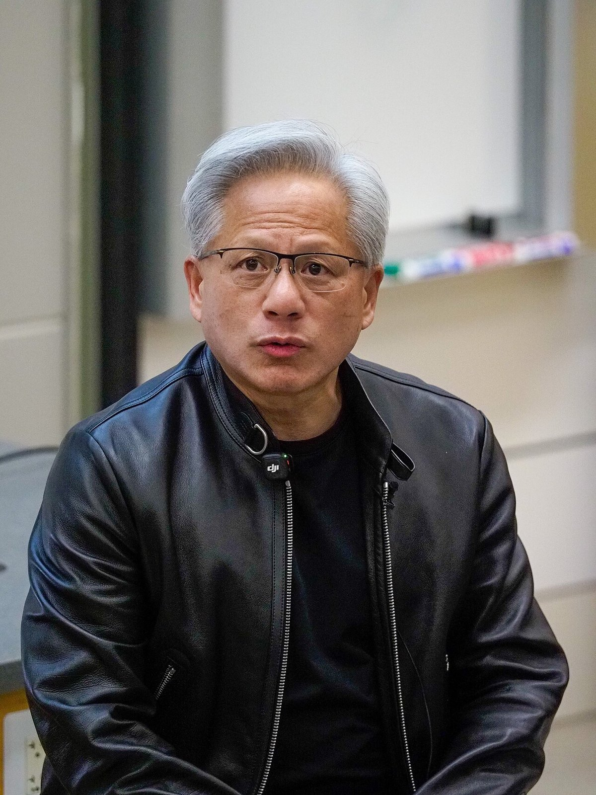
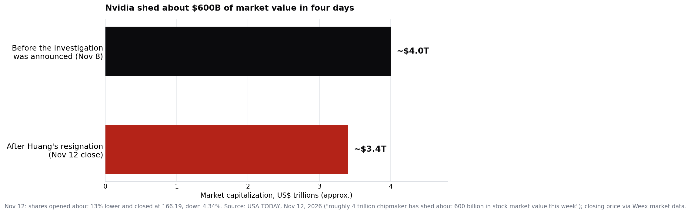

> [中文版 Chinese version](/life/nvidia-huang-resigns-nov-12-zh/)

*Jensen Huang at Stanford University on April 30, 2026. Photo via Wikimedia Commons (CC BY 4.0).*

## What happened

On Thursday, November 12, Nvidia announced that Jensen Huang had resigned as president, chief executive officer, and a member of the board, effective immediately. The board had accepted his resignation the previous day, November 11, according to the company's Form 8-K filing with the SEC. Chief financial officer Colette Kress, 59, who has been Nvidia's CFO since September 2013, will serve as interim CEO while keeping her finance role. The board also appointed Harvey C. Jones — a director since 1993 — as its first-ever board chair, and said it would consider internal and external candidates for the permanent job.

The company's announcement gives **no reason** for the resignation, and Huang was not quoted in it. That silence is doing a lot of work, because the resignation follows four days of escalating reporting:

- **November 8:** Nvidia announced that independent directors, assisted by outside legal counsel, would investigate whether Huang had been the target of a foreign intelligence operation. At the time, the board said it had no reason to believe U.S. national security interests or Nvidia secrets had been compromised, and expressed confidence in Huang.
- **The following weekend:** The New York Times reported that Huang may have been the target of a foreign espionage operation, centered on his relationship with Alice Huang, a Singapore-based tech executive whom U.S. intelligence officials suspect of spying for China. U.S. authorities have said she was involved in facilitating shipments of Nvidia chips to Chinese firms, and have concluded that Megaspeed, a Singapore company that buys Nvidia chips, was a Chinese intelligence asset. Bloomberg reported on November 11 that she has returned to China and is living in Beijing.
- **November 11:** The Times reported that Huang also had an extramarital relationship with Kimberly Powell, Nvidia's vice president of healthcare, citing five people who worked at the company. The same day, The Wall Street Journal reported that directors were preparing to remove Huang; shares fell about 8% in after-hours trading. In a memo to employees, Huang acknowledged being unfaithful to his wife, said he took "full responsibility," and apologized to his family and colleagues.
- **November 12:** the resignation. Shares opened about 13% lower and closed at $166.19, down 4.34%.

All of the above is reported, not established by the company: the resignation is a confirmed governance outcome, not a finding about espionage, export controls, or workplace conduct. Nvidia has published no investigative findings. President Trump, who said on November 9 that he had spoken with Huang and that the FBI was investigating, suggested on Truth Social that Tim Cook should replace him. Huang also faces a potential congressional subpoena if he does not comply with a request for a closed-door briefing.

## The number that matters

The roughly $4 trillion chipmaker has shed about **$600 billion in stock market value this week** since the board investigation was announced, according to USA TODAY. Huang, 63, owns about 3.6% of Nvidia's stock and, as USA TODAY put it, has "no obvious successor."

*Nvidia's market value before and after the week's events. Source: USA TODAY, Nov 12, 2026; closing price via market data.*

## Why this is bigger than a CEO story

Huang cofounded Nvidia in 1993 and ran it for 33 years. That is not a normal tenure; it is the entire history of the company as a public enterprise. For the last three years, the investment case for Nvidia has been inseparable from the founder: he was the product strategist, the chief salesman to hyperscalers and heads of state, and the person whose keynote could move the company's market value by hundreds of billions in an afternoon. The market is now repricing the difference between "Nvidia the company" and "Nvidia the founder" — and the $600 billion answer is that investors had priced in a large founder premium.

Three things to watch now:

**1. The earnings call in five days.** Nvidia reports third-quarter fiscal 2027 results on Tuesday, November 17, at about 1:20 p.m. Pacific, with the call at 2 p.m. — unchanged from the schedule set before the resignation. It will be the first Nvidia earnings call in the company's public history without Huang, and Kress will have to front it while also running finance. The numbers will be judged against a new question: not "how fast is AI demand growing" but "who is steering this company, and for how long."

**2. The succession search.** A board that says it will consider internal and external candidates is saying it does not have a ready answer. The obvious internal names all run businesses inside Nvidia, not the whole company; an external hire would need to command a chip empire, a software ecosystem, and a geopolitical position simultaneously. Either path takes months, and the interim period is when competitors and customers make their moves.

**3. The deals in flight.** Nvidia agreed to buy Hugging Face for $12.9 billion, a deal scheduled to close in the first half of 2027; Hugging Face's CEO has already pledged to keep defending open-source AI "harder than ever." Deals announced under a founder-CEO get re-examined under a caretaker one, by both the buyer and the seller.

The uncomfortable part of this story is that the board's own investigation has produced no public findings, and may never. The resignation ends the governance crisis without resolving the questions behind it: whether any Nvidia technology reached China through the channels U.S. authorities described, and whether the board's November 8 statement of confidence was premature. Those questions now belong to investigators and Congress, not to an earnings call. What the earnings call has to answer is simpler and harder: whether the machine Huang built keeps running without him.

*All figures are a snapshot of reporting as of the morning of November 13, 2026 (PT), and are subject to change. Allegations in this post are attributed to their sources (The New York Times, Bloomberg, The Wall Street Journal, USA TODAY); Nvidia's own filing and announcement state no reason for the resignation.*

<!-- rebuild trigger 2026-11-13 -->
