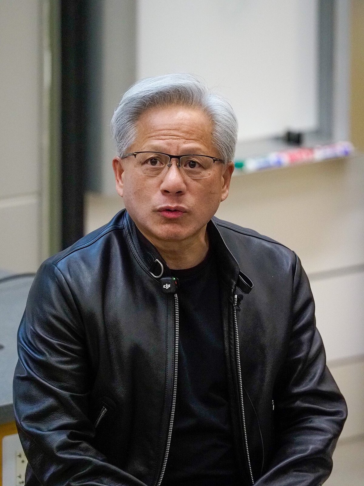
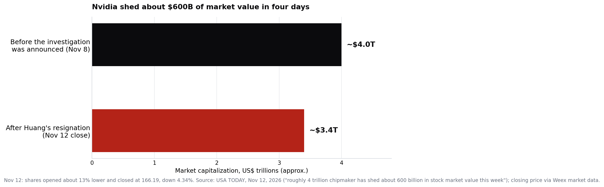

> [中文版 Chinese version](/life/nvidia-huang-resigns-nov-12-zh/)

*Jensen Huang at Stanford University on April 30, 2026. Photo via Wikimedia Commons (CC BY 4.0).*

## What happened

On Thursday, November 12, Nvidia announced that Jensen Huang had resigned as president, chief executive officer, and a member of the board, effective immediately. The board had accepted his resignation the previous day, November 11, according to the company's Form 8-K filing with the SEC. Chief financial officer Colette Kress, 59, who has been Nvidia's CFO since September 2013, will serve as interim CEO while keeping her finance role. The board also appointed Harvey C. Jones — a director since 1993 — as its first-ever board chair, and said it would consider internal and external candidates for the permanent job.

The company's announcement gives **no reason** for the resignation, and Huang was not quoted in it. That silence is doing a lot of work, because the resignation follows four days of escalating reporting:

- **November 8:** Nvidia announced that independent directors, assisted by outside legal counsel, would investigate whether Huang had been the target of a foreign intelligence operation. At the time, the board said it had no reason to believe U.S. national security interests or Nvidia secrets had been compromised, and expressed confidence in Huang.
- **The following weekend:** The New York Times reported that Huang may have been the target of a foreign espionage operation, centered on his relationship with Alice Huang, a Singapore-based tech executive whom U.S. intelligence officials suspect of spying for China. U.S. authorities have said she was involved in facilitating shipments of Nvidia chips to Chinese firms, and have concluded that Megaspeed, a Singapore company that buys Nvidia chips, was a Chinese intelligence asset. Bloomberg reported on November 11 that she has returned to China and is living in Beijing.
- **November 11:** The Times reported that Huang also had an extramarital relationship with Kimberly Powell, Nvidia's vice president of healthcare, citing five people who worked at the company. The same day, The Wall Street Journal reported that directors were preparing to remove Huang; shares fell about 8% in after-hours trading. In a memo to employees, Huang acknowledged being unfaithful to his wife, said he took "full responsibility," and apologized to his family and colleagues.
- **November 12:** the resignation. Shares opened about 13% lower and closed at $166.19, down 4.34%.

All of the above is reported, not established by the company: the resignation is a confirmed governance outcome, not a finding about espionage, export controls, or workplace conduct. Nvidia has published no investigative findings. President Trump, who said on November 9 that he had spoken with Huang and that the FBI was investigating, suggested on Truth Social that Tim Cook should replace him. Huang also faces a potential congressional subpoena if he does not comply with a request for a closed-door briefing.

## The 33-year run

To grasp what just left the building, it helps to remember what was built. Huang, born in Tainan, Taiwan in 1963 and sent to the United States as a child, sketched the company with Sun Microsystems engineers Chris Malachowsky and Curtis Priem at a Denny's booth on Berryessa Road in San Jose in late 1992. Nvidia was founded on April 5, 1993, with $40,000 of the founders' money. Its first chip, the NV1, shipped in 1995 and bet on a rendering approach the industry did not adopt; the RIVA 128 in 1997 put the company on its feet. It went public on January 22, 1999, at $12 a share.

The decision that made everything else possible came in 2006: CUDA, a platform that let developers program Nvidia's graphics chips for general-purpose computing. For years it looked like an expensive hobby. Then, in 2023, the AI boom arrived all at once, and the ecosystem was the moat. Nvidia's market value crossed $1 trillion in May 2023, $2 trillion in February 2024, $3 trillion that June, and $4 trillion on July 9, 2025 — the first company ever to reach it — then $5 trillion on October 29, 2025. For fiscal 2026, ended this past January, Nvidia reported $215.9 billion in revenue and $120.1 billion of net income, with $193.7 billion of revenue from data centers alone. Days before the $5 trillion milestone, Huang told a Washington audience that Nvidia had booked $500 billion in orders for its Blackwell and Rubin chips through 2026.

## The number that matters

The roughly $4 trillion chipmaker has shed about **$600 billion in stock market value this week** since the board investigation was announced, according to USA TODAY. Huang, 63, owns about 3.6% of Nvidia's stock and, as USA TODAY put it, has "no obvious successor."

*Nvidia's market value before and after the week's events. Source: USA TODAY, Nov 12, 2026; closing price via market data.*

## Who is Colette Kress

The person now running the world's most valuable chipmaker is the person who has run its numbers for thirteen years. Kress joined Nvidia in September 2013 as executive vice president and CFO, when annual revenue was $4.13 billion; fiscal 2026 revenue was $215.9 billion. Before Nvidia, she spent about eight years in finance roles at Texas Instruments, thirteen years at Microsoft from 1997 to 2010 — becoming CFO of the Server and Tools division in 2006 — and three years at Cisco as senior vice president and CFO of its Business Technology and Operations Finance organization. She holds a bachelor's degree in finance from the University of Arizona and an MBA from Southern Methodist University. She is the first person other than Huang to run Nvidia since he co-founded it in 1993, and she signed the November 12 8-K as interim chief executive officer while keeping the CFO title.

That résumé cuts both ways. Kress has presented Nvidia's numbers on every quarterly earnings call for thirteen years, so the November 17 call is familiar territory in one sense: she has run the financial half of it since 2013. But she has never run the company, never set product strategy, and never been the person hyperscaler CEOs and heads of state call when they want more chips. The market's question is not whether she can keep the books — it is whether a finance chief can hold the founder's coalition of customers, suppliers, and governments together while the board searches for a permanent chief executive.

## The Singapore thread

The espionage reporting has a second strand that matters independently of Huang's personal conduct: Singapore, and the question of how Nvidia's most advanced chips reach China. The United States has restricted exports of Nvidia's most advanced AI processors to China since 2022. Yet Singapore accounted for 22% of Nvidia's revenue in the fiscal quarter that ended in July 2025, up from 8% in 2023 — even as Singapore's trade ministry has estimated that chips physically delivered to the country represented less than 1% of Nvidia's total revenue. The gap is the story: Singapore is a billing and transit hub, and chips sold legally to buyers there or in Malaysia can be resold or re-exported onward, in violation of U.S. rules.

Singapore's own enforcement record shows the machinery. In February 2025, Singapore police charged four people in a fraud case involving servers that may have contained Nvidia chips and were exported to Malaysia, with the wider case involving transactions worth roughly $390 million. Police questioned Alice Huang — then Megaspeed's CEO, chairperson, and a key controller — in June 2025. Megaspeed, spun off from a Chinese gaming company, had become Nvidia's largest customer in Southeast Asia. Singapore's position, stated by its Ministry of Home Affairs, is that it does not enforce other countries' unilateral export controls — but companies operating there are expected to consider foreign export regulations.

None of this establishes that Huang did anything wrong, and Nvidia's board said on November 8 that it had no reason to believe company secrets were compromised. But it explains why the investigation landed where it did. The export-control question — whether advanced chips are reaching China through Singapore — is a live enforcement matter with real defendants and real charges, and it will outlast the governance crisis. The resignation ends the CEO story; it does not end the Singapore story.

## Why this is bigger than a CEO story

Huang cofounded Nvidia in 1993 and ran it for 33 years. That is not a normal tenure; it is the entire history of the company as a public enterprise. For the last three years, the investment case for Nvidia has been inseparable from the founder: he was the product strategist, the chief salesman to hyperscalers and heads of state, and the person whose keynote could move the company's market value by hundreds of billions in an afternoon. The market is now repricing the difference between "Nvidia the company" and "Nvidia the founder" — and the $600 billion answer is that investors had priced in a large founder premium.

Three things to watch now:

**1. The earnings call in five days.** Nvidia reports third-quarter fiscal 2027 results on Tuesday, November 17, at about 1:20 p.m. Pacific, with the call at 2 p.m. — unchanged from the schedule set before the resignation. It will be the first Nvidia earnings call in the company's public history without Huang, and Kress will have to front it while also running finance. The numbers will be judged against a new question: not "how fast is AI demand growing" but "who is steering this company, and for how long."

**2. The succession search.** A board that says it will consider internal and external candidates is saying it does not have a ready answer. The obvious internal names all run businesses inside Nvidia, not the whole company; an external hire would need to command a chip empire, a software ecosystem, and a geopolitical position simultaneously. Either path takes months, and the interim period is when competitors and customers make their moves. The closest precedent is Apple in 2011, when Tim Cook — an operations chief, not a product visionary — succeeded Steve Jobs and the market spent years doubting whether the company could innovate without its founder. Cook answered by being a different kind of chief executive. Nvidia's board will have to decide whether it wants its own Cook, or whether it believes the founder's job is still a product job that only a chip architect can do.

**3. The deals in flight.** Nvidia agreed to buy Hugging Face for $12.9 billion, a deal scheduled to close in the first half of 2027; Hugging Face's CEO has already pledged to keep defending open-source AI "harder than ever." Deals announced under a founder-CEO get re-examined under a caretaker one, by both the buyer and the seller.

The uncomfortable part of this story is that the board's own investigation has produced no public findings, and may never. The resignation ends the governance crisis without resolving the questions behind it: whether any Nvidia technology reached China through the channels U.S. authorities described, and whether the board's November 8 statement of confidence was premature. Those questions now belong to investigators and Congress, not to an earnings call. What the earnings call has to answer is simpler and harder: whether the machine Huang built keeps running without him.

*All figures are a snapshot of reporting as of the morning of November 13, 2026 (PT), and are subject to change. Allegations in this post are attributed to their sources (The New York Times, Bloomberg, The Wall Street Journal, USA TODAY); Nvidia's own filing and announcement state no reason for the resignation.*

## Sources

- Nvidia Form 8-K, November 12, 2026 (resignation accepted November 11; Kress interim CEO; Harvey C. Jones first board chair; no reason given).
- The New York Times / Bloomberg / The Wall Street Journal, November 8–12, 2026 (board investigation announced November 8; Alice Huang and Megaspeed; Kimberly Powell; directors preparing to remove Huang; shares down about 8% after hours).
- USA TODAY, November 12, 2026 (about $600 billion in market value shed since the investigation was announced; Huang owns about 3.6%; "no obvious successor"; shares closed at $166.19, down 4.34%).
- Wikipedia / SW Architect / Thomasnet, 2026 (founded April 5, 1993 by Huang, Malachowsky, and Priem; Denny's booth on Berryessa Road; $40,000 starting capital; NV1 1995; RIVA 128 1997; IPO January 22, 1999 at $12; CUDA 2006; $1 trillion May 2023; first to $4 trillion July 9, 2025; $5 trillion October 29, 2025; fiscal 2026 revenue $215.9 billion, net income $120.1 billion, data center $193.7 billion; $500 billion in Blackwell and Rubin orders through 2026).
- Reuters / BusinessDay / Inc. / MLQ, November 12–13, 2026 (Kress: Texas Instruments about eight years; Microsoft 1997–2010, Server and Tools CFO from 2006; Cisco 2010–2013; Nvidia CFO since September 2013; revenue $4.13 billion in the fiscal year she joined; first person other than Huang to run Nvidia since 1993).
- Internewscast / FL Postwire / Nortex Media, November 2026 (U.S. export restrictions on advanced AI chips to China since 2022; Singapore 22% of Nvidia revenue in the quarter ended July 2025 vs 8% in 2023; less than 1% physically delivered; February 2025 charges, four people, transactions worth about $390 million; Alice Huang questioned June 2025; Megaspeed largest Nvidia customer in Southeast Asia; Singapore does not enforce unilateral export controls).

<!-- rebuild trigger 2026-11-13 -->
