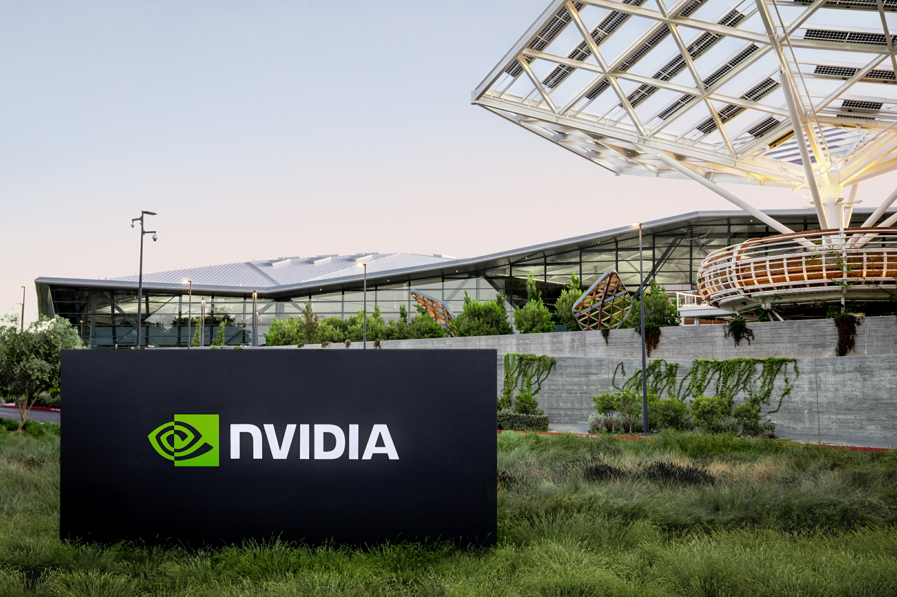
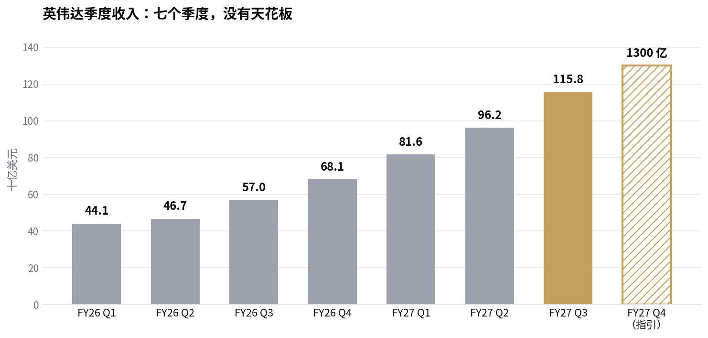

> [English version](/life/nvidia-q3-earnings-115b/)

*英伟达位于圣克拉拉的 Voyager 大楼。官方照片：NVIDIA Newsroom。*

## 这个季度的数字

英伟达于 11 月 17 日周二收盘后公布了 2027 财年第三季度业绩，这些数字几乎让人忍不住要复核一遍。收入为 **1158.4 亿美元，同比增长 103%，环比增长 20%**。这比华尔街约 1091 亿美元的共识预期高出约 67 亿美元，也比英伟达自己 1080 亿美元的指引高出 78 亿美元。调整后每股收益为 **2.68 美元，预期为 2.47 美元**。GAAP 净利润达到 **653 亿美元**，同比翻了一倍以上，GAAP 毛利率为 74.8%。

数据中心业务——实际意义上这就是现在的公司——收入 **1076 亿美元，同比增长 110%**，占总收入的 93%。其中，超大规模客户贡献 601 亿美元（增长 71%），AI 云、工业与企业客户贡献 475 亿美元，增长 195%。第二个数字更有意思：增长最快的来源不再只是几家巨型云厂商，而是直接购买算力的新云厂商、企业和前沿实验室构成的长尾。

展望比本季度更强劲。英伟达预计第四财季收入为 **1300 亿美元，上下浮动 3%**，高于分析师预期的约 1250 亿美元，毛利率为 71% 至 72%。注意一个前提：第四财季是 14 周，而非常规的 13 周，所以增幅中有一部分是日历因素，而非需求——但只是一部分。临时 CEO 柯莱特·克雷斯还把公司 2028 财年的收入增长预期从约 **70% 上调至约 75%**。公司预计明年收入增长四分之三，而基数本身刚刚翻了一番。

七个季度之前，英伟达的季度收入是 441 亿美元。不到两年时间里，它几乎翻了三倍——而指引说，下个季度还会更大。

*季度收入，单位十亿美元，2026 财年第一季度至 2027 财年第三季度；2027 财年第四季度为公司指引。来源：英伟达财报与业绩公告。*

## Rubin 是数字里面的故事

财报标题数字讲的是需求故事，里面的产品故事是 Vera Rubin。英伟达的新平台在**量产出货的第一个季度就创造了近 200 亿美元收入**，是公司历史上爬坡最快的产品。作为参照：这一个新平台一个季度的收入，大约相当于英伟达两年前整个季度的收入。

这个爬坡速度之所以重要，是因为它回答了今年一直笼罩在英伟达头顶的问题：Blackwell 周期成熟之后怎么办？目前为止的答案是，Rubin 周期在 Blackwell 结束之前就开始了。超大规模客户在继续购买 Grace Blackwell 的同时采用 Rubin，甚至连老一代 Hopper 芯片的合同据报道都在以显著更高的价格续签。产品线如今是一架梯子——Hopper、Blackwell、Rubin——每个台阶上都有客户，而不是整个市场必须同时穿越的一代产品。

数据中心数字内部的结构本身就是一个故事。超大规模客户——少数几家巨型云公司——增长 71%，这本身就很惊人。但 AI 云、工业与企业板块增长 195%，接近翻了三倍。这个板块里住着新云厂商——CoreWeave、Nebius 这样的公司——以及主权 AI 买家和正在自建推理能力的企业。买家基础正在拓宽：英伟达不再只卖给四五家资本开支步调一致的客户，而是卖给一个不断扩大的买家金字塔，每个买家都有自己的预算周期，这让需求不那么集中，也让任何单一客户都更难抽身。这是 headline 数字之下的结构性变化，也是为什么指引能够持续上调，哪怕个别客户已经大到举足轻重。

中国是数字里唯一一个主动留出的缺口。英伟达第三季度向中国发运了 **24 亿美元的 Hopper 芯片**，如今已完全停止向中国发运 Hopper；第四季度指引假设中国数据中心计算收入为零。这是一条价值每季度 24 亿美元的收入线，公司主动放弃了它，而指引仍然上调。下次再有人把中国限制描述为对英伟达增长的生存威胁时，值得记住这一点：公司刚刚消化了这笔损失，仍然上调了预测。

## 董事会的答案

这次财报电话会是近 28 年来第一次没有黄仁勋主持，而董事会借这个机会关上了一扇门。董事会主席哈维·琼斯明确表示，董事会**"不打算请黄仁勋回来担任 CEO"**，并称与猎头公司海德里克与斯特格尔斯合作的永久继任者搜寻，如今是一场外部搜寻。自 11 月 12 日黄仁勋辞职以来担任临时 CEO 的克雷斯主持了这次电话会。

背景是迫使黄仁勋离职的丑闻：有报道称他存在多起婚外情，包括与一名据称可能向中国转运受限芯片的所谓中国间谍。这些报道是 allegations（指控），不是定论，也是董事会和监管机构如今正在审查的内容。但董事会的声明不是指控，而是一项决定。公司内部曾有派系谋求黄仁勋回归，一些报道这样描述过——这一派已经输了。问题不再是创始人会不会回来，而是谁来接替他，以及搜寻要花多长时间。

这是一个真实的悬顶，也是股价没有因为一份超预期财报而直接飙升的原因。英伟达的战略、文化和客户关系，在不同寻常的程度上曾集中于一个人身上。产品路线图——Rubin 正在出货，再往后的平台——是在黄仁勋离职前就定下的，克雷斯在电话会上强调业务基本没有变化。路线图可以靠惯性运行一段时间。但永久 CEO 是那个必须谈判下一轮客户承诺、下一场监管较量和下一次平台赌注的人。搜寻每拖一个季度，公司最重要的一个职位就空缺一个季度。

克雷斯本人并不是通常意义上的过渡人物。她自 2013 年起担任英伟达首席财务官，这意味着她经历了整个 AI 繁荣期的财务管理——加密货币寒冬、游戏业务低迷，以及一家公司从年收入 260 亿美元爬到一个季度 1158 亿美元的四年。市场的问题不是她能否守住这个位置，而是董事会把她当作通往外部人选的桥梁，还是外部搜寻本身就表明董事会想要一位与缔造这台机器的人不同类型的领导者。一位同时担任 CFO 的临时 CEO 是一只稳健的手，但按定义也是临时的——这种安排持续越久，市场就越会把它解读为犹豫而非稳定。

## 利润率与日历：指引里藏着的细节

这份财报有两个细节值得单独拆解，因为它们决定了 1300 亿美元指引的真实含金量。第一个是毛利率。本季度 GAAP 毛利率为 74.8%，而第四季度的指引是 71% 至 72%。毛利率下滑三个百分点左右，原因不是需求疲软，而是产品组合的变化：Rubin 平台刚刚量产，早期生产的良率与成本结构不如成熟的 Blackwell，而新平台在收入中的占比越高，整体毛利率就越被拉低。这是硬件公司每次平台换代时都会经历的阵痛，分析师对此有预期——但值得注意的是，英伟达选择在指引中直接承认这一点，而不是用更高的收入数字来掩盖它。按 1300 亿美元收入、71% 至 72% 毛利率计算，第四季度的毛利润仍将比本季度高出约 100 亿美元。利润率在下降，利润额在上升，这就是规模的力量。

第二个细节是日历。第四财季是一个 14 周的季度，而非常规的 13 周。多出的一周大约贡献 7% 至 8% 的收入增量，这意味着 1300 亿美元指引中有一部分是日历因素，而非需求增长。把这一因素剔除后，第四季度的"真实"需求增速约为 4% 至 5%，而不是 headline 上 12% 的环比增幅。这并不是在贬低这份指引——一个 14 周的季度本来就是日历的馈赠，收入就是收入——但它提醒我们，在比较季度增速时需要把日历因素考虑进去。市场上的专业投资者都会做这道算术题，而散户往往只看 headline 数字。这也是财报后股价表现纠结的原因之一：headline 数字无可挑剔，但拆开之后，增长的质量比第一眼看到的要温和一些。

还有一个值得注意的数字：公司在第二季度通过回购与分红向股东返还了约 260 亿美元，而本季度管理层表示计划返还全部超额自由现金流。一个季度净利润 650 亿美元的公司，现金多到不知道该怎么花——这既是实力的证明，也是问题的开始：当一家公司每季度产生数百亿美元现金时，资本配置本身就成了一项战略决策。回购注销流通股、支撑每股收益；分红提供稳定的回报；但真正决定长期价值的，仍然是这些现金有多少被投入到下一代平台的研发中。英伟达的研发投入同样在以惊人的速度增长，而这才是护城河真正的来源。

## SEC 的阴影

同一天财报之外，还有第二片治理乌云。《华尔街日报》于 11 月 17 日报道，**美国证券交易委员会正在进行一项民事调查，审查英伟达的信息披露是否误导投资者**，重点是国际销售与亚洲市场。民事调查不是违规认定，也不是指控；它是 SEC 在提问，而这个规模的公司经常被提问。但调查主题——围绕国际销售的信息披露——与黄仁勋事件核心的中国芯片转运指控直接相关，这正是市场关注它的原因。

诚实的表述是：这项调查是一个尾部风险，而非基本情形。基本情形是 SEC 审查信息披露后结案，就像大多数此类调查一样。尾部情形是正式行动、重述报表，或对公司如何谈论中国业务的认定。投资者无法精确给这个尾部情形定价，所以他们把它定价为一个折扣——对其他一切都打上几个百分点的不确定性。这个折扣在今天上午的股价表现中清晰可见，也是 1158 亿美元的季度没有带来直接上涨的主要原因。

## 市场的耸肩

股价的反应是对这一天最诚实的总结。英伟达周二收于 **155.46 美元，当日下跌 0.44%**，随后盘后上涨 **3.6% 至 161.04 美元**。周三盘前交易暗示会有更大的涨幅——上涨 4.8% 至约 163 美元——但据《华尔街日报》报道，股价在**开盘后不久回落**，吐回了盘前涨幅。尽管财报令人振奋，11 月以来股价仍下跌约 24%，整个上午都在拿不定主意：数字重要，还是闹剧重要。

这种拿不定主意在某种意义上是正确的反应。财报说业务表现超出所有人的预期。治理新闻说公司领导层尚未确定，信息披露正在接受审查。两者同时成立，市场正在实时权衡。超预期财报通常会让多头赢得争论；CEO 搜寻与 SEC 调查通常会让空头赢得争论。今天，双方都没有赢。

电话会上的一个细节值得比目前获得的关注更多，因为它指向另一种集中风险。克雷斯表示，**Anthropic 的年化收入在 10 月底已达到 810 亿美元**，而前沿实验室约占数据中心销售额的 15%。这是一则关于一家即将成为上市公司的客户的惊人披露——Anthropic 今晚为 IPO 定价，明天开始交易——同时也提醒人们，英伟达的需求已经变得多么集中。少数几家前沿实验室如今占到了半导体行业最大收入线的相当份额。当它们以 Anthropic 的速度增长时，这是利好；当它们不增长时，这是风险。它同时是两者，这正是克雷斯提到它的原因。

电话会之下还运行着一个更安静的股东故事。英伟达表示计划将全部超额自由现金流返还给股东，而这个承诺的规模很难夸大：仅第二季度，公司就通过回购与分红返还了约 260 亿美元。一个季度净利润 650 亿美元的公司，不需要在投资与返现之间做选择——它可以两者都做，而且规模是历史上很少有公司达到的。回购不是持有这只股票的理由，但它是股价的底部：每个季度，相当一部分流通股正被业务顺带产生的现金注销。

## 11 月的下跌：财报解决不了的问题

要理解今天的股价反应，需要先回顾 11 月发生了什么。11 月 2 日收盘时，英伟达股价还在 202.06 美元；到 11 月 16 日收盘，已经跌至 156.14 美元——短短 12 个交易日跌去约 23%。导火索是 11 月 12 日黄仁勋的辞职，但跌势本身早在辞职之前就开始了：11 月 4 日跌至 200.13 美元，11 月 5 日跌至 181.60 美元，11 月 10 日跌至 168.89 美元。市场在黄仁勋离职之前就已经在重新定价这家公司，辞职只是让不确定性从"需求会不会见顶"变成了"公司由谁来领导"。

这个背景解释了为什么一份超预期财报没能带来直接上涨。股价在 11 月已经计入了大量的坏消息：CEO 辞职、SEC 调查、11 月均价的下跌、以及整个 AI 板块的估值回调。财报的超预期部分——收入比共识高 67 亿美元、指引上调、Rubin 爬坡——是市场在 11 月下跌过程中没有预料到的好消息，理论上应该推动股价反弹。但盘后的涨幅在周三早上被迅速吐回，说明市场对"好消息"的定价与对"坏消息"的定价并不对称：坏消息已经被计入股价，而好消息需要时间来确认——尤其是当好消息来自一家正在寻找新 CEO、同时接受 SEC 调查的公司时。

更深层的逻辑是，英伟达的估值已经进入了一个新阶段。过去三年，市场的逻辑是"需求永远超出预期"，而每一份财报都在验证这个逻辑。现在的逻辑变成了"需求依然强劲，但公司本身出现了裂缝"。前一种逻辑下，股价只看收入增速；后一种逻辑下，股价要同时为治理风险、监管风险和客户集中度风险定价。这就是为什么 1158 亿美元的季度只换来了一个"耸肩"：数字回答了旧问题，而市场已经开始问新问题了。

## 75% 的增长意味着什么

克雷斯把 2028 财年收入增长预期上调至约 75%，这个数字值得换算成绝对值来理解。2027 财年前三个季度的收入合计为 2936 亿美元，加上第四季度 1300 亿美元的指引，全年收入约为 4236 亿美元。在这个基数上再增长 75%，意味着 2028 财年收入约为 7400 亿美元——相当于一家公司在一年之内再造出一个比自己 2026 财年全年收入（约 2159 亿美元，按四个季度 441、467、570、681 亿美元合计）还要大的增量。这种规模的增长在任何行业都是罕见的，而在半导体行业更是前所未见。

这个数字也解释了为什么市场对 CEO 搜寻如此敏感。一家年收入 7400 亿美元量级的公司，其 CEO 需要谈判的客户承诺、监管关系与供应链安排，都是以千亿美元为单位的。黄仁勋的继任者接手的不是一家芯片公司，而是一个横跨云计算、主权 AI、自动驾驶与机器人多个领域的算力帝国。董事会选择外部搜寻，意味着他们认为这个职位的最佳人选不一定来自公司内部——这本身就是一个值得玩味的信号：它暗示董事会想要的是一位能够管理"后黄仁勋时代"的职业经理人，而不是一位黄仁勋的复制品。而这种选择的风险在于，英伟达的护城河在很大程度上建立在创始人与客户之间的个人信任之上，一位外部 CEO 需要时间来重建这种信任——而市场给新 CEO 的时间，从来都不慷慨。

当然，75% 只是一个预期，而不是承诺。即使 2028 财年的实际增速只有 60%——比指引低 15 个百分点——全年收入仍将达到约 6780 亿美元，依然是人类历史上任何一家半导体公司都未曾接近过的规模。而如果增速只有 50%，收入也有约 6350 亿美元。换句话说，指引的精确数字远不如它的方向重要：英伟达正在告诉市场，增长曲线的斜率不会在明年放缓，而只会变陡。投资者真正需要判断的不是 75% 能否实现，而是需求侧的支撑是否足够坚实——而这又回到了 Rubin 的爬坡、客户群的拓宽，以及那个尚未回答的问题：当所有人都在建设算力时，谁来为这些算力买单？答案的一部分，就在明天上市的 Anthropic 身上。

## 谁在买单：需求侧的另一面

收入数字回答了一个问题，却引出了另一个问题：到底是谁在买这么多算力？电话会给出的拆分提供了一个答案：超大规模客户 601 亿美元，AI 云、工业与企业客户 475 亿美元。前者是人们熟悉的名字——几家巨型云厂商；后者则是一个正在快速成形的新的买家群体：CoreWeave、Nebius 这样的新云厂商，主权 AI 项目，以及开始自建推理能力的传统企业。195% 的增速说明，这个群体的购买力正在以比巨头更快的速度增长，而这对英伟达的议价能力至关重要：当买家从四五家变成四五十家时，任何一家客户的议价能力都会下降，而英伟达的定价权则会上升。

克雷斯在电话会上透露的 Anthropic 数据是这个故事的缩影：Anthropic 的年化收入在 10 月底已达到 810 亿美元，而前沿实验室约占数据中心销售额的 15%。这意味着，仅 Anthropic 一家公司的年化收入，就已经相当于英伟达一个季度数据中心收入的四分之三左右。更重要的是，Anthropic 明天就要上市了——它的收入数字将从此成为公开信息，而它的算力采购计划也将受到公开市场的审视。英伟达与 Anthropic 的关系正在从"供应商与客户"变成"上市公司与上市公司"，而这种关系的透明度提高，对双方都是双刃剑：投资者会更清楚地看到需求的来源，也会更清楚地看到需求的集中度。

集中度的另一面是脆弱性。前沿实验室约占数据中心销售额的 15%，按本季度 1076 亿美元计算，约为 160 亿美元——这是一个季度内来自少数几家客户的收入。如果其中一家放缓采购，缺口将以数十亿美元计，而英伟达需要在同一个季度里从其他客户那里补上。这正是超大规模客户与 AI 云客户 195% 增长的意义所在：买家金字塔越宽，单一客户放缓的冲击就越小。但金字塔的底部——那些为 AI 云提供资金的新云厂商——本身的资金来源，恰恰是风险资本与债务市场对 AI 叙事的信心。如果叙事动摇，底部买家的购买力会比顶部的巨头更快消失。这就是需求故事里真正的循环性：英伟达的增长依赖于它的客户的增长，而它的客户的增长依赖于市场对 AI 的信心，而市场对 AI 的信心，部分又依赖于英伟达的财报。这是一个自我强化的循环——在上升时如此，在下降时亦然。

## 结论

抛开戏剧性，这个季度的结论毫不含糊：对 AI 算力的需求仍在加速，新平台的爬坡速度超过以往任何一代，公司刚刚把明年的增长预期上调至 75%。产品故事已经去风险，需求故事完好无损，中国的缺口已被吸收。

没有去风险的是治理故事，而它如今就是股价上的全部折扣。CEO 搜寻是未来两个季度英伟达最重要的变量——比第四季度财报更重要，因为第四季度的数字已有指引，基本已被定价。SEC 调查是第二个变量，它将按监管机构的时间表、而非公司的时间表解决。

观察英伟达的框架因此已经翻转。三年来，问题一直是需求是否可能真的如数字所说的那样强劲。数字一个季度接一个季度地回答了这个问题，而这个季度回答得最为坚决。现在的问题是，创造这些数字的公司能否在顶峰上稳住自己——找到一位永久 CEO、让监管机构满意，并留住那些如今已成为其最大增长来源的客户。业务无懈可击，董事会才是需要关注的地方。

**值得关注：**CEO 搜寻的任何消息及其时间表；SEC 调查的进展；明年 2 月第四季度财报对照 1300 亿美元指引的表现；以及 Rubin 的爬坡能否延续到第二个季度——那将证明这是一次平台换代，而非一个季度的爆发。
