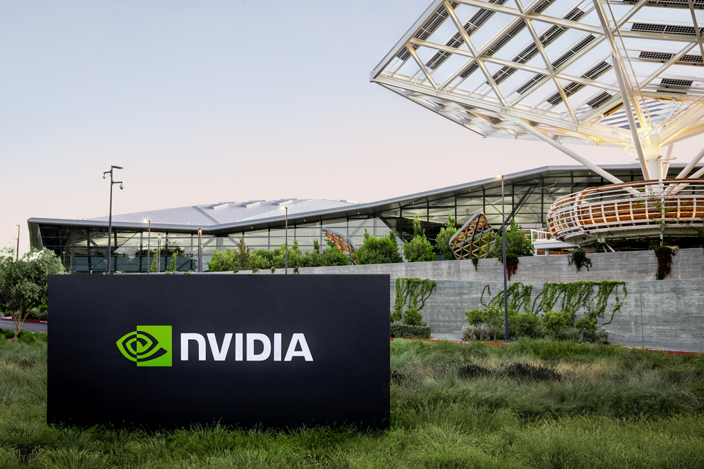
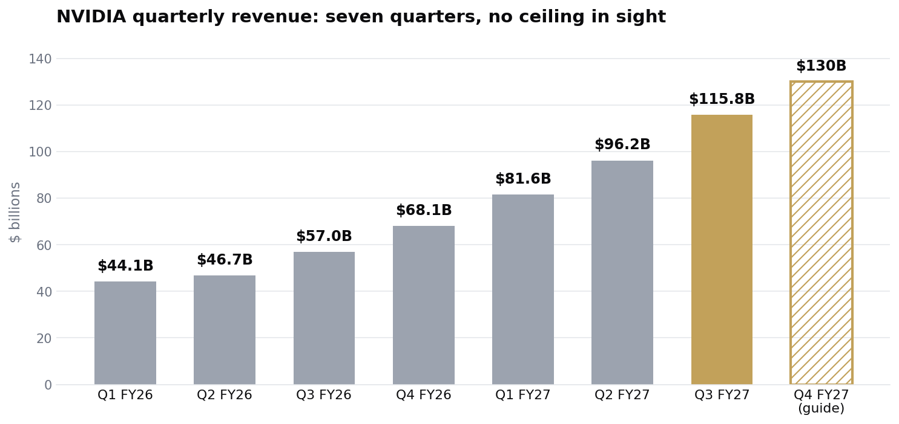

> [中文版 Chinese version](/life/nvidia-q3-earnings-115b-zh/)

*NVIDIA's Voyager building in Santa Clara. Official photo: NVIDIA Newsroom.*

## The quarter in numbers

NVIDIA reported its fiscal third-quarter 2027 results after the close on Tuesday, November 17, and the numbers are almost hard to read without double-checking them. Revenue was **$115.84 billion, up 103% from a year earlier and 20% from the previous quarter**. That beat the Wall Street consensus of roughly $109.1 billion by about $6.7 billion, and it beat NVIDIA's own guidance of $108 billion by $7.8 billion. Adjusted earnings were **$2.68 per share, against $2.47 expected**. GAAP net income reached **$65.3 billion**, more than double a year ago, at a GAAP gross margin of 74.8%.

The data center business — which is now the company, for practical purposes — did **$107.6 billion, up 110% year over year**, or 93% of total revenue. Inside that number, hyperscale customers contributed $60.1 billion (up 71%), while AI clouds, industrial, and enterprise customers contributed $47.5 billion, up 195%. The second number is the more interesting one: the fastest growth is no longer coming only from the handful of giant cloud companies, but from the long tail of neoclouds, enterprises, and frontier labs buying compute directly.

The outlook is stronger than the quarter. NVIDIA guided fiscal fourth-quarter revenue to **$130 billion, plus or minus 3%**, above the roughly $125 billion analysts wanted, at gross margins of 71% to 72%. Note the caveat: the fourth quarter is a 14-week quarter rather than 13, so part of the step-up is calendar, not demand — but only part. Interim CEO Colette Kress also raised the company's fiscal 2028 revenue growth outlook to **approximately 75%, from 70%**. The company is guiding to a year in which revenue grows by three-quarters, on top of a base that has already doubled.

Seven quarters ago, NVIDIA's quarterly revenue was $44.1 billion. It has now nearly tripled in less than two years — and the guide says the next quarter will be bigger still.

*Quarterly revenue, $ billions, Q1 FY2026–Q3 FY2027; Q4 FY2027 is company guidance. Source: NVIDIA filings and earnings releases.*

## Rubin is the story inside the story

The headline number is a demand story. The product story inside it is Vera Rubin. NVIDIA's new platform generated **nearly $20 billion in revenue in its first quarter of production shipments**, the fastest product ramp in the company's history. For context, that single quarter of a single new platform is roughly the size of NVIDIA's entire quarterly revenue two years ago.

The ramp matters because it answers the question that has shadowed NVIDIA all year: what happens when the Blackwell cycle matures? The answer, so far, is that the Rubin cycle starts before Blackwell ends. Hyperscalers are adopting Rubin while still buying Grace Blackwell, and even contracts for the older Hopper chips are reportedly being renewed at significantly higher prices. The product stack is now a ladder — Hopper, Blackwell, Rubin — with customers at every rung, rather than a single generation that the whole market must move through at once.

The mix inside the data center number is itself a story. The hyperscalers — the handful of giant cloud companies — grew 71%, which is extraordinary on its own. But the AI clouds, industrial, and enterprise segment grew 195%, nearly tripling. That segment is where the neoclouds live — the CoreWeaves and Nebiuses of the world — alongside sovereign AI buyers and enterprises building their own inference capacity. The buyer base is broadening: NVIDIA is no longer selling only to four or five customers whose capital budgets move in lockstep. It is selling to a widening pyramid of buyers, each with its own budget cycle, which makes demand less lumpy and harder for any single customer to walk away from. That is the structural change underneath the headline, and it is why the guide can keep rising even as individual customers grow large enough to matter on their own.

China is the one deliberate hole in the numbers. NVIDIA shipped **$2.4 billion of Hopper chips to China in the third quarter**, and has now stopped shipping Hopper to China entirely; the fourth-quarter guide assumes zero data center compute revenue from China. That is a $2.4-billion-a-quarter revenue line the company has voluntarily walked away from, and the guide still goes up. It is worth remembering the next time someone describes the China restrictions as an existential threat to NVIDIA's growth: the company just absorbed the loss and raised its forecast anyway.

## The board's answer

The earnings call was the first in nearly 28 years without Jensen Huang at the helm, and the board used the occasion to close a door. Board chair Harvey Jones said plainly that the board **"does not intend to reinstate Jensen as CEO,"** and that the search for a permanent successor — run with executive search firm Heidrick & Struggles — is now an external search. Kress, the CFO who has served as interim CEO since Huang resigned on November 12, ran the call.

The context is the scandal that forced Huang out: reports that he had multiple extramarital affairs, including with an alleged Chinese spy who might have funnelled restricted chips to China. Those reports are allegations, not findings, and they are part of what the board and the regulators are now examining. But the board's statement is not an allegation; it is a decision. The faction inside the company that had been angling for Huang's return, as some reports described it, has lost. The question is no longer whether the founder comes back. It is who replaces him, and how long the search takes.

That is a genuine overhang, and it is the reason the stock did not simply rocket on a beat-and-raise. NVIDIA is a company whose strategy, culture, and customer relationships were, to an unusual degree, embodied in one person. The product roadmap — Rubin shipping, the next platform after it — was set before Huang left, and Kress emphasized on the call that the business is largely unchanged. The roadmap can run on rails for a while. But a permanent CEO is the person who will have to negotiate the next cycle of customer commitments, the next regulatory fight, and the next platform bet. Every quarter the search drags on is a quarter in which the company's most important hire is unfilled.

Kress herself is not a placeholder in the usual sense. She has been NVIDIA's CFO since 2013, which means she has run the finances through the entire AI boom — the crypto winters, the gaming slumps, and the four-year climb from a $26-billion-a-year company to one doing $115 billion in a quarter. The market's question is not whether she can keep the seat warm; it is whether the board intends her as a bridge to an external hire, or whether the external search is itself a signal that the board wants a different kind of leader than the one who built the machine. An interim CEO who is also the CFO is a steady hand. It is also, by definition, a temporary one — and the longer the arrangement lasts, the more the market will read it as indecision rather than stability.

## The SEC shadow

There is a second governance cloud, and it arrived the same day as the earnings. The Wall Street Journal reported on November 17 that the **SEC is conducting a civil investigation into whether NVIDIA's disclosures may have misled investors**, with particular attention to international sales and Asian markets. A civil investigation is not a finding of wrongdoing, and it is not a charge; it is the SEC asking questions, and companies of NVIDIA's size are asked questions regularly. But the subject matter — disclosures around international sales — connects directly to the China chip-diversion allegations at the center of the Huang story, and that connection is why the market is paying attention.

The honest way to frame it: the investigation is a tail risk, not a base case. The base case is that the SEC examines the disclosures and closes the matter, as it does in most such inquiries. The tail case is a formal action, restatements, or findings that force a reckoning with how the company talked about its China business. Investors cannot price that tail case precisely, so they price it as a discount — a few percent of uncertainty applied to everything else. That discount is visible in the stock's behavior this morning, and it is the main reason a $115.8 billion quarter did not produce a straightforward rally.

## The market's shrug

The stock's reaction is the most honest summary of the day. NVIDIA closed Tuesday at **$155.46, down 0.44%** on the session, then rose **3.6% after hours to $161.04** on the earnings. Wednesday pre-market trading suggested a bigger move — up 4.8% to about $163 — but the shares **slipped shortly after the opening bell**, according to the Wall Street Journal, giving back the pre-market gain. For all the excitement of the beat, the stock is still down roughly 24% in November, and it spent the morning unable to decide whether the numbers or the soap opera matter more.

That indecision is, in a sense, the correct response. The earnings say the business is performing better than anyone expected. The governance news says the company's leadership is unresolved and its disclosures are under scrutiny. Both are true at the same time, and the market is weighing them against each other in real time. A beat-and-raise normally settles the argument for the bulls; a CEO search and an SEC inquiry normally settle it for the bears. Today, neither side has won.

There is also a quieter shareholder story running underneath the noise. NVIDIA said it plans to return all excess free cash flow to shareholders, and the scale of that promise is hard to overstate: in the second quarter alone, the company returned approximately $26 billion through buybacks and dividends. A company generating $65 billion of net income in a quarter does not need to choose between investing and returning cash — it can do both, at a scale that few companies in history have managed. The buyback is not the reason to own the stock, but it is a floor under it: every quarter, a meaningful share of the float is being retired with cash the business throws off almost as an afterthought.

One detail from the call deserves more attention than it has received, because it speaks to a different kind of concentration risk. Kress said that **Anthropic's annualized revenue reached $81 billion at the end of October**, and that frontier labs account for about **15% of data center sales**. That is a remarkable disclosure about a customer that is about to become a public company — Anthropic prices its IPO tonight and starts trading tomorrow — and it is also a reminder of how concentrated NVIDIA's demand has become. A small number of frontier labs now represent a meaningful share of the largest revenue line in semiconductors. That is a bull case when they are growing at Anthropic's pace, and a risk when they are not. It is both at once, which is why Kress mentioned it.

## The verdict

Strip away the drama and the quarter is unambiguous: demand for AI compute is still accelerating, the new platform is ramping faster than any before it, and the company just raised its growth outlook for next year to 75%. The product story is de-risked. The demand story is intact. The China hole is absorbed.

What is not de-risked is the governance story, and it is now the whole discount on the stock. The CEO search is the single most important variable for NVIDIA over the next two quarters — more important than the Q4 print, because the Q4 print is already guided and largely baked in. The SEC inquiry is the second variable, and it will resolve on the regulator's timetable, not the company's.

The framework for watching NVIDIA has therefore flipped. For three years, the question was whether demand could possibly be as strong as the numbers said. The numbers have answered that question, quarter after quarter, and this quarter answered it most emphatically of all. The question now is whether the company that produces those numbers can hold itself together at the top — find a permanent CEO, satisfy the regulators, and keep the customers who are now its largest source of growth. The business is bulletproof. The boardroom is the thing to watch.

**What to watch:** any news on the CEO search and its timeline; developments in the SEC inquiry; the Q4 print in February against the $130 billion guide; and whether the Rubin ramp sustains into its second quarter, which would confirm this was a platform transition rather than a one-quarter surge.
