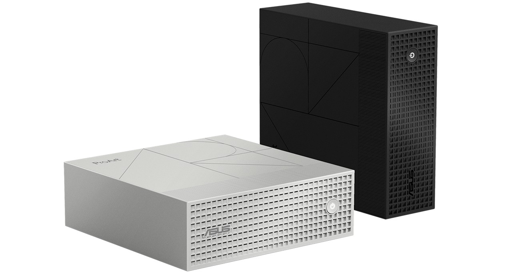
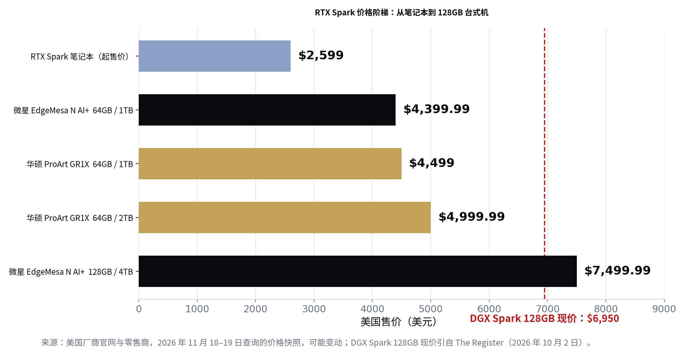

> [English version 英文版](/life/nvidia-rtx-spark-mini-pcs-4499/)

*华硕 ProArt GR1X。官方产品图：NVIDIA / 华硕，来自 NVIDIA 博客。*

2026 年 11 月 18 日星期三，首批搭载英伟达自研 PC 芯片 RTX Spark N1X 的紧凑型台式机在美国开售——来自华硕、戴尔和微星，宏碁、技嘉、惠普以及微软的 Surface RTX Spark Dev Box 还在路上。

先说价格：华硕 ProArt GR1X 起售价 4,499 美元，微星 EdgeMesa N AI+ 起售价 4,399.99 美元，是这次发布里最便宜的一台，而最贵的配置——微星的 128GB 版本——要 7,499.99 美元。但真正有意思的是，价格带来的冲击感已经反转了：一年前，最直接的参照物、同样芯片的 Linux AI 台式机 DGX Spark 只要 3,999 美元，一台 Windows 版卖 4,499 美元看起来会是个糟糕的交易。而今天，经过两轮由内存涨价推动的提价，同一台 DGX Spark 要 6,950 美元。内存危机几乎是阴差阳错地，让英伟达的消费级 AI 台式机成了买到这颗芯片最便宜的途径。

但这并不意味着它适合所有人。这些机器非常专、非常窄：在一件事上极其强大——本地运行大模型，在普通电脑擅长的很多事情上却有所妥协。它值不值得摆上你的桌子，几乎完全取决于你有没有一项真正需要 128GB 统一内存的工作。

## 卖的是什么

英伟达 11 月 18 日在官方博客发布的公告，点名了三家已经在美国开售的厂商：

| 机型 | 内存 / 存储 | 美国售价* |
|---|---|---|
| 微星 EdgeMesa N AI+（X-006US） | 64GB / 1TB | $4,399.99 |
| 华硕 ProArt GR1X | 64GB / 1TB | $4,499 |
| 华硕 ProArt GR1X | 64GB / 2TB | $4,999.99（Best Buy） |
| 微星 EdgeMesa N AI+（X-005US） | 128GB / 4TB | $7,499.99 |
| 戴尔 Creator Edition Desktop | 128GB / — | 未公布售价 |

*\*价格为 2026 年 11 月 18–19 日在美国厂商官网和零售商查询到的快照，税前，价格可能变动。英伟达官方不标价。*

有三点值得注意。第一，两家厂商在相同配置上的差价正好是 100 美元——这不是巧合。微星其实先上市，11 月 11 日以 4,699 美元开卖，然后在华硕公布 4,499 美元的当天降价 300 美元（128GB 版本降了 500 美元，从 7,999 美元降下来），据 Notebookcheck 报道。第二，戴尔是个例外：它的 Creator Edition Desktop 于 11 月 18 日在戴尔官网接受预订，配 128GB 内存，但戴尔没有公布价格，写稿时也无法确认——这说明戴尔还在盘算要把多少内存成本转嫁给买家。第三，每台机器用的都是满血芯片，没有缩水版台式机：每个配置都是 20 核 Grace CPU 加 6,144 核 Blackwell GPU，配置之间变的只有内存和存储。你不可能一不小心买到慢的那台——但整条价格阶梯也就是一条内存和存储阶梯：微星从 64GB 升到 128GB 要加 3,100 美元，相当于每多 1GB 要 48.44 美元。这是这次发布里最重要的一组数字。

华硕这台机器本身是个设计宣言：150×150×51 毫米，差不多正好一升，重 1.48 公斤（3.26 磅）。两个共 218 片扇叶的风扇为 140W 的芯片散热，定位就是 7×24 小时跑 AI 智能体。它用一个 240W 的 USB-C 电源适配器供电，有三个 20Gbps 的 USB-C 口、HDMI 2.1、万兆以太网、Wi-Fi 7 和两个 M.2 固态硬盘插槽，能带动四台 4K 显示器。它没有的东西也同样说明问题：没有 USB-A 口，没有读卡器，而且内存没法升级——像笔记本一样焊死在主板上。买到什么就是什么，永远如此。

目前只在美国有售，渠道是华硕官网商城、Best Buy、亚马逊、Micro Center 和 Central Computers。英国、欧盟和印度都还没有公布价格，技嘉自家的一升左右的 AI TOP AERO 也还没有价格和上市日期。在美国以外，这次发布还只是值得关注，而不是值得购买。

## 拆开 N1X：一颗芯片，一池内存

要理解这台机器为什么存在——以及为什么卖这个价——必须先理解定义它的那个架构决定：统一内存。

普通台式机有两池分开的内存：CPU 用的系统内存（通常是 16GB 或 32GB），和焊在显卡旁边的显存（现代显卡是 12GB、16GB 或 24GB）。跑 AI 模型时，模型的权重住在显存里，装不下的部分就根本跑不起来。一个 700 亿参数的模型，用 8 位精度量化也需要大约 70GB 的权重，这就是为什么它在任何一张消费级显卡上都跑不起来。

N1X 把这堵墙拆掉了。它把一颗 20 核的 Grace CPU（Arm 架构，和手机、Mac 里的芯片同源）和一颗 Blackwell RTX GPU（6,144 个 CUDA 核心、第五代 Tensor Core、第四代 RT Core）融合成一颗超级芯片，两者共享一池最高 128GB 的 LPDDR5X 内存，通过英伟达的 NVLink-C2C 互连，CPU 和 GPU 看到的是同一份数据，不用来回拷贝。没有显存上限这回事，因为根本没有显存。这就是整个产品：能装下 1200 亿参数模型的、最便宜的 Windows 机器。

至于什么样的模型能装下，算术很简单，而它直接决定了哪个配置值得买。模型权重大约是：FP4 精度下每 10 亿参数占 0.5GB，FP8 精度下每 10 亿参数占 1GB，FP16 精度下每 10 亿参数占 2GB。再加上操作系统和 KV 缓存——模型用来记住对话内容的动态内存，会随着上下文长度增长——就能算出：

| 模型 | 精度 | 权重大小 | 能装进哪台 |
|---|---|---|---|
| 120B | FP4 | 约 60GB | 只有 128GB 版 |
| 70B | FP8 | 约 70GB | 只有 128GB 版 |
| 32B | FP8 | 约 32GB | 64GB 版绰绰有余 |

经验法则是：64GB 覆盖 300 亿参数及以下的模型，128GB 覆盖 700 亿到 1200 亿参数的模型。那 3,100 美元就是为这条分界线付的钱。而对大多数人来说，今天实际跑的模型都在分界线以下：300 亿级别最好的开源模型，写代码、处理文档、跑本地智能体已经非常能打。1200 亿级别确实更强，但没有强四倍——却要四倍的内存。

然后是那个“1 petaflop”的数字，需要仔细读。英伟达给 N1X 标的是最高 1 petaflop 的 AI 算力，但这个数字是在 FP4 精度下测的，还假设了稀疏计算——也就是芯片跳过数学运算里的零值。这是一个理论峰值。而且，它不是决定聊天机器人“感觉有多快”的数字。模型生成文字是一个 token 一个 token 往外吐的，每生成一个 token 都要把整个模型的权重从内存里读一遍，所以生成速度几乎完全取决于内存带宽，而不是算力。N1X 平台的带宽大约是 273–300GB/s，只有苹果 M5 Max 的 614GB/s 的一半左右。这台机器能装下非常大的模型，但生成文字的速度不会比跑同一个模型的 Mac 快。那个 petaflop 是真的，但它主要体现在处理你输入的提示词那个阶段，而不是体现在你眼睁睁看着的一个字一个字生成的过程里。

台式机相对笔记本唯一真正的优势是功耗。RTX Spark 笔记本在 2026 年 10 月 16 日上市，起售价 2,599 美元，同样的 N1X 芯片跑在 45–80W；台式机跑到最高 140W。早期报道认为实际性能差距不大——大约 10% 或更少——因为瓶颈在内存带宽而不在功耗。台式机真正买到的不是速度，而是“一直在那儿”：一台插着电放在桌上的机器，7×24 小时跑智能体和定时任务，而你的笔记本可以带着出门。

## 从 Project DIGITS 到能买到的产品

这条路要从 2025 年 1 月的 CES 说起，黄仁勋当时发布了 Project DIGITS，一台售价 3,000 美元的“个人 AI 超级计算机”。它在 2025 年 GTC 上改名 DGX Spark，采用 GB10 Grace Blackwell 超级芯片——和 N1X 同一个芯片家族——于 2025 年 10 月 15 日以 3,999 美元开售，配 128GB 内存和 4TB 存储，运行英伟达基于 Ubuntu 的 Linux 系统 DGX OS，卖给那些住在 Linux 里、想要 CUDA 和 2000 亿参数左右模型的研究者。RTX Spark 笔记本在 2026 年 10 月 16 日跟进，起售价 2,599 美元，评价谨慎乐观。台式机是第三步：同样的思路，减去 Linux 的要求，给那些想要一台专用的本地 AI 机器、又不愿放弃 Windows 和 Adobe 应用的人。

## 本地跑大模型，体验到底怎么样

参数能装下是一回事，用起来什么感觉是另一回事，值得单独说清楚，因为这决定了这台机器每天的真实价值。

先说速度。本地推理的生成速度主要由内存带宽决定，而 N1X 的带宽大约是 273–300GB/s。直观的对比是：云端的前沿模型跑在数据中心的大卡上，带宽是这个数字的十倍以上，吐字自然快得多；而同样跑一个 120B 模型，这台机器的生成速度也会明显慢于一台 M5 Max 的 Mac——后者的带宽是 614GB/s。需要提醒的是，截至写稿时还没有独立的实测数据来验证 N1X 的具体生成速度，英伟达官方也没有公布 token 每秒的数字，所以任何宣称具体数字的说法都值得怀疑。合理的预期是：日常对话、写代码、处理文档完全可用，但别指望它像云端一样“秒回”，大模型的长回复需要一点耐心。

再说本地的好处。第一是隐私：代码、文件、对话记录都在自己的机器上，不经过云端，这对处理未公开的工作内容、商业资料或者个人数据的人来说是实打实的价值，英伟达官方也在博客里把这一点放在了前面。第二是没有按量计费：云端 API 是按 token 收钱的，用得越多越贵，而本地模型跑多少都不要钱——华硕甚至宣称这台机器能支持 120B 模型、最高 100 万 token 的上下文，当然长上下文会吃掉大量 KV 缓存，实际能用多长要看具体模型和量化方式。第三是 7×24 小时在线：智能体可以在半夜自己跑任务、定时处理工作、早上把结果放在你面前，笔记本合上盖子就做不到这一点。

还有一类用途值得单独提：微调。英伟达在发布里明确提到了“模型微调”，这不是随便说的。128GB 统一内存在这里的价值比单纯跑推理更大：跑推理只需要装下权重，微调还需要装下优化器状态和梯度——通常是权重的几倍。用 LoRA 这类参数高效微调方法，一个 70B 模型可以在 128GB 的机器上做微调，而在 64GB 的机器上就很吃力；7B、8B 这种小模型甚至可以做全参数微调。对独立开发者和小团队来说，这意味着不用租云端 GPU 也能把开源模型调成自己业务的样子——比如喂给它公司的文档、客服记录或者代码库，调出一个专用的版本。当然，微调的速度同样受内存带宽限制，大模型的一次完整微调仍然要以小时甚至以天计，它不是数据中心的替代品，而是“能在自己桌上完成”的替代品。

本地智能体是另一个正在成形的用法。英伟达在博客里展示的工作流是：用自然语言指令指挥 Hermes Agent，把 Photoshop 和 ComfyUI 连起来，从一张草图生成渲染图和动画，全程在本地完成；Switchyard 则负责在本地模型和云端模型之间自动分流任务，简单的本地跑，需要深度推理的再上云。在 Adobe MAX 的现场演示里，参会者就是这么做出一幅共享的迈阿密城市景观的。这些演示当然经过精心挑选，但它们指向的方向是明确的：本地 AI 的价值不只是“跑一个聊天机器人”，而是让一整条创作和开发流水线在自己的机器上转起来。

但也要算一笔账：一个每月 20 美元的云端 AI 订阅一年是 240 美元，4,499 美元够订将近 19 年。当然订阅和本地不是一回事——订阅给你的是云端最强模型的能力，本地给你的是隐私、控制权和不依赖网络的确定性。如果你每天只是偶尔问几个问题，订阅便宜得多；如果你每天高强度用、或者处理不能上云的数据，本地才开始划算。判断标准很简单：你是为了“不用交 token 钱”买它，还是为了“数据不出门”买它？前者很难回本，后者无法标价。

## DGX Spark 之谜：Windows 版反而成了便宜的那个

下面这张对比表，会让整个发布换个样子：

|  | RTX Spark 台式机 | RTX Spark 笔记本 | DGX Spark |
|---|---|---|---|
| 芯片 | N1X（GB10 家族） | N1X（GB10 家族） | GB10 Grace Blackwell |
| CPU / GPU | 20 核 Grace / 6,144 CUDA 核心 | 20 核 Grace / 6,144 CUDA 核心（顶配） | 20 核 Arm / 6,144 CUDA 核心 |
| 统一内存 | 64 或 128GB | 32–128GB | 128GB（另有 64GB 合作伙伴版） |
| 内存带宽 | 约 273–300GB/s | 约 273GB/s | 273GB/s |
| 功耗 | 最高 140W | 45–80W | 最高 240W |
| 操作系统 | Windows 11 on Arm | Windows 11 on Arm | DGX OS（Linux） |
| 价格* | $4,399.99 起 | $2,599 起 | $6,950（128GB） |

*\*价格为 2026 年 11 月 18–19 日查询到的快照，可能变动；DGX Spark 价格引自 The Register，2026 年 10 月 2 日。*

DGX Spark 的价格史，就是 2026 年内存危机的缩影：2025 年 10 月上市时 3,999 美元，2026 年 2 月因为内存供应紧张涨到 4,699 美元，2026 年 10 月 2 日又涨到 6,950 美元——一年涨了 74%。与此同时，英伟达在 10 月 23 日推出了一个缩水的 64GB 版本，只通过合作伙伴销售，起售价 4,999 美元。背后的原因是同一股力量：根据 TrendForce 数据的一项测算，DRAM 合约价在 2026 年里大约涨了四倍，因为内存厂商把产能转向了 AI 数据中心要用的 HBM 和服务器内存。

所以这个“悖论”是真实的，但范围很窄，而且两头都成立。在 128GB 这个档位，DGX Spark 其实是更便宜的那个——6,950 美元对微星的 7,499.99 美元，而且还多了 Linux AI 软件栈和一个 200Gb/s 的 ConnectX-7 高速网口，可以把几台机器连起来跑 2000 亿参数以上的模型。真正的便宜货是 64GB 的 RTX Spark 台式机：4,399.99 美元，比 64GB 的 DGX Spark（4,999 美元）便宜 600 美元，还多了 Windows 和 PC 厂商的保修。如果你想要的是一台 Windows 机器，能跑 120B 模型、顺便还能剪视频，RTX Spark 台式机是更好的选择——在 64GB 这个档位，也是更便宜的选择。

这笔账其实还揭示了一个更深层的问题：英伟达现在是在用两条产品线卖同一颗芯片，一条给开发者（Linux、DGX OS、CUDA 原生开发、集群组网），一条给更广泛的 Windows 用户（Adobe 全家桶、日常办公、游戏——虽然游戏不太行）。两条线的价差本来应该由软件和定位来决定，现在却被内存价格打乱了。当内存涨到这个地步，64GB 的 Windows 版反而成了整个产品家族的“价格洼地”。但这也意味着风险：如果内存价格回落，今天的价差逻辑会立刻重写，128GB 版本的溢价会显得更不合理。买 128GB 的人，某种意义上是在内存价格的最高点锁定了未来几年的内存成本。

*RTX Spark 价格阶梯（2026 年 11 月 18–19 日美国售价快照）。虚线：DGX Spark 128GB 现价 6,950 美元（The Register，2026 年 10 月 2 日）。图表为作者自制。*

看这张阶梯图，最直观的结论是：这些机器的价格就是内存的价格。从 2,599 美元的笔记本到 7,499.99 美元的台式机，芯片完全一样，2,599 美元到 4,399.99 美元这一步买的是更大的功耗空间和固定在桌上的形态，往后每一步都是在买 GB 数。而从 64GB 到 128GB 的 3,100 美元差价，就是内存危机按 GB 收的税。如果内存价格下跌，图里每一个价格都应该跟着跌；如果继续涨，128GB 这个档位就会变成奢侈品。今天买 128GB 的人，实际上是在市场最高点为内存付溢价。除非你能说出自己要跑的那个 700 亿参数以上的模型的名字，否则买 64GB。

## Windows on Arm：真正决定成败的问题

上面这些分析都有一个前提：软件得能跑。而这恰恰是这台机器最大的风险。N1X 是一颗 Arm 芯片，跑的是 Windows 11，这意味着市面上绝大多数现有的 Windows 软件——为英特尔和 AMD 的 x86 处理器写的——都要经过微软的 Prism 模拟层来运行。

好消息是，根据一个月的笔记本评测来看，情况比十年前 Windows on Arm 的灾难要好得多。The Verge 的三位编辑拿它当日常主力机，Slack、Discord、Signal、CapCut、Audacity 都跑得没什么问题，体验和普通 Windows 笔记本基本分不出来。Adobe 现在也提供了 Photoshop、Premiere Pro、Illustrator 和 InDesign 的原生 Arm 版本，Substance 3D Painter 12.2 也在公开测试版里首次支持了 Arm 原生运行。英伟达自己的软件故事同样完整：原生 CUDA 支持、通过 Windows Subsystem for Linux 使用 Linux 开发工具、用 Hermes Agent 和 NemoClaw 蓝图搭建本地智能体、用 Unsloth 做微调、Windows ML 现在还能通过 llama.cpp 后端直接跑 Hugging Face 上的 GGUF 模型。对于 AI 开发和创意工作来说，这个平台已经就绪了。

坏消息集中在两个地方：游戏和小众专业工具。游戏是最弱的一环：能跑的游戏，性能大致相当于一块 GeForce RTX 5070，但反作弊软件是真正的绊脚石——有一家评测抽查了 15 款主流游戏，发现大约一半玩不了，主要就是因为反作弊软件没有 Arm 版本；吃 CPU 的游戏在模拟层下表现更差。PCWorld 的结论很直白：别为了游戏买 RTX Spark。而如果你的工作流依赖某个小众的、只有 x86 版本的专业软件或老插件，花 4,499 美元之前一定要先查兼容性——模拟层能覆盖大多数软件，但不是全部，而且出问题的时候往往是悄无声息的，直到你真正要用它那一刻才发现。

还有一个经常被忽略的细节：驱动和生态的成熟度。RTX Spark 是一个全新的平台，英伟达在博客里提到的不少功能——比如 Blender 5.3 里的 DLSS 4.5 光线重建、Adobe 全家桶的 TensorRT-RTX 加速——都是在 11 月这波更新里刚刚上线的。第一批用户某种程度上是在帮厂商把生态跑顺。笔记本用户过去一个月的反馈总体是正面的，但也有小毛病：个别应用启动慢、偶尔要重启一次、深色模式之类的小地方不跟手。这些都不是致命问题，但放在一台 4,499 美元的机器上，意味着你买的不仅是一台电脑，也是一张新平台的早期入场券。

好消息是，缺口正在缩小。英伟达表示正在和主要的反作弊厂商合作，微软也在扩展 Prism 的支持范围，Adobe 的原生应用还在不断增加——Substance 3D Painter 的 Arm 原生版就是 11 月才进入公开测试的。但这些都是进行时，不是完成时，没有明确的时间表。买之前最稳妥的办法，是把自己每天离不开的软件和常玩的游戏列个清单，逐个确认，而不是相信“大部分都能跑”这种笼统的说法。

所以结论是分层的：如果你要的是 AI 开发和创意工作，平台已经准备好了；如果你要的是一台什么都能干的通用电脑，它仍然是一道“具体情况具体分析”的题——而对一台 4,499 美元的电脑来说，这本身就是一个值得警惕的信号。

## 它和 MacBook Pro 怎么选

很多人看到 128GB 统一内存，第一反应会是苹果。毕竟苹果从 M1 时代起就在卖同一个概念：CPU 和 GPU 共享一池大内存。做个直接对比是公平的，也是必要的。

14 英寸 MacBook Pro 配 M5 Max 芯片起售价 3,499 美元，同样最高支持 128GB 统一内存，内存带宽是 614GB/s——大约是 N1X 的两倍。Tom's Hardware 评测过的一台 128GB、4TB 存储、带纳米纹理显示屏的配置是 5,849 美元。2026 年 10 月 28 日苹果还发布了带 PROLED 触摸屏的新款 MacBook Pro，14 英寸 M5 Max 版起售价 4,499 美元。也就是说，同样是 128GB 统一内存、同样是 4,499 美元起，你可以在苹果这边买到一台带屏幕、带电池、所有软件都原生运行的笔记本，在英伟达这边买到一台没有屏幕、没有电池、还要自己配显示器的迷你台式机。

那为什么还有人选英伟达？答案就一个词：CUDA。苹果的统一内存跑的是 Metal 生态，跑本地模型用的是 MLX 框架，体验其实很好——但整个 AI 开发世界的默认语言是 CUDA：PyTorch、vLLM、TensorRT、Unsloth、ComfyUI 的插件生态，几乎所有教程、开源项目和生产工具都是先为 CUDA 写的。Mac 能跑模型，但很多开发工具在 Mac 上要么没有、要么是二手移植；RTX Spark 跑的是原生 CUDA，整个英伟达软件栈直接可用。对开发者来说，这不是性能差距，是生态差距。

反过来，对创作者和普通专业用户来说，苹果的机器是更好的电脑：带宽翻倍意味着同样模型的生成速度更快，电池意味着可以带着走，macOS 意味着所有软件都原生运行。简单说：苹果的机器是更好的电脑，英伟达的机器是更好的 CUDA 盒子。选哪个，取决于你更需要“电脑”还是更需要“CUDA”。

## 云端租卡 vs 买盒子

还有一笔账必须算：云端租 GPU。今天的云 GPU 租赁市场已经非常成熟，按小时计费、随开随用，完全可以按需租一张大卡来跑大模型。根据 QuantaCloud 在 2026 年 11 月 12 日的价格，DGX Spark 那 6,950 美元，大约等于租 2,908 个小时的 RTX PRO 6000 Blackwell——那是一张远比 N1X 强大的专业卡。换算一下，4,399.99 美元的微星 RTX Spark 台式机，大约等于租 1,800 多个小时的同级别专业卡。

这笔账的结论很直观：如果你只是偶尔跑大模型——一周几个小时——租云端便宜得多，而且租到的卡比你买的盒子强得多；如果你每天高强度跑、或者要 7×24 小时挂着智能体，买盒子的成本会在几个月到一年左右打平，之后就是净赚。关键变量是你的使用强度，而不是机器本身的价格。很多人买这种盒子的真实动机其实是“不想再为 token 付钱”的心理，而不是算出来的经济账——买之前先诚实地估计一下自己每周到底跑几个小时，能省下不少冤枉钱。

另外还有一个折中方案值得提：2,599 美元的 RTX Spark 笔记本。如果你只是想体验本地大模型、或者模型都在 32B 以下，笔记本是更便宜的入场券，还多了一块屏幕和一块电池。台式机的意义只在两种情况下成立：一是你需要 140W 的持续性能和 7×24 小时在线，二是你需要 128GB 内存但又不想为 DGX Spark 付 6,950 美元。

## 英伟达在下一盘什么棋

只看产品本身，会错过这件事的一半意义。英伟达历史上是卖 GPU 的，不是卖电脑的。DGX Spark 是它第一次把整台电脑卖给你，RTX Spark 是它第一次把整台消费级电脑卖给你——从芯片供应商变成平台厂商，这是英伟达过去两年里最重要、也最大胆的转型。

赌注的核心是 Windows on Arm。过去四十年，Windows 电脑基本等于英特尔加 AMD 的 x86 电脑，Arm 只属于手机。高通的骁龙 X 系列先趟出了一条路：微软做了 Prism 模拟层，Adobe 把全家桶搬上了 Arm，Windows on Arm 从“没法用”变成了“基本能用”。英伟达现在是站在高通趟出来的这条路上，押注 Windows 的软件生态终于准备好迎接 Arm 了。如果这个判断是对的，英伟达就从“显卡公司”变成了“PC 芯片公司”，直接和英特尔、AMD、高通、苹果在同一个牌桌上竞争；如果判断错了，RTX Spark 就会和当年的 Windows RT 一样，成为一个技术正确、市场错误的注脚。

还有一个背景是“AI PC”这个概念的通货膨胀。过去两年，几乎每家 PC 厂商都在卖“AI PC”，但大多数所谓 AI PC 的实质是一颗跑 Copilot 功能的 NPU 加 16GB 或 32GB 内存——能帮你抠图、做会议纪要，跑不了真正的大模型。英伟达的打法完全不同：它不跟你谈 NPU 的 TOPS 数字，而是直接给你 128GB 统一内存，让你把 120B 的模型装进一台一升大的盒子里。这是把“AI PC”从营销话术变成硬指标的一步，也是英伟达对“本地 AI 应该是什么样子”给出的自己的答案。

风险同样真实。第一是竞争：高通、AMD、联发科都在做统一内存的 Windows 芯片，一旦有人用更便宜的价格拿出接近的内存容量，RTX Spark 的窗口期就会迅速收窄。第二是和自家 GPU 业务的左右手互搏：一张 RTX 5090 卖 1,999 美元起，32GB 显存，游戏和渲染都更强——虽然它跑不了 70B 模型，但对大多数买家来说，5090 加一台普通电脑是更通用的组合。第三是内存价格本身：如果 DRAM 一直这么贵，128GB 这个档位就永远是奢侈品，整个品类的量就起不来。

接下来值得盯住的几件事：宏碁、惠普、技嘉的机器定价如何，微软的 Surface RTX Spark Dev Box 什么时候出、卖多少钱，64GB 的 DGX Spark 合作伙伴版会不会反过来压低 RTX Spark 台式机的价格，以及内存价格在 2027 年初的走势。这几个变量，基本就决定了“桌面本地 AI”是一门生意，还是一个昂贵的实验。

## 结论：一个专家工具，卖着专家工具的价格

所以，谁应该买这台机器？界限其实很清晰，分三类人。

**应该买**，如果你是每天都要跑本地模型的开发者或研究者——用 Unsloth 做微调、用 Hermes 测试智能体、把模型当成服务挂给自己的工具链——并且想要一台专用的 Windows 机器，插着电放在桌上，笔记本出门也不受影响。64GB 的微星 4,399.99 美元，是目前在 Windows 上买到这颗芯片最便宜的途径，而且比同内存的 DGX Spark 还便宜 600 美元。128GB 的微星 7,499.99 美元，只有在你能说出那个需要它的 700 亿参数以上模型的名字时才值得买。买之前先问自己一个问题：我每周要跑的模型里，有没有 64GB 装不下的？如果答案是没有，省下的 3,100 美元可以干很多事。

**可以考虑**，如果你是创作者，Adobe 全家桶的工作流已经在 Arm 上原生运行，并且想在 ComfyUI 里做本地图片和视频生成，不想再租云端 GPU。但先算清楚租云端的账：偶尔用，云端便宜得多；每天高强度用，盒子才划算。还有一个很多人忽略的点：本地生成图片和视频，显存带宽同样是瓶颈，N1X 的 273–300GB/s 在这个场景下也不占优势——它最强的场景始终是大语言模型，而不是图像生成。买它做图之前，最好先确认你的工作流里大语言模型占多大比重。

**不应该买**，如果你想要的是一台通用电脑、一台游戏 PC，或者一台 MacBook 的替代品。14 英寸 MacBook Pro 配 M5 Max 起售价 3,499 美元，内存带宽翻倍（614GB/s），同样最高 128GB 统一内存，而且所有软件都原生运行，还带电池。苹果的机器是更好的电脑，英伟达的机器是更好的 CUDA 盒子。而如果你的模型都在 32B 及以下，2,599 美元的 RTX Spark 笔记本就能做同样的事，还便宜得多。

最后说一句实话：英伟达造出了第一台能把前沿级别开源模型装进内存的 Windows 台式机，定价刚好卡在内存危机让它看起来合理的那个点上。这是一件了不起的工程产品，一个真实存在的新品类，同时也是对大多数人来说一笔糟糕的消费。真正适合它的人会知道自己是谁——他们脑子里已经有了一个具体的模型，和一份需要在凌晨三点跑起来的工作。其他人应该等一等：等内存价格回落，等宏碁、惠普和技嘉的机器上市，等 4,499 美元的实验变成 2,999 美元的产品。这类东西通常都是这么走的。

## 购买前检查清单

如果你读到这里还是想买，下单之前先过一遍这张清单：

1. **先定模型，再定内存。** 列出你每周真正要跑的模型和量化精度，算出权重需要多少内存，再决定 64GB 还是 128GB。不要为“以后可能用到”多花 3,100 美元。
2. **查软件兼容性。** 把你每天离不开的软件列出来，逐个确认有没有 Arm 原生版、或者在 Prism 模拟下能不能正常工作。尤其是小众专业工具和老插件，别等到货了才发现跑不起来。
3. **确认你的购买渠道。** 目前只在美国销售，华硕走官网商城、Best Buy、亚马逊、Micro Center 和 Central Computers；戴尔的 128GB 版本还没有价格，微星的 128GB 版本一度缺货。价格是 11 月 18–19 日的快照，可能会变。
4. **想清楚你要的是 Windows 还是 Linux。** 如果你的工作流全在 Linux 和 CUDA 命令行里，DGX Spark 的 DGX OS 可能更适合你，哪怕 128GB 版本要 6,950 美元；如果你要的是 Windows 和 Adobe 全家桶，RTX Spark 台式机才是对的那个。
5. **算一下云端对比。** 估计自己每周跑模型的小时数，对照云端租卡的价格，确认买盒子真的比租卡划算，而不是单纯想“拥有”一台。
6. **可以等就等。** 宏碁、惠普、技嘉的机器和微软的 Surface RTX Spark Dev Box 都还在路上，更多的选择通常意味着更好的价格——而内存价格本身也在剧烈波动。

## 常见问题

**这台机器能玩游戏吗？** 能跑一部分，但不建议为了游戏买它。能跑的游戏性能大致相当于 GeForce RTX 5070，但反作弊软件不支持 Arm 的游戏玩不了，有评测抽查 15 款主流游戏发现大约一半玩不了。想玩游戏，同价位买一台传统游戏本或者一张 RTX 5090 更合理。

**128GB 内存是必需的吗？** 对大多数人不是。64GB 能跑 32B 及以下的模型，已经覆盖了写代码、处理文档、跑本地智能体这些最常见的需求。只有当你要跑 70B 以上的模型时，128GB 才从“奢侈”变成“必需”。

**它和 DGX Spark 到底该选哪个？** 看操作系统和用途。要 Windows、要 Adobe 全家桶、要一台也能日常办公的电脑，选 RTX Spark 台式机；要 Linux、要原生 CUDA 开发环境、要把几台机器连起来跑 200B 以上的大模型，选 DGX Spark。64GB 这个档位 RTX Spark 更便宜，128GB 这个档位 DGX Spark 更便宜。

**现在买还是再等等？** 如果你已经有明确的模型和用途，等的意义不大——内存价格和新品上市时间都不确定。但如果你只是“想体验一下本地大模型”，2,599 美元的 RTX Spark 笔记本是更便宜的入场券；如果不着急，等宏碁、惠普、技嘉的机器上市之后再比价，通常不会吃亏。

**它能代替云端 AI 订阅吗？** 不能完全代替。本地模型在隐私和控制权上赢了，但在绝对能力上，云端最强的模型仍然领先一代以上。现实的用法是搭配：日常的、涉及隐私的、重复性的任务本地跑，需要最强推理能力的时候再调云端——英伟达的 Switchyard 做的就是这件事，在本地和云端模型之间自动分流任务。

**内存以后会降价吗？** 短期内很难。按 TrendForce 的数据，DRAM 合约价在 2026 年每个季度都在上涨，第四季度预计还要再涨 10–15%，内存厂商的产能优先给了 AI 数据中心要用的 HBM 和服务器内存。但内存是出了名的周期性行业，价格涨到这个地步，扩产迟早会跟上，只是没人能说准拐点在哪个季度。急着用就现在买，不急就等。

## 资料来源

- NVIDIA Blog, "NVIDIA RTX Spark Compact Desktops Out Now," 2026 年 11 月 18 日 — <https://blogs.nvidia.com/blog/rtx-spark-desktop-local-ai-available-now/>
- The Threshold, "RTX Spark desktops: prices, specs and where to buy," 2026 年 11 月 19 日 — <https://thethreshold.media/blog/rtx-spark-desktop-mini-pc-price-specs-asus-msi-dell-2026>
- Codema, "RTX Spark desktops: ASUS, Dell, MSI on sale now," 2026 年 11 月 18 日 — <https://codema.ai/articles/rtx-spark-desktops-asus-dell-msi-available.html>
- Notebookcheck, "MSI undercuts Asus with first Nvidia RTX Spark mini-PC release," 2026 年 11 月 18 日 — <https://www.notebookcheck.net/MSI-undercuts-Asus-with-first-Nvidia-RTX-Spark-mini-PC-release.1453590.0.html>
- WCCFTech, "ASUS Officially Launches NVIDIA RTX Spark-Powered ProArt GR1X," 2026 年 11 月 18 日 — <https://wccftech.com/asus-officially-launches-nvidia-rtx-spark-powered-proart-gr1x/>
- The Verge（经 Glonce 转载），RTX Spark 笔记本评测 — <https://glonce.com/nvidia-rtx-spark-laptops-tested-windows-on-arm/>
- Engadget，ASUS ProArt P16 评测 — <https://www.engadget.com/2294849/asus-proart-p16-rtx-spark-review/>
- PCWorld，RTX Spark 笔记本游戏表现 — <https://www.pcworld.com/article/3268177/nvidia-built-the-gaming-laptop-of-the-future-but-dont-buy-rtx-spark-for-games.html>
- DGX Spark 价格史：The Register，经 Kevin Welter / GPUwerk — <https://kevinwelter.com/en/blog/dgx-spark-test>，<https://gpuwerk.com/blog/gpu-memory-shortage-2026/>
- QuantaCloud，DGX Spark 售价 vs 云端租卡对比 — <https://quantacloud.net/guides/dgx-spark-price-vs-cloud-gpu>
- MacBook Pro M5 Max 价格与带宽：OnPremWorld — <https://onpremworld.com/en/news/2026-10-macbook-pro-proled-m5-max>
