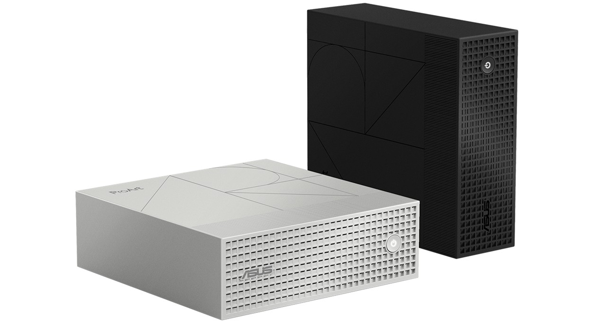
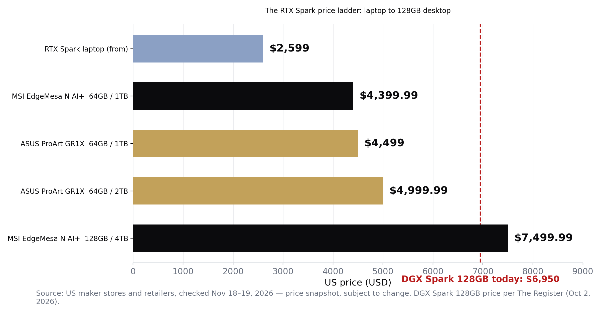

> [中文版 Chinese version](/life/nvidia-rtx-spark-mini-pcs-4499-zh/)

*The ASUS ProArt GR1X. Official product image: NVIDIA / ASUS, via the NVIDIA Blog.*

On Wednesday, November 18, 2026, the first compact desktops built around NVIDIA's own PC chip, the RTX Spark N1X, went on sale in the US — from ASUS, Dell and MSI, with Acer, GIGABYTE, HP and Microsoft's Surface RTX Spark Dev Box still to come.

The headline number is the price: the ASUS ProArt GR1X starts at $4,499, MSI's EdgeMesa N AI+ at $4,399.99, and the most expensive configuration, MSI's 128GB model, at $7,499.99. But the sticker shock has inverted: a year ago the obvious comparison, NVIDIA's own DGX Spark — the Linux AI desktop on the same silicon — cost $3,999, and today, after two rounds of memory-driven price increases, it costs $6,950. The memory crisis has, almost by accident, made NVIDIA's consumer AI desktop the cheap way to buy this chip.

That does not make it a good buy for everyone. These are strange, narrow machines: enormously capable at exactly one thing — running large AI models locally — and compromised at several things normal computers do well. Whether one belongs on your desk depends on whether you have a specific job for 128GB of unified memory.

## What went on sale

NVIDIA's announcement, published on the NVIDIA Blog on November 18, names three vendors with machines available to buy now in the US:

| Machine | Memory / storage | US price* |
|---|---|---|
| MSI EdgeMesa N AI+ (X-006US) | 64GB / 1TB | $4,399.99 |
| ASUS ProArt GR1X | 64GB / 1TB | $4,499 |
| ASUS ProArt GR1X | 64GB / 2TB | $4,999.99 (Best Buy) |
| MSI EdgeMesa N AI+ (X-005US) | 128GB / 4TB | $7,499.99 |
| Dell Creator Edition Desktop | 128GB / — | Price not announced |

*\*Prices are a snapshot checked on US maker stores and retailers on November 18–19, 2026, before tax, and are subject to change. NVIDIA itself lists no prices.*

Three things stand out. First, the gap between the two vendors at the same configuration is exactly $100 — and that is not a coincidence. MSI launched first, on November 11 at $4,699, then cut its price by $300 (and the 128GB model by $500, from $7,999) the day ASUS announced $4,499, according to Notebookcheck. Second, Dell is the odd one out: its Creator Edition Desktop opened for orders on November 18 with 128GB, but Dell announced no price. Third, every machine uses the same full-strength chip — the 20-core Grace CPU and the 6,144-core Blackwell GPU in every configuration. You cannot accidentally buy the slow one, but the entire price ladder is a memory and storage ladder: the jump from 64GB to 128GB on the MSI costs $3,100, or $48.44 per additional gigabyte. That is the single most important number in this launch.

The ASUS box measures 150 × 150 × 51 mm — almost exactly one liter — and weighs 1.48 kg (3.26 lb). Two fans with 218 blades cool a 140W chip built to run AI agents 24/7. It runs off a single 240W USB-C adapter, with three 20Gbps USB-C ports, HDMI 2.1, 10-gigabit Ethernet, Wi-Fi 7 and two M.2 SSD slots, and drives up to four 4K displays. What it does not have is also telling: no USB-A port, no memory card reader, and no way to upgrade the memory — it is soldered, like in a laptop. What you buy is what you get, forever.

Availability is US-only for now, through the ASUS eShop, Best Buy, Amazon, Micro Center and Central Computers. No UK, EU or India prices have been announced, and GIGABYTE's own one-liter AI TOP AERO has no pricing or ship date yet. Outside the US, this launch is something to watch, not something to buy.

## Inside the N1X: one chip, one pool of memory

The one architectural decision that defines this box is unified memory. A normal desktop PC has two separate memory pools: system RAM for the CPU (typically 16GB or 32GB) and VRAM soldered next to the GPU (12GB, 16GB or 24GB). When an AI model runs, its weights live in VRAM, and anything that does not fit there simply cannot run — a 70-billion-parameter model at 8-bit precision needs about 70GB of weights, which is why it runs on no consumer graphics card ever made.

The N1X throws that wall away. It fuses a 20-core Grace CPU (Arm-based, like the chips in phones and Macs) with a Blackwell RTX GPU carrying 6,144 CUDA cores, fifth-generation Tensor Cores and fourth-generation RT cores, sharing one pool of up to 128GB of LPDDR5X memory over NVIDIA's NVLink-C2C interconnect. There is no VRAM limit to hit, because there is no VRAM. That is the entire product: the cheapest Windows machine that can hold a 120-billion-parameter model in memory.

The arithmetic of what fits is simple, and it determines which configuration is worth buying. Model weights take roughly 0.5GB per billion parameters at FP4, about 1GB per billion at FP8, and about 2GB per billion at FP16 — plus the operating system and the KV cache, the working memory a model uses to remember the conversation:

| Model | Precision | Weights | Fits |
|---|---|---|---|
| 120B | FP4 | ~60GB | 128GB only |
| 70B | FP8 | ~70GB | 128GB only |
| 32B | FP8 | ~32GB | 64GB easily |

Rule of thumb: 64GB covers the 30-billion-parameter class and below; 128GB covers 70–120B. That is what the $3,100 is for. For most people, the models they actually run live below that line: the best open 30B-class models are already very capable for coding, document work and local agents. The 120B class is better, but not four times better — and it costs four times the memory.

Then there is the "1 petaflop" number, which deserves a careful reading. NVIDIA rates the N1X at up to 1 petaflop of AI performance, but that figure is measured at FP4 precision and assumes sparsity — the chip skipping zero values. It is a peak figure, and not the number that decides how fast a chatbot feels. A model generates text one token at a time, and each token requires reading the model's entire weights from memory, so generation speed is almost entirely a function of memory bandwidth, not compute. The N1X platform's bandwidth is around 273–300GB/s: roughly half the 614GB/s of Apple's M5 Max. This box can hold a very large model, but it will not generate text as fast as a Mac running the same model.

The desktop's one genuine advantage is permanence: the same silicon at up to 140W instead of the laptops' 45–80W, in a machine that sits on your desk, plugged in, running agents and scheduled jobs 24/7 while your laptop travels.

## From Project DIGITS to a product you can buy

The road here started at CES in January 2025, when Jensen Huang announced Project DIGITS, a "personal AI supercomputer" for $3,000. Renamed DGX Spark at GTC 2025 and built on the GB10 Grace Blackwell Superchip — the same silicon family as the N1X — it went on sale on October 15, 2025, at $3,999 with 128GB and 4TB, running DGX OS, NVIDIA's Ubuntu-based Linux. The RTX Spark laptops followed on October 16, 2026, from $2,599, to cautiously positive reviews. The desktops are the third step: the same idea, minus the Linux requirement, for anyone who wants a dedicated local-AI machine but will not give up Windows or Adobe's apps.

## The DGX Spark paradox: the Windows box is now the cheap one

Here is the comparison that reframes the whole launch:

| | RTX Spark desktop | RTX Spark laptop | DGX Spark |
|---|---|---|---|
| CPU / GPU | 20-core Grace / 6,144 cores | 20-core Grace / 6,144 cores (top tier) | 20-core Arm / 6,144 cores |
| Unified memory | 64 or 128GB | 32–128GB | 128GB (64GB partner version) |
| Memory bandwidth | ~273–300GB/s | ~273GB/s | 273GB/s |
| Power | Up to 140W | 45–80W | Up to 240W |
| OS | Windows 11 on Arm | Windows 11 on Arm | DGX OS (Linux) |
| Price today* | From $4,399.99 | From $2,599 | $6,950 (128GB) |

*\*Price snapshot, Nov 18–19, 2026, subject to change; DGX Spark price per The Register, Oct 2, 2026.*

The DGX Spark's price history is the 2026 memory crisis in miniature: $3,999 at launch in October 2025, $4,699 in February 2026, then $6,950 on October 2, 2026 — a 74% increase in a year — while a cut-down 64GB version arrived through partners from $4,999 on October 23. DRAM contract prices roughly quadrupled over 2026, by one calculation of TrendForce data, as memory makers shifted production to HBM and server DRAM.

The paradox is real but narrow, and it cuts both ways. At 128GB the DGX Spark is actually the cheaper machine — $6,950 against MSI's $7,499.99 — and it adds the Linux AI stack and a 200Gb/s clustering port for running 200B-plus models across linked boxes. The real bargain is the 64GB RTX Spark desktop at $4,399.99, which undercuts the 64GB DGX Spark's $4,999 by $600 while adding Windows and a PC maker's warranty. If you want one box, on Windows, that runs a 120B model and also edits video, the RTX Spark desktop is the better buy — and, at 64GB, the cheaper one too.

*The RTX Spark price ladder (US snapshot, Nov 18–19, 2026). Dashed line: DGX Spark 128GB at $6,950 (The Register, Oct 2, 2026). Chart: author's own.*

The shape of that ladder says it all: the price of these machines is the price of memory. The chip is identical from the $2,599 laptop to the $7,499.99 desktop, and the $3,100 jump from 64GB to 128GB is the memory crisis priced per unit. Buy 64GB unless you can name the 70B-plus model you will run.

## Windows on Arm: the question that decides everything

All of this is moot if the software does not work, and that is the real risk. The N1X is an Arm chip running Windows 11, so most existing Windows software — written for Intel and AMD x86 processors — runs through Microsoft's Prism emulation layer. The good news, from a month of laptop reviews, is that the situation is far better than a decade ago: The Verge's testers ran Slack, Discord, Signal, CapCut and Audacity as daily drivers with few issues, and Adobe ships native Arm versions of its main creative apps. NVIDIA's software story is solid too — native CUDA, Linux tools through Windows Subsystem for Linux, Hermes agents, Unsloth fine-tuning, and Windows ML running GGUF models.

The bad news is concentrated in games and niche professional tools. Gaming performance is roughly at GeForce RTX 5070 level when a game works, but anti-cheat software is the tripwire: one review's check of 15 major titles found around half unplayable, mostly for lack of an Arm anti-cheat build. PCWorld's verdict was blunt: do not buy RTX Spark for games. And if your workflow depends on a specialized x86-only application, check compatibility before spending $4,499. For AI development and creative work, the platform is ready. For everything else, it is a case-by-case question — a strange thing to say about a $4,499 computer.

## The verdict: a specialist tool, priced like one

**Buy it** if you are a developer or researcher who runs local models every day and wants a dedicated Windows box that stays on while your laptop travels. At $4,399.99 for 64GB, the MSI is the cheapest way into this silicon on Windows; buy the 128GB model at $7,499.99 only if you can name the 70B-plus model that needs it.

**Consider it** if you are a creator whose Adobe workflow is already native on Arm and who wants local generation in ComfyUI without renting cloud GPUs. But do the rental math first: at November 2026 cloud prices, $6,950 bought about 2,900 hours of an RTX PRO 6000 Blackwell rental — so occasional use is far cheaper in the cloud.

**Do not buy it** if you want a general-purpose computer, a gaming PC, or a MacBook alternative. A 14-inch MacBook Pro with the M5 Max starts at $3,499, has twice the memory bandwidth (614GB/s), and runs your software natively. Apple's machine is the better computer; NVIDIA's is the better CUDA box. And if your models are 32B or smaller, a $2,599 RTX Spark laptop does the same job for far less money.

The honest summary: NVIDIA has built the first Windows desktop that can hold a frontier-class open model in memory, priced at the exact point where the memory crisis makes it look reasonable. It is a remarkable piece of engineering, a genuine new category, and a bad purchase for most people. Everyone else should wait: for memory prices to fall, for the Acer, HP and GIGABYTE boxes to arrive, and for the $4,499 experiment to become a $2,999 product.

## Sources

- NVIDIA Blog, "NVIDIA RTX Spark Compact Desktops Out Now," Nov 18, 2026 — <https://blogs.nvidia.com/blog/rtx-spark-desktop-local-ai-available-now/>
- The Threshold, "RTX Spark desktops: prices, specs and where to buy," Nov 19, 2026 — <https://thethreshold.media/blog/rtx-spark-desktop-mini-pc-price-specs-asus-msi-dell-2026>
- Codema, "RTX Spark desktops: ASUS, Dell, MSI on sale now," Nov 18, 2026 — <https://codema.ai/articles/rtx-spark-desktops-asus-dell-msi-available.html>
- Notebookcheck, "MSI undercuts Asus with first Nvidia RTX Spark mini-PC release," Nov 18, 2026 — <https://www.notebookcheck.net/MSI-undercuts-Asus-with-first-Nvidia-RTX-Spark-mini-PC-release.1453590.0.html>
- WCCFTech, "ASUS Officially Launches NVIDIA RTX Spark-Powered ProArt GR1X," Nov 18, 2026 — <https://wccftech.com/asus-officially-launches-nvidia-rtx-spark-powered-proart-gr1x/>
- The Verge (via Glonce), RTX Spark laptop tests — <https://glonce.com/nvidia-rtx-spark-laptops-tested-windows-on-arm/>
- Engadget, ASUS ProArt P16 review — <https://www.engadget.com/2294849/asus-proart-p16-rtx-spark-review/>
- PCWorld, RTX Spark laptop gaming verdict — <https://www.pcworld.com/article/3268177/nvidia-built-the-gaming-laptop-of-the-future-but-dont-buy-rtx-spark-for-games.html>
- DGX Spark price history: The Register via Kevin Welter / GPUwerk — <https://kevinwelter.com/en/blog/dgx-spark-test>, <https://gpuwerk.com/blog/gpu-memory-shortage-2026/>
- QuantaCloud, DGX Spark price vs cloud GPU rental — <https://quantacloud.net/guides/dgx-spark-price-vs-cloud-gpu>
- MacBook Pro M5 Max pricing / bandwidth: OnPremWorld — <https://onpremworld.com/en/news/2026-10-macbook-pro-proled-m5-max>
