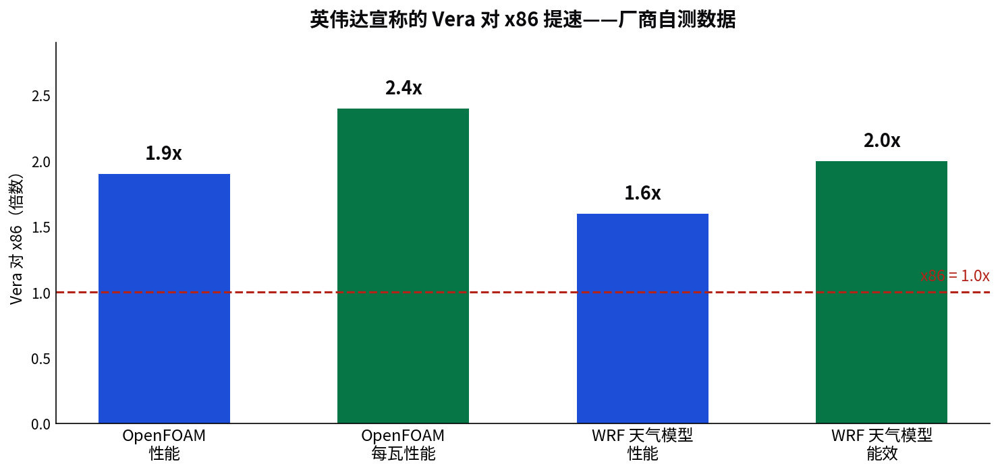

> [English version](/life/nvidia-vera-cpu-rubin-hpc-sc26/)

*英伟达位于加州圣克拉拉的总部。照片：Coolcaesar，来自 Wikimedia Commons（CC BY-SA 4.0）。*

## 发生了什么

11 月 16 日周一，英伟达在芝加哥 SC26 超算大会上发布了两款面向科学计算的硬件——目标直指英特尔与 AMD。

第一款是 **Vera CPU 机架级平台**。Vera 是英伟达首款全自研数据中心 CPU：**88 颗自研 Olympus 核心、176 线程**，搭配 SOCAMM2 LPDDR5X 内存，单芯片带宽最高 1.2 TB/s。一台机架塞下 **192 颗 Vera CPU**，约 300 TB 内存、1 PB 存储，全液冷 NVIDIA MGX 设计，以 Quantum-X800 InfiniBand 互联，聚合峰值内存带宽超过 200 TB/s。机架将由戴尔、HPE、联想与超微于 **2027 年初**起销售；为 Vera 优化的 HPC SDK 26.11（编译器与库）现已提供。

第二款是 **Rubin HPC GPU**，Vera Rubin 平台的新成员，面向科学、工程与分析领域的仿真与数据处理。英伟达称其单芯片集成**超过 5 万个 CUDA 核心**——按其自己的说法是纪录——另有稀疏数据加速与第七代 NVLink，预计 **2028 年**供货。英伟达未公布价格，也未公布显存、FP64 算力或功耗数据。

*英伟达宣称的 Vera 对 x86 提速。来源：NVIDIA Newsroom，2026 年 11 月 16 日。均为厂商自测数据；新闻稿未点名对比的 x86 芯片，公司的性能简报中列出的对比对象是一台双路 AMD EPYC 9755 系统。*

## 从 Grace 到 Vera：英伟达如何学会造 CPU

Vera 是英伟达的第二颗数据中心 CPU，而两代之间的差别正是故事所在。第一代 Grace 于 2021 年 GTC 上发布，是英伟达首款基于 Arm 架构的数据中心 CPU——当时公司刻意把它定位为 GPU 的搭档，而非英特尔至强或 AMD EPYC 的对手。Grace 于 2023 年登场，是 72 核 Arm Neoverse 设计，配 LPDDR5X 内存与 900 GB/s 的 NVLink-C2C GPU 互联；将它与 Hopper GPU 配对的 Grace Hopper 超级芯片于 2023 年 5 月进入量产。2024 年有 9 台超级计算机采用了 GH200，基于它的 JEDI 系统登上了 Green500 能效榜首。Grace 证明了英伟达能造出一颗像样的数据中心 CPU，更重要的是证明了超算中心愿意买——但按设计，它在 GPU 系统里仍然是配角。

Vera 改变了这颗 CPU 的工作定位。核心不再是授权的 Arm Neoverse 核心，而是英伟达自己设计的 **88 颗 Olympus 核心**，每核双线程——这是英伟达第一次为数据中心从零设计 CPU 核心。单芯片内存带宽提升到 1.2 TB/s，CPU 到 GPU 的互联提升到 1.8 TB/s 的 NVLink-C2C，是 Grace 的两倍。封装方式也说明了目标客户是谁：每个 1U 托盘装 8 颗 Vera CPU，机架复用了英伟达 AI 系统的 NVL72 机箱、配电与冷却部件。这不是一颗恰好放在 GPU 旁边的 CPU，而是一颗以机架级系统形态独立销售的 CPU，面向纯粹跑在 CPU 上的负载——气候模型、分子动力学、天气预报——那些几十年来一直是 x86 地盘的负载。

软件与硬件同时到位，而这一点决定了一颗新 CPU 的生死。HPC SDK 26.11 现已发布，内含为 Vera 优化的编译器与库；英伟达还发布了下一代 Fortran 编译器的公开测试版——这个细节很能说明问题，因为相当大比例的科学代码至今仍用 Fortran 写，一颗没有好 Fortran 编译器的新架构 CPU，对它的目标客户来说就是一块镇纸。

## 英伟达想让你看到的数字

Vera 的卖点是内存带宽与能效，而非核心数量。在英伟达自测中，OpenFOAM motorBike Large 气流仿真上 Vera 达到 x86 系统的 **1.9 倍性能、2.4 倍每瓦性能**；开源 WRF 天气模型上则宣称 **1.6 倍性能、2 倍能效**。

这个卖点针对的是科学计算衡量方式里一个真实的弱点。Vera 瞄准的大多数负载都是内存受限的：处理器花在等数据上的时间比花在计算上的时间还多。行业里最出名的基准 LINPACK 测的是稠密算术，偏爱为此而生的机器；而内存受限的 HPCG 基准讲的是另一个故事——在 2025 年 11 月的榜单上，前十名的系统跑 HPCG 时没有一台超过其 LINPACK 峰值的约 3%（按一项计算）。Vera 的赌注是，真正重要的瓶颈是搬数据、不是做乘法，一颗围绕单芯片 1.2 TB/s 内存带宽打造的 CPU，会在实际生产中运行的负载上胜出，哪怕它永远登不上 LINPACK 榜首。

这些数字应被视为厂商跑分，而非定论：新闻稿没有点名对比的 x86 芯片，尚无独立实测，首批系统也要到 2027 年初才出货。真正可验证的信号是客户——德国气候计算中心（DKRZ）已选定 Vera CPU 用于其 **HLRE-5 超级计算机**，与英伟达 GB200 Grace Blackwell 系统搭配，由 Bull 建造，预计 2028 年初上线。这份合同价值 4,000 万欧元、含五年支持——是一家国家级气候中心真金白银的承诺，不是意向书。

英伟达还在会上发布了 **Nemotron for Science**：一个开放模型套件，包含 Nemotron 3.5 Super VL 模型、近 5 万道化学题的 LitmusBench v0.2 数据集与后训练方案——同一 pitch 的软件一面：AI 智能体加上高速仿真，等于更快的发现。英伟达超大规模与 HPC 副总裁 Ian Buck 把这一周定调为科学进入"智能体时代"：能够规划实验、运行代码、在研究者自己的系统上核查结果的软件。

## Rubin HPC 解码

Rubin HPC 是两款发布中更单薄的一款，也更能说明英伟达认为市场正在往哪里走。它属于 Vera Rubin 平台——以天文学家 Vera Rubin 命名——的一款 GPU，但它不是为 AI 训练打造的那颗 Rubin GPU。那颗芯片有 28,672 个 CUDA 核心；Rubin HPC 超过 5 万个，按 Ian Buck 在主题演讲中的说法，约为 Hopper 的三倍——这是单颗英伟达 GPU 的纪录，至少是标准版 Rubin 芯片的 1.7 倍。

核心数是标题，但更有意思的主张是英伟达尚未解释的那一个。这颗芯片增加了公司所称的稀疏数据加速，针对科学代码中反复出现的四种模式：稀疏矩阵运算、模板计算、排序与规约。这些是气候模型、工程仿真、基因组分析与金融风险建模中的主导算子——也恰恰是内存受限的负载，在这些负载上堆算力毫无用处，因为核心的时间都花在等数据上。英伟达称，该设计让数据搬运与计算同步扩展，使核心把时间花在计算上而不是等待上。至于怎么做到的，它没有说。

这正是缺失的数字比已公布的数字更重要的原因。英伟达没有发布 Rubin HPC 的显存容量或类型、内存带宽、FP64 算力与功耗。作为参照，标准版 Rubin GPU 标称约 33 TFLOPS 的 FP64 算力与 288 GB HBM4 显存——但 Rubin HPC 针对的是不同的工作，没有带宽与双精度数据，就无法在仿真速度上对它进行比较。核心数说明不了一段代码跑多快，FP64 峰值也说明不了——当代码在等内存的时候。等到英伟达公布这些数字、独立机构实测真实算子之前，5 万多个核心只是一个数字，不是预测。而且预计 2028 年才供货，规格仍可能变动。

这里值得把"核心数为什么说明不了速度"讲透，因为它是理解 Rubin HPC 的关键，也是理解整个 HPC 市场正在发生什么的关键。科学代码里最常见的算子——稀疏矩阵运算、模板计算、排序与规约——都有一个共同点：它们对内存的依赖远远大于对算力的依赖。处理器每做一次乘法，可能要先从内存里搬运几十甚至几百字节的数据；如果内存搬运的速度跟不上，核心就会空转，再多的核心也只是在排队等数据。这就是为什么 LINPACK 榜单上的峰值算力与真实代码的运行速度之间，经常隔着一个数量级的差距：LINPACK 测的是稠密算术，数据可以反复利用、几乎不需要搬运；而真实的气候模型、工程仿真与基因组分析，恰恰是搬运最频繁的负载。英伟达在 Rubin HPC 上增加稀疏数据加速，针对的正是这个瓶颈——它声称该设计让数据搬运与计算同步扩展，使核心把时间花在计算上而不是等待上。但公司没有解释这是怎么做到的，也没有公布内存带宽与 FP64 算力这两项最能验证这个主张的数字。在这些数字出现之前，5 万多个核心只是一个标题：它告诉你英伟达认为市场正在往哪里走，却没有告诉你这颗芯片在真实代码上跑得有多快。2028 年的供货日期又拉长了这个不确定性——规格仍可能变动，而竞争对手不会等到 2028 年才回应。

## Vera 对 x86 双头垄断意味着什么

Vera 的意义不只是一颗新 CPU，而是一家 GPU 公司第一次以机架级系统的形态，正面进入英特尔与 AMD 统治了几十年的市场。几十年来，数据中心 CPU 的市场结构几乎没有变过：英特尔至强与 AMD EPYC 两分天下，客户买 CPU、装自己的系统、跑自己的代码。英伟达的第一代 Grace 刻意避开了这场正面竞争——它把自己定位为 GPU 的搭档，卖的是 Grace Hopper 超级芯片，而不是一颗独立的 CPU。Vera 改变了这个定位：它以 192 颗 CPU 的机架级平台独立销售，面向纯粹跑在 CPU 上的负载——气候模型、分子动力学、天气预报——那些几十年来一直是 x86 地盘的负载。

这个转变的底气来自两点。第一是内存带宽：单芯片 1.2 TB/s 的带宽、机架聚合超过 200 TB/s 的峰值带宽，直接瞄准了科学计算里最真实的瓶颈。Vera 瞄准的大多数负载都是内存受限的，处理器花在等数据上的时间比花在计算上的时间还多——在这样的负载上，一颗围绕带宽打造的 CPU，会在实际生产中运行的负载上胜出，哪怕它永远登不上 LINPACK 榜首。第二是软件：HPC SDK 26.11 现已发布，内含为 Vera 优化的编译器与库，英伟达还发布了下一代 Fortran 编译器的公开测试版。相当大比例的科学代码至今仍用 Fortran 写，一颗没有好 Fortran 编译器的新架构 CPU，对它的目标客户来说就是一块镇纸。英伟达同时交付硬件与编译器，说明它理解一颗新 CPU 的生死不在硅片上，而在客户能不能把已有的代码不加改动地搬过来、跑得更快。

但 Vera 面对的阻力同样真实。x86 的护城河不只是性能，而是几十年积累的软件生态、工具链与运维经验：超算中心的操作员熟悉至强与 EPYC 的行为，代码库针对 x86 做了几十年的优化，采购流程与供应商关系也都围绕这两家建立。一颗新架构的 CPU 要打进去，不能只靠跑分好看，而要靠第一个真实客户的背书——这正是 DKRZ 的 HLRE-5 合同之所以重要的原因。一家国家级气候中心把自己的下一代超算押在一颗尚未出货的 CPU 上，合同价值 4,000 万欧元、含五年支持，这不是意向书，而是真金白银的承诺。如果 HLRE-5 上线后跑出的数字接近新闻稿里的 1.9 倍与 1.6 倍，Vera 就从一张路线图变成了 x86 的真正对手；如果差距很大，质疑者会说，厂商跑分终究是厂商跑分。答案要到 2028 年才有，而在此之前，Vera 的故事仍然是一半证据、一半承诺。

## 同一场大会上，英特尔在卖什么

SC26 上不只有英伟达。英特尔在同一场大会上公布了 GPU D270（代号 Crescent Island）的首批跑分，宣称在 FP64 金融负载上最高达到英伟达 RTX PRO 6000 Blackwell 服务器版的 5.9 倍——欧洲蒙特卡洛期权定价 5.9 倍、欧洲 Black-Scholes 5.6 倍、二项式定价 4.6 倍、美式 Black-Scholes 1.92 倍。D270 基于 Xe3P 架构，32 个 Xe 核心、256 个 XMX 矩阵引擎，160 GB LPDDR5X 显存、带宽 1.5 TB/s，功耗 350W，风冷 PCIe 卡，精度覆盖从 FP4 到全速 FP64。英特尔还公布了下一代至强 Diamond Rapids：最多 256 个性能核、内存带宽最高 1.6 TB/s、末级缓存最高 1.28 GB，尚未公布上市日期。这些数字同样是厂商自测：测试跑在预生产硅片上，英伟达一方的软件版本早于其 FP64 仿真技术，有报道指出测试配置中 8 块英伟达卡对 1 块 D270、未说明是否按卡归一化。D270 没有价格、没有上市日期，客户送样于 10 月开始，有研究机构预计 2027 年量产。但方向很清楚：英特尔正在用一块同时覆盖 AI 推理与双精度计算的卡，反攻英伟达的 HPC 地盘；而英伟达则用 Rubin HPC 回应——两家公司在同一周、同一场大会上，互相亮出了对方主场产品的替代品。

## DKRZ 与 HLRE-5：第一个真实考场

Vera 的第一个真实考场在德国。德国气候计算中心（DKRZ）已选定 Vera CPU 用于其 HLRE-5 超级计算机，与 GB200 Grace Blackwell 系统搭配，由 Bull 建造，预计 2028 年初上线，合同价值 4,000 万欧元、含五年支持。气候模拟是检验内存带宽主张最合适的试金石：更高的分辨率意味着更多的网格点，更多的集合成员意味着更多的并行模拟，而所有这些都要不断地把数据搬进搬出处理器。DKRZ 的选择之所以可信，是因为它不是一份意向书，而是一份付费合同——一家国家级气候中心把自己的下一代超算押在了一颗尚未出货的 CPU 上。对英伟达来说，HLRE-5 的意义不只是订单：它是第一个能用生产级气候代码检验 Vera 那些 1.9 倍、1.6 倍厂商数字的客户。如果 HLRE-5 上线后跑出的数字接近新闻稿，Vera 就从一张路线图变成了 x86 的真正对手；如果差距很大，质疑者会说，厂商跑分终究是厂商跑分。答案要到 2028 年才有。

## Nemotron for Science：AI 智能体做科研

硬件之外，英伟达在 SC26 上还发布了 Nemotron for Science——一个开放模型套件，包含 Nemotron 3.5 Super VL 模型、近 5 万道化学题的 LitmusBench v0.2 数据集与后训练方案。它的定位与 Vera、Rubin HPC 是同一套 pitch 的软件一面：AI 智能体加上高速仿真，等于更快的发现。英伟达超大规模与 HPC 副总裁 Ian Buck 把这一周定调为科学进入"智能体时代"：软件能够规划实验、运行代码、在研究者自己的系统上核查结果。这个愿景与硬件发布是互相锁定的：Vera 跑得动的仿真越快，智能体能尝试的假设就越多；智能体越能干，科学家对算力的需求就越大。值得注意的还有 SC26 本身的背景：超级计算大会是超算行业的年度大考，TOP500 榜单与 Green500 能效榜单都在这个周期里更新。2025 年 11 月的 HPCG 榜单上，前十名的系统没有一台超过其 LINPACK 峰值的约 3%——这个数字正是英伟达拿来论证"内存才是瓶颈"的证据。而在 Green500 能效榜上，基于 GH200 的 JEDI 系统曾经登顶，证明了英伟达的能效路线在超算中心是行得通的。Vera 与 Rubin HPC 要面对的，正是这些榜单背后的评判标准：不是跑分高，而是真实代码跑得快、耗电少。SC26 上的发布只是开场，榜单与客户实测才是期末考试。

## 为什么这条消息重要

时间点就是故事。这是**黄仁勋 11 月 12 日辞去 CEO 后英伟达首个重磅产品发布**，而发布次日（11 月 17 日）就是公司财报——首个没有黄仁勋的财报电话会。传递给市场的信息再清楚不过：路线图不依赖于一个人。传递信息的人本身也是信息的一部分：首席财务官 Colette Kress 担任临时 CEO，而在 SC26 上为英伟达这一周开场的是 Ian Buck——一位工程负责人，而不是临时代言人。公司展示的是整个梯队，不只是路线图。

产品层面的指向同样明确。多年来英伟达卖的是插在别人 CPU 旁边的 GPU；Vera 改变了这一点：英伟达现在连 CPU 也卖，而且机架就是为跑了几十年 x86 地盘的仿真负载设计的。值得注意的是，英特尔正在同一场大会上推销自己具备 FP64 能力的 GPU——两家公司正在同时入侵对方的主场。

Rubin HPC 是更长远的赌注，也是更单薄的发布：一款 2028 年的产品，只有一个核心数 headline、没有公开规格，这是一张路线图标记，而非硬件。但方向很清楚：英伟达不再只是 AI 训练公司，它想要整个科学计算栈——CPU、GPU、网络与中间的软件——而且愿意在创始人离开的那一周就这么说。

接下来值得看的很直接。第一，11 月 17 日的财报电话会：公司是否会给 Vera 与 Rubin HPC 任何收入层面的定调，以及没有黄仁勋在场时它如何谈需求。这场电话会之所以值得盯，不只是因为它是首个没有黄仁勋的财报电话会，更因为它将是市场第一次听到新管理层用自己的语言描述需求——过去十几年，英伟达的需求故事几乎都是由黄仁勋一个人讲述的；现在，讲述者换了，故事本身会不会变调，是投资者最想知道的事。第二，DKRZ 的 HLRE-5 建设——这是 Vera 的内存带宽卖点在真实气候代码面前经受检验的第一次。第三，Rubin HPC 缺失的数字——内存带宽与 FP64 算力——它们将决定 5 万核的标题是仿真领域的真正一步，还是幻灯片上的一个大数字。在这些数字出现之前，Vera 是有证据支撑的发布，Rubin HPC 是只有承诺的发布。

*本文反映截至 2026 年 11 月 16 日上午（太平洋时间）的状态。来源：NVIDIA Newsroom；NVIDIA Blog；StorageReview；AI Stock Wire；Unite.AI；ByteOrbital；Converge Digest；ServeTheHome；Tech Times；WCCFTech。*

