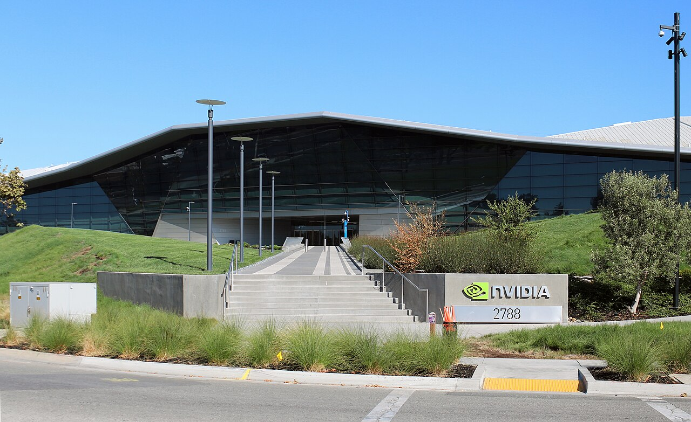

> [English version](/life/nvidia-vera-cpu-rubin-hpc-sc26/)

*英伟达位于加州圣克拉拉的总部。照片：Coolcaesar，来自 Wikimedia Commons（CC BY-SA 4.0）。*

## 发生了什么

11 月 16 日周一，英伟达在芝加哥 SC26 超算大会上发布了两款面向科学计算的硬件——目标直指英特尔与 AMD。

第一款是 **Vera CPU 机架级平台**。Vera 是英伟达首款全自研数据中心 CPU：**88 颗自研 Olympus 核心、176 线程**，搭配 SOCAMM2 LPDDR5X 内存，单芯片带宽最高 1.2 TB/s。一台机架塞下 **192 颗 Vera CPU**，约 300 TB 内存、1 PB 存储，全液冷 NVIDIA MGX 设计，以 Quantum-X800 InfiniBand 互联，聚合峰值内存带宽超过 200 TB/s。机架将由戴尔、HPE、联想与超微于 **2027 年初**起销售；为 Vera 优化的 HPC SDK 26.11（编译器与库）现已提供。

第二款是 **Rubin HPC GPU**，Vera Rubin 平台的新成员，面向科学、工程与分析领域的仿真与数据处理。英伟达称其单芯片集成**超过 5 万个 CUDA 核心**——按其自己的说法是纪录——另有稀疏数据加速与第七代 NVLink，预计 **2028 年**供货。英伟达未公布价格，也未公布显存、FP64 算力或功耗数据。

*英伟达宣称的 Vera 对 x86 提速。来源：NVIDIA Newsroom，2026 年 11 月 16 日。均为厂商自测数据；新闻稿未点名对比的 x86 芯片，公司的性能简报中列出的对比对象是一台双路 AMD EPYC 9755 系统。*

## 英伟达想让你看到的数字

Vera 的卖点是内存带宽与能效，而非核心数量。在英伟达自测中，OpenFOAM motorBike Large 气流仿真上 Vera 达到 x86 系统的 **1.9 倍性能、2.4 倍每瓦性能**；开源 WRF 天气模型上则宣称 **1.6 倍性能、2 倍能效**。

这些数字应被视为厂商跑分，而非定论：新闻稿没有点名对比的 x86 芯片，尚无独立实测，首批系统也要到 2027 年初才出货。真正可验证的信号是客户——德国气候计算中心（DKRZ）已选定 Vera CPU 用于其 **HLRE-5 超级计算机**，与英伟达 GB200 Grace Blackwell 系统搭配，由 Bull 建造，预计 2028 年初上线。

英伟达还在会上发布了 **Nemotron for Science**：一个开放模型套件，包含 Nemotron 3.5 Super VL 模型、近 5 万道化学题的 LitmusBench v0.2 数据集与后训练方案——同一 pitch 的软件一面：AI 智能体加上高速仿真，等于更快的发现。

## 为什么这条消息重要

时间点就是故事。这是**黄仁勋 11 月 12 日辞去 CEO 后英伟达首个重磅产品发布**，而发布次日（11 月 17 日）就是公司财报——首个没有黄仁勋的财报电话会。传递给市场的信息再清楚不过：路线图不依赖于一个人。

产品层面的指向同样明确。多年来英伟达卖的是插在别人 CPU 旁边的 GPU；Vera 改变了这一点：英伟达现在连 CPU 也卖，而且机架就是为跑了几十年 x86 地盘的仿真负载设计的。值得注意的是，英特尔正在同一场大会上推销自己具备 FP64 能力的 GPU——两家公司正在同时入侵对方的主场。

Rubin HPC 是更长远的赌注，也是更单薄的发布：一款 2028 年的产品，只有一个核心数 headline、没有公开规格，这是一张路线图标记，而非硬件。但方向很清楚：英伟达不再只是 AI 训练公司，它想要整个科学计算栈——CPU、GPU、网络与中间的软件——而且愿意在创始人离开的那一周就这么说。

*本文反映截至 2026 年 11 月 16 日上午（太平洋时间）的状态。来源：NVIDIA Newsroom；StorageReview；AI Stock Wire；Unite.AI；ByteOrbital。*
