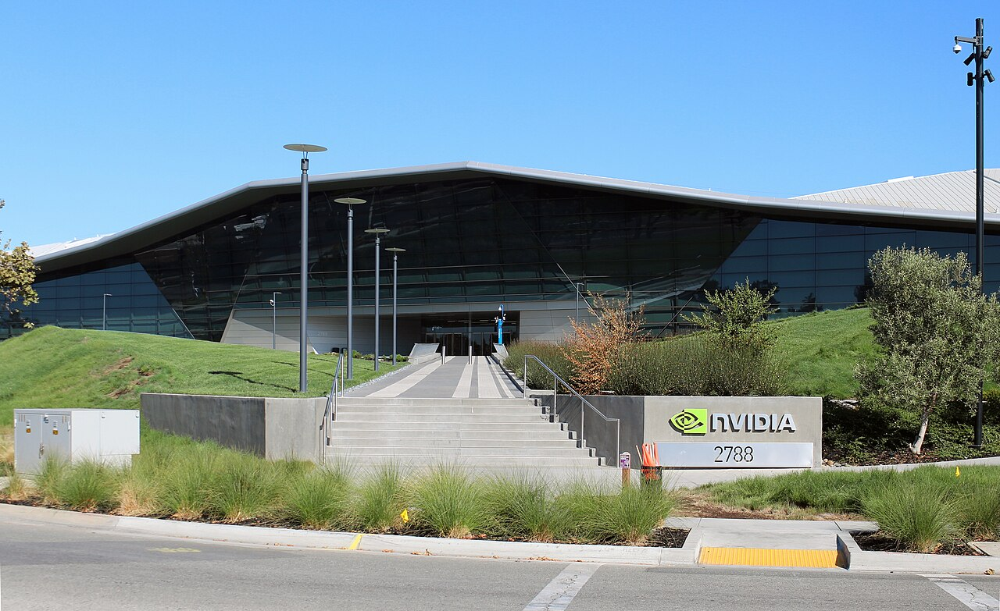
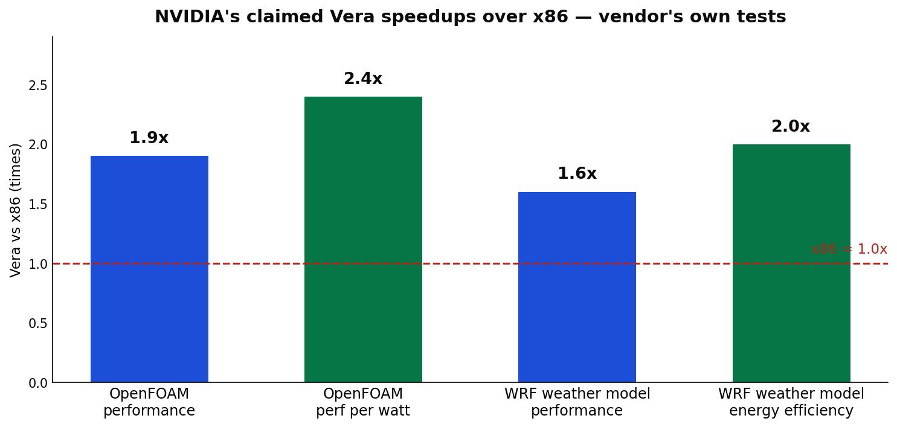

> [中文版 Chinese version](/life/nvidia-vera-cpu-rubin-hpc-sc26-zh/)

*NVIDIA headquarters in Santa Clara, California. Photo: Coolcaesar, via Wikimedia Commons (CC BY-SA 4.0).*

## What happened

NVIDIA used the SC26 supercomputing conference in Chicago on Monday, November 16, to unveil two pieces of hardware aimed squarely at scientific computing — and, not incidentally, at Intel and AMD.

The first is the **Vera CPU rack-scale platform**. Vera is NVIDIA's first fully custom data center CPU: **88 custom Olympus cores, 176 threads**, and SOCAMM2 LPDDR5X memory delivering up to 1.2 TB/s of bandwidth per chip. The rack packs **192 Vera CPUs** with about 300 TB of memory and 1 PB of storage into a fully liquid-cooled NVIDIA MGX design, tied together with Quantum-X800 InfiniBand networking and delivering more than 200 TB/s of aggregate peak memory bandwidth. The racks will be sold by Dell Technologies, HPE, Lenovo, and Supermicro starting in **early 2027**, and the HPC SDK 26.11 — compilers and libraries tuned for Vera — is available now.

The second is the **Rubin HPC GPU**, a new member of the Vera Rubin platform built for simulation and data processing in science, engineering, and analytics. NVIDIA says it carries **more than 50,000 CUDA cores on a single chip** — a record count, by its own claim — plus sparse data acceleration and seventh-generation NVLink. It is expected to be available in **2028**. NVIDIA published no price and no memory, FP64 throughput, or power figures.

*NVIDIA's claimed Vera speedups over x86. Source: NVIDIA Newsroom, November 16, 2026. These are the vendor's own tests; the x86 systems are unnamed in the release, and the company's performance brief lists a two-socket AMD EPYC 9755 system as the comparison point.*

## The numbers NVIDIA wants you to see

NVIDIA's pitch for Vera is memory bandwidth and efficiency, not raw core count. In its own tests on OpenFOAM's motorBike Large airflow simulation, Vera delivered **1.9x the performance and 2.4x the performance per watt** of x86 systems. On the open-source Weather Research and Forecasting model, it claims **1.6x the performance and 2x the energy efficiency**.

Treat those numbers as a vendor benchmark, not a verdict: the release does not name the x86 chips, no independent measurements exist yet, and the first systems do not ship until early 2027. What is independently verifiable is the customer signal — the German Climate Computing Center (DKRZ) has selected Vera CPUs for its **HLRE-5 supercomputer**, alongside NVIDIA GB200 Grace Blackwell systems, built by Bull and expected in early 2028.

NVIDIA also announced **Nemotron for Science** at the show: an open model package combining the Nemotron 3.5 Super VL model, the LitmusBench v0.2 chemistry dataset of nearly 50,000 questions, and post-training recipes — the software side of the same pitch, that AI agents plus fast simulation equal faster discovery.

## Why this one matters

The timing is the story. This is NVIDIA's first major product announcement since **Jensen Huang resigned as CEO on November 12**, and it lands one day before the company's earnings report on November 17 — the first earnings call without Huang. The message to the market is unmistakable: the roadmap does not depend on one person.

The product story is just as pointed. NVIDIA has spent years selling GPUs that sit next to someone else's CPU. Vera changes that: NVIDIA now sells the CPU too, in a rack designed to run the simulation workloads that have been x86 territory for decades. Intel, notably, is pitching its own FP64-capable GPU at the same show — the two companies are now invading each other's home turf at the same time.

Rubin HPC is the longer bet and the thinner announcement: a 2028 product with a headline core count and no published specs is a roadmap marker, not hardware. But the direction is clear. NVIDIA is no longer just the AI training company. It wants the whole scientific computing stack — CPU, GPU, networking, and the software in between — and it is willing to say so the week its founder leaves.

*This post reflects the status as of the morning of November 16, 2026 (PT). Sources: NVIDIA Newsroom; StorageReview; AI Stock Wire; Unite.AI; ByteOrbital.*
