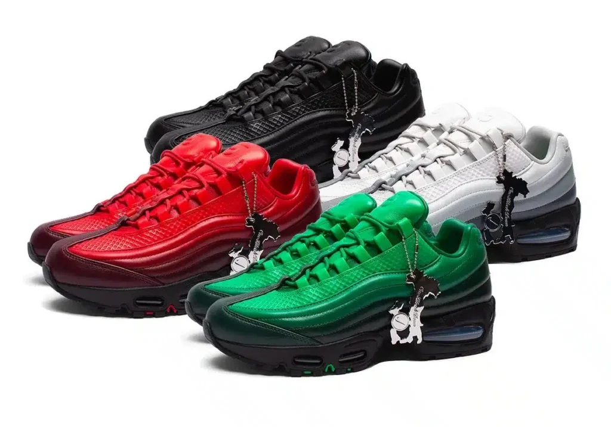
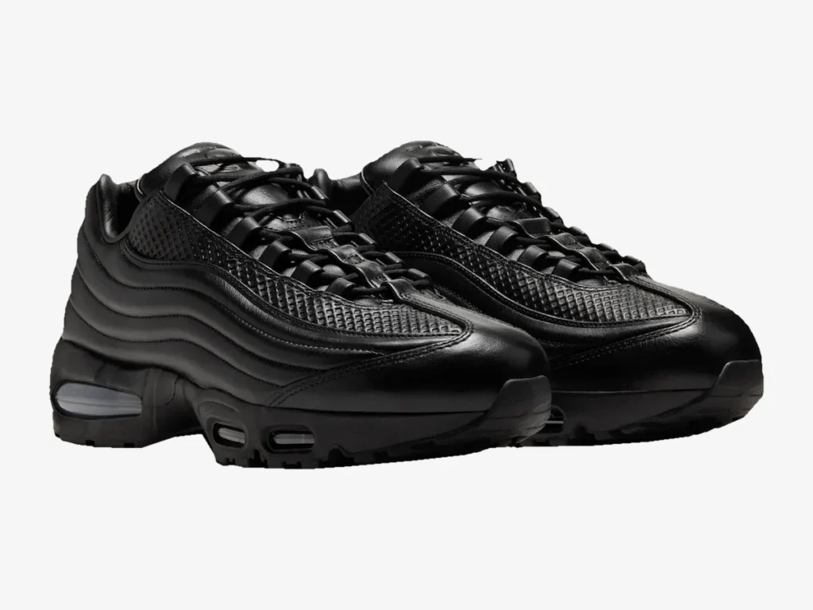
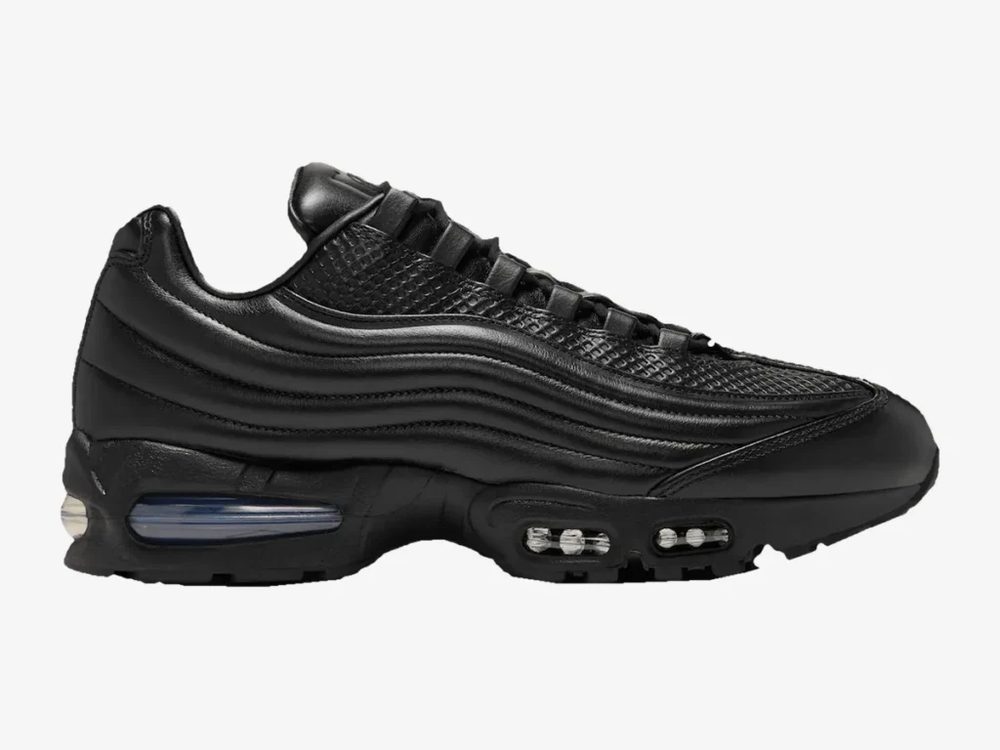
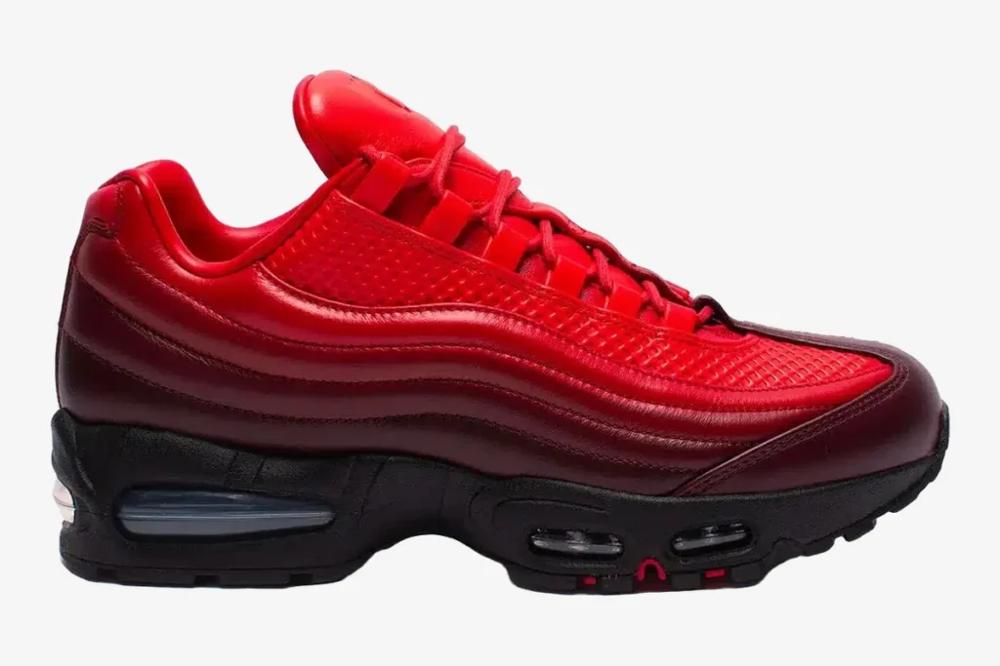
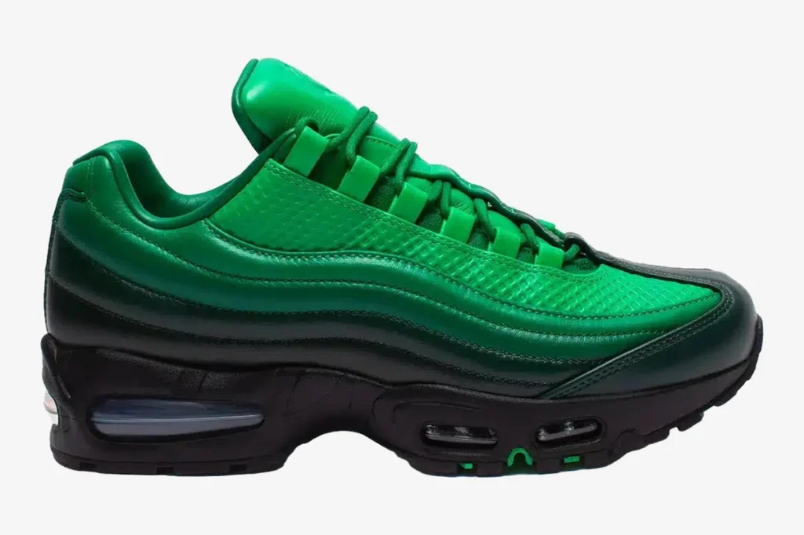
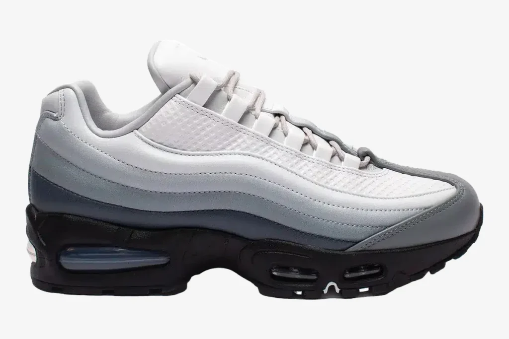

> [English version 英文版](/life/one-block-down-nike-air-max-95-lux-italy/)

黑色款今天登陆 Nike SNKRS，2026 年 11 月 19 日星期四。这是硬新闻。这双鞋的其他部分则是一堂历史课：One Block Down x Nike Air Max 95 LUX “Italy” 复活了 Nike  dormant 七年、原始形态已有 25 年历史的一条副线。这是一双围绕意大利制鞋工艺打造的皮革 Air Max 95，售价 200 美元，共四双配色——其中只有一双能在米兰之外买到。

这不是一篇曝料文章。Nike 与 One Block Down 已于 11 月 16 日正式发布了这个系列，Hypebeast 当天做了完整报道，发售日期、价格与货号在 Hypebeast、Sneaker News、Sole Retriever 的发售日历以及多家欧洲球鞋媒体上都已确认。米兰首发已在 11 月 13 日完成，今天是全球发售日，这也是它成为今日话题的原因。

先说一句实话：这不是上脚评测。黑色款今天才面向公众发售，写稿时还没有任何针对这双 Lux 的独立上脚实测。下面是一篇基于官方图片与已确认事实的长篇初看：Lux 系列的历史、逐个细节的设计解读、四双配色与决定你能不能买到的地理因素、随鞋发售的足球主题服饰，以及去抽一双 200 美元皮革跑鞋到底值不值。

*官方 lookbook 中的四双配色合影：黑色、红色、灰色、绿色，每双都挂着意大利半岛形状的金属挂牌。图片：Nike / One Block Down，经 SNKREMPIRE。*

## 基本事实

| | |
|---|---|
| **鞋款** | One Block Down x Nike Air Max 95 LUX “Italy” |
| **货号** | IM0704-001（黑色）、IM0704-002（灰色 / Platinum Tint）、IM0704-300（绿色 / Gym Green）、IM0704-600（红色 / Varsity Red） |
| **配色** | 黑色 / Black-Gym Green-Black；另有红、灰、绿三双意大利配色 |
| **发售日期** | 2026 年 11 月 13 日——四双配色与服饰系列在 One Block Down 米兰旗舰店与官网发售（意大利配色仅限店内）；2026 年 11 月 19 日——黑色款通过 Nike SNKRS 与指定零售商全球发售 |
| **发售价** | 美国 200 美元；欧洲 199.99 欧元；英国 184.99 英镑——为 2026 年 11 月 19 日查询的价格 snapshot，subject to change |
| **发售渠道** | Nike SNKRS（仅黑色款，全球）；One Block Down 米兰旗舰店（Piazza Armando Diaz 2）与 oneblockdown.it（四双全有） |
| **定位** | 米兰买手店复活 Nike 2000 年代初的 Lux 计划：高级皮革 Air Max 95，基于现行 Big Bubble 大气垫鞋底，意大利皮革与三色细节 |

## 为什么是今天的故事

热度很容易证明，因为报道是从各个方向同时来的。Hypebeast 于 11 月 16 日发布了官方揭晓；Sneaker News 报道了发售日历与 SNKRS 日期；Grailify 把它列进了第 47 周最值得关注的发售；Sneakerjagers、The Drop Date、SNKREMPIRE 等欧洲媒体两周来一直在追踪四双配色的分开发售日期。而时间点本身也在起作用：黑色款全球 SNKRS 发售在米兰首发六天之后，这种错开发售让一双鞋的话题从一个早上延续成整整一周，而不是昙花一现。

还有一个结构性的原因，让它比一般的买手店联名更值得写。Air Max 95 正处在 30 周年周期里——Sergio Lozano 1995 年的设计在 2025 年满 30 岁——而 Nike 过去两年一直在用加大的 “Big Bubble” 大气垫鞋底复刻那个年代的几乎所有经典。Lux 是那个年代所剩无几的、还躺在架子上的副线之一。这次由一家米兰买手店而不是 Nike 内部来复活它，等于 Nike 在不走内部立项流程的情况下重启了一个 dormant 的奢华想法——如今 Nike 的档案复活大多就是这么开始的。

## 历史：2001 年的一场奢华实验

要理解一双 200 美元的皮革 Air Max 95 为什么有意思，得回到 Lux Pack。2000 年代初，Nike 挑了几双自家经典——Air Force 1 高低帮、Air Trainer SX、Air Max 95——拿到意大利，用高级皮革与银色五金重新制作，大多做成黑色。目的从来不是联名或讲故事，而是 Nike 在测试：自家的运动鞋能不能按奢侈品的做法来生产——在那个年代，意大利制造的标签本身就有分量。最初的 Air Max 95 Lux 就是在 Nike 位于意大利蒙特贝卢纳（Montebelluna）的工厂生产的。

这个系列没有做成常驻产品线。Air Max 95 Lux 在 2019 年又出现过一次，Supreme 拿它做了三双配色，然后又沉寂了七年。唯一有据可查的价格对比相当夸张：Sneaker Freaker 记载，Supreme 2019 年的 Lux 款要 500 美元一双。拿这个数字做参照，One Block Down 这双 200 美元的定价就不像奢侈品定价，更像一个走量的决定——和 Nike 自家 “Greedy” Big Bubble 配色同价，只比 190 美元的镀铬 Big Bubble 贵 10 美元。对一个卖点就是皮革与意大利血统的联名来说，按自家高级产品线的价格卖，才是真正出人意料的地方。

顺带说一句 1995 年的原版：它是 Nike 历史上最重要的跑鞋之一。Sergio Lozano 以人体为灵感设计了它——波浪形分层鞋面让人联想到肌肉纤维，鞋带孔像肋骨，中底像脊柱——而且它是 Nike 第一双前掌也能看到气垫的鞋，而不只是后跟。黑色渐变鞋面的初代 “Neon” 之后，三十年里出了数百个配色，但这双鞋以解剖学为先的设计思路，让它至今看起来仍像一件设计品，而不只是一双复古鞋。Lux 计划在 2001 年和今天打的赌是一样的：同样的解剖学结构，换成皮革会更好看。

## 设计：每个细节都是典故，最好的那个藏了起来

鞋面从头到尾都是黑色皮革——不是皮革加网布的混合，而是一次彻底的重做。通常是分层网布的位置，改用带纹理的皮革来模仿网布图案，远看结构还在，拿在手里却是实心的。2001 年的原版在同样的位置用的是打孔皮革；2026 年改用纹理，处理更安静，也更显贵。鞋带孔的银色五金回来了，和当年的 Lux 一样；鞋舌上有一处压纹标记，把 One Block Down 自己的 logo 压进了 Swoosh 的轮廓里，是压上去的，不是印上去的。

*黑色款（IM0704-001）官方图片：全黑皮革鞋面，波浪形分层保留，纹理皮革替代了原本的网布。图片：Nike，经 SNKREMPIRE。*

能解释整个项目的细节，藏在几乎没人会看的地方——前掌气垫窗里。可视气垫单元里有一道从绿经透明到红的渐变——意大利三色旗，被放进了 Air Max 95 真正赖以成名的那个部件里，而不是鞋跟标或鞋舌上。鞋垫也重复了这个设计，一只绿、一只深红，中间是双方联名 logo。一枚金属挂牌被切成意大利半岛的形状——西西里岛和撒丁岛都包括在内，比 2001 年的挂牌更新——用圆珠链挂在鞋带上，上面是店名的手写体。连鞋盒都放弃了 Nike 的橙色，改成淡粉与棕褐的双色，盒盖上 One Block Down 与 “Just Do It” 并列。

*黑色款侧面：波浪形分层在皮革重做后保留了下来，前后掌可见气垫用的是 Big Bubble 鞋底。图片：Nike，经 SNKREMPIRE。*

还有两个值得细看的细节。中底里嵌了一块 TPU 插件，上面的图案庆祝 Air Max 95 问世 30 周年，包含 One Block Down 的图形与意大利元素。另外还有一处与早期 Lux 款有意的决裂：2001 年原版和 2019 年 Supreme 款的侧面线条都是直的，而 One Block Down 保留了 Air Max 95 标志性的波浪线。这是个小决定，但它决定了这是一双“恰好是 Lux 的 95”，而不是一双“恰好是 95 的 Lux 鞋”。

这里要老实说一个限定条件，因为 “意大利制造” 的故事并不完全像名字暗示的那样。皮革是在意大利鞣制与加工的，意大利配色上的三色渐变也是在意大利数码印制与贴合的——但最终组装在越南完成。2001 年的原版是在蒙特贝卢纳生产的；2026 年这双在材料与工艺上是意大利的，在组装上不是。这不是缺点——如今几乎所有 Nike 高端联名都是这么生产的——但值得说清楚，因为这双鞋的前提本身就很容易让人默认它是意大利制造。

## 四双配色，与决定你能不能买到的地理

黑色款（IM0704-001，Nike 官方配色名 Black / Black-Gym Green-Black）是对 2001 年原版的致敬，也是唯一全球发售的一双：11 月 13 日米兰首发，今天 11 月 19 日 SNKRS 与指定零售商全球上架。它也是四双里最好穿、最容易用 200 美元去 justify 的一双——一双没有任何图案的黑色皮革 95，在米兰和那不勒斯都能穿，正因为它什么都不喊。

另外三双是另一回事。红色（IM0704-600，Varsity Red）、绿色（IM0704-300，Gym Green）、灰色（IM0704-002，Platinum Tint）组成 Italy pack：白、绿、红渐变沿着侧面线条走，延续到 T 形前掌面板与鞋舌，中足加固件用了国旗配色，镀银挂牌上是半岛形状的双方联名 logo。三双都在 11 月 13 日发售，仅限 One Block Down 米兰旗舰店，数量极少——而且截至今天，没有任何消息确认它们会在网上卖。真正的决定因素是地理。四双里有三双是“去米兰的理由”；只有一双是全世界都能抽的。

*红色意大利配色（IM0704-600）：Varsity Red 皮革，渐变沿波浪形分层向下——仅限米兰旗舰店。图片：Nike / One Block Down，经 SNKREMPIRE。*

*绿色意大利配色（IM0704-300）：Gym Green 向鞋跟渐变为近黑色——仅限米兰旗舰店。图片：Nike / One Block Down，经 SNKREMPIRE。*

*灰色意大利配色（IM0704-002，Platinum Tint）：白灰渐变配黑色鞋底——仅限米兰旗舰店。图片：Nike / One Block Down，经 SNKREMPIRE。*

哪双重要，取决于你在哪里。如果你不在米兰，答案就是黑色款，因为只有它能买到。如果你在米兰，红色是三双里最张扬、最上镜的，绿色最忠于国旗，灰色是 Italy pack 里最好穿的——白灰渐变更像一个高级中性色，而不是一句宣言。三双都不是安慰奖，只是都被一张机票 gate 住了。

## 服饰系列，与足球那条线

鞋不是单独发售的。系列里还有一个以 Nike Football 传承为灵感的技术服饰胶囊：球衣、夹克、长裤与两顶 skull cap，重新演绎了 Nike Football 的 “Dorito” 标识与 Total 90 品牌，而不是简单复刻。为了呼应 One Block Down 的创立年份与 “从第一天起就全力以赴” 的理念，Total 90 的标志被翻转成 “09”。意大利国旗的致敬织进了服装的结构里，所有单品都有撞色缝线，训练 T 恤内部还有一条三色织带。

足球这条线不是装饰，它是这次联名 premise 的另一半：一边是意大利制鞋工艺，一边是 1990 年代 Nike Football 的黄金时代，而 One Block Down——一家与 Nike 多次合作的米兰店，做过国际米兰服饰系列与一批 Air Max Plus（TN）发售，还上过 SNKRS 的 “Talking Shop” 专栏——正是这两段历史真正交汇的地方。Air Max Plus 的历史在这里比足球更重要：TN 是欧洲的鞋中之鞋，而一家多年来服务这个客群的零售商，最清楚为什么一双没有任何图案的黑色皮革 95 会在米兰卖得动。

## 这双鞋是什么，不是什么

有必要说清楚你买的是什么。底下的 Air Max 95 是一双 31 年前的设计，Lux 处理不改变它的鞋底：Big Bubble 中底、前后掌可见气垫、以解剖学为先的分层结构。变的是材料与意义。这是一双高级材料复刻的经典，不是性能鞋，没人应该指望它带来新的缓震科技。这里的科技是皮革、工艺与故事——而故事就是产品。

这也是为什么性能发售常见的上脚评测 caveat 在这里不那么重要，而另一条 caveat 更重要：皮革会改变一双鞋的磨合方式。重新塑形的加厚鞋面刚上脚会比大多数人熟悉的网布 95 更硬，纹理皮革的折痕走向也和网布、光面皮革都不一样。这些答案要等今天之后几周，由真正穿上它的人给出，而不是发售报道——本文不会假装已经知道。鞋楦用的是现行 Big Bubble 95，所以尺码上可以按近期市售 Big Bubble 配色来预期，但这只是预期，不是实测结论。

同样值得点名的是它不是什么。它不是 2001 年意义上的意大利制造——皮革在意大利加工，鞋在越南组装。它也不是 600 双那种意义上的限定神鞋：黑色款是全球 SNKRS 发售，Nike 完全有动力按真实数量生产。它也不是便宜货——200 美元已经是 Nike 给这个鞋型定的高级产品线天花板，比镀铬 Big Bubble 贵 10 美元，和 Greedy 配色同价。但按这个价格，它是迄今为止买到一双皮革 Lux 95 最便宜的方式：上一批要 500 美元。

## 谁该去抽，怎么抽

购买建议很简单，因为地理已经替大多数人做了决定。想要黑色款，今天 11 月 19 日去 SNKRS 抽——同时要明白，一双 200 美元、来自米兰买手店、用一周错开发售吊足胃口的皮革联名，会有真实的需求，哪怕抽不中 Travis Scott 的量级。实际策略还是老一套：先 SNKRS，再 One Block Down 自己的官网，然后是上架的指定零售商。在 SNKRS 发售真正开始之前别去找转卖——一双今天才全球发售的鞋，提前挂出的转卖价永远是它最贵的价格，而黑色款是真正意义上的市售款：真实数量、真实渠道、200 美元。

想要意大利配色的话，对自己诚实一点：红、绿、灰三双都是米兰旗舰店限定，网上发售至今未确认，唯一可靠的办法就是人在米兰，或者认识在米兰的人。SNKREMPIRE 上黑色款的转卖挂牌——写稿时 GOAT 上约 1600 欧元，全球发售之前——提醒了稀缺遇上全球需求时会发生什么，也提醒了不要相信发售前的转卖价：那是还没跟 SNKRS 发售竞争过的人定的价。

如果今天没抽中黑色款，也不用慌。Lux 这条线既然回来了，Nike 就不会只为一双配色复活它——2019 年 Supreme 那次是三双，2001 年那个包是四双鞋。今天决定的只是你能不能按原价拿到第一双，这条线本身的寿命大概率比一次发售要长。

## 结论

One Block Down x Nike Air Max 95 LUX “Italy” 不是本周最吵的鞋，而是最聪明的一双——一次联名清楚地知道自己打开的是哪座档案，并用那座档案里最好的主意做了一双鞋：拿一双经典，换成皮革，把国旗藏进只有气垫窗能展示的地方。黑色款是能穿的那双，意大利三色是能收藏的那双，而 200 美元这个价格是让整件事成立的细节——一场奢华实验，按高级产品线的价格卖，在它所基于的鞋问世 31 年后、在它所复活的实验 25 年后。米兰先拿到了，今天轮到其他人。

*价格为 2026 年 11 月 19 日查询的 snapshot，subject to change。来源：Hypebeast（官方揭晓与发售信息，2026 年 11 月 16 日）；BecauseSneakers（设计细节、定价与发售日期，2026 年 11 月 7 日更新）；SNKREMPIRE（四双配色、货号与发售日期，2026 年 11 月 8 日更新）；Sneakerjagers（发售细节与产地说明）；The Drop Date（近距离解析，2026 年 11 月）；Grailify（第 47 周最值得关注的发售）。这是一篇初看，不是上脚评测：黑色款于 2026 年 11 月 19 日全球发售，写稿时尚无独立上脚实测。*
