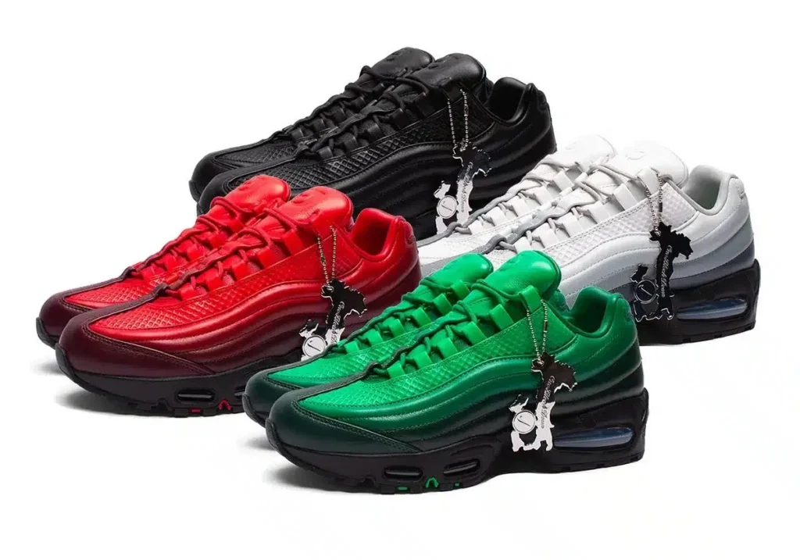
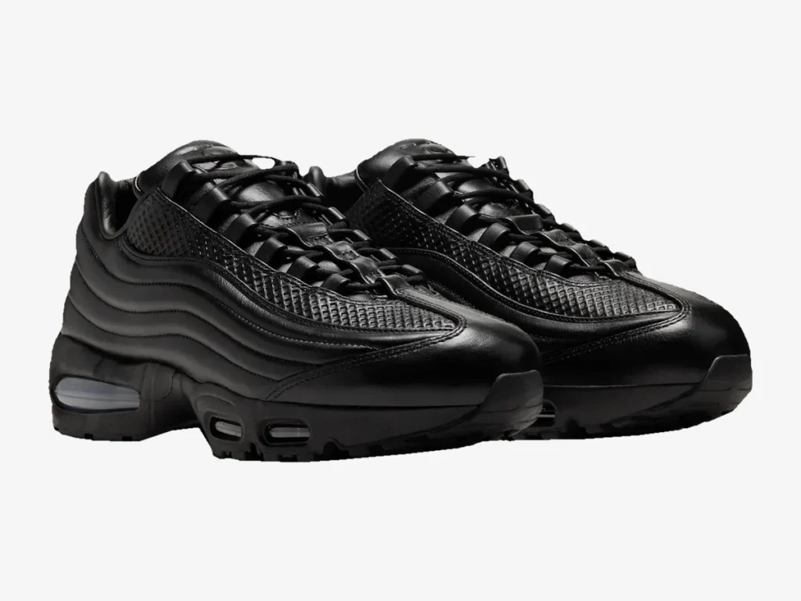
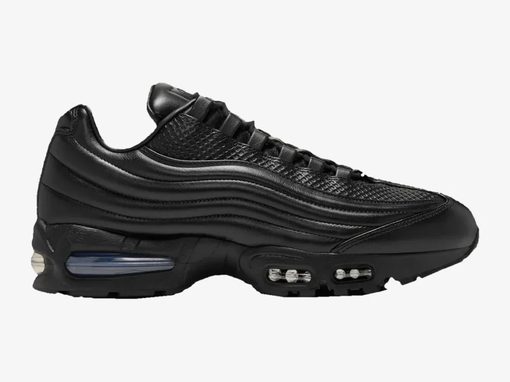
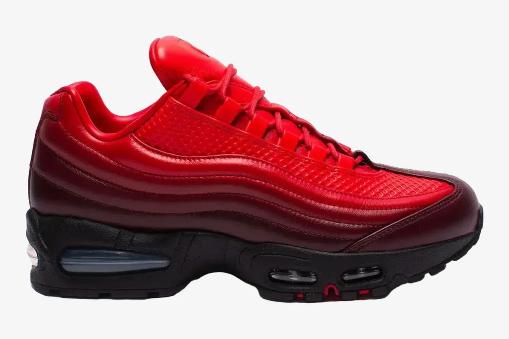
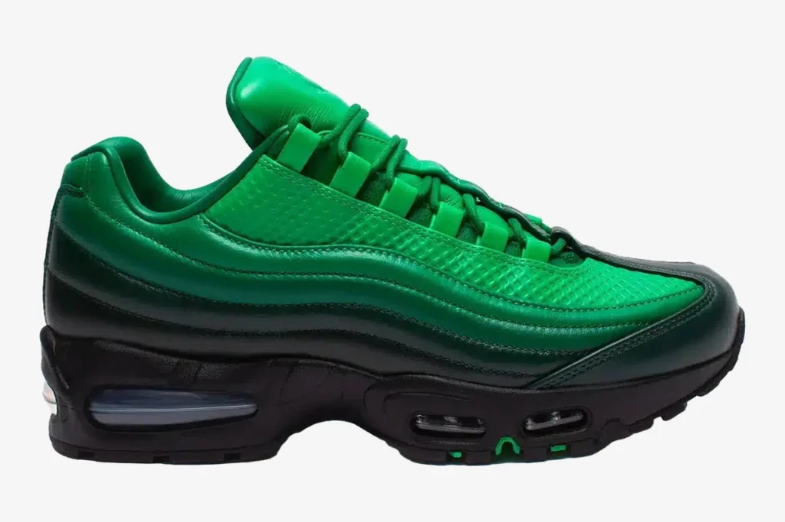
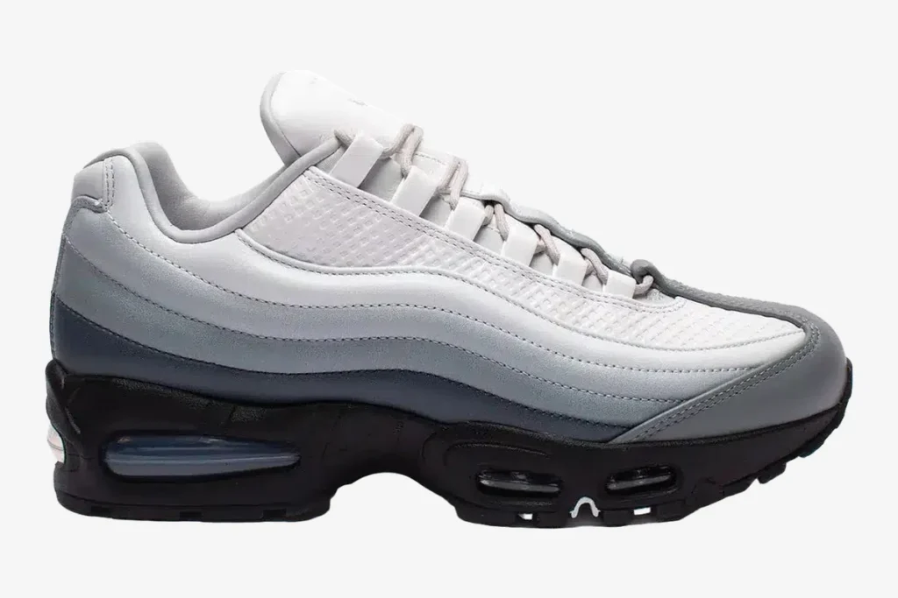

> [中文版 Chinese version](/life/one-block-down-nike-air-max-95-lux-italy-zh/)

The black pair goes live on Nike SNKRS today, Thursday, November 19, 2026. That is the hard news. Everything else about this shoe is a history lesson: the One Block Down x Nike Air Max 95 LUX "Italy" revives a Nike sub-line that has been dormant for seven years and, in its original form, has not been made for twenty-five. It is a leather Air Max 95 built around Italian craftsmanship, priced at $200, in four colorways — and only one of the four is available outside Milan.

This is not a leak story. Nike and One Block Down officially unveiled the collection on November 16, Hypebeast ran the full reveal the same day, and the release dates, prices, and style codes are confirmed across Hypebeast, Sneaker News, Sole Retriever's release calendar, and multiple European trackers. The Milan launch already happened on November 13. Today is the global date, and it is the reason this is the story of the day.

One honest note up front: this is not a wear test. The black pair reaches the public today, and no independent wear testing of this Lux pair existed at the time of writing. What follows is a long first look built on the official photography and the confirmed facts: the history of the Lux line, the design decoded detail by detail, the four colorways and the geography that decides which ones you can actually buy, the football-inspired apparel that comes with it, and the honest case for entering a SNKRS drop for a $200 leather runner.

*All four colorways together in the official lookbook: Black, Red, Grey, and Green, each carrying the chrome hangtag cut in the shape of Italy. Image: Nike / One Block Down, via SNKREMPIRE.*

## The facts

| | |
|---|---|
| **Model** | One Block Down x Nike Air Max 95 LUX "Italy" |
| **Style codes** | IM0704-001 (Black), IM0704-002 (Grey / Platinum Tint), IM0704-300 (Green / Gym Green), IM0704-600 (Red / Varsity Red) |
| **Colorways** | Black / Black-Gym Green-Black; plus Red, Grey, and Green Italy colorways |
| **Release dates** | November 13, 2026 — all four colorways and the apparel at One Block Down's Milan flagship and webstore (Italy colorways in-store only); November 19, 2026 — Black colorway globally via Nike SNKRS and select retailers |
| **Retail price** | $200 in the US; €199.99 in Europe; £184.99 in the UK — price snapshot as of November 19, 2026, subject to change |
| **Where** | Nike SNKRS (Black only, globally); One Block Down Milan flagship, Piazza Armando Diaz 2, and oneblockdown.it (all four) |
| **What it is** | A Milan boutique's revival of Nike's early-2000s Lux program: a premium-leather Air Max 95, built on the current Big Bubble tooling, with Italian leather and tricolor detailing |

## Why this is the story of the day

The heat is easy to prove, because the coverage arrived from every direction at once. Hypebeast published the official unveiling on November 16. Sneaker News covered the release calendar and the SNKRS date. Grailify put it on its Top Sneaker Releases list for week 47. European trackers — Sneakerjagers, The Drop Date, SNKREMPIRE — have been tracking all four colorways and their split release dates for two weeks. And the timing is doing real work: the black pair's global SNKRS launch lands today, November 19, six days after the Milan-first launch, which is exactly the kind of staggered rollout that keeps a shoe in the conversation for a full week instead of a single morning.

There is also a structural reason this one matters more than the average boutique collaboration. The Air Max 95 is in the middle of its thirtieth-anniversary era — Sergio Lozano's 1995 design turned thirty in 2025 — and Nike has spent the last two years reissuing nearly everything from that period on the enlarged "Big Bubble" tooling. The Lux line is one of the last sub-lines from that era still sitting on the shelf. Reviving it now, with a Milan boutique rather than in-house, is Nike restarting a dormant luxury idea without having to argue for it internally — which is how most of its archive revivals now begin.

## The history: a luxury experiment from 2001

To understand why a $200 leather Air Max 95 is interesting, you have to go back to the Lux Pack. In the early 2000s, Nike took a handful of its own classics — the Air Force 1 in low and mid, the Air Trainer SX, and the Air Max 95 — and had them built in Italy, in high-end leather with silver hardware, most of them finished in black. The point was never a collaboration or a story. It was Nike testing whether its own sportswear could be made the way a luxury house would make it, at a moment when Italian production still carried real meaning on a label. The original Air Max 95 Lux was built at Nike's Montebelluna factory in Italy.

The pack did not become a franchise. The Air Max 95 Lux surfaced once more in 2019, when Supreme used it for a three-colorway run, and then went quiet for another seven years. The only direct price comparison on record for that 2019 run is steep: Sneaker Freaker puts the Supreme Lux pairs at $500 a pair. Against that number, $200 for the One Block Down pair reads less like a luxury price and more like a volume decision — the same $200 Nike charges for its in-house "Greedy" Big Bubble pairs, and ten dollars above the $190 chrome Big Bubble. For a collaboration whose entire premise is leather and Italian provenance, charging what the premium in-house tier already charges is the real surprise here.

The 1995 original, for context, is one of the most consequential running shoes Nike ever made. Sergio Lozano designed it around the human body: the wavy layered panels evoke muscle fibers, the lace loops suggest ribs, the midsole traces a spine — and it was the first Nike shoe with a visible Air unit in the forefoot, not just the heel. The black gradient upper of the original "Neon" era gave way over three decades to hundreds of colorways, but the silhouette's anatomy-first construction is why it still reads as a design object rather than a retro. The Lux program's bet, in 2001 and again now, is that the same anatomy looks even better in leather.

## The design: every detail is a reference, and the best one is hidden

The upper is black leather throughout — not a leather-and-mesh mix, but a full rebuild. The panels that normally carry the 95's layered mesh are cut from a textured leather that imitates the mesh pattern, so the structure still reads from across the room and turns solid in the hand. The 2001 pair used perforations in the same place; the 2026 pair uses texture instead, which is a quieter, more expensive-looking solution. Silver hardware is back on the eyestays, as it was on the original Lux pairs, and a debossed mark on the tongue folds One Block Down's own logo into the Swoosh, pressed into the leather rather than printed on top of it.

*The Black pair (IM0704-001) in Nike's official photography: a full black leather upper, the wavy panels intact, textured leather standing in for the usual mesh. Image: Nike, via SNKREMPIRE.*

The detail that explains the whole project sits where almost nobody looks, inside the forefoot Air window. The visible Air unit carries a gradient running from green through clear to red — the Italian tricolor, placed inside the one component the Air Max 95 is actually known for, instead of on a heel tab or a tongue label. The insoles repeat it, one green and one deep red, with the co-brand logo set between them. A metal hangtag cut in the shape of the Italian peninsula — Sicily and Sardinia included, an update from the 2001 tag — hangs off the lacing on a ball chain, with the shop's name in script across it. Even the box drops Nike's orange, splitting into a pale pink and tan two-tone with One Block Down set alongside "Just Do It" on the lid.

*Lateral view of the Black pair: the wavy panels survive the leather rebuild, and the visible Air units — forefoot and heel — carry the Big Bubble tooling. Image: Nike, via SNKREMPIRE.*

Two more details reward a closer look. The sole holds a TPU insert with artwork celebrating thirty years of the Air Max 95, including One Block Down graphics and references to Italy. And there is a deliberate break from the earlier Lux pairs: the 2001 originals and the 2019 Supreme run both used straight stripes on the side; One Block Down keeps the wavy lines that make the Air Max 95 what it is. It is a small decision, and it is the difference between a Lux shoe that happens to be a 95 and a 95 that happens to be Lux.

One honest qualification belongs here, because the "Made in Italy" story is not quite what the name suggests. The leather is prepared and finished in Italy, and the tricolor gradients on the Italy colorways were digitally printed and applied in Italy — but final assembly takes place in Vietnam. The 2001 original was built in Montebelluna; the 2026 pair is Italian in material and finishing, not in assembly. That is not a flaw — it is how nearly all premium Nike collaborations are made now — but it is worth stating plainly, because the whole premise of the shoe invites the assumption.

## The four colorways, and the geography that decides them

The Black pair (IM0704-001, listed by Nike as Black / Black-Gym Green-Black) is the tribute to the 2001 original, and it is the only pair with a global release: Milan on November 13, then SNKRS and select retailers worldwide today, November 19. It is also the most wearable of the four, and the easiest to justify at $200 — a black leather 95 with no graphics at all, a shoe that works in Milan and Naples precisely because it does not announce itself.

The other three are a different proposition. Red (IM0704-600, Varsity Red), Green (IM0704-300, Gym Green), and Grey (IM0704-002, Platinum Tint) form the Italy pack: gradients in white, green, and red run along the side stripes and continue over the T-shaped front panel and the tongue, the midfoot reinforcements come in flag colors, and the silver-plated hangtags carry the shared logo in the shape of the peninsula. All three launched on November 13, exclusively at One Block Down's Milan flagship, in highly limited numbers — and, as of today, no online sale has been confirmed for them. The real decision here is geography. Three of the four colorways are a reason to be in Milan; the fourth is the one the rest of the world gets a shot at.

*The Red Italy colorway (IM0704-600): Varsity Red leather with the gradient running down the wavy panels — Milan flagship exclusive. Image: Nike / One Block Down, via SNKREMPIRE.*

*The Green Italy colorway (IM0704-300): Gym Green fading to near-black at the heel — Milan flagship exclusive. Image: Nike / One Block Down, via SNKREMPIRE.*

*The Grey Italy colorway (IM0704-002, Platinum Tint): white-to-grey gradient over a black sole — Milan flagship exclusive. Image: Nike / One Block Down, via SNKREMPIRE.*

Which one matters depends on where you are. If you are anywhere outside Milan, the answer is the Black pair, because it is the only one you can buy. If you are in Milan this week, the Red is the loudest of the three and the most likely to photograph well, the Green is the most faithful to the flag, and the Grey is the most wearable of the Italy pack — a white-to-grey gradient that reads as a premium neutral rather than a statement. None of the three is a consolation prize; all three are simply gated by a plane ticket.

## The apparel, and the football thread

The shoes do not launch alone. The collection includes a technical apparel capsule inspired by Nike Football's heritage: a jersey, a jacket, trousers, and two skull caps that reinterpret the Nike Football "Dorito" identity and Total 90 branding rather than simply reproducing them. As a nod to One Block Down's founding year and its ethos to "give everything from day one," the Total 90 symbol is flipped to read "09." Additional tributes to the Italian flag are woven through the garments' construction, highlighted by contrast stitching on all garments and an internal tricolor tape featured on the Training T-shirt.

The football thread is not decoration. It is the second half of the collaboration's premise: Italian footwear craftsmanship on one side, the 1990s golden era of Nike Football on the other, with One Block Down — a Milan shop that has worked with Nike repeatedly, on an Inter Milan apparel collection and a run of Air Max Plus releases, and earned a "Talking Shop" feature on SNKRS — as the place where those two histories actually meet. The Air Max Plus history matters here more than the football one: the TN is the European shoe above all others, and a retailer that has spent years serving that audience knows exactly why a black leather 95 carrying no graphics at all will move.

## What the shoe is, and what it is not

It is worth being plain about what you are buying. The Air Max 95 underneath is a thirty-one-year-old design, and the Lux treatment does not change its tooling: the Big Bubble midsole, the visible forefoot and heel Air units, the anatomy-first paneling. What changes is the material and the meaning. This is a premium-material reissue of a classic, not a performance shoe, and nobody should buy it expecting new cushioning technology. The technology here is the leather, the finishing, and the story — and the story is the product.

That is also why the usual wear-test caveats matter less than they do for a performance release, and why one caveat matters more: leather changes how a shoe breaks in. The padded, sculpted upper will feel stiffer out of the box than the mesh 95s most people know, and the textured leather panels will crease differently from both mesh and smooth leather. Those answers will come from owners in the weeks after today, not from launch coverage — and this article will not pretend otherwise. The underlying last is the current Big Bubble 95, so expect the same fit as the recent general-release Big Bubble pairs, but treat that as an expectation, not a tested fact.

It is also worth naming what the shoe is not. It is not a Made-in-Italy shoe, in the 2001 sense — the leather is finished in Italy and the shoe is assembled in Vietnam. It is not a limited-edition grail in the 600-pair sense: the Black pair is a global SNKRS release, and Nike has every incentive to make it in real numbers. And it is not a bargain — $200 is the top of Nike's own premium tier for this silhouette, ten dollars above the chrome Big Bubble and the same as the Greedy pairs. What it is, at that price, is the cheapest way anyone has ever been able to buy a leather Lux 95: the last ones cost $500.

## Who should try for a pair — and how

The buying case is simple, because the geography already made the decision for most people. If you want the Black pair, enter the SNKRS drop today, November 19 — and understand that a $200 leather collaboration from a Milan boutique with a one-week staggered rollout will draw real demand, even if it will not draw Travis Scott numbers. The practical strategy is the usual one: SNKRS first, then One Block Down's own webstore, then the select retailers carrying it. Do not pay a reseller before the SNKRS drop has actually happened — early resale prices on a shoe with a global release scheduled for today are the worst prices you will ever see for it, and the Black pair is a general release in the only sense that matters: it exists in real numbers, through real channels, at $200.

If you want one of the Italy colorways, be honest with yourself: Red, Green, and Grey are Milan flagship exclusives with no confirmed online sale, and the only reliable way to get one is to be in Milan or to know someone who is. The SNKREMPIRE marketplace listing for the Black pair — around €1,600 on GOAT at the time of writing, before the global drop — is a reminder of what happens when scarcity meets a global audience, and it is also a reminder not to trust pre-drop resale prices: they are set by people who have not yet had to compete with a SNKRS release.

If you miss the Black pair today, do not panic. The Lux line is back now, and Nike does not revive a sub-line for a single colorway — the 2019 Supreme run was three pairs, and the 2001 pack was four shoes. What today decides is whether you get the first one at retail. The line itself is likely to have a longer life than a single drop.

## The verdict

The One Block Down x Nike Air Max 95 LUX "Italy" is not the loudest shoe of the week. It is the smartest one — a collaboration that understood exactly which archive it was opening, and built a shoe out of that archive's best idea: take a classic, make it in leather, and hide the flag where only the Air window can show it. The Black pair is the wearable one, the Italy trio is the collectible one, and the $200 price is the detail that makes the whole thing work — a luxury experiment, sold at a premium-tier price, thirty-one years after the shoe it is based on and twenty-five years after the experiment it revives. Milan got it first. Today, everyone else gets their shot.

*Price is a snapshot as of November 19, 2026, subject to change. Sources: Hypebeast (official unveiling and release information, November 16, 2026); BecauseSneakers (design details, pricing, and release dates, updated November 7, 2026); SNKREMPIRE (all four colorways, style codes, and release dates, updated November 8, 2026); Sneakerjagers (release details and manufacturing notes); The Drop Date (closer look, November 2026); Grailify (Top Sneaker Releases, Week 47). This is a first look, not a wear test: the Black pair releases globally November 19, 2026, and no independent wear testing was available at the time of writing.*
