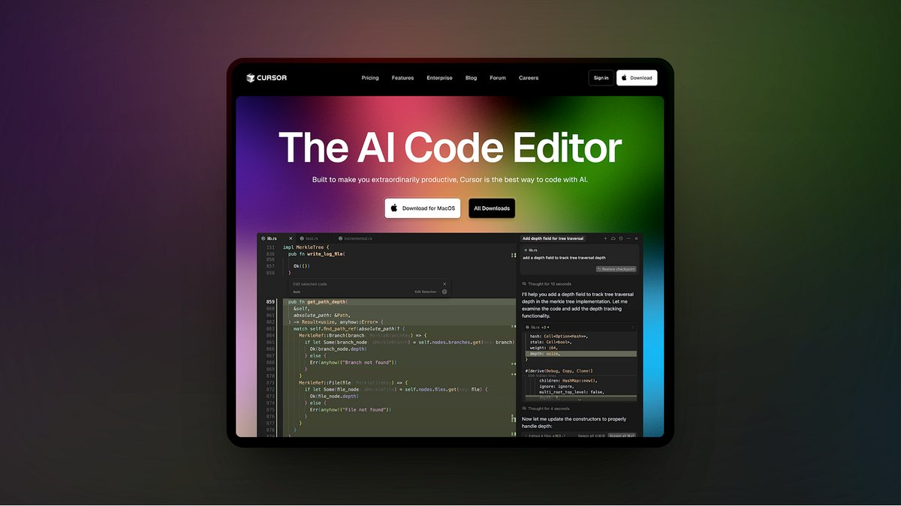
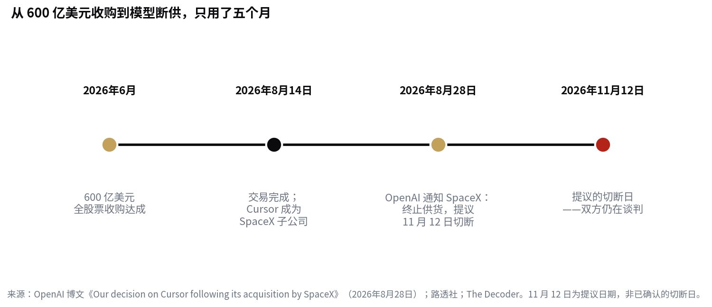

> [English version](/life/openai-cursor-cutoff-nov-12/)

*Cursor 官网首页。cursor.com 截图，经 Sebastian Roehl / Substack 转载。*

## 今天发生什么

**2026 年 11 月 12 日**是 OpenAI 提议终止向 Cursor 供应模型的日期。Cursor 是那款 AI 代码编辑器。OpenAI 在 8 月 28 日的博文《Our decision on Cursor following its acquisition by SpaceX》中宣布了这一决定，并表示 11 月 12 日是合同允许的最长通知期。决定还覆盖未来模型：OpenAI 明确表示也不会向 Cursor 提供后续模型，并点名了即将推出的 **Astra**。

但在展开之前，有一个重要前提：**这个日期只是提议，并未确认**。OpenAI 自己的帮助页面至今仍写着"提议的过渡期于 11 月 12 日结束"，而截至 11 月 11 日，双方仍在谈判。Cursor 首席执行官 Michael Truell 表示谈判还在继续，双方均未确认 11 月 11 日时模型是否仍在线。所以今天可能是模型选择器被清空的日子——也可能是双方宣布延期的日子。

*从 600 亿美元收购到模型断供，只用了五个月。来源：OpenAI 博文（2026年8月28日）；路透社；The Decoder。*

## 五个月是怎么走到这一步的

导火索是所有权，不是技术。**2026 年 6 月**，SpaceX 同意以 **600 亿美元全股票交易**收购 Cursor 背后的公司 **Anysphere**；交易于 **8 月 14 日**完成。两周后，OpenAI 发出通知。

OpenAI 给出的理由异常直白："基于我们与埃隆·马斯克旗下公司违反合同的经历，我们无法确信 SpaceX 会在我们的服务条款范围内使用我们的技术。"公司提到了与马斯克旗下公司过去的合同纠纷，包括 X 违反与 OpenAI 的协议。路透社证实了这份通知与 6 月的交易。

## 对 Cursor 用户实际意味着什么

比标题暗示的要小——而这一点值得直说：

- **失去的：** Cursor 模型选择器里的内置 OpenAI 模型。新的 OpenAI 模型也不会再来；目录冻结在已有版本上。
- **留下的：** Claude、Gemini、Grok、Moonshot 的模型，以及 Cursor 自家模型。Anthropic 已公开表示会继续为 Cursor 内的 Claude 增加算力。
- **变通办法：** 如果你有自己的 OpenAI API 密钥，仍可接入并在 Cursor 内使用 GPT 模型。OpenAI 也表示会继续支持其在 Cursor 等编辑器内运行的编程扩展。
- **规模：** Truell 称 OpenAI 模型仅占 Cursor 流量的约 **5%**。这款编辑器本就是模型无关的，大部分用量本来就在别处。

所以对绝大多数 Cursor 用户来说，11 月 12 日在编辑器里什么都不会变。变的是它底下的结构。

## 判断

这其实不是一个关于 5% 流量的故事，而是关于开发者使用的工具被吸纳进垂直整合体系后会发生什么的故事。Cursor 曾经是中立地带：一款流行的编辑器，乐意运行任何一家的模型。如今它归 SpaceX 所有——一家 AI 业务上季度收入占比过半、正在为自家算力园区砸 740 亿美元的公司（[见今日另一篇](/life/spacex-74b-ai-campuses-zh/)）——而 OpenAI 决定不再给对手的资产供货。

先例比断供本身更重要。模型供应如今成了企业博弈中的杠杆，而非中立的水电煤。如果你把工作流建立在一款编辑器加一个模型家族之上，这套组合的两半都可能因为一场与你无关的收购而被抽走。给开发者的实际教训很枯燥，但很实在：让你的提示词、规则和模型选择保持可迁移，因为编辑器里的模型选择器是一种商业关系，不是一项功能——而商业关系是会终结的。

## 来源

- OpenAI，"Our decision on Cursor following its acquisition by SpaceX"，2026年8月28日（通知终止模型供应合同；提议切断日 2026 年 11 月 12 日；未来模型包括 Astra 将不予供应；"我们无法确信 SpaceX 会在我们的服务条款范围内使用我们的技术"）。
- 路透社，经 The Decoder 与 Geroundtable，2026年11月（SpaceX 6 月同意以 600 亿美元全股票收购 Anysphere；交易 8 月 14 日完成；路透社证实该通知）。
- The Decoder，"OpenAI cuts off Cursor after SpaceX acquisition"，2026年11月（变化内容：内置 OpenAI 模型下线；Claude、Gemini、Grok 保留；自带 API 密钥仍可用；OpenAI 扩展继续支持）。
- Cursor / Michael Truell，经 The Decoder 与 Medium，2026年11月（OpenAI 模型约占 Cursor 流量 5%；与 OpenAI 的谈判仍在继续；11 月 12 日为提议日期，非已确认的切断日）。
