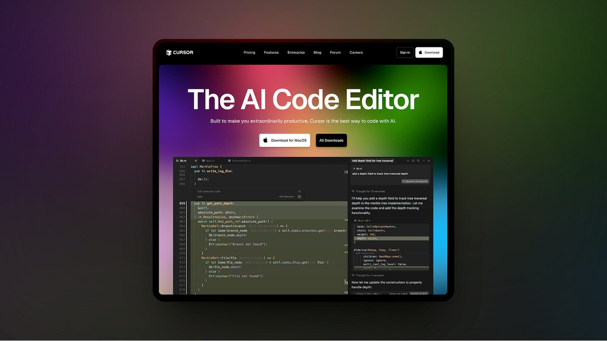
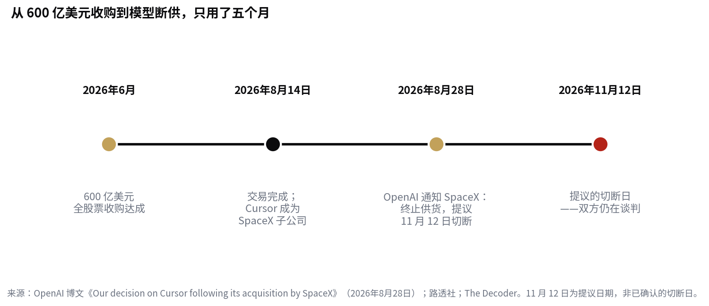

> [English version](/life/openai-cursor-cutoff-nov-12/)

*Cursor 官网首页。cursor.com 截图，经 Sebastian Roehl / Substack 转载。*

## 今天发生什么

**2026 年 11 月 12 日**是 OpenAI 提议终止向 Cursor 供应模型的日期。Cursor 是那款 AI 代码编辑器。OpenAI 在 8 月 28 日的博文《Our decision on Cursor following its acquisition by SpaceX》中宣布了这一决定，并表示 11 月 12 日是合同允许的最长通知期。决定还覆盖未来模型：OpenAI 明确表示也不会向 Cursor 提供后续模型，并点名了即将推出的 **Astra**。

但在展开之前，有一个重要前提：**这个日期只是提议，并未确认**。OpenAI 自己的帮助页面至今仍写着"提议的过渡期于 11 月 12 日结束"，而截至 11 月 11 日，双方仍在谈判。Cursor 首席执行官 Michael Truell 表示谈判还在继续，双方均未确认 11 月 11 日时模型是否仍在线。所以今天可能是模型选择器被清空的日子——也可能是双方宣布延期的日子。

*从 600 亿美元收购到模型断供，只用了五个月。来源：OpenAI 博文（2026年8月28日）；路透社；The Decoder。*

## 五个月是怎么走到这一步的

导火索是所有权，不是技术。**2026 年 6 月**，SpaceX 同意以 **600 亿美元全股票交易**收购 Cursor 背后的公司 **Anysphere**；交易于 **8 月 14 日**完成。两周后，OpenAI 发出通知。

OpenAI 给出的理由异常直白："基于我们与埃隆·马斯克旗下公司违反合同的经历，我们无法确信 SpaceX 会在我们的服务条款范围内使用我们的技术。"公司提到了与马斯克旗下公司过去的合同纠纷，包括 X 违反与 OpenAI 的协议。路透社证实了这份通知与 6 月的交易。

要理解这句话的分量，得先看这笔交易的规模。600 亿美元全股票，买的是一家四年前才由四名大学生创立的公司。按公开报道，这是风投支持的创业公司有史以来最大的一笔收购。而 OpenAI 的通知只用了两周就跟了上来——收购 8 月 14 日完成，8 月 28 日博文就已发出。时间线本身就是表态：OpenAI 不是在评估新东家，而是在等交割完成的那一刻。

## 讽刺：OpenAI 出钱孵化了 Cursor

OpenAI 如今要切断的公司，恰恰是它参与缔造的。Anysphere 由四名 MIT 本科生——Michael Truell、Sualeh Asif、Arvid Lunnemark 和 Aman Sanger——于 2022 年创立，公司的第一笔钱就来自 OpenAI 创业基金（OpenAI Startup Fund），该基金在 2023 年 10 月领投了 800 万美元的种子轮。Cursor 于 2023 年 3 月公开发布，它不是在现有编辑器上加一个插件，而是把 VS Code 分叉出来、围绕 AI 重建的原生编辑器。OpenAI 自己的基金当年押注的是"AI 原生编辑器就是编程的未来"；三年后，OpenAI 拒绝让自己的模型运行在这个编辑器里，原因只是这款编辑器如今属于对手的版图。种子轮那张支票就是整个故事的缩影：2023 年，各家 AI 实验室还在互相资助彼此的生态；到了 2026 年，它们开始互相筑墙了。

这种反转在科技史上并不罕见——大公司常常先投资、后封杀自己投过的东西——但这次的特殊之处在于时间压缩得太厉害。种子轮到断供只隔了三年，收购到断供只隔了两周。Cursor 的团队几乎没有犯任何错误：产品赢了市场、收入创了纪录、估值翻了几十倍，唯一"做错"的事，是被一家 OpenAI 的对手买走了。

## 四个 MIT 学生到 600 亿美元

收购价只有对照 Cursor 的增长速度才讲得通，而这个速度在软件史上几乎没有先例。公司 2025 年 1 月跨过 1 亿美元年化收入——按多数统计，这是 SaaS 公司到达这个里程碑的最快纪录——6 月达到 5 亿美元，11 月达到 10 亿美元，2026 年 2 月据报道已达 20 亿美元年化收入。估值一步不落地跟着走：2024 年 8 月 A 轮 6,000 万美元、估值 4 亿美元；当年 12 月 B 轮 1 亿美元、估值 25 亿美元；2025 年 6 月 C 轮 9 亿美元、估值 99 亿美元；2025 年 11 月 D 轮 23 亿美元、估值 293 亿美元，由 Accel 与 Coatue 共同领投，英伟达与谷歌参投。到 2026 年 3 月，公司收入约 60% 来自企业客户，产品已被过半《财富》500 强企业采用——按《财富》的统计，比例已达 67%。

SpaceX 出的价格大约是上一轮私人估值的两倍，用股票支付，买的是一家四年前由几个刚毕业就拒绝了大厂 offer 的年轻人创办的公司。这笔交易还让 Cursor 成了一家子公司，而母公司的 AI 业务收入占比已过半，其自家 AI 实验室 xAI 做的 Grok 正是 OpenAI 模型的直接竞争对手。这就是 OpenAI 做出反应的背景：不只是一次易主，而是最受欢迎的 AI 编辑器被吸纳进了一家在模型、算力、数据中心每一层都与 OpenAI 竞争的公司的体系。

还有一层常被忽略的含义：600 亿美元的收购价里，买的不只是编辑器，还有 Cursor 的用户关系。开发者每天在编辑器里写下的提示词、规则文件、代码库上下文，是训练下一代编程模型最值钱的原料之一。谁拥有编辑器，谁就拥有这条数据管道。OpenAI 切断模型供应，等于拒绝把自己的模型变成给对手数据管道供货的上游。

## 十年的积怨

这一切都不是新仇。马斯克 2015 年 12 月与 Sam Altman 等人共同创办了非营利组织 OpenAI，捐了数千万美元，2018 年 2 月离开董事会——公开理由是特斯拉自己的 AI 业务构成利益冲突，背后则是一次失败的合并企图：他曾试图把 OpenAI 并入特斯拉并由自己掌控。2023 年他创办 xAI，推出 Grok 与 OpenAI 正面竞争。2024 年 2 月他起诉 OpenAI，指控其背弃创立时的非营利使命、转向逐利并与微软结盟；撤诉后于 2024 年 8 月在联邦法院重新起诉，增加了欺诈与反垄断指控；2025 年 2 月又牵头以 974 亿美元竞购 OpenAI 的非营利母公司。2026 年 5 月，联邦陪审团认定他的诉讼请求已超过诉讼时效，法官采纳了这一裁决；马斯克表示将上诉。与此同时，OpenAI 已于 2025 年 10 月完成重组为公益公司（public benefit corporation），微软持有约 27% 的股份。

这段历史解释了为什么 OpenAI 8 月的博文措辞如此尖锐。"基于我们与埃隆·马斯克旗下公司违反合同的经历"，这不是通用的风险提示，而是对十年诉讼、一次失败的收购要约、以及一场 OpenAI 靠程序性理由而非实体理由赢下的官司的直接指涉。当 OpenAI 说它无法确信 SpaceX 会遵守条款时，它说的其实是：双方之间的信任早已耗尽，而 Cursor 的合同从 SpaceX 签下收购协议那天起，就注定只能靠借来的时间续命。

## 对 Cursor 用户实际意味着什么

比标题暗示的要小——而这一点值得直说：

- **失去的：** Cursor 模型选择器里的内置 OpenAI 模型。新的 OpenAI 模型也不会再来；目录冻结在已有版本上。
- **留下的：** Claude、Gemini、Grok、Moonshot 的模型，以及 Cursor 自家模型。Anthropic 已公开表示会继续为 Cursor 内的 Claude 增加算力。
- **变通办法：** 如果你有自己的 OpenAI API 密钥，仍可接入并在 Cursor 内使用 GPT 模型。OpenAI 也表示会继续支持其在 Cursor 等编辑器内运行的编程扩展。
- **规模：** Truell 称 OpenAI 模型仅占 Cursor 流量的约 **5%**。这款编辑器本就是模型无关的，大部分用量本来就在别处。

所以对绝大多数 Cursor 用户来说，11 月 12 日在编辑器里什么都不会变。变的是它底下的结构。

实际影响比声势要窄，但对那 5% 的用户来说是真实的。围绕 Cursor 里的 GPT 模型搭建工作流的开发者——规则文件、Agent 模式、针对某个特定模型行为调校过的行内补全——现在面临选择：在 Cursor 内换模型；自带 API 密钥、按 API 价格直接向 OpenAI 付费（在每月 20 美元的 Cursor Pro 订阅之外另付）；或者干脆换工具。自带密钥这条路行得通，但它改变了经济账：你买的不再是一个打包产品，而是在自己组装一个，计量、限速与账单都归你管。最便宜的教训正是这款编辑器从 2023 年起一直在教的那条：提示词、规则文件和模型选择才是可迁移的部分，其他一切——选择器、默认模型、打包定价——都属于别人的商业关系。

还有一个细节值得开发者留意：被冻结的不是"今天能用的模型版本"，而是"未来的模型"。就算谈判拖出几个月、现有模型暂时保留，Cursor 里的 OpenAI 模型目录也已经是一个只会变旧、不会更新的快照。模型能力每几个月就上一个台阶，一个冻结的目录贬值速度比大多数人预期的快得多。更现实的问题是团队协作：如果你的团队有人用 Cursor、有人用别的工具，而你们共享同一套提示词与规则文件，模型的不一致会让"在我机器上能跑"变成"在我的模型上能跑"——调试成本会悄悄上升，直到有人出面统一工具链。

## Cursor 如今所处的市场

Cursor 并不孤单，而这次断供落在一个已经一分为二的市场里。一边是 IDE 原生工具：GitHub Copilot，行业老大，截至 2026 年初用户超过 3,500 万、付费订阅 180 万，仍是扎根 GitHub 的团队的默认选择；Windsurf，前身是 Codeium 的编辑器，被 Cognition 收购后改名 Devin Desktop；以及 Cursor 本人，在多数满意度调查里是 IDE 派开发者的生产力之选。另一边是终端 Agent——Anthropic 的 Claude Code、OpenAI 自己的 Codex CLI、谷歌的 Gemini CLI——它们把终端而不是编辑器当作界面，在最复杂的工程任务上正赢得越来越多。两边的界限正在模糊：Copilot 加了 Agent 模式，Cursor 加了终端 Agent，每家工具都在以某种形式按用量计费。

断供改变的是"中立"这块招牌的含金量。Cursor 创立时的卖点是"跑任何一家的模型"，这正是它成为开发者主动选择的编辑器、而非公司指派的编辑器的原因。在 SpaceX 旗下，卖点表面上没变——Claude、Gemini、Grok 和自家模型都还在——但例外已经摆在了台面上。一个 2026 年 11 月挑选编辑器的开发者，必须问一个 2023 年不存在的问题：这款编辑器接下来可能失去哪个模型家族，又会是谁家的商业纠纷导致它？目前的答案是只有 OpenAI 的模型没了，但问题本身就是代价。一款编辑器一旦因收购失去过一个模型家族，选择器里的其他每一个模型家族都成了一场待谈的谈判——而注意到这一点的开发者，会让自己的工作流保持可迁移。

更长远地看，这件事可能重塑整个 AI 编程工具的竞争格局。如果模型供应可以成为企业博弈的杠杆，那么"模型无关"就不再是一句口号，而是一项需要持续谈判、付费与让步才能维持的运营状态。独立的编辑器公司要么接受这种状态，要么投靠某一家实验室换取稳定的模型供应——而后者正是 Cursor 已经走过的路。换句话说，中立编辑器的时代可能正在收尾，取而代之的是几个垂直整合的阵营：微软–GitHub–OpenAI、Anthropic–Claude Code、SpaceX–xAI–Cursor。开发者选的不再只是一款工具，而是一个阵营。

还有一个常被忽略的视角：断供对 OpenAI 自己也是有代价的。Cursor 是开发者每天工作的地方，GPT 模型离开这个入口，等于把一批高价值用户——那些愿意为编程工具付费的专业开发者——拱手让给了 Claude 与 Gemini。OpenAI 的算盘是，模型供应的杠杆价值大于这批用户的流失；但如果谈判最终破裂、模型真的下线，OpenAI 等于用自己的用户基数给对手的模型做了广告。谈判桌两边都有牌可打，这也是双方至今仍在谈的原因。

## 判断

这其实不是一个关于 5% 流量的故事，而是关于开发者使用的工具被吸纳进垂直整合体系后会发生什么的故事。Cursor 曾经是中立地带：一款流行的编辑器，乐意运行任何一家的模型。如今它归 SpaceX 所有——一家 AI 业务上季度收入占比过半、正在为自家算力园区砸 740 亿美元的公司（[见今日另一篇](/life/spacex-74b-ai-campuses-zh/)）——而 OpenAI 决定不再给对手的资产供货。

先例比断供本身更重要。模型供应如今成了企业博弈中的杠杆，而非中立的水电煤。如果你把工作流建立在一款编辑器加一个模型家族之上，这套组合的两半都可能因为一场与你无关的收购而被抽走。给开发者的实际教训很枯燥，但很实在：让你的提示词、规则和模型选择保持可迁移，因为编辑器里的模型选择器是一种商业关系，不是一项功能——而商业关系是会终结的。更具体地说，从今天起，评估一款 AI 编程工具时，除了看它的功能与价格，还要看它的所有权：它属于谁、谁可能买走它、以及它依赖的模型供应掌握在谁手里。这些问题在 2023 年听起来很多余，在 2026 年 11 月 12 日之后，它们成了选型清单上的必答题。

最后还有一个值得盯的信号：谈判仍在继续。11 月 12 日是"提议"的日期，不是"已确认"的断供日。如果双方最终达成延期或新的商业安排，说明即使在这种对抗里，模型供应仍然是可以谈判的商品；如果今天模型选择器真的被清空，那就意味着 OpenAI 把模型供应当成了不可谈判的武器。两种结局讲的是同一个故事的不同版本——区别只在于，武器化进行到了哪一步。还有一个时间点值得记在日历上：OpenAI 点名的未来模型 Astra。如果 Astra 发布时 Cursor 里没有它，所有人都会明白，断供不是一次性的事件，而是一条持续拉开的鸿沟——Cursor 的用户从此只能在别的模型家族里等下一代能力。而对 OpenAI 来说，Astra 的缺席也是一次公开的表态：它宁愿让 Cursor 的用户看不到自己的最新模型，也不愿让这些模型为对手的资产增值。归根结底，11 月 12 日这一天最大的新闻不是某个模型下线，而是 AI 行业正式进入了"模型即武器"的阶段——而 Cursor，只是第一张多米诺骨牌。

## 来源

- OpenAI，"Our decision on Cursor following its acquisition by SpaceX"，2026年8月28日（通知终止模型供应合同；提议切断日 2026 年 11 月 12 日；未来模型包括 Astra 将不予供应；"我们无法确信 SpaceX 会在我们的服务条款范围内使用我们的技术"）。
- 路透社，经 The Decoder 与 Geroundtable，2026年11月（SpaceX 6 月同意以 600 亿美元全股票收购 Anysphere；交易 8 月 14 日完成；路透社证实该通知）。
- The Decoder，"OpenAI cuts off Cursor after SpaceX acquisition"，2026年11月（变化内容：内置 OpenAI 模型下线；Claude、Gemini、Grok 保留；自带 API 密钥仍可用；OpenAI 扩展继续支持）。
- Cursor / Michael Truell，经 The Decoder 与 Medium，2026年11月（OpenAI 模型约占 Cursor 流量 5%；与 OpenAI 的谈判仍在继续；11 月 12 日为提议日期，非已确认的切断日）。
- Maomorales / Round Funded / Sterling Charts，2026年（Anysphere 2022 年由四名 MIT 学生创立；Cursor 2023 年 3 月发布；OpenAI 创业基金领投 800 万美元种子轮，2023 年 10 月；A 轮 6,000 万美元、估值 4 亿美元，2024 年 8 月；B 轮 1 亿美元、估值 25 亿美元，2024 年 12 月；C 轮 9 亿美元、估值 99 亿美元，2025 年 6 月；D 轮 23 亿美元、估值 293 亿美元，2025 年 11 月；年化收入 2025 年 1 月 1 亿美元、11 月 10 亿美元、2026 年 2 月 20 亿美元；2026 年 3 月《财富》500 强采用率 67%；600 亿美元收购为风投支持创业公司有史以来最大收购）。
- How It Unfolded / Lawfold，2026年10–11月（马斯克 2015 年 12 月共同创办 OpenAI；2018 年 2 月 20 日离开董事会；2024 年 2 月起诉；2024 年 8 月在联邦法院重新起诉；2025 年 2 月 974 亿美元竞购；2026 年 5 月 18 日陪审团认定诉讼请求超过时效；OpenAI 2025 年 10 月 28 日完成重组；微软持股约 27%）。
- The A.I. Beat / Prompt Genius / Rework，2026年（GitHub Copilot 用户超 3,500 万、付费订阅 180 万，2026 年初；Windsurf 被 Cognition 收购、现名 Devin Desktop；终端 Agent 包括 Claude Code、Codex CLI、Gemini CLI；Cursor Pro 每月 20 美元）。

[END EXTERNAL CONTENT: source=file file=~/workspace/stage/openai-cursor-cutoff-nov-12/article-zh.md tool_name=read]
