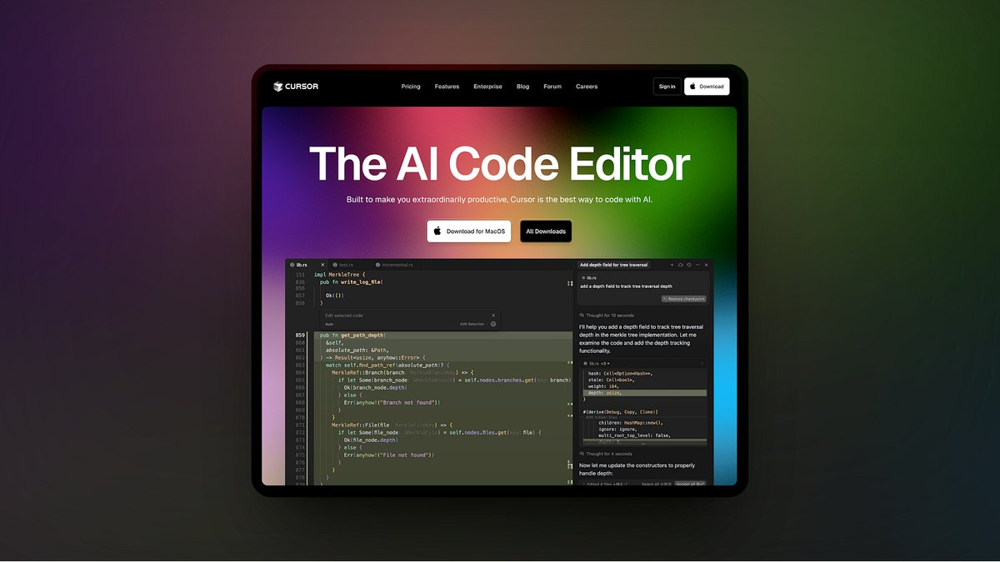
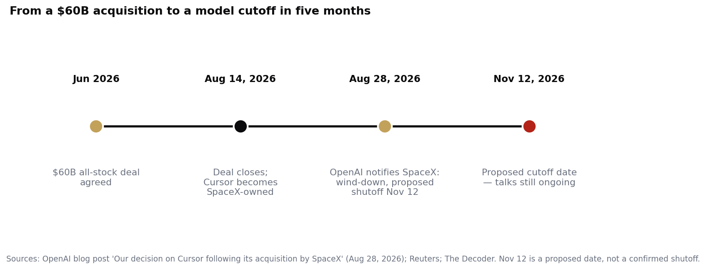

> [中文版 Chinese version](/life/openai-cursor-cutoff-nov-12-zh/)

*Cursor's homepage. Screenshot of cursor.com, via Sebastian Roehl / Substack.*

## What happens today

**November 12, 2026** is the date OpenAI proposed for winding down the contract that supplies its models to Cursor, the AI code editor. OpenAI announced the decision on August 28 in a blog post titled "Our decision on Cursor following its acquisition by SpaceX," and said November 12 was the maximum notice its contract allowed. The decision also covers future models: OpenAI said it will not supply Cursor with upcoming models either, naming its forthcoming model **Astra** explicitly.

One important caveat before anything else: **the date is proposed, not confirmed**. OpenAI's own help page still describes a proposed transition period ending November 12, and as of November 11 the two companies were still talking. Cursor CEO Michael Truell has said talks continue, and neither side has confirmed whether the models were still live on November 11. So today may be the day the picker empties — or the day the two sides announce more time.

*From a $60B acquisition to a model cutoff in five months. Sources: OpenAI blog post (Aug 28, 2026); Reuters; The Decoder.*

## How five months got us here

The trigger was ownership, not technology. In **June 2026**, SpaceX agreed to buy **Anysphere**, the company behind Cursor, in a **$60 billion all-stock deal**; the acquisition closed on **August 14**. Two weeks later, OpenAI gave notice.

OpenAI's stated reason was unusually blunt: "We cannot be confident that SpaceX will use our technology within our terms of service, based on our experience with Elon Musk's companies violating contracts." The company pointed to past contract fights with Musk's companies, including X's breached OpenAI deal. Reuters confirmed both the notice and the June deal.

## The irony: OpenAI funded Cursor

The company OpenAI is now cutting off is one it helped create. Anysphere was founded in 2022 by four MIT undergraduates — Michael Truell, Sualeh Asif, Arvid Lunnemark, and Aman Sanger — and its first money came from the OpenAI Startup Fund, which led an $8 million seed round in October 2023. Cursor launched publicly in March 2023 as a fork of VS Code rebuilt around AI, not as a plugin bolted onto an existing editor. OpenAI's own fund bet that the future of coding was an AI-native editor; three years later, OpenAI is refusing to let its models run inside the editor its fund seeded, because that editor now belongs to a rival's empire. The seed check is the whole story in miniature: in 2023, the AI labs were still funding each other's ecosystems. In 2026, they are fencing them off.

## Four MIT students to $60 billion

The acquisition price only makes sense against Cursor's growth, which has no real precedent in software. The company crossed $100 million in annualized revenue in January 2025 — the fastest run to that mark in SaaS history by most accounts — then $500 million by June, $1 billion by November, and a reported $2 billion annualized run rate by February 2026. The valuation tracked it step for step: $400 million at the Series A in August 2024, $2.5 billion at the Series B that December, $9.9 billion at the Series C in June 2025, and $29.3 billion at a $2.3 billion Series D in November 2025, co-led by Accel and Coatue with Nvidia and Google participating. By March 2026, roughly 60% of revenue came from corporate customers, and the product was used by more than half the Fortune 500 — 67%, by Fortune's count.

SpaceX paid about twice the last private valuation, in stock, for a company founded four years earlier by people who had turned down jobs at big tech companies straight out of university. Described as the largest acquisition of a venture-backed startup on record, the deal also made Cursor a subsidiary inside a company whose AI segment already generated more than half its revenue — and whose own AI lab, xAI, builds Grok, a direct competitor to OpenAI's models. That is the context OpenAI was reacting to: not just a change of owner, but the absorption of the most popular AI editor into the stack of a company that competes with OpenAI at every layer, from models to data centers.

## A decade of bad blood

None of this is a new fight. Musk co-founded OpenAI as a nonprofit in December 2015 alongside Sam Altman and others, and donated tens of millions before leaving the board in February 2018, publicly over a conflict with Tesla's own AI work and privately after a failed attempt to merge OpenAI into Tesla and take control. He founded xAI in 2023, building Grok as a direct competitor. In February 2024 he sued OpenAI, alleging it had abandoned its founding nonprofit mission in favor of profit and its partnership with Microsoft; he withdrew the first suit, refiled in federal court in August 2024 with fraud and antitrust claims, and in February 2025 led a $97.4 billion bid to buy OpenAI's nonprofit parent. In May 2026, a federal jury found his trial claims were filed too late — time-barred — and the judge adopted the verdict; Musk has said he will appeal. OpenAI completed its recapitalization into a public benefit corporation in October 2025, with Microsoft holding about 27%.

That history is why OpenAI's August blog post reads the way it does. "Based on our experience with Elon Musk's companies violating contracts" is not a generic risk disclosure; it is a reference to a decade of litigation, a failed takeover bid, and a lawsuit OpenAI won on a technicality rather than on the merits. The trust between these two parties is already spent.

## What actually changes for Cursor users

Less than the headlines suggest — and that is the point worth stating plainly:

- **What goes:** the built-in OpenAI models in Cursor's model picker. No new OpenAI models will arrive there either; the catalogue is frozen on the versions it already has.
- **What stays:** Claude, Gemini, Grok, Moonshot's models, and Cursor's own models. Anthropic has publicly said it will keep adding compute for Claude inside Cursor.
- **The workaround:** if you have your own OpenAI API key, you can still plug it in and use GPT models inside Cursor. OpenAI also says it will keep supporting its coding extensions that run inside editors like Cursor.
- **The scale:** Truell says OpenAI models serve only about **5% of Cursor's traffic**. The editor is model-agnostic, and most of its usage was already elsewhere.

So for the large majority of Cursor users, November 12 changes nothing in the editor. What changes is the structure underneath it.

The practical consequence is narrower than the drama, but it is real for the 5%. Developers who built their workflow around GPT models inside Cursor — its rules files, its agent mode, its inline completions tuned to a specific model's behavior — now face a choice: switch models inside Cursor, bring their own API key and pay OpenAI directly at API rates on top of Cursor's $20-a-month Pro subscription, or move to another tool entirely. The API-key route works, but it changes the economics: you are no longer buying a bundled product, you are assembling one, and the metering, rate limits, and billing are yours to manage. The cheapest lesson is the one the editor itself has been teaching since 2023: your prompts, your rules files, and your model choice are the portable parts. Everything else — the picker, the default model, the bundled pricing — belongs to someone else's business relationship.

## The market Cursor now sits in

Cursor is not alone, and the cutoff lands in a market that has split in two. On one side are the IDE-native tools: GitHub Copilot, the incumbent with over 35 million users and 1.8 million paying subscribers as of early 2026, still the default for teams that live on GitHub; Windsurf, the former Codeium editor, now sold as Devin Desktop after Cognition's acquisition; and Cursor itself, the productivity leader for IDE-centric developers by most satisfaction surveys. On the other side are the terminal agents — Anthropic's Claude Code, OpenAI's own Codex CLI, Google's Gemini CLI — which treat the terminal, not the editor, as the interface, and which have been winning the most complex engineering work. The categories are blurring: Copilot has added agent mode, Cursor has added terminal agents, and every tool now meters usage in some form.

What the cutoff changes is the neutrality premium. Cursor's founding pitch was that it would run anyone's models, and that pitch is what made it the editor developers chose rather than the one their company assigned. Under SpaceX, the pitch is the same — Claude, Gemini, Grok, and Cursor's own models all still run — but the exception is now visible, and every other model family in the picker is a negotiation waiting to happen.

## The verdict

This is not really a story about 5% of traffic. It is a story about what happens when the tools developers use get absorbed into vertically integrated stacks. Cursor used to be neutral ground: a popular editor that would happily run anyone's models. Now it is owned by SpaceX — a company whose own AI business generated more than half its revenue last quarter and which is spending $74 billion on its own compute campuses ([see today's other post](/life/spacex-74b-ai-campuses/)) — and OpenAI has decided it will not feed a rival's asset.

The precedent matters more than the cutoff. Model supply is now a lever in corporate fights, not a neutral utility. If you build your workflow around one editor and one model family, both halves of that stack can now be pulled by an acquisition you had nothing to do with. The practical lesson for developers is boring but real: keep your prompts, your rules, and your model choice portable, because the picker in your editor is a business relationship, not a feature — and business relationships end.

## Sources

- OpenAI, "Our decision on Cursor following its acquisition by SpaceX," August 28, 2026 (notice to wind down the model-supply contract; proposed shutoff November 12, 2026; future models including Astra will not be supplied; "we cannot be confident that SpaceX will use our technology within our terms of service").
- Reuters, via The Decoder and Geroundtable, November 2026 (SpaceX agreed in June to buy Anysphere for $60 billion in an all-stock deal; deal closed August 14, 2026; Reuters confirmed the notice).
- The Decoder, "OpenAI cuts off Cursor after SpaceX acquisition," November 2026 (what changes: built-in OpenAI models go; Claude, Gemini, Grok stay; own API key still works; OpenAI extensions still supported).
- Cursor / Michael Truell, via The Decoder and Medium, November 2026 (OpenAI models serve about 5% of Cursor traffic; talks with OpenAI continue; November 12 is a proposed date, not a confirmed shutoff).
- Maomorales / Round Funded / Sterling Charts, 2026 (Anysphere founded 2022 by four MIT students; Cursor launched March 2023; OpenAI Startup Fund led $8M seed, October 2023; Series A $60M at $400M, August 2024; Series B $100M at $2.5B, December 2024; Series C $900M at $9.9B, June 2025; Series D $2.3B at $29.3B, November 2025; $100M annualized revenue January 2025; $1B November 2025; $2B February 2026; 67% of the Fortune 500 by March 2026; $60B SpaceX acquisition, largest of a venture-backed startup on record).
- How It Unfolded / Lawfold, October–November 2026 (Musk co-founded OpenAI December 2015; left the board February 20, 2018; sued February 2024; refiled in federal court August 2024; $97.4B bid February 2025; jury found claims time-barred May 18, 2026; OpenAI recapitalization completed October 28, 2025; Microsoft about 27%).
- The A.I. Beat / Prompt Genius / Rework, 2026 (GitHub Copilot over 35 million users, 1.8 million paying subscribers, early 2026; Windsurf acquired by Cognition, now Devin Desktop; terminal agents Claude Code, Codex CLI, Gemini CLI; Cursor $20/month Pro).
