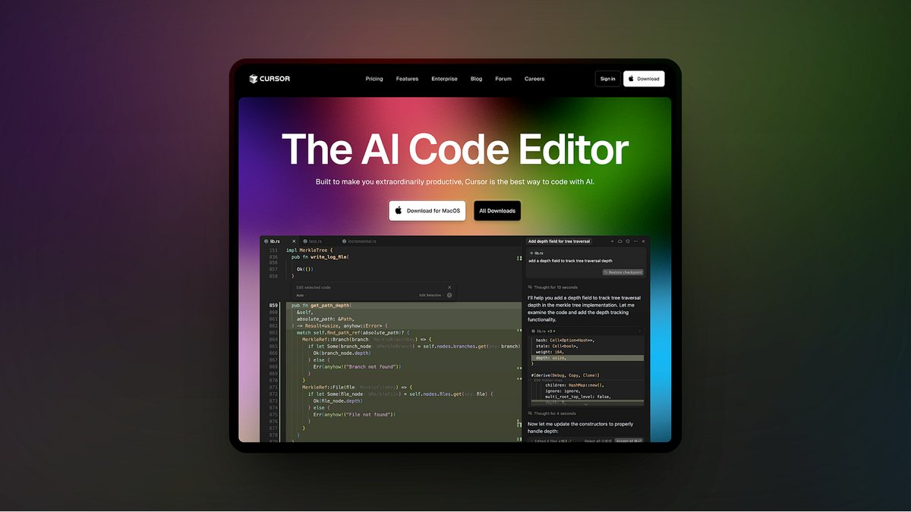
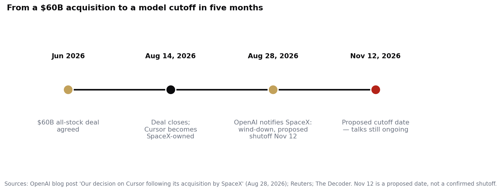

> [中文版 Chinese version](/life/openai-cursor-cutoff-nov-12-zh/)

*Cursor's homepage. Screenshot of cursor.com, via Sebastian Roehl / Substack.*

## What happens today

**November 12, 2026** is the date OpenAI proposed for winding down the contract that supplies its models to Cursor, the AI code editor. OpenAI announced the decision on August 28 in a blog post titled "Our decision on Cursor following its acquisition by SpaceX," and said November 12 was the maximum notice its contract allowed. The decision also covers future models: OpenAI said it will not supply Cursor with upcoming models either, naming its forthcoming model **Astra** explicitly.

One important caveat before anything else: **the date is proposed, not confirmed**. OpenAI's own help page still describes a proposed transition period ending November 12, and as of November 11 the two companies were still talking. Cursor CEO Michael Truell has said talks continue, and neither side has confirmed whether the models were still live on November 11. So today may be the day the picker empties — or the day the two sides announce more time.

*From a $60B acquisition to a model cutoff in five months. Sources: OpenAI blog post (Aug 28, 2026); Reuters; The Decoder.*

## How five months got us here

The trigger was ownership, not technology. In **June 2026**, SpaceX agreed to buy **Anysphere**, the company behind Cursor, in a **$60 billion all-stock deal**; the acquisition closed on **August 14**. Two weeks later, OpenAI gave notice.

OpenAI's stated reason was unusually blunt: "We cannot be confident that SpaceX will use our technology within our terms of service, based on our experience with Elon Musk's companies violating contracts." The company pointed to past contract fights with Musk's companies, including X's breached OpenAI deal. Reuters confirmed both the notice and the June deal.

## What actually changes for Cursor users

Less than the headlines suggest — and that is the point worth stating plainly:

- **What goes:** the built-in OpenAI models in Cursor's model picker. No new OpenAI models will arrive there either; the catalogue is frozen on the versions it already has.
- **What stays:** Claude, Gemini, Grok, Moonshot's models, and Cursor's own models. Anthropic has publicly said it will keep adding compute for Claude inside Cursor.
- **The workaround:** if you have your own OpenAI API key, you can still plug it in and use GPT models inside Cursor. OpenAI also says it will keep supporting its coding extensions that run inside editors like Cursor.
- **The scale:** Truell says OpenAI models serve only about **5% of Cursor's traffic**. The editor is model-agnostic, and most of its usage was already elsewhere.

So for the large majority of Cursor users, November 12 changes nothing in the editor. What changes is the structure underneath it.

## The verdict

This is not really a story about 5% of traffic. It is a story about what happens when the tools developers use get absorbed into vertically integrated stacks. Cursor used to be neutral ground: a popular editor that would happily run anyone's models. Now it is owned by SpaceX — a company whose own AI business generated more than half its revenue last quarter and which is spending $74 billion on its own compute campuses ([see today's other post](/life/spacex-74b-ai-campuses/)) — and OpenAI has decided it will not feed a rival's asset.

The precedent matters more than the cutoff. Model supply is now a lever in corporate fights, not a neutral utility. If you build your workflow around one editor and one model family, both halves of that stack can now be pulled by an acquisition you had nothing to do with. The practical lesson for developers is boring but real: keep your prompts, your rules, and your model choice portable, because the picker in your editor is a business relationship, not a feature — and business relationships end.

## Sources

- OpenAI, "Our decision on Cursor following its acquisition by SpaceX," August 28, 2026 (notice to wind down the model-supply contract; proposed shutoff November 12, 2026; future models including Astra will not be supplied; "we cannot be confident that SpaceX will use our technology within our terms of service").
- Reuters, via The Decoder and Geroundtable, November 2026 (SpaceX agreed in June to buy Anysphere for $60 billion in an all-stock deal; deal closed August 14, 2026; Reuters confirmed the notice).
- The Decoder, "OpenAI cuts off Cursor after SpaceX acquisition," November 2026 (what changes: built-in OpenAI models go; Claude, Gemini, Grok stay; own API key still works; OpenAI extensions still supported).
- Cursor / Michael Truell, via The Decoder and Medium, November 2026 (OpenAI models serve about 5% of Cursor traffic; talks with OpenAI continue; November 12 is a proposed date, not a confirmed shutoff).
