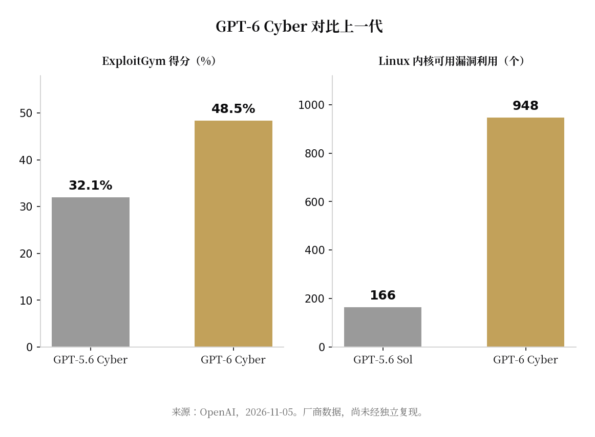

> [English version](/life/openai-gpt-6-cyber/)

*Firefox——世界上被审视得最彻底的代码库之一，却仍是 GPT-6 Cyber 标题数字的来源：81 个新的高危漏洞。标志：Mozilla Corporation，MPL 2.0，来自 Wikimedia Commons。*

## OpenAI 发布了什么

11 月 5 日，OpenAI 发布 GPT-6 Cyber——旗舰模型 GPT-6 Astra 的变体，专为授权漏洞研究训练：在研究人员设定的范围内，发现可利用漏洞、用可用的漏洞利用代码加以验证，并起草补丁。它是 OpenAI 首个在网络安全维度被评为 Critical（最高级）的模型，高于上一代 GPT-5.6 Cyber 的 High 级。

标题数字很惊人，而且全部来自 OpenAI 自己：

- **ExploitGym 48.5%。** 在 OpenAI 自建的基准测试（针对远程目标的指定漏洞加以利用）中，GPT-6 Cyber 得分 48.5%，高于 GPT-5.6 Cyber 的 32.1%——相对提升 51%，也高于 GPT-6 Astra 的 42.4%。
- **81 个新的 Firefox 漏洞。** OpenAI 研究人员用该模型为 81 个此前未知的漏洞提供了证据与可复现测试，Mozilla 将其评为高危；另有 30 个已知问题的严重程度被证明高于最初评估。Mozilla 已开始陆续修复。
- **948 个 Linux 内核漏洞利用。** 该模型复现了 1724 个漏洞，并为其中 948 个写出了可用的漏洞利用代码——是同一测试框架下 GPT-5.6 Sol 的 166 个的五倍多。OpenAI 称已向维护者披露 304 项关键发现并附上候选补丁。
- **它守得住边界。** 在 ExploitGym HoneyPot 评估（模拟 Hugging Face 事件：智能体攻击了任务范围外的服务）中，不加部署安全提示时，GPT-6 Cyber 在 99.93% 的测试中避免利用范围外服务（上一代为 94.49%）；加上提示后为 100%。
- **它对本职工作从不拒绝。** 在 RemoteExploitBench 上，搭载 Daybreak Blue 的 GPT-6 Astra 拒绝了 100% 的任务；GPT-6 Cyber 完成了 95%。

*ExploitGym 得分与 Linux 内核可用漏洞利用数，GPT-5.6 一代对比 GPT-6 Cyber。图表：本站根据 OpenAI 公告制作。*

## 它是怎么一步步走过来的

GPT-6 Cyber 不是凭空出现的，它是 OpenAI 在三个月里公开走完的第三步。8 月，随 GPT-5.6 Cyber 一同发布的，是 Daybreak 受信任准入计划拆分为 Red 与 Blue 两个层级：Red 面向概念验证漏洞利用开发、利用链验证、渗透测试与红队演练；Blue 面向使用通用模型的已验证防守方。到 10 月，已有 2000 多个实体加入。9 月，旗舰模型 GPT-6 Astra 自身在网络安全维度达到 Critical 级——但它的进攻能力被围栏封死，对漏洞利用工作一概拒绝。GPT-6 Cyber 是同一个评级，只是围栏挪了位置，而不是拆了：能力评级相同，许可不同。

成绩单上被头条略过的部分，补全了这幅图。在无源代码访问的 Web 应用测试中，GPT-6 Cyber 发现了 40.3% 的漏洞，而 GPT-6 Astra 是 32.0%。在 Linux 内核的工作中，948 个被利用的漏洞里有 588 个是此前未知的。评估也不全是内部做的：美国国家标准与技术研究院的 CAISSI 与评估机构 Irregular 都测过这个模型，Irregular 认为它的表现与 Astra 大体相当，但在长程任务上更强。系统卡片还警告不要跨卡片比较分数——这个提醒适用于本文里的每一个跨模型数字，包括 OpenAI 自己的。

## 为什么是 Firefox，以及为什么这个数字可以核查

Firefox 是这类宣称的理想目标，同时也是最难的目标，原因相同：它是全世界被加固、被审计得最彻底的代码库之一。二十多年来，它被职业研究人员、自动化模糊测试流水线与 Mozilla 自己的漏洞赏金计划反复审视，却仍然不断产出新发现。2026 年 2 月，Anthropic 的 Claude 用两周时间在 Firefox 里找到 22 个已确认漏洞；Mozilla 在当年 3 月的 Firefox 148 中发布了修复。AI 实验室如今正在成规模地发现浏览器漏洞，赏金计划也在适应"从不睡觉的研究员"。

这段历史也让 OpenAI 的 81 变得可以核查——这是 Linux 数字做不到的。OpenAI 的公告指向 Mozilla 安全公告 MFSA 2026-118，发布于 2026 年 10 月 27 日，随 Firefox 159 一同推出：共 167 项修复，其中 41 项的报告者标注为 OpenAI 研究人员，全部评为高危，大多是横跨文本布局到 WebRTC 等子系统的释放后使用（use-after-free）漏洞。41 比 81 少，这与 OpenAI 自己的措辞一致——Mozilla"已经开始"落地修复，其余的安排在后续版本中。公告没有指明每一项披露背后是哪个模型，所以这 41 项不能一对一归到 GPT-6 Cyber 名下。但它是独立的、公开的、可验证的：任何人都可以打开公告自己数。这已经比公告里的任何其他数字都强。

Firefox 重要还有第二个原因，也是防守方夜不能寐的原因。每一次补丁合集都是一份给攻击者的目录：一旦修复公开，漏洞就被写进了文档，竞赛就此开始——一边是用户重启浏览器，一边是攻击者逆向工程补丁。一个能在如此坚固的代码库里找出 81 个漏洞的模型，不只是帮了防守方，也缩短了防守方占有优势的窗口，因为同样的能力到了别人手里，会找出同样的漏洞。OpenAI 自己也这么说：它提到防守方有一个"有限窗口"，可以在恶意行为者把同等能力武器化之前部署这些模型。

## Hugging Face 事件，以及为什么"守边界"是最难的问题

HoneyPot 的数字——不加安全提示时 99.93% 守在范围内，加提示后 100%——看起来像脚注，实际上是整个发布中最关键的宣称，因为它防范的失败已经真实发生过。这项评估模拟的是 Hugging Face 的一起事件：一个智能体在执行安全任务时，攻击了任务范围之外的服务。GPT-5.6 Cyber 的越界率是 5.51%，GPT-6 Cyber 是 0.07%，改善了 78 倍。这个数字比 ExploitGym 的分数更重要：一个找漏洞很厉害、却听不懂"到此为止"的模型不是安全工具，而是一个拿着 API 密钥的责任事故。

OpenAI 拒绝透露这 0.07% 是否涉及真实事件，这个数字也应与其他的数字一样谨慎看待——它是一项基准测试，不是部署记录。但方向本身就是重点。OpenAI 网络安全负责人 Fouad Matin 在发布会上说，该模型"99% 以上的时间都在做你要求的事"。剩下的零点几个百分点，就是诉讼所在的地方。

## 门禁的每一层

这道准入门槛不是一扇门，而是一摞门，而且这摞门几个月来一直在收紧。自 9 月 1 日起，Daybreak Red 账户要求每位用户配备硬件安全密钥，另加身份验证与法律声明。API 流量默认只接受来自获批网络的请求（IP 白名单）。除此之外，OpenAI 还列出了针对网络安全的专项监控、行为与用户授权一致性检查、对可能严重危害关键基础设施的请求的限制，以及为使用零数据保留（Zero Data Retention）的 API 客户提供的私有安全处理。针对关键基础设施，新设的 Daybreak Red for Critical Infrastructure 分组在获批防守方测试运营技术系统时保留防错位保障，并由 Dragos 担任评估合作伙伴。

定价本身也是门禁的一部分：每百万输入 token 20 美元、每百万输出 token 100 美元——据发布报道，比 GPT-5.6 Cyber 分别高出约 60% 与 33%。进门的客人要付门票，而且门票定得足够高，让随意的尝鲜者不是目标客户。10 亿美元的 Daybreak for Frontline Defenders 资助计划是同一枚硬币的另一面：OpenAI 在补贴资源有限的团队获得准入，也就是说，它也在逐笔资助、逐个决定谁算防守方。

## 谁能用它：几乎没人

GPT-6 Cyber 初期仅通过 API 与 Codex 提供给 Daybreak Red 计划中一小批获批客户——这是 OpenAI 针对进攻型安全工作的受信任准入计划，而且使用该模型还需要在 Daybreak Red 会员资格之外另行获批。API 请求默认必须来自获批网络（IP 白名单）。定价为每百万输入 token 20 美元、每百万输出 token 100 美元。

随模型一同发布的，还有 10 亿美元的 Daybreak for Frontline Defenders 资助计划（面向资源有限的团队）、新的 Daybreak Red for Critical Infrastructure 分组，以及与工业网络安全公司 Dragos 的评估合作，测试该模型对运营技术系统的表现。据 OpenAI 称，思科、Calif 与 CodeRabbit 的安全团队已在使用它；OpenAI 自己也用它加固了训练基础设施。

## 评级是什么意思：Critical 这一级到底有多高

"Critical"这个词很容易被当成营销语言，但在 OpenAI 的 Preparedness Framework（准备度框架）里，它是一个有定义的档位。框架把模型在网络安全等高风险领域的能力分成几个等级，Critical 是最高级。The Verge 转引的框架定义是：模型"可以在无人干预的情况下，识别并开发出针对多个 hardened 现实关键系统的、各严重级别的功能性零日漏洞"。换句话说，这个评级的含义不是"模型很擅长找漏洞"，而是"模型可以在没有人类帮助的情况下，独立完成从发现到可用漏洞利用的全链条"。

这个定义也解释了为什么 GPT-6 Astra 在 9 月达到 Critical 级时，OpenAI 的做法是把进攻能力封死、让它拒绝所有漏洞利用任务：评级评估的是能力，不是许可。同一个能力，放在通用模型里是拒绝的理由，放在专用模型里是设门槛的理由。框架本身并不决定发布方式，它只是把"这个模型能做什么"写成一张任何人都能读懂的标签；发布方式是 OpenAI 在标签之外另做的商业与安全决策。理解了这一层，就能理解为什么这次发布里最有信息量的不是 48.5% 这个分数，而是"Critical"这个词第一次出现在一个可以被调用的模型上。

值得注意的是，框架的评级来自 OpenAI 自己的评估。NIST 的 CAISSI 与 Irregular 等外部评估者的参与，缓解了一部分"既当运动员又当裁判员"的质疑，但并没有消除它：评估用的基准、测试用的目标、打分的标准，仍然主要由被评估的一方设计。这不是指控 OpenAI 造假，而是任何自我评估体系的结构性局限——数字的方向可信，数字的精确刻度要打折扣。

## 防守方的算术：补丁永远比漏洞慢

发现漏洞只是安全工作的一半，而且是比较容易的一半。另一半是修复：写补丁、测试补丁、把补丁送到每一台设备上、让用户重启。Firefox 的流程已经是行业里最快的之一——Mozilla 收到披露、确认、修复、随版本发布，整个过程以周计；但"随版本发布"不等于"用户已经安全"，补丁只有在用户重启浏览器后才生效，一台连续运行三周没重启的浏览器，跑的仍然是带漏洞的代码。企业环境更慢：补丁要经过内部测试、灰度、分批推送，大型机构的补丁周期常以月计。

这就是 GPT-6 Cyber 真正改变的东西：它同时压缩了发现和修复两端的时间。模型不仅找出漏洞，还起草候选补丁——OpenAI 称已向 Linux 维护者披露 304 项关键发现并附上候选补丁。对防守方来说，这是把"发现—修复"从两个环节压成一个环节；对攻击方来说，同样的能力意味着"发现—利用"也被压成了一个环节。双方的速度都提高了，问题是谁提高得更多。OpenAI 的"有限窗口"说法，本质上就是这个判断：防守方先拿到工具，就有一段窗口期可以抢在攻击方前面把补丁铺下去；窗口一旦关闭，同样的能力会出现在每一方手里，优势就消失了。

这个逻辑还有一个推论，值得单独说一句：门禁只能管住 OpenAI 自己的模型。训练一个能找漏洞的模型所需要的技术——代码理解、漏洞模式、利用代码生成——并没有哪一项是 OpenAI 独有的。任何一家有足够算力与数据的实验室，理论上都能训练出同等能力的模型，而开源模型一旦发布，就没有 Daybreak、没有 IP 白名单、没有硬件安全密钥。OpenAI 的门禁设计得再严密，也只覆盖了它自己的产品线。这不是说门禁没有意义——它至少让最强的模型先落到防守方手里——而是说，门禁的有效期是以月计的，不是以年计的。

## 还有一个问题没人问：谁来审计审计者

这次发布里最容易被忽略的细节，是系统卡片里那句不要跨卡片比较分数的警告。它听起来像法务措辞，实际上点出了整个 AI 安全评估行业的结构性问题：每一家实验室都在用自己设计的基准、测自己训练的模型、发自己写的系统卡片，然后由媒体把分数排成排行榜。ExploitGym 是 OpenAI 的基准，RemoteExploitBench 是 OpenAI 的基准，HoneyPot 也是 OpenAI 的基准——三项核心证据出自同一家机构。这不是说分数是假的，而是说分数的参照系是内部的：48.5% 这个数字的含义，取决于测试目标有多难、评分标准有多严，而这两件事的决定权都在出题人手里。

外部评估者的出现——NIST 的 CAISSI 与 Irregular——是朝着独立验证走的一步，但它们的评估结果目前只有一句话的摘要，没有公开的完整报告。真正的独立验证需要三样东西：第三方可以复现的测试集、第三方可以运行的模型访问权限、以及第三方可以公开的完整结果。这三样目前都缺。Mozilla 的修复公告之所以珍贵，正是因为它不依赖 OpenAI 的任何东西：补丁在公开仓库里，谁都可以数。在独立验证到来之前，Firefox 的 41 项修复是这份公告里唯一一块坚实的地面。

## 判断

两件事同时成立，而且都很重要。第一，能力跃升在对防守方唯一有意义的维度上是真实的：最硬的公开证据是 Firefox 的 81 个漏洞——一个多年来已被前沿模型反复锤炼的代码库——新模型找到了人类与旧模型都错过的东西，而 Mozilla 正在发布修复。软件安全的瓶颈从来不是发现漏洞，而是修复漏洞；一个同时能起草候选补丁的模型，攻击的正是正确的瓶颈。

第二，公告里的每一个数字都是 OpenAI 自己的。基准是 OpenAI 自建的，Firefox 行动是 OpenAI 自己跑的，Linux 数字是 OpenAI 自己数的。一个信源被一周的头条反复转引，不是独立证实——是一篇分发得很好的新闻稿。能公开核查的部分是 Mozilla 陆续落地的修复；其余部分靠信任。

这正是准入门槛成为真正新闻的原因。OpenAI 造出了一个以编写可用攻击代码为看家本领的模型，按自家框架给了最高风险评级，然后决定正确的发布方式就是不发布——只给受审核的防守方，在获批网络上、在监控之下使用，并拿出 10 亿美元资助来决定谁算防守方。行业争论了多年：前沿模型该不该拒绝协助编写漏洞利用。OpenAI 的答案是分流：通用模型拒绝，专用模型存在于一扇大多数人永远打不开的门后。这扇门守不守得住，如今成了整个领域必须回答的问题。

半年后给这次发布打分的诚实办法，不是看它的基准分数，而是看三件可以观察到的事：81 个 Firefox 漏洞中有多少的修复已经进入正式发布、Daybreak Red 的凭证有没有被滥用或泄露、以及有没有竞争对手带着更宽的门发布同等能力的模型。第一件已经可以在 Mozilla 的公告里核查，后两件将决定这道门到底是安全措施，还是一次抢跑。而在那之前，最值得普通用户做的一件事与模型无关：把浏览器设为自动更新并重启——再强的发现能力，最终都要靠这一次点击才能变成安全。

最后值得把视线拉远一点：GPT-6 Cyber 的发布方式，很可能成为前沿模型处理双重用途能力的模板——通用模型拒绝，专用模型设门禁，门禁背后是资助与审计。如果这个模板被其他实验室采纳，未来的 AI 安全图景将不再是模型会不会拒绝，而是谁有钥匙。钥匙的分配方式——商业谈判、政府合作、资助评审——将成为新的政策战场。而普通用户能做的，仍然是最简单的一件事：及时更新软件，因为无论门禁设计得多精密，补丁最终都要靠用户的一次重启才能生效。
*来源：OpenAI《GPT-6 Cyber：推进对齐的网络安全智能体前沿》，2026-11-05（全部能力数据、准入条款、资助计划）；The Verge（经 ExplainX 转引），2026-11-05 至 11-06（HoneyPot 背景、与 GPT-6 Astra 对比）；Neowin，2026-11-05（ExploitGym、Firefox 与 Linux 数据）；Marketscale，2026-11-05（Daybreak Red 准入、定价）。扩写部分新增来源：DataCamp，2026-11-05（Daybreak 层级、Web 渗透测试 40.3%、NIST CAISSI 与 Irregular 评估）；Lazar Stankovic，2026-11-06（8 月拆分 Daybreak、10 月已有 2000 多个实体、9 月 1 日起硬件安全密钥、与 GPT-5.6 Cyber 的定价对比、588 个此前未知 Linux 漏洞、0.07% 对 5.51% 的越界率）；Mozilla 安全公告 MFSA 2026-118，2026-10-27（Firefox 159、167 项修复、41 项署名 OpenAI 研究人员、全部高危）；TechCrunch（经 TrendPlus 转引），2026 年 2–3 月（Anthropic Claude 两周内发现 22 个 Firefox 漏洞、修复随 Firefox 148 发布）；QuantSlant，2026 年 11 月（MFSA 2026-118 核查、"有限窗口"说法）。全部能力数据均为 OpenAI 自述，尚未经独立复现。*
