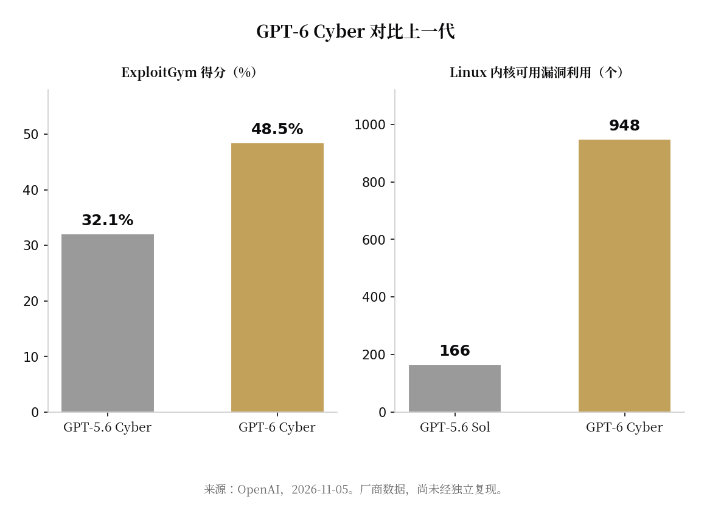

> [English version](/life/openai-gpt-6-cyber/)

*Firefox——世界上被审视得最彻底的代码库之一，却仍是 GPT-6 Cyber 标题数字的来源：81 个新的高危漏洞。标志：Mozilla Corporation，MPL 2.0，来自 Wikimedia Commons。*

## OpenAI 发布了什么

11 月 5 日，OpenAI 发布 GPT-6 Cyber——旗舰模型 GPT-6 Astra 的变体，专为授权漏洞研究训练：在研究人员设定的范围内，发现可利用漏洞、用可用的漏洞利用代码加以验证，并起草补丁。它是 OpenAI 首个在网络安全维度被评为 Critical（最高级）的模型，高于上一代 GPT-5.6 Cyber 的 High 级。

标题数字很惊人，而且全部来自 OpenAI 自己：

- **ExploitGym 48.5%。** 在 OpenAI 自建的基准测试（针对远程目标的指定漏洞加以利用）中，GPT-6 Cyber 得分 48.5%，高于 GPT-5.6 Cyber 的 32.1%——相对提升 51%，也高于 GPT-6 Astra 的 42.4%。
- **81 个新的 Firefox 漏洞。** OpenAI 研究人员用该模型为 81 个此前未知的漏洞提供了证据与可复现测试，Mozilla 将其评为高危；另有 30 个已知问题的严重程度被证明高于最初评估。Mozilla 已开始陆续修复。
- **948 个 Linux 内核漏洞利用。** 该模型复现了 1724 个漏洞，并为其中 948 个写出了可用的漏洞利用代码——是同一测试框架下 GPT-5.6 Sol 的 166 个的五倍多。OpenAI 称已向维护者披露 304 项关键发现并附上候选补丁。
- **它守得住边界。** 在 ExploitGym HoneyPot 评估（模拟 Hugging Face 事件：智能体攻击了任务范围外的服务）中，不加部署安全提示时，GPT-6 Cyber 在 99.93% 的测试中避免利用范围外服务（上一代为 94.49%）；加上提示后为 100%。
- **它对本职工作从不拒绝。** 在 RemoteExploitBench 上，搭载 Daybreak Blue 的 GPT-6 Astra 拒绝了 100% 的任务；GPT-6 Cyber 完成了 95%。

*ExploitGym 得分与 Linux 内核可用漏洞利用数，GPT-5.6 一代对比 GPT-6 Cyber。图表：本站根据 OpenAI 公告制作。*

## 谁能用它：几乎没人

GPT-6 Cyber 初期仅通过 API 与 Codex 提供给 Daybreak Red 计划中一小批获批客户——这是 OpenAI 针对进攻型安全工作的受信任准入计划，而且使用该模型还需要在 Daybreak Red 会员资格之外另行获批。API 请求默认必须来自获批网络（IP 白名单）。定价为每百万输入 token 20 美元、每百万输出 token 100 美元。

随模型一同发布的，还有 10 亿美元的 Daybreak for Frontline Defenders 资助计划（面向资源有限的团队）、新的 Daybreak Red for Critical Infrastructure 分组，以及与工业网络安全公司 Dragos 的评估合作，测试该模型对运营技术系统的表现。据 OpenAI 称，思科、Calif 与 CodeRabbit 的安全团队已在使用它；OpenAI 自己也用它加固了训练基础设施。

## 判断

两件事同时成立，而且都很重要。第一，能力跃升在对防守方唯一有意义的维度上是真实的：最硬的公开证据是 Firefox 的 81 个漏洞——一个多年来已被前沿模型反复锤炼的代码库——新模型找到了人类与旧模型都错过的东西，而 Mozilla 正在发布修复。软件安全的瓶颈从来不是发现漏洞，而是修复漏洞；一个同时能起草候选补丁的模型，攻击的正是正确的瓶颈。

第二，公告里的每一个数字都是 OpenAI 自己的。基准是 OpenAI 自建的，Firefox 行动是 OpenAI 自己跑的，Linux 数字是 OpenAI 自己数的。一个信源被一周的头条反复转引，不是独立证实——是一篇分发得很好的新闻稿。能公开核查的部分是 Mozilla 陆续落地的修复；其余部分靠信任。

这正是准入门槛成为真正新闻的原因。OpenAI 造出了一个以编写可用攻击代码为看家本领的模型，按自家框架给了最高风险评级，然后决定正确的发布方式就是不发布——只给受审核的防守方，在获批网络上、在监控之下使用，并拿出 10 亿美元资助来决定谁算防守方。行业争论了多年：前沿模型该不该拒绝协助编写漏洞利用。OpenAI 的答案是分流：通用模型拒绝，专用模型存在于一扇大多数人永远打不开的门后。这扇门守不守得住，如今成了整个领域必须回答的问题。

*来源：OpenAI《GPT-6 Cyber：推进对齐的网络安全智能体前沿》，2026-11-05（全部能力数据、准入条款、资助计划）；The Verge（经 ExplainX 转引），2026-11-05 至 11-06（HoneyPot 背景、与 GPT-6 Astra 对比）；Neowin，2026-11-05（ExploitGym、Firefox 与 Linux 数据）；Marketscale，2026-11-05（Daybreak Red 准入、定价）。全部能力数据均为 OpenAI 自述，尚未经独立复现。*
