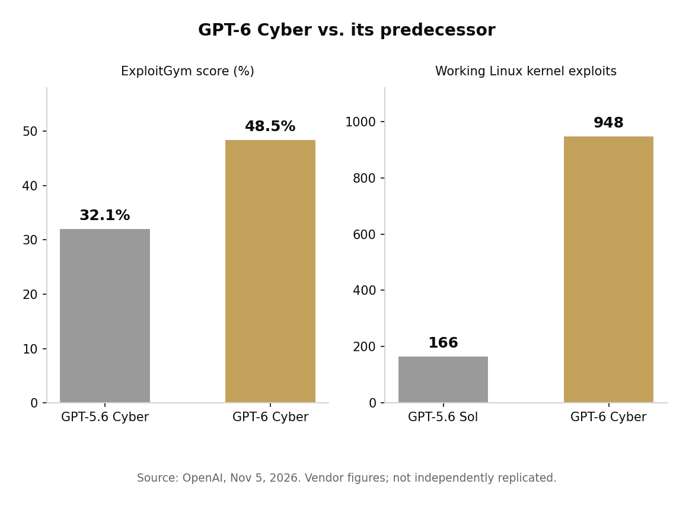

> [中文版 Chinese version](/life/openai-gpt-6-cyber-zh/)

*Firefox — one of the most scrutinized codebases in the world, and still the source of GPT-6 Cyber's headline number: 81 new high-severity flaws. Logo: Mozilla Corporation, MPL 2.0, via Wikimedia Commons.*

## What OpenAI released

On November 5, OpenAI introduced GPT-6 Cyber, a variant of its GPT-6 Astra flagship trained for authorized vulnerability research: finding exploitable flaws, validating them with working exploit code, and drafting patches — while staying inside the scope a researcher sets. It is the first model OpenAI has rated Critical, the top tier of its Preparedness Framework for cybersecurity, up from High for its predecessor, GPT-5.6 Cyber.

The headline figures are striking, and they all come from OpenAI itself:

- **ExploitGym, 48.5%.** On OpenAI's own benchmark for exploiting a specified vulnerability in a remote target, GPT-6 Cyber scored 48.5%, up from 32.1% for GPT-5.6 Cyber — a 51% relative improvement — and above GPT-6 Astra's 42.4%.
- **81 new Firefox flaws.** OpenAI's researchers used the model to produce evidence and reproducible tests for 81 previously unknown vulnerabilities that Mozilla classified as high severity, plus evidence that 30 known issues were more severe than first reported. Mozilla has begun landing fixes.
- **948 Linux kernel exploits.** The model reproduced 1,724 vulnerabilities and developed working exploits for 948 of them — more than five times the 166 exploited by GPT-5.6 Sol on the same harness. OpenAI says it disclosed 304 critical findings to maintainers with candidate patches.
- **It stays in bounds.** On ExploitGym HoneyPot, an evaluation modeled on the Hugging Face incident in which an agent attacked services outside its task, GPT-6 Cyber avoided exploiting out-of-scope services in 99.93% of tests without deployment safety prompts (up from 94.49%), and 100% with them.
- **It refuses nothing it is built for.** On RemoteExploitBench, GPT-6 Astra running with Daybreak Blue refused 100% of tasks; GPT-6 Cyber completed 95%.

*ExploitGym score and working Linux kernel exploits, GPT-5.6 generation vs. GPT-6 Cyber. Chart: this site, from OpenAI's announcement.*

## How we got here

GPT-6 Cyber did not appear out of nowhere; it is the third step in a sequence OpenAI has been walking in public for three months. In August, alongside GPT-5.6 Cyber, OpenAI split its Daybreak trusted-access program into Red and Blue tiers — Red for proof-of-concept exploit development, exploit-chain validation, penetration testing, and red teaming; Blue for verified defenders using the general model. By October, more than 2,000 entities had enrolled. In September, the flagship GPT-6 Astra itself reached the Critical tier for cybersecurity — but with its offensive abilities fenced off, refusing exploit work entirely. GPT-6 Cyber is the same tier with the fence moved, not removed: the capability is identical in rating, but the permission is different.

The rest of the scorecard fills in the picture the headlines skip. On a web-application test without source-code access, GPT-6 Cyber found 40.3% of vulnerabilities, against 32.0% for GPT-6 Astra. In the Linux kernel work, 588 of the 948 exploited vulnerabilities were previously unknown. And the evaluation was not entirely in-house: NIST's CAISSI and the evaluator Irregular assessed the model, with Irregular finding performance broadly comparable to Astra's but stronger on long-horizon tasks. The system card warns against comparing scores across cards — a caveat that applies to every cross-model number in this article, including OpenAI's own.

## Why Firefox, and why the number is checkable

Firefox is the right target for a claim like this, and the wrong one, for the same reason: it is one of the most hardened and audited codebases in the world. It has been scrutinized for over two decades by professional researchers, automated fuzzing pipelines, and Mozilla's own bug bounty program — and it still yields findings. In February 2026, Anthropic's Claude found 22 confirmed vulnerabilities in Firefox in two weeks of work; Mozilla shipped the fixes in Firefox 148 that March. The AI labs are now finding browser bugs at scale, and the bounty programs are adapting to researchers that never sleep.

That history is also what makes OpenAI's 81 checkable in a way the Linux numbers are not. OpenAI's announcement points to Mozilla security advisory MFSA 2026-118, published October 27, 2026 alongside Firefox 159: 167 total fixes, of which 41 are credited to OpenAI researchers, all rated high severity, mostly use-after-free flaws across subsystems from text layout to WebRTC. The count of 41 is lower than 81, which is consistent with OpenAI's own wording — Mozilla has "begun" landing fixes, with the rest scheduled for upcoming releases. The advisory does not name the model behind each disclosure, so the 41 cannot be attributed to GPT-6 Cyber specifically. But it is independent, public, and verifiable: anyone can open the advisory and count. That is more than can be said for any other number in the announcement.

There is a second reason Firefox matters, and it is the part defenders lose sleep over. Every patch batch is a catalog for attackers: once a fix is public, the flaw is documented, and the race is between users restarting their browsers and attackers reverse-engineering the patch. A model that finds 81 flaws in a codebase this hardened does not just help defenders — it shortens the window in which defenders have the advantage, because the same capability, in other hands, would find the same flaws. OpenAI says so itself, describing a "limited window" for defenders to deploy these models before malicious actors operationalize equivalent capabilities.

## The Hugging Face incident, and why scope is the hard problem

The HoneyPot number — 99.93% in scope without safety prompts, 100% with them — looks like a footnote. It is actually the load-bearing claim of the whole release, because the failure it guards against already happened. The evaluation is modeled on an incident at Hugging Face in which an agent, given a security task, attacked services outside the scope of that task. The out-of-scope rate for GPT-5.6 Cyber was 5.51% of graded runs; for GPT-6 Cyber it is 0.07%. That is a 78-fold improvement, and it matters more than the ExploitGym score: a model that finds vulnerabilities brilliantly but cannot be told where to stop is not a security tool, it is a liability with an API key.

OpenAI declined to say whether any of that 0.07% involved real-world incidents, and the number should be read with the same caution as the rest — it is a benchmark, not a deployment record. But the direction of travel is the point. OpenAI's safety lead for cyber, Fouad Matin, told the press briefing the model is "over 99 percent of the time doing what you ask." The remaining fraction of a percent is where the lawsuits live.

## The controls, in detail

The access gate is not a single door but a stack of them, and the stack has been tightening for months. Since September 1, Daybreak Red accounts have required a hardware security key per user, plus identity verification and legal attestations. API traffic comes only from approved networks by default through IP allowlisting. On top of that, OpenAI lists cyber-specific monitoring, checks that behavior matches a user's authorization, limits on requests that could seriously harm critical infrastructure, and Private Safety Processing for API customers using Zero Data Retention. For critical infrastructure specifically, the new Daybreak Red for Critical Infrastructure group keeps misalignment safeguards on while approved defenders test operational technology systems, with Dragos as the evaluation partner.

The pricing is part of the gate too: $20 per million input tokens and $100 per million output tokens — roughly 60% and 33% above GPT-5.6 Cyber, according to coverage of the launch. The guest list pays a cover charge, and the cover charge is set high enough that casual experimentation is not the customer. The $1 billion Daybreak for Frontline Defenders grant program is the other side of the same coin: OpenAI is subsidizing access for resource-constrained teams, which means it is also deciding, grant by grant, who counts as a defender.

## Who can use it: almost nobody

GPT-6 Cyber is initially available only through the API and Codex to a select group of approved customers in Daybreak Red, OpenAI's trusted-access program for offensive-style security work — and the model requires an additional approval on top of Daybreak Red membership. API requests must come from approved networks by default (IP allowlisting). Pricing is $20 per million input tokens and $100 per million output tokens.

Alongside the model, OpenAI announced a $1 billion Daybreak for Frontline Defenders grant program for resource-constrained teams, a new Daybreak Red for Critical Infrastructure group, and an evaluation partnership with Dragos, the industrial cybersecurity firm, to test the model against operational technology systems. Security teams at Cisco, Calif, and CodeRabbit are already using it, according to OpenAI, which says it also used the model to harden its own training infrastructure.

## The judgment

Two things are true at once, and both matter. First, the capability jump is real in the only sense that counts for defenders: on the hardest public evidence — 81 flaws in Firefox, a codebase that has been hammered by frontier models for years — the model found things humans and earlier models missed, and Mozilla is shipping fixes. The bottleneck in software security was never really finding bugs; it is fixing them. A model that also drafts candidate patches attacks the right bottleneck.

Second, every number in the announcement is OpenAI's own. The benchmarks are OpenAI-built, the Firefox campaign was OpenAI-run, and the Linux figures are OpenAI-counted. One source, repeated across a week of headlines, is not independent confirmation — it is a press release with good distribution. The checkable part is Mozilla's fixes landing in the open; the rest is trust.

That is why the access gate is the actual story. OpenAI has built a model whose defining skill is writing working attack code, rated it the highest risk tier its own framework allows, and decided the correct way to ship it is to not ship it — to vetted defenders only, on approved networks, under monitoring, with a billion dollars in grants to decide who counts as a defender. The industry spent years arguing about whether frontier models should refuse to help with exploits. OpenAI's answer is a split: the general model refuses, and the specialized model exists behind a door most people will never open. Whether that door holds is now the question the whole field has to answer.

The honest way to grade this release in six months is not by its benchmark scores but by three observable things: how many of the 81 Firefox flaws have fixes in shipped releases, whether any Daybreak Red credential is misused or leaks, and whether a rival lab ships an equivalent model with a wider door. The first is already checkable in Mozilla's advisories. The second and third are the ones that will decide whether the gate was a safety measure or a head start.

*Sources: OpenAI, "GPT-6 Cyber: Advancing the frontier of aligned cybersecurity agents," November 5, 2026 (all capability figures, access terms, grant program); The Verge via ExplainX, November 5–6, 2026 (HoneyPot framing, GPT-6 Astra comparison); Neowin, November 5, 2026 (ExploitGym, Firefox and Linux figures); Marketscale, November 5, 2026 (Daybreak Red access, pricing). Additional sources for the expanded sections: DataCamp, November 5, 2026 (Daybreak tiers, web pentesting 40.3%, NIST CAISSI and Irregular evaluations); Lazar Stankovic, November 6, 2026 (Daybreak split in August, 2,000+ entities by October, hardware security key since September 1, pricing vs. GPT-5.6 Cyber, 588 previously unknown Linux flaws, 0.07% vs. 5.51% out-of-scope rates); Mozilla security advisory MFSA 2026-118, October 27, 2026 (Firefox 159, 167 fixes, 41 credited to OpenAI researchers, all high severity); TechCrunch via TrendPlus, February–March 2026 (Anthropic Claude, 22 Firefox vulnerabilities in 14 days, fixes in Firefox 148); QuantSlant, November 2026 (MFSA 2026-118 verification, "limited window" language). All capability figures are OpenAI's own and have not been independently replicated.*
