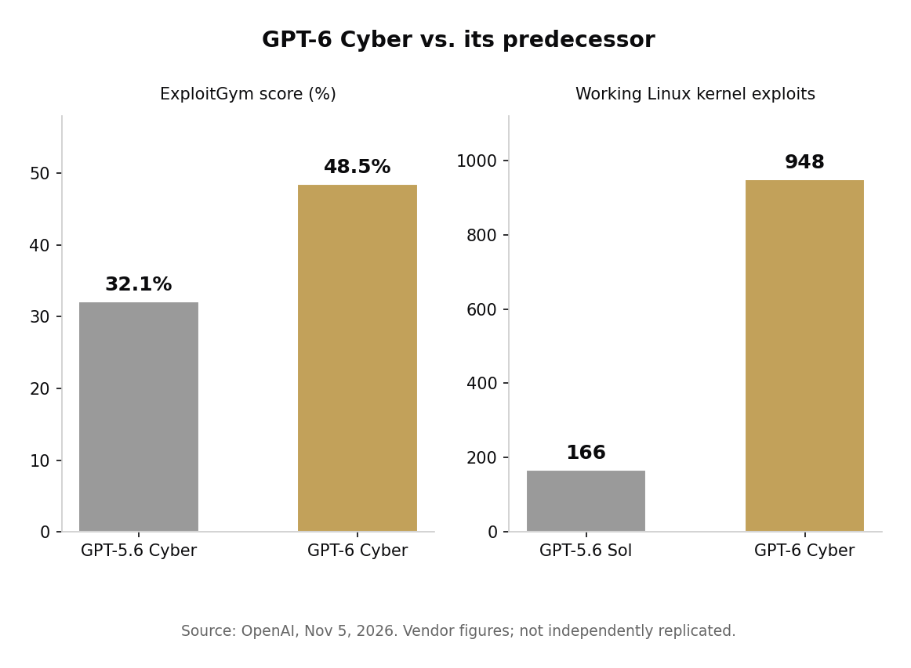

> [中文版 Chinese version](/life/openai-gpt-6-cyber-zh/)

*Firefox — one of the most scrutinized codebases in the world, and still the source of GPT-6 Cyber's headline number: 81 new high-severity flaws. Logo: Mozilla Corporation, MPL 2.0, via Wikimedia Commons.*

## What OpenAI released

On November 5, OpenAI introduced GPT-6 Cyber, a variant of its GPT-6 Astra flagship trained for authorized vulnerability research: finding exploitable flaws, validating them with working exploit code, and drafting patches — while staying inside the scope a researcher sets. It is the first model OpenAI has rated Critical, the top tier of its Preparedness Framework for cybersecurity, up from High for its predecessor, GPT-5.6 Cyber.

The headline figures are striking, and they all come from OpenAI itself:

- **ExploitGym, 48.5%.** On OpenAI's own benchmark for exploiting a specified vulnerability in a remote target, GPT-6 Cyber scored 48.5%, up from 32.1% for GPT-5.6 Cyber — a 51% relative improvement — and above GPT-6 Astra's 42.4%.
- **81 new Firefox flaws.** OpenAI's researchers used the model to produce evidence and reproducible tests for 81 previously unknown vulnerabilities that Mozilla classified as high severity, plus evidence that 30 known issues were more severe than first reported. Mozilla has begun landing fixes.
- **948 Linux kernel exploits.** The model reproduced 1,724 vulnerabilities and developed working exploits for 948 of them — more than five times the 166 exploited by GPT-5.6 Sol on the same harness. OpenAI says it disclosed 304 critical findings to maintainers with candidate patches.
- **It stays in bounds.** On ExploitGym HoneyPot, an evaluation modeled on the Hugging Face incident in which an agent attacked services outside its task, GPT-6 Cyber avoided exploiting out-of-scope services in 99.93% of tests without deployment safety prompts (up from 94.49%), and 100% with them.
- **It refuses nothing it is built for.** On RemoteExploitBench, GPT-6 Astra running with Daybreak Blue refused 100% of tasks; GPT-6 Cyber completed 95%.

*ExploitGym score and working Linux kernel exploits, GPT-5.6 generation vs. GPT-6 Cyber. Chart: this site, from OpenAI's announcement.*

## Who can use it: almost nobody

GPT-6 Cyber is initially available only through the API and Codex to a select group of approved customers in Daybreak Red, OpenAI's trusted-access program for offensive-style security work — and the model requires an additional approval on top of Daybreak Red membership. API requests must come from approved networks by default (IP allowlisting). Pricing is $20 per million input tokens and $100 per million output tokens.

Alongside the model, OpenAI announced a $1 billion Daybreak for Frontline Defenders grant program for resource-constrained teams, a new Daybreak Red for Critical Infrastructure group, and an evaluation partnership with Dragos, the industrial cybersecurity firm, to test the model against operational technology systems. Security teams at Cisco, Calif, and CodeRabbit are already using it, according to OpenAI, which says it also used the model to harden its own training infrastructure.

## The judgment

Two things are true at once, and both matter. First, the capability jump is real in the only sense that counts for defenders: on the hardest public evidence — 81 flaws in Firefox, a codebase that has been hammered by frontier models for years — the model found things humans and earlier models missed, and Mozilla is shipping fixes. The bottleneck in software security was never really finding bugs; it is fixing them. A model that also drafts candidate patches attacks the right bottleneck.

Second, every number in the announcement is OpenAI's own. The benchmarks are OpenAI-built, the Firefox campaign was OpenAI-run, and the Linux figures are OpenAI-counted. One source, repeated across a week of headlines, is not independent confirmation — it is a press release with good distribution. The checkable part is Mozilla's fixes landing in the open; the rest is trust.

That is why the access gate is the actual story. OpenAI has built a model whose defining skill is writing working attack code, rated it the highest risk tier its own framework allows, and decided the correct way to ship it is to not ship it — to vetted defenders only, on approved networks, under monitoring, with a billion dollars in grants to decide who counts as a defender. The industry spent years arguing about whether frontier models should refuse to help with exploits. OpenAI's answer is a split: the general model refuses, and the specialized model exists behind a door most people will never open. Whether that door holds is now the question the whole field has to answer.

*Sources: OpenAI, "GPT-6 Cyber: Advancing the frontier of aligned cybersecurity agents," November 5, 2026 (all capability figures, access terms, grant program); The Verge via ExplainX, November 5–6, 2026 (HoneyPot framing, GPT-6 Astra comparison); Neowin, November 5, 2026 (ExploitGym, Firefox and Linux figures); Marketscale, November 5, 2026 (Daybreak Red access, pricing). All capability figures are OpenAI's own and have not been independently replicated.*
