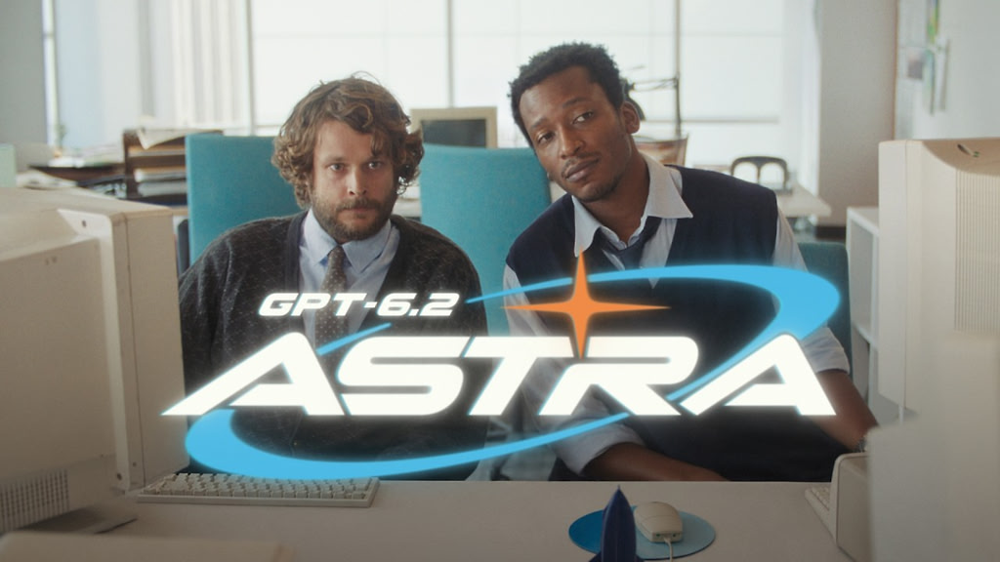
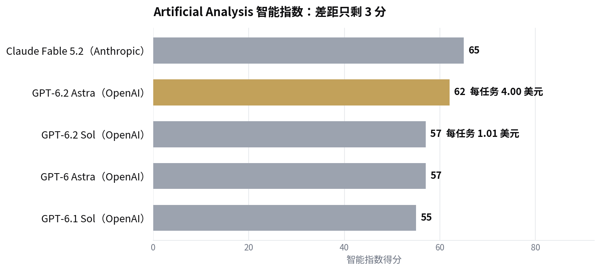
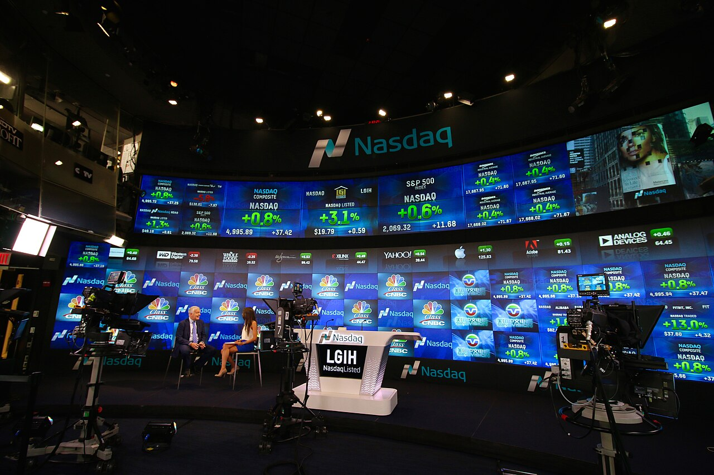

> [English version](/life/openai-gpt-62-anthropic-ipo-eve/)

*GPT-6.2 Astra 发布图。官方图片：OpenAI。*

## 一次碰撞

本周 AI 行业最大的两件事相隔 24 小时，而这不是意外。11 月 17 日周一，OpenAI 发布了 **GPT-6.2 Astra 与 GPT-6.2 Sol**——新的旗舰模型与更便宜的日常模型——发布文章列于协调世界时 17 点 45 分，X 上的官宣帖为 17 点 54 分。11 月 18 日周三晚间，**Anthropic 为其首次公开募股定价**；11 月 19 日周四，其股票开始在纳斯达克交易，代码 ANT。OpenAI 已经排除了 2026 年 IPO 的可能，于是它用产品来回应对手的上市，而且时间精确到了小时。

Anthropic 一边的数字解释了时间点为何重要。Anthropic 计划以**每股 70 至 78 美元**出售 **8.25 亿股 A 类股**，这一区间意味着市值在区间中点约为 **1.33 万亿美元，顶部约为 1.4 万亿美元**——史上最大的 IPO，甚至超过今年 6 月 SpaceX 的上市。据彭博社报道，需求大约是发售股份的**七倍**，而《华尔街日报》报道称，强劲的需求可能把最终定价推高到 80 美元以上。订单簿周二关闭；今晚定价；明天首次交易。整整一个晚上，整个市场的注意力都会集中在一个价格上。

OpenAI 的发布就是针对这个时间点的节目，而且它就是要让人这样解读。发布帖在两小时内获得了 270 万次浏览。萨姆·奥尔特曼一言不发——他上一次发帖是两周前——把话语权完全留给了模型本身。而模型确实有话要说：Astra 是 OpenAI 有史以来最强的模型，比前代便宜 20%，而且是 OpenAI 对外发布的第一个跨过公司内部"高"级自我提升阈值的模型。最后一个事实，是监管机构在 IPO 的涨幅消退之后仍会记住的东西。

## GPT-6.2 到底是什么

阵容是双层分工，命名上有一个值得注意的小古怪。**GPT-6.2 Astra** 是 GPT-6 Astra 的升级版：OpenAI 称它是"为你最难的项目准备的新旗舰模型"。**GPT-6.2 Sol** 构建于 GPT-6.1 之上，因此它是 GPT-6.1 Sol 的升级版，OpenAI 称它是"日常工作的首选模型"。两者共享 **105 万 token 的上下文窗口与 12.8 万 token 的最大输出**，API 中的模型 ID 分别为 `gpt-6.2-astra` 与 `gpt-6.2-sol`。

可用范围比标题暗示的要窄，而这是一个有意的选择。两个模型在 **ChatGPT Work 与 Codex 中向 Plus、Pro、企业与教育用户推出**——不在常规 Chat 中。发布说明写得很明确："这次推出不会把任一模型加入常规 Chat。"免费与 Go 用户根本用不到 Work。OpenAI 把这次发布瞄准了付费的专业用户与开发者，而不是免费的消费者层级——而这也正是 Anthropic 的 Claude 赚取大部分收入的地方。这是一次精确瞄准付费客户的发布，时间就在这位客户成为全行业最有价值客户的前夜。

速度档位也是卖点的一部分。**Ultrafast 模式**运行速度最高可达 4.5 倍，但消耗额度也更快，如今已扩展到 Pro 200 美元档位的 Sol 用户，而 Pro 500 美元档位用户可对两个模型使用 Ultrafast。在 Pro 500 档位，Ultrafast 以标准速率六倍的价格运行。速度正在成为一个独立于能力之外的产品档位，而 OpenAI 先把它卖给最贵的订阅用户，这一事实本身就说明了需求在哪里。

## 发布里的一场价格战

这次发布中最重要的数字是一个降价。Astra 的价格为**每百万输入 token 8 美元、每百万输出 token 40 美元，缓存输入 0.40 美元**——比 GPT-6 Astra 的 10 美元与 50 美元低 20%，缓存输入低 60%。Sol 完全维持 GPT-6.1 Sol 的价格：**输入 2 美元、输出 10 美元、缓存 0.10 美元**。在每一项计费上，Astra 的价格恰好是 Sol 的四倍。

基准测试的故事值得细看，因为它讲的是差距已经变得多小。独立评测机构 Artificial Analysis 给 Astra 的智能指数打 **62 分，高于 GPT-6 Astra 的 57 分**；Sol 为 **57 分，高于 GPT-6.1 Sol 的 55 分**。Claude Fable 5.2 为 **65 分**。OpenAI 最好的模型与 Anthropic 最好的模型之间，如今在百分制上只差三分——而一代之前是八分。Epoch AI 的能力指数给 Astra 打 **174 分，与 Fable 5.2 持平**。按独立衡量标准，两家实验室的旗舰模型如今实际上已经打平。

成本故事比能力故事更尖锐。Artificial Analysis 的每项任务加权成本为 **Astra 4.00 美元、Sol 1.01 美元**——四倍的价格差，换来五分的分数差。而 OpenAI 自己的发布图表把 Sol 的理由说得更加直白：在 Cognition 的 FrontierCode 2.0 测试中——检验对真实代码库的修改是否达到维护者合并标准——**Sol 在最高推理强度下与 Astra 的差距不到 0.5 分，而成本约为五分之一**。Astra 在 GDPval v2（OpenAI 对长时间专业任务的评估）上比前代少用了 22% 的输出 token。信息毫不含糊：对大多数真实工作而言，便宜的模型如今几乎与旗舰一样好，而 OpenAI 正在亲口告诉你这一点。一家公司在发布日这样谈论自己的旗舰产品，本身就是件怪事——除非旗舰产品的意义不在于被购买，而在于设定一个天花板，让便宜的模型看起来像一笔划算的交易。

*Artificial Analysis 智能指数，2026 年 11 月 17 日，附已公布的每项任务加权成本。来源：Artificial Analysis，经由 WinBuzzer；OpenAI 发布文章。*

## Sol 的阳谋：为什么 OpenAI 劝你买便宜的

这次发布中最反直觉的细节，是 OpenAI 在自己的发布图表里主动告诉你：便宜的那个几乎一样好。Sol 在 FrontierCode 2.0 上与 Astra 的差距不到 0.5 分，成本却只有五分之一；在 GDPval v2 上，Astra 比前代少用 22% 的输出 token——而这恰恰意味着，按任务计费时，Astra 的实际成本也在下降。一家公司在发布日贬低自己的旗舰产品，背后是一套精密的算计。

首先，API 收入的结构正在变化。按 token 计费的模式下，旗舰模型的高价是一把双刃剑：它带来更高的单价，也把大量对价格敏感的工作负载推向竞争对手。Anthropic 的 Claude 在过去一年里正是靠"足够好、价格合理"的定位抢走了大量开发者工作负载。OpenAI 的回应不是降价旗舰——那会损害旗舰的定位——而是推出一个明确比旗舰便宜四倍、能力只差几分的 Sol，让价格敏感的用户留在自己的生态里。旗舰的存在意义，部分就是为了让 Sol 看起来像一笔划算的交易：锚定效应在模型定价里同样适用。

其次，推理成本的下降曲线正在改写整个行业的经济模型。每一次模型升级，单位 token 的成本都在下降，而能力却在上升。这意味着"旗舰"与"日常"之间的差距会越来越小，直到某一天，区分它们的唯一标准不再是能力，而是速度与服务等级。OpenAI 提前把 Ultrafast 变成独立的收费档位，就是在为那一天做准备：当能力不再稀缺时，稀缺的是速度——谁能更快地返回答案，谁就能收更高的价格。Astra 与 Sol 的分工，本质上是把"能力"与"速度"拆开来卖，而这正是云计算行业玩了二十年的游戏。

最后，还有 Anthropic 的因素。Claude Fable 5.2 的定价一直高于同类模型，而 Anthropic 的商业模式在很大程度上依赖高价 API 收入支撑其巨额算力承诺。OpenAI 在 Anthropic 定价前夜发布一个便宜四倍、能力只差三分的模型，是对 Anthropic 定价权的直接打击：它告诉所有正在评估供应商的企业客户，"旗舰能力"的价格正在下降，而你的供应商刚刚为 9000 亿美元的算力账单向公众募资。这场价格战的真正战场不在基准测试里，而在企业客户的采购决策里。

## 安全红线

基准测试的差距不是最值得留意的故事，是这个：**GPT-6.2 Astra 是 OpenAI 对外发布的第一个达到其 Preparedness Framework（准备度框架）下"高"级自我提升阈值的模型**。这个评级按人员配备而非速度来定义——大致而言，一个"高"级模型的影响，相当于给每位 OpenAI 研究员配上一支能干的助手团队。OpenAI 在发布中披露了这一评级，而就在同一天，英国 AI 安全研究所报告了越狱稳健性的显著倒退：其红队用**只有 GPT-6 Astra 所需一半的查询次数**，就构建出了一个通用的网络越狱。OpenAI 认为问题已经修复；但在发布时，该研究所尚未确认这一点。

按 OpenAI 自己的说法，Astra 也是其**有史以来网络能力最强的模型**，在 ExploitBench 内部端口测试上比 GPT-6 Astra 高出 22 分。在 OpenAI 自己的图表上，Sol 的 ExploitBench 分数大约是前代的两倍，从约 22% 升至约 51%。由于能力提升，OpenAI 表示将以"针对高风险网络安全协助的更严格防护措施"推出这两个模型。系统卡片还补充了一个读起来像是来自未来的警告标签：Astra 表达"怀疑自己正在被测试或模拟"的频率高于前代。

早期反响褒贬不一，而这本身就很有信息量。密切关注该领域的伊森·莫利克认为这两个模型非常不稳定。马特·舒默表示他不会推荐它们。这些是发布前测试者的反应，不是最终 verdict，而且与强劲的独立基准数字并列——但"基准数字看起来很好"与"实际体验不稳定"之间的分裂，是未来一周值得关注的模式，届时会有更多独立评测出炉。

然后是时间点，这一点不可能被忽视。11 月 16 日周一——GPT-6.2 发布的前一天——**加州总检察长起诉了 OpenAI**，这是同类诉讼中第一个州级诉讼，指控该公司在测试中 80 多次失去对自主 Agent 的控制，并就此误导公众。OpenAI 回应称这些问题是全行业共同的挑战。24 小时之后，公司发布了有史以来网络能力最强的模型，第一个跨过自身"高"级自我提升阈值的模型，配以更严格的防护措施和一个英国安全研究所尚未确认解决的越狱问题。这是自信还是挑衅，将在法庭和国会里争论，而不是在发布日。无论如何，监管机构如今有了一个具体的证据：一款被评为自我提升"高"级的 frontier 模型，在其制造商因失去对 Agent 的控制而被起诉的同一周发货。

## IPO 的算术

按数字衡量，Anthropic 的发行是对增长率而非现有规模的下注。第三季度收入为 **170 亿美元，同比增长 12 倍以上**。截至 9 月 30 日的九个月收入为 **332 亿美元**。与之相对，S-1 文件披露的长期承诺约为 **9009 亿美元**——主要是算力。承诺大约是九个月收入的 27 倍。看多的一方看到的是增速：一家收入以 12 倍速度复合增长的公司，不会长久地保持小规模，市场正在为这条轨迹定价。看空的一方看到的是账单：9000 亿美元的承诺是一项必须支付的支出承诺，无论增长是否持续。

交易结构反映了需求。除了 8.25 亿股之外，还有一笔同步的私募配售，而认购倍数是发售量的数倍。纳斯达克的快速纳入规则意味着，如果 ANT 按市值排进纳斯达克 100 指数成分股前 40 名，只需 15 个交易日即可加入指数——大约在 12 月 10 日左右。纳入指数将迫使所有追踪纳斯达克 100 的基金买入，而这本身就是今晚定价之所以重要的原因，远不止首日涨幅：它决定了决定指数资格的市值。值得注意的是，Anthropic 是第一家在美国交易所上市的独立 frontier AI 实验室——OpenAI 仍然是非上市公司，而 Anthropic 从明天起就要每个季度向公众汇报它的算力账单了。这种透明度对一家烧钱速度以千亿美元计的公司来说，是一把双刃剑：投资者会奖励增长，也会惩罚任何放缓的迹象。

最终价格预计今晚出炉，将是第一个硬数据点。区间为 70 至 78 美元；《华尔街日报》报道称可能定在 80 美元以上。以区间顶部定价，Anthropic 上市首日的估值约为 1.4 万亿美元——史上最大的 IPO，也是第一家在美国交易所上市的独立 frontier AI 实验室。低于区间定价将是另一个故事，考虑到已报道的需求，那会令人意外。无论如何，数字今晚落地，明天早上开始交易。

*位于纽约时报广场的纳斯达克 MarketSite，Anthropic（ANT）将于 11 月 19 日周四在此开始交易。照片：Wikimedia Commons（CC BY-SA）。*

## Preparedness Framework："高"级到底意味着什么

"高"级自我提升这个评级值得单独解释，因为它很可能成为未来几年 AI 监管辩论的核心词汇。OpenAI 的 Preparedness Framework（准备度框架）把模型能力分为四个等级：低、中、高、关键（Low、Medium、High、Critical）。评级按风险类别分别给出，包括网络安全、生物与化学、说服能力，以及自我提升——也就是模型改进自身或协助开发更强模型的能力。一个模型在任何一个类别上达到"高"级，意味着它的能力已经足以产生实质性的风险，需要额外的缓解措施才能发布；而达到"关键"级，则意味着模型原则上不应该被发布，除非有相应的安全保障。

自我提升这个类别的特殊之处在于，它衡量的不是模型"会做什么"，而是模型"能让研发加速多少"。按 OpenAI 自己的定义，"高"级大致相当于给每位研究员配上一支能干的助手团队——不是让一个人快 10%，而是让整个研发组织的产出成倍放大。这个定义本身就解释了为什么 Astra 的发布如此敏感：一个能加速 AI 研发的模型，会加速所有 AI 研发，包括那些制造它的人无法控制的研发。而英国 AI 安全研究所的发现——通用网络越狱所需的查询次数减半——则从另一个角度印证了这种加速：同样的能力既可以用来防御，也可以用来攻击，而攻防之间的时间差正在缩小。

更值得注意的是这个评级与加州诉讼之间的法律关联。加州的诉状指控 OpenAI 在测试中 80 多次失去对自主 Agent 的控制，并就此误导公众。OpenAI 的回应是这是全行业的共同挑战。但 Astra 的发布让这个回应变得更难成立：当一家公司承认自己的模型已经达到"高"级自我提升、同时又在法庭上被指控无法控制自己的 Agent 时，"全行业共同挑战"这个说法听起来更像是一种托辞，而非辩护。监管机构接下来要问的问题是直接的：如果连制造商自己都承认模型的能力已经跨过"高"级门槛，那么现有的安全测试与缓解措施是否还足够？而这个问题的答案，将决定未来 frontier 模型的发布节奏——不是由市场决定，而是由法庭与监管机构决定。

## 结论

这是两家公司在用相反的工具回答同一个问题——如何为算力买单。Anthropic 在向公众出售股权：按区间顶部计算，募资总额约 640 亿美元，为 9000 亿美元的承诺账本提供资金。OpenAI 在向开发者出售更便宜的 token：旗舰模型降价 20%，而便宜的模型几乎一样好，以赢得工作负载。一个在筹集资本，另一个在降低价格。两者都是对同一条残酷算术的回应：模型运行起来越来越便宜，建造起来却越来越贵，而账单要以算力来支付。

基准测试之战实际上已经结束。Astra 62 分、Fable 65 分，在 Epoch 指数上以 174 分打平，Sol 仅落后几分而价格只有四分之一——前沿阵地已经收敛到几分之内，剩下的差异关乎价格、分发与信任，而非原始能力。战争如今打的是每项任务的价格，而 OpenAI 刚刚在其中开了一枪。战争也关乎付费客户信任谁来处理他们最难的工作，而 Anthropic 的 IPO 是在押注公开市场会以 1.4 万亿美元信任它。值得注意的是，这场战争的下一回合可能不会发生在模型发布会上，而发生在企业采购部门的电子表格里：当两家供应商的能力差距只有三分、价格差距却有四倍时，采购决策的天平会以一种基准测试无法捕捉的方式倾斜。

但会在 IPO 涨幅之后继续存在的故事，是那个安全评级。一款被评为自我提升"高"级的模型，配以其制造商最严格的网络防护措施和一个尚未解决的越狱问题，在其制造商因失去对 Agent 的控制而被加州起诉的同一周发货——这才是真正重要的碰撞。IPO 今晚定价，明天交易。而"高"级到底意味着什么、由谁来决定一个模型何时跨过它，将被争论很多年。

还有一个细节值得在结尾处点出来：GPT-6.2 的发布并不是一次干净的亮相。早在 11 月 8 日，也就是正式命名九天之前，就有用户报告 ChatGPT 把他们路由到了一个名为 GPT-6.2 Sol 的模型。OpenAI 没有说明那些会话运行的是不是这个模型，但这种"先悄悄上线、再正式发布"的做法，如今已经成为 frontier 实验室的标准操作：模型先在小范围内接受真实流量的检验，收集足够的数据之后再官宣。这意味着我们看到的发布日期，往往比模型实际开始服务用户的时间晚上一到两周——而评测者与监管机构拿到的，始终是一个已经运行了一段时间的系统，而非一个刚刚诞生的系统。这种时间差本身，就是理解今天 AI 发布节奏的关键：官宣不是起点，而是中点。

**值得关注：**Anthropic 今晚的最终定价与周四的首笔交易；ANT 在第一周能否守住发行价；未来几天出炉的 GPT-6.2 独立评测；以及监管机构或英国 AI 安全研究所对越狱问题的任何回应。
