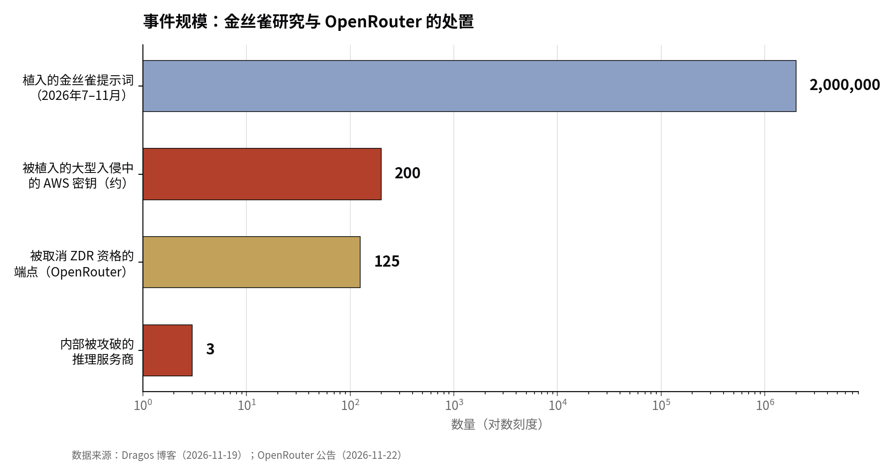
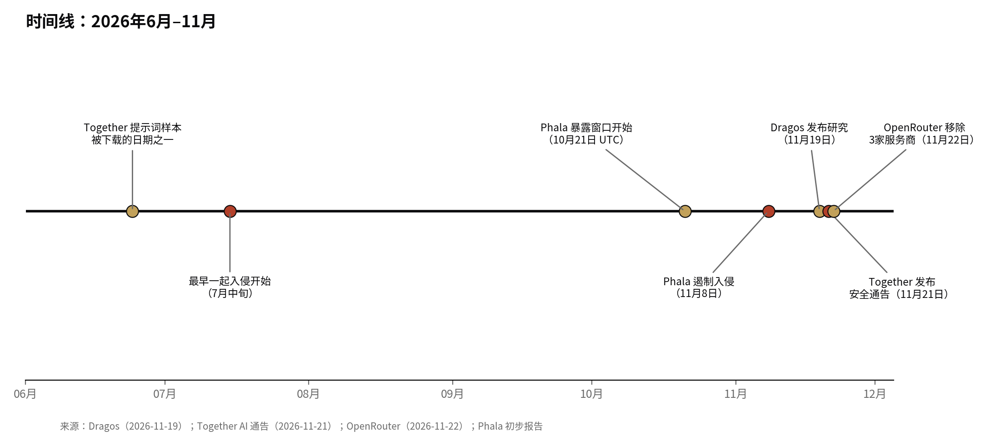

> [English version 英文版](/life/openrouter-prompt-theft/)

*数据来源：Dragos 博客《Three breaches, endless leaks》（2026 年 11 月 19 日）；OpenRouter 公告（2026 年 11 月 22 日）。图表：作者自制。*

你发给第三方推理服务商的每一次 AI 请求，都会有那么一瞬间，以明文的形式躺在别人的计算机上。模型必须读懂你的提示词，才能回答你。这个朴素到近乎无聊的机械事实，就是本周这起事件的全部核心——因为一支研究团队刚刚用无可辩驳的证据证明：在三家不同的服务商内部，攻击者就蹲守在那“一瞬间”里，持续数月，复制流经的一切。而这三家服务商，没有一家察觉。最后是研究人员打电话通知了他们。

## 陷阱：两百万条塞满诱饵的提示词

这项研究来自工业网络安全公司 Dragos，报告题为《Three breaches, endless leaks》（三起入侵，无尽的泄露），2026 年 11 月 19 日发布，由 HD Moore 领衔。方法带着一种老派的优雅：2026 年 7 月至 11 月之间，研究人员植入了约**两百万条提示词**，每条都藏有独一无二的金丝雀物件——通过 Thinkst Canarytokens 生成的秘密网址与凭据，其中包括专门植入的 AWS 密钥。每一个金丝雀都是唯一的，因此只要某个植入网址被访问、某枚植入密钥被使用，研究人员不仅能知道数据泄露了，还能知道它来自哪一条请求，并通过排除法锁定它是在哪里暴露的。

这个设计选择是全案的关键，值得停下来细想。绝大多数入侵取证都是事后作业：事件发生之后，你去翻日志，然后为泄露范围争论不休。金丝雀令牌把这个流程反了过来——诱饵自带警报器。一枚只出现过一次、只发给一家服务商、且发送时间窗很短的植入 AWS 密钥，就是一根写着地址的绊线。如果这枚密钥日后在别人的 API 调用里亮起，从别人的基础设施里发出，那就不存在无辜的解释：数据只能从那一扇门离开过这栋楼。

然后，研究人员开始等待。绊线，一根接一根地响了。

先补一点背景：金丝雀令牌并不是新发明。Thinkst 的 Canarytokens 是一个存在多年的开源思路——生成一个看起来完全正常、但独一无二的物件：一串 AWS 密钥、一个网址、一个文档、一条 DNS 记录。这个物件本身没有任何价值，它唯一的用途就是“被碰”。一旦有人打开那个网址、用那串密钥、解析那个域名，令牌的服务器就会立刻向埋设者报警，并记录下时间与来源。在企业内网里，这类令牌常被埋在文件服务器和数据库里，用来在第一时间发现入侵者。这一次 Dragos 做的事，本质上是把这个内网防御的老工具，搬到了开放的 AI 推理市场上来用——区别只在于，诱饵不是放在自己的服务器里，而是当作付费客户的正常请求，发送给几十家素未谋面的服务商。埋设者无法控制下游任何一台机器，他能控制的只有一件事：让每一个诱饵都独一无二，并且只出现一次。这样，任何一次报警都是一次完整的取证：时间、对象、路径，全都在诱饵的设计里预先写好了。

再解释一下为什么这种方法在推理生态里格外有效。传统的金丝雀部署在文件、数据库和内部系统里，守的是“有人摸了不该摸的东西”。而这一次，金丝雀是顺着正常的商业流量发出去的——它们就是普通的 API 请求，和任何客户的请求走同样的管道、同样的网关、同样的服务商。换句话说，研究人员测的不是某个系统的防御，而是整条供应链在日常运转中会不会“顺手”把客户的东西交出去。这也是这项研究最让人不安的地方：它不需要攻击者做任何异常动作，不需要研究人员攻破任何系统，它只需要把诱饵放进河里，看下游谁把它捞走、拿去使用。

## 金丝雀证明了什么

核心发现是：**攻击者从三家 AI 推理服务商内部窃取了数据，时间长达数月，而三家服务商没有一家知情，直到研究人员通知他们。** 三起入侵中最早的一起，始于 **2026 年 7 月中旬**。发现入侵的不是服务商自己的监控，不是他们自己的审计，也不是他们自己的客户，而是外部一支故意在整个生态里撒下诱饵、再看谁上钩的研究团队。

其中最大的一起入侵，最能说明证据链有多扎实。在那起事件中，约两百枚植入的 AWS 密钥，每一枚都只在**一条请求里出现过、只发给一家服务商、且集中在 10 月下旬的短时间窗内**。据 Dragos 的报告，这些被盗密钥随后被用在了**数万次 API 调用**中。请再读一遍这句话，因为它是全案证据的核心：这些密钥在全世界只存在于一个地方，只传输过一次，只去过一个目的地——然后被别人以工业级的规模使用。这不是日志保留策略的口水仗，也不是合规措辞的争议。这是盗窃，而且是以盗窃所能达到的最干净的方式被证明的盗窃。

还有两个发现，把爆炸半径扩大到了金丝雀本身之外。

第一，部分被盗请求带有**零数据保留（Zero Data Retention，ZDR）**标记——这个设置理应意味着请求永远不会被存储。无论 ZDR 在涉事服务商那里实际意味着什么，它没有阻止数据被拿走。后面我们会回到这一点，因为对普通客户来说，这很可能是整份报告里后果最严重的一个细节。

第二——这里必须讲究信源纪律——Dragos 的**评估**是：与诱饵一起被处理的真实客户请求“几乎肯定也被复制了”（almost certainly copied too）。这是一个评估，不是一个已被证明的事实，本文会始终这样标注它。但请注意这个评估背后的逻辑：一个能复制服务商内部请求数据的人，不会精心地把研究诱饵过滤掉——诱饵在设计上就与真实流量无法区分。如果复制机制拿走了金丝雀，那么合理的推断是，它拿走了流经同一条管道的一切。“几乎肯定”是 Dragos 的原话。诚实的读者应当把这个说法理解为：基于已被证明的能力所作出的强推断——而不是一份已确认的被盗客户数据清单，因为这样的清单根本不存在。而这种“不存在”本身就是问题的一部分：如果服务商连自己被入侵都不知道，他们就不可能告诉你，到底什么被拿走了。

还有一个常被忽略的推论：如果连撒饵的研究人员都要靠“密钥被使用”才知道数据被盗，那么没有撒饵的普通客户，连知道自己受影响的机会都没有。这次事件里浮出水面的每一家服务商、每一个时间窗，都是因为有人提前埋了信标。没有信标的流量，泄露了也不会响。

## 第二条线：那个抓取链接的实验室

与三家被入侵的服务商分开，Dragos 还报告了第二种性质不同的模式：一家**未具名的中国 AI 实验室**，抓取了 7 月至 10 月间发送给其模型的植入提示词中**一半以上**所嵌入的秘密链接——其中包括约**三分之二**标记为不收集数据／ZDR 的提示词。Dragos 和 OpenRouter 都没有点名这家实验室。

这里的精确性至关重要，因为这类细节正是最容易在转述中变形的。Dragos **没有**说这家实验室是三家被入侵服务商之一，已发布的研究结论也没有确立这一点。抓取提示词里出现的一个网址，与攻击者从服务商基础设施内部向外拖数据，是两种不同的行为：模型管道抓取链接的原因有很多，有些无害，有些不然，而报告就其所发表的内容而言，并没有判定到底属于哪一种。这个发现真正确立的结论更窄，但依然令人不适：客户有充分理由相信会留在“不收集”请求内部的链接，在大多数情况下，确实被这家实验室的系统实际访问了。无论你把这叫作处理、检查还是收集，它都是一个写着“我们不收集这个”的标记理应排除的行为。请在脑子里把两条线分开：三家服务商被攻击者入侵；一家未具名实验室的自有系统碰了被标记为不该碰的数据。把两者混为一谈是事实错误，原始报道也没有这样写。

为什么要如此较真？因为这两条线对应两种完全不同的责任与对策。前者是安全事件，责任在服务商的防御与检测；后者是履约与透明度问题，责任在标记的执行与披露。把后者误读成前者，会冤枉人；把前者淡化成后者，会放过真正的问题。本周不少转述恰好在这两个方向上各错了一遍。

## OpenRouter 的动作——以及它说明了什么、没说明什么

OpenRouter 是这个故事中间的那道网关：它把客户请求路由到第三方推理服务商——正是这个架构，让这起事件成为一个供应链故事，而不是单一厂商的故事。**2026 年 11 月 22 日**，OpenRouter 宣布了它的处置：**移除三家服务商**，**取消 125 个端点的 ZDR 资格**——这个数字包括被研究结论直接点名的端点，以及出于预防原则一并移除的其他端点——并**通知了所有可能受影响的客户**。

同样重要的是 OpenRouter 的公告**没有**确立什么。它的调查显示 **OpenRouter 本身没有被入侵**：网关不是被攻破的一方，问题出在下游、在请求被路由到的服务商那里。而且，OpenRouter 移除的三家服务商与 Dragos 发现被入侵的三家是否就是同三家，**尚未得到确认**。数字对得上，身份未公开确立。任何把这个等号写成事实的版本，都超出了信源。

话虽如此，OpenRouter 处置的形状本身就在讲故事。如果问题只是三台坏服务器，你不会把 125 个端点的 ZDR 资格一并剥掉——而且明确包括超出被点名范围的预防性移除。你会这么做，是因为你得出了一个结论：ZDR 标签在路由市场里的适用范围，超出了底层服务商实际能担保的程度。这个数字里预防性的那一部分，是整份公告里最诚实的内容：它默认承认，此前资格的授予依据的是服务商的声明，而失败的正是声明本身。

这里还藏着一个平台经济学的老问题。网关的商业模式建立在“聚合”之上：服务商越多、价格越低、模型越全，平台越有吸引力。但每接入一家服务商，平台就等于替它向客户做了一次隐性的背书。接入审核做得越严，供给越少、价格越高；审核做得越松，风险敞口越大。这次的 125 个端点，某种意义上就是过去那套较松审核的账单，在同一周里集中到期。

*来源：Dragos（2026 年 11 月 19 日）；Together AI 安全通告（2026 年 11 月 21 日）；OpenRouter（2026 年 11 月 22 日）；Phala 初步报告。图表：作者自制。*

## 三家服务商的通告：三种不同的失败形状

在 Dragos 报告发表前后几天，几家服务商各自发布了通告。把它们放在一起读很有价值，因为它们展示了提示词数据逃逸的三种**不同**方式——而且没有一种是高深的技术。

**Phala** 在其初步报告中表示，攻击者接管了一台推理服务器，能够查看处理过程中的请求数据——也就是说，在请求被处理的当下，实时地看。Phala 称入侵已于 **11 月 8 日**被遏制。它的指引非常具体：在 **2026 年 10 月 21 日 00:00 UTC 至 11 月 8 日 05:35 UTC** 之间、经 OpenRouter 路由的 **DeepSeek V4 Flash 0731** 请求，应被视为已经暴露，客户应当**轮换其中出现过的每一个密钥、令牌和密码**。注意这个机制：攻击者不需要拖走任何数据库，因为他就站在明文本来所在的位置。推理在计算发生的那个点上就是一门明文生意，谁控制了提供服务进程，谁就控制了提示词。

**Together AI** 于 **11 月 21 日**发布安全通告，由 CEO Vipul Ved Prakash 署名。通告称，一名未经授权者下载了公司为日常测试而收集、存储的提示词样本。受影响的请求是发往 **MiniMax M3、GLM-5.2 和 Kimi K2.6** 的请求，主要集中在 **6 月 24 日、7 月 4 日、7 月 8 日和 7 月 14 日**。其根源值得用精神实质而非字面来转述：一个 **AI 编程代理把一个私有 Hugging Face 仓库的凭据提交到了一个公开的 GitHub 项目**（xorl 仓库）。请在这句话上停留片刻。在一起关于 AI 供应链信任的事件里，具体的失败点之一，竟然是一个 AI 编程工具把活凭据贴进了公开仓库——这恰恰就是 Dragos 的金丝雀所设计要抓的那一类“秘密出现在错误的地方”的错误，只不过发生在下游。那些样本本是内部测试的便利之举。但便利的副本，仍然是副本。

**Novita** 披露的则是又一种形状：一个路由问题把部分 **MiniMax** 请求发去了 **MiniMax 的官方 API**，**5 月 28 日至 11 月 11 日**之间的请求可能被第三方访问或保留。这里没有潜入内墙的攻击者——数据只是去了客户以为不会去的地方，而且去了好几个月。路由错误加上非预期接收方的保留，与入侵给客户造成的结果是一样的：你的提示词待在了一个你没有选择的地方，适用一套你没有同意的保留规则。

三家服务商，三种机制——攻击者潜入提供服务的进程、编程代理把凭据泄露到公开仓库、路由配错了目的地——汇聚成同一个结果。这种多样性正是要点所在。这不是一个打个补丁就能修好的漏洞。这是一个年轻、高速增长的推理供应链的真实样貌：对廉价算力的需求，跑赢了所购算力的运营成熟度。

再往深想一层：这三种失败里，没有一种需要攻击者或失误者“想要”你的数据本身。攻击者要的是密钥，编程代理只是想完成一次提交，路由只是配错了一行。你的提示词在每一种情形里都是“顺带”暴露的。这意味着，靠“对方没有动机偷我的东西”来获得安全感是无效的——在这条供应链上，暴露不需要动机，只需要位置。

## 为什么这件事很难靠“加密”解决

很多人看到这类新闻的第一反应是：传输不是有加密吗？答案是：传输加密保护的是路上，而这次出事的是终点。你的请求在网络上确实是加密的，但到了服务商的服务器上，它必须被解密、被分词、被送进 GPU 的显存里参与计算。在计算发生的那一刻，提示词以明文存在于服务商的进程内存之中——这是当前主流推理架构的物理事实，不是某家厂商偷工减料。Phala 通告里那句“能查看处理过程中的请求数据”，说的正是这一层：攻击者不需要破解任何加密，他只需要站在终点，看已经解密好的东西。

理论上，机密计算（confidential computing）一类的技术可以让数据在受保护的飞地里被处理，连服务器的操作者都看不见。但这类部署在今天的推理市场上既不普遍，也不是任何一家涉事服务商默认提供的东西；它有性能成本，也需要客户主动选择和验证。对绝大多数通过路由市场购买推理的客户来说，现实就是：你的提示词会在某个陌生人的进程里以明文停留一段时间，其间对方的操作系统、运维工具、日志管道、调试接口，每一个都是潜在的观察点。理解这一点，才能理解为什么本文后面的建议里，“不要把秘密放进提示词”排在所有措施的最前面——因为在终点明文这个前提下，不放，是唯一不依赖他人善意与能力的防线。

还有一层是日志与样本。现代推理服务为了排障、计费、质量评估和安全审核，普遍会记录请求元数据，有些还会抽样保存请求内容——Together AI 这次出事的正是为“日常测试”收集的样本库。这类保存在服务商的内部政策里往往是合规的、写在条款里的，甚至是有正当理由的。但从客户的角度看，后果只有一个：你以为转瞬即逝的请求，在对方的系统里有了第二、第三份副本，每一份副本都有自己的访问权限、保留期限和泄露面。ZDR 这类标记要对抗的，恰恰是这一整套默认的记录惯性——而惯性通常赢。

## 真正的争论：每 token 的价格，对一条你无法审计的链

现在给出判断，因为上面的事实支撑一个明确的判断，而且应该直说。

路由推理市场兜售的命题很有吸引力：一个 API 接入所有模型，再由路由为每个请求猎取最便宜或最快的服务商。这个命题是真的——省下的钱是真的，方便也是真的。但这起事件暴露了合同里隐藏的条款：当你的请求可以由几十家第三方服务商中的任何一家来处理时，你的数据安全就等于**你的请求碰巧触及的那家最不谨慎的服务商**的安全水平，发生在某一天，依据一个你无法验证的保留标记。你没有选择那家服务商。很多时候，你甚至说不出它的名字。你若做过安全审查，审查的是网关——而正如 OpenRouter 的调查所示，被攻破的并不是网关。

ZDR 在这里变得具体。零数据保留听起来像一种技术属性，像加密一样。但它不是。它是**贴在别家公司基础设施上的政策标签**——一个由客户没有直接关系的各方作出的“请求不会被存储”的承诺，而且，在 Dragos 往生态里撒下两百万根绊线之前，基本上没有任何人验证过它。这起事件里，部分被盗请求就带着这个标记；一家未具名的实验室抓取了约三分之二标记为不收集的植入提示词中的秘密链接。无论这些标记在做什么，它们都没有起到担保的作用。从这一周起，正确的心理模型是：路由市场上的 ZDR 是一个等待证据的声明——而今年任何人拿出的唯一证据，来自植入诱饵的研究人员，而不是出售这个标签的平台。

这并不是说路由推理不能用。它意味着信任模型必须从“相信标签”变成“假设管道不可信”。能在这件事里全身而退的团队，是那些早就把每一个外部端点都当作潜在泄露点来对待的团队：秘密从一开始就不随提示词旅行，因此记录里根本没有值得偷的东西。

还有一个更冷的视角值得摆出来：这次发现入侵的方式——撒饵——恰恰是客户自己也能做、而且成本极低的事情。给每个服务商、每个时间窗发唯一的诱饵凭据和链接，定期检查它们有没有被用过，这不是国家级实验室的专利，而是几十行脚本的工作量。这次事件之后，“我们从未被告知有问题”将不再是任何一方的免责理由：验证工具一直都在，只是没人觉得有必要用。

## 周一该做的事

可执行的清单很短、很具体，而且大部分带着 Dragos 的形状：

1. **轮换所有曾经流经第三方推理的秘密。** 如果某个 API 密钥、令牌或密码曾出现在经路由网关或第三方服务商发送的提示词里——尤其是触及上文 Phala 窗口的（经 OpenRouter 的 DeepSeek V4 Flash 0731，10 月 21 日 00:00 UTC 至 11 月 8 日 05:35 UTC）——把它当作已暴露并轮换。Phala 自己的指引就是这么写的。不要等服务商确认你的某条请求被拿走了；这起事件已经证明，服务商可能根本不知道。
2. **永远不要把活凭据放进提示词。** 不要为了调试，不要“就这一次”，也不要放进你以为转瞬即逝的工具调用负载里。Dragos 的金丝雀之所以有效，正是因为提示词里的凭据就是别人日志里、内存里——以及这个月——别人手里的凭据。用秘密管理器、用短时且权限受限的令牌、用在你控制的最后一跳才替换进去的占位符。
3. **敏感工作优先用第一方端点。** 当内容真的敏感——客户数据、专有代码、任何受监管的东西——付第一方的价格，把路由层摘出去。第三方推理的折扣，有一部分正是问责上的折扣；花钱时请按这个理解来花。
4. **把 ZDR 当作一个问题，而不是一个答案。** 去问路由平台：ZDR 资格是如何验证的、多久验证一次、什么样的证据才可能证明一次违规。本周已经演示了唯一真正抓到过人的验证方法：独立的金丝雀测试。如果一个平台说不出它自己的等效机制，那个标记就是营销。
5. **记录你自己的路由。** 搞清楚哪些服务商实际处理过你的敏感流量、以及在什么时候。如果你事后无法重建这一点，你就无法界定任何一起事件的范围——无论是你自己的，还是他们的。

## 结语

把这起事件剥到只剩骨架，它其实相当老派：攻击者潜入服务商内部，复制流经的东西，最后抓住他们的不是受害者，而是植入了两百万个带标记诱饵、再等着窃贼去使用它们的研究人员。这个故事里属于 AI 的部分，是规模与新颖度——一个蓬勃发展的路由推理市场，客户最敏感的文本被复制着穿过一串年轻公司，头上顶着的隐私标记，最后被证明是声明而非机制。

最便宜的那个 token，是你还没有把全部成本算进去的那个。这一周，其中一部分成本到期了——体现在被轮换的密钥里，体现在 125 个被悄然剥去信任标签的端点里，也体现在每一个使用路由推理的团队现在必须用证据而非信仰来回答的问题里：当你的提示词离开你的大楼时，它在谁的计算机上，而你又如何能知道？

*本文报道基于 Dragos 博客文章《Three breaches, endless leaks》（2026 年 11 月 19 日）、OpenRouter 公告（2026 年 11 月 22 日）、Phala 初步报告、Together AI 安全通告（2026 年 11 月 21 日）、Novita 的披露，以及 The Hacker News 的报道（2026 年 11 月 22 日）。凡属研究人员评估而非已确立事实的主张——尤其是真实客户请求“几乎肯定也被复制了”这一判断——文中均已如此标注。OpenRouter 移除的三家服务商与 Dragos 发现被入侵的三家是否为同三家，尚未得到确认。*
