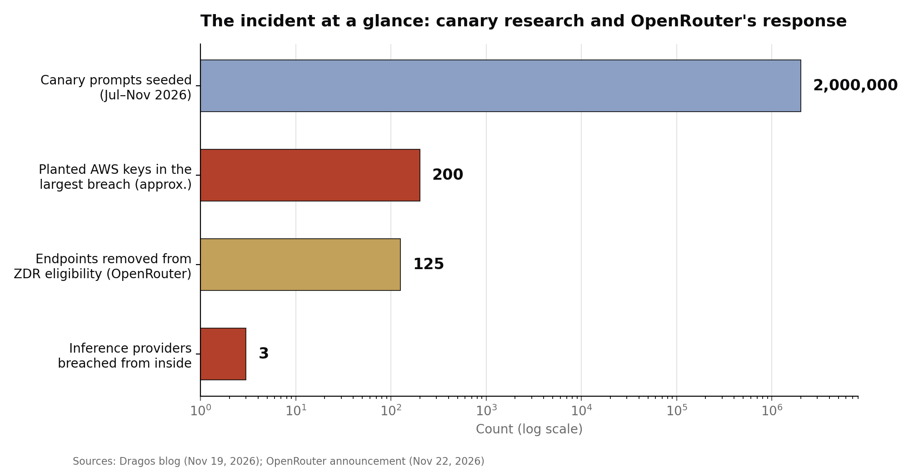

> [中文版 Chinese version](/life/openrouter-prompt-theft-zh/)

*Sources: Dragos blog, "Three breaches, endless leaks" (November 19, 2026); OpenRouter announcement (November 22, 2026). Chart: author's own.*

Every AI request you send to a third-party inference provider is, for a moment, plaintext sitting on somebody else's computer. The model has to read your prompt to answer it. That simple mechanical fact is the whole story of this week — because a team of researchers just proved, with receipts, that attackers were sitting inside that moment at three separate providers, for months, copying what passed through. And nobody at those providers noticed. The researchers had to call them and tell them.

## The trap: two million prompts full of bait

The research came from Dragos, an industrial cybersecurity firm, in a report titled "Three breaches, endless leaks," published on November 19, 2026 and led by HD Moore. The method was elegantly old-school. Between July and November 2026, the researchers seeded roughly **two million prompts** with unique canary artifacts — secret URLs and credentials generated through Thinkst Canarytokens, including planted AWS keys. Each canary was unique, so if a planted URL was ever fetched or a planted key ever used, the researchers would know not just *that* data had leaked, but *which* request it came from and, by elimination, *where* it had been exposed.

This is the critical design choice, and it is worth pausing on. Most breach detection is forensic: after an incident, you dig through logs and argue about scope. Canary tokens invert that. The bait carries its own alarm. A planted AWS key that appears in exactly one request, sent to exactly one provider, in a short, known time window, is a tripwire with an address on it. If that key lights up later — in someone else's API calls, from someone else's infrastructure — there is no innocent explanation. The data left the building through exactly one door.

Then the researchers waited. And the tripwires started firing.

## What the canaries proved

The headline finding: **attackers had stolen data from inside three AI inference providers, over a period of months, and none of the three providers knew until the researchers informed them.** The earliest of the three breaches began in **mid-July 2026**. Detection did not come from the providers' own monitoring, their own audits, or their own customers. It came from an outside research team that had deliberately salted the ecosystem with bait and watched who bit.

The largest single breach shows how tight the attribution is. In that case, a couple of hundred planted AWS keys were each sent in **exactly one request, to one provider, in short windows in late October**. Those stolen keys were subsequently used in **tens of thousands of API calls**, according to Dragos's reporting. Read that again, because it is the evidentiary core of the whole affair: keys that existed nowhere else in the world, transmitted once, to one destination — and then used at industrial scale by someone else. That is not a logging mishap or a retention-policy quibble. That is theft, demonstrated about as cleanly as theft can be demonstrated.

Two further findings widen the blast radius beyond the canaries themselves.

First, some of the stolen requests were flagged **Zero Data Retention (ZDR)** — the setting that is supposed to mean the request is never stored. Whatever ZDR meant operationally at the providers involved, it did not prevent the data from being taken. We will come back to why that matters, because it is arguably the most consequential detail in the entire report for ordinary customers.

Second — and here the sourcing discipline matters — Dragos's **assessment** is that real customer requests processed alongside the bait were "almost certainly copied too." That is an assessment, not a proven fact, and this article will keep it labelled that way. But note the logic behind it. An attacker positioned to copy request data inside a provider is not carefully filtering for researcher bait; the bait was indistinguishable from real traffic by design. If the copying mechanism took the canaries, the reasonable inference is that it took everything flowing through the same pipe. "Almost certainly" is Dragos's phrase. The honest reader should treat the claim as a strong inference from a demonstrated capability — not as a confirmed inventory of stolen customer data, because no such inventory exists. That absence is itself part of the problem: if the providers did not know they were breached, they cannot tell you precisely what was taken.

## A second thread: the lab that fetched the links

Separate from the three breached providers, Dragos reported a second, distinct pattern. An **unnamed Chinese AI lab** fetched the secret links embedded in **more than half** of the seeded prompts sent to its models between July and October — including roughly **two-thirds** of the prompts that were marked as no-data-collection or ZDR. Neither Dragos nor OpenRouter named the lab.

Precision matters here, because this detail is exactly the kind that mutates as it gets retold. Dragos did **not** say this lab is one of the three breached providers, and nothing in the published findings establishes that. Fetching a URL that appears inside a prompt is a different act from an attacker exfiltrating data from inside a provider's infrastructure: model pipelines fetch links for many reasons, some benign, some not, and the report, as published, does not settle which. What the finding does establish is narrower and still uncomfortable: links that customers had every reason to expect would stay inside a no-collection request were, in a majority of cases, actually retrieved by the lab's systems. Whether you call that processing, inspection, or collection, it is behaviour a "we do not collect this" flag is supposed to rule out. Keep the two threads separate in your head: three providers breached by attackers, and one unnamed lab whose own systems touched data they were flagged not to touch. Conflating them would be a factual error, and the original reporting does not make it.

## OpenRouter's move — and what it does and does not say

OpenRouter is the gateway in the middle of this story: it routes customer requests to third-party inference providers, which is precisely the architecture that makes this incident a supply-chain story rather than a single-vendor story. On **November 22, 2026**, OpenRouter announced its response: it **removed three providers**, **removed 125 endpoints from ZDR eligibility** — a figure that combines endpoints implicated by the findings with additional endpoints removed as a precaution — and **notified all potentially affected customers**.

Equally important is what OpenRouter's announcement does *not* establish. Its findings showed **no breach of OpenRouter itself**: the gateway was not the compromised party; the compromise sat downstream, at providers requests were routed to. And it has **not been confirmed** that the three providers OpenRouter removed are the same three providers Dragos found breached. The numbers match; the identity has not been publicly established. Any version of this story that states the equivalence as fact is going beyond the sources.

That said, the shape of OpenRouter's response tells its own story. You do not strip ZDR eligibility from 125 endpoints — explicitly including precautionary removals beyond the flagged ones — if you believe the problem is three bad servers. You do it if you have concluded that the ZDR label, as applied across a routed marketplace, was asserting more than the underlying providers could guarantee. The precautionary tail of that number is the most honest part of the announcement: an implicit admission that eligibility had been granted on the strength of provider claims, and that claims are what failed.

*Sources: Dragos (November 19, 2026); Together AI security notice (November 21, 2026); OpenRouter (November 22, 2026); Phala preliminary report. Chart: author's own.*

## The provider notices: three different failure shapes

In the days around the Dragos publication, individual providers issued their own notices. They are worth reading as a set, because they show three *different* ways prompt data escapes — and none of them is exotic.

**Phala**, in its own preliminary report, said an attacker took over an inference server and could view request data in process — that is, live, as requests were being handled. Phala says the breach was contained on **November 8**. Its guidance is specific: requests to **DeepSeek V4 Flash 0731** routed via OpenRouter between **October 21, 2026 at 00:00 UTC and November 8, 2026 at 05:35 UTC** should be treated as exposed, and customers should **rotate every key, token, and password** that appeared in them. Note the mechanism: no database needed to be dumped, because the attacker stood where the plaintext already was. Inference is a plaintext business at the point of computation, and whoever controls the serving process controls the prompts.

**Together AI** published a security notice on **November 21**, signed by CEO Vipul Ved Prakash. An unauthorized party, it said, had downloaded stored prompt samples that the company collected for routine testing. The affected requests were to **MiniMax M3, GLM-5.2, and Kimi K2.6**, mainly on **June 24, July 4, July 8, and July 14**. The root cause deserves to be quoted in spirit if not in letter: an **AI coding agent committed a credential** for a private Hugging Face repository **to a public GitHub project** (the xorl repository). Sit with that for a moment. In an incident about AI supply-chain trust, one of the concrete failure points was an AI coding tool pasting a live credential into a public repo — the exact class of secret-in-the-wrong-place mistake that the Dragos canaries were designed to catch downstream. The samples were supposed to be an internal testing convenience. Convenience copies are still copies.

**Novita** disclosed a different shape again: a routing issue sent some **MiniMax** requests to **MiniMax's official API**, and requests from **May 28 to November 11** may have been accessed or retained by a third party. No attacker in the walls here — the data simply went somewhere other than where customers believed it was going, for months. Routing errors and retention by an unintended recipient produce the same customer-facing outcome as a breach: your prompts were in a place you did not choose, under retention rules you did not agree to.

Three providers, three mechanisms — an attacker inside the serving process, a credential leaked by a coding agent into a public repo, and a routing mistake — converging on one result. That diversity is the point. This is not a single bug to patch. It is what a young, fast-growing inference supply chain looks like when demand for cheap capacity outruns the operational maturity of the capacity being bought.

## The real argument: price per token versus a chain you cannot audit

Now the judgment, because the facts above support one and it should be stated plainly.

The routed-inference market sells a compelling proposition: one API, every model, and routing that hunts for the cheapest or fastest provider per request. That proposition is real — the savings are real, the convenience is real. But this incident exposes the hidden term in the contract. When your request can be served by any of dozens of third-party providers, your data's safety is the safety of the *least careful provider your request happened to touch*, on a day you cannot reconstruct, under a retention flag you cannot verify. You did not choose that provider. In many cases you could not name it. Your security review, if you did one, reviewed the gateway — and the gateway, as OpenRouter's findings showed, was not the thing that got breached.

ZDR is where this becomes concrete. Zero Data Retention sounds like a technical property, like encryption. It is not. It is a **policy label applied to other companies' infrastructure** — a promise that a request will not be stored, made by parties the customer has no direct relationship with, and, until Dragos salted the ecosystem with two million tripwires, verified by essentially nobody. Some stolen requests in this incident carried that flag. An unnamed lab fetched secret links from roughly two-thirds of the seeded prompts marked no-collection. Whatever those flags were doing, they were not functioning as guarantees. The correct mental model, from this week forward, is that ZDR on a routed marketplace is a claim awaiting evidence — and the only evidence anyone produced this year came from researchers planting bait, not from the platforms selling the label.

None of this means routed inference is unusable. It means the trust model has to change from *believe the label* to *assume the pipe is hostile*. The teams that will come out of this fine are the ones that already treated every external endpoint as a potential disclosure: secrets never travel inside prompts in the first place, so there is nothing in the transcript worth stealing.

## What to do on Monday

The actionable list is short, concrete, and mostly Dragos-shaped:

1. **Rotate secrets that ever transited third-party inference.** If an API key, token, or password appeared in a prompt sent through a routed gateway or a third-party provider — and especially if it touched the Phala window above (DeepSeek V4 Flash 0731 via OpenRouter, October 21 00:00 UTC to November 8, 05:35 UTC) — treat it as exposed and rotate it. Phala's own guidance says exactly this. Do not wait for a provider to confirm your specific request was taken; as this incident proved, the providers may not know.
2. **Never put live credentials in prompts.** Not for debugging, not "just this once," not in a tool-call payload you assume is transient. The Dragos canaries worked precisely because a credential in a prompt is a credential in someone else's logs, memory, and — this month — someone else's hands. Use secret managers, short-lived scoped tokens, and placeholders resolved at the last hop you control.
3. **Prefer first-party endpoints for sensitive work.** When the content is genuinely sensitive — customer data, proprietary code, anything regulated — pay the first-party price and cut the routing layer out. The discount on third-party inference is partly a discount on accountability; spend accordingly.
4. **Treat ZDR as a question, not an answer.** Ask routed platforms how ZDR eligibility is verified, how often, and what evidence would ever prove a violation. This week demonstrated the only verification method that has actually caught anyone: independent canary testing. If a platform cannot describe its equivalent, the flag is marketing.
5. **Log your own routing.** Know which providers actually served your sensitive traffic, and when. If you cannot reconstruct that after the fact, you cannot scope an incident — yours or theirs.

## The bottom line

Strip the incident to its skeleton and it is almost old-fashioned: attackers got inside service providers, copied what flowed past, and were caught not by the victims but by researchers who had planted two million labelled decoys and waited for the thieves to use them. The AI part of the story is the scale and the newness — a booming market in routed inference where a customer's most sensitive text is replicated across a chain of young companies, under privacy flags that turned out to be assertions rather than mechanisms.

The cheapest token is the one whose full cost you have not counted. This week, part of that cost came due — in rotated keys, in 125 endpoints quietly stripped of a trust label, and in a question every team using routed inference now has to answer with evidence instead of faith: when your prompt leaves your building, whose computer is it on, and how would you ever know?

*Reporting in this article is based on the Dragos blog post "Three breaches, endless leaks" (November 19, 2026), OpenRouter's announcement (November 22, 2026), Phala's preliminary report, Together AI's security notice (November 21, 2026), Novita's disclosure, and coverage by The Hacker News (November 22, 2026). Where a claim is a researcher's assessment rather than an established fact — in particular, the judgement that real customer requests were "almost certainly copied too" — it is labelled as such in the text. It has not been confirmed that the three providers removed by OpenRouter are the same three providers Dragos found breached.*
