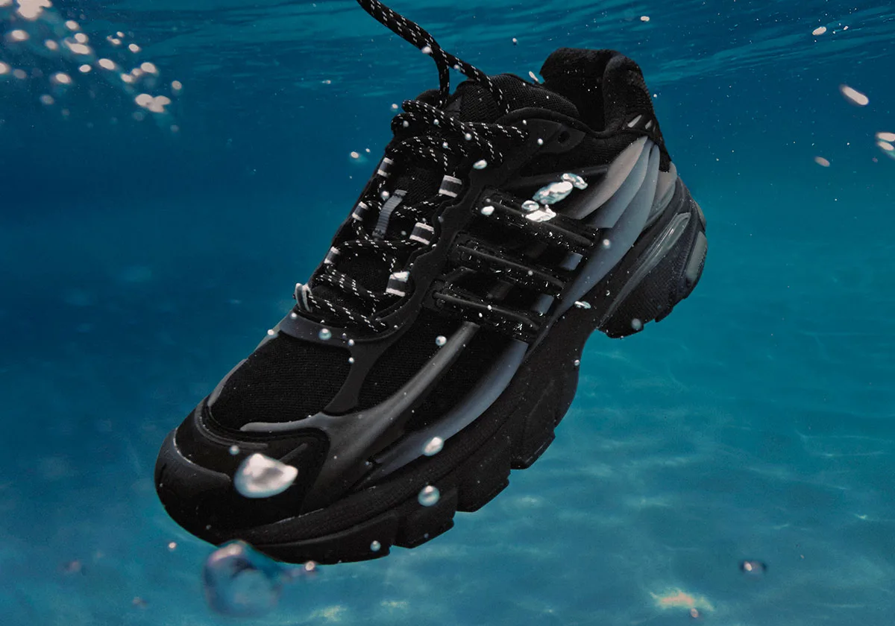
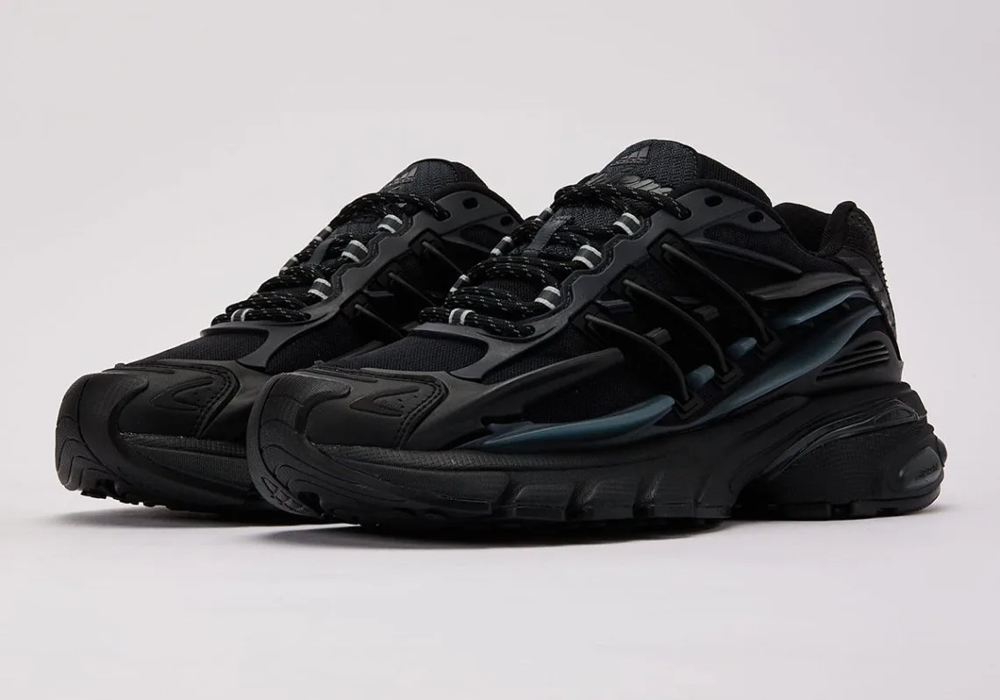
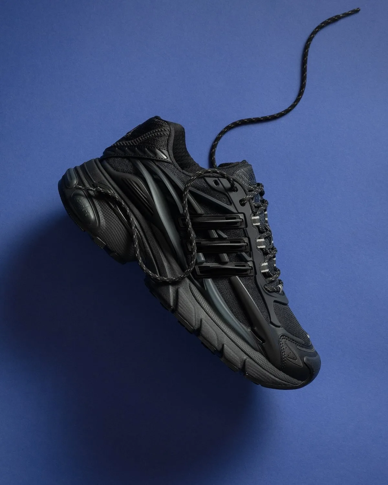
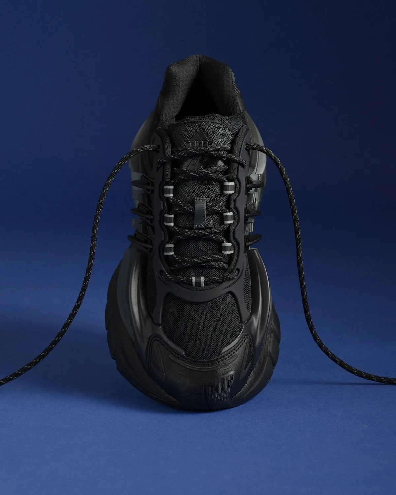
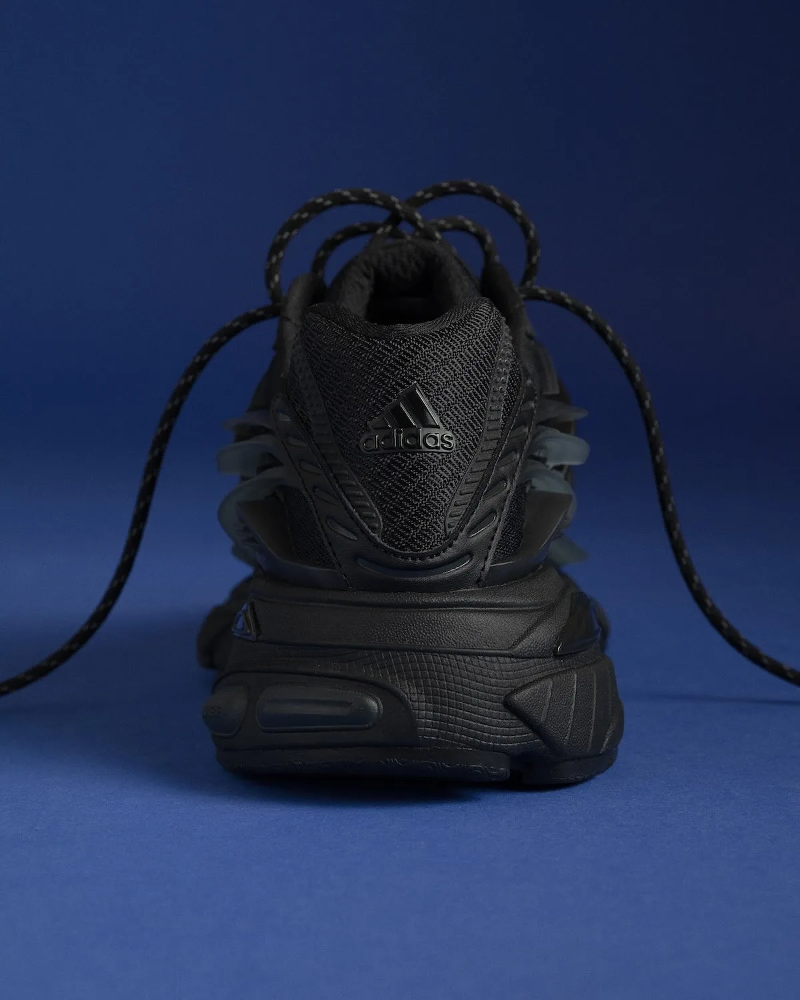
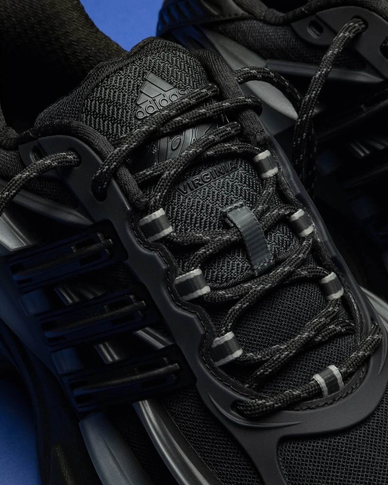
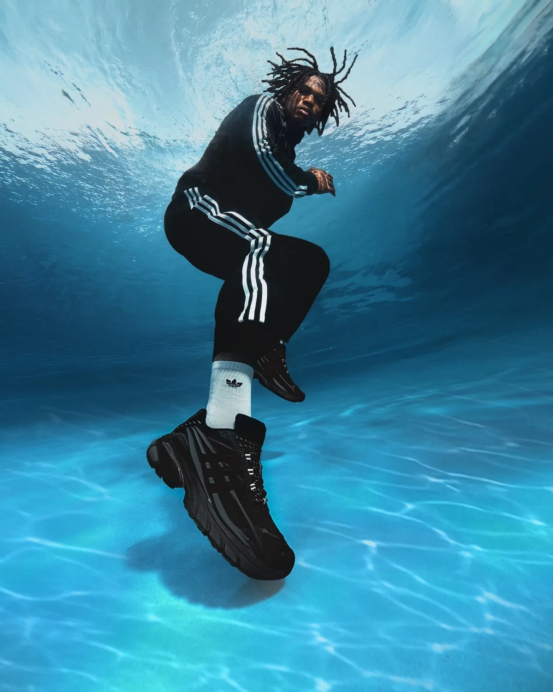

> [English version 英文版](/life/pharrell-adidas-jellyfish-triple-black-restock/)

大多数补货都是一种承认：承认首发备货太少、需求判断错了、品牌想把同一笔钱再赚一次。Pharrell Williams × adidas VIRGINIA Adistar Jellyfish「Triple Black」的回归略有不同，而这个不同正是这双鞋的全部故事。这不是一双被遗忘的配色被重新搬上货架清仓，而是 Footwear News 评选的 2025 年度鞋王的黑色版本，在全年最大的购物周回归，而且恰好赶在它的二级市场热度终于冷却到「按原价买是为穿、不是为炒」的时刻。

先把事实说清，因为明天会很快。 「Triple Black」（货号 KJ3841）将于 2026 年 11 月 25 日周三全球补货，售价 300 美元。adidas CONFIRMED App 与 VIRGINIA 官网的抽签已经开放，报名自 11 月 23 日开启；Sneaker News 列出的零售网络远不止精品店抽签：adidas 美国 CONFIRMED、Foot Locker、Sneaker Politics、SNIPES US、TAKOUT NY、DTLR 等都在名单里。这个「广」很重要。Jellyfish 刚诞生时是一双几乎没人买得到的鞋；明天，它是一双几乎人人可以试着买的鞋，而且与黑五的 Air Jordan 4「Bred」同周。这不是日历的巧合，而是一条刻意弧线的终点——先稀缺、后普及。无论你喜不喜欢这双鞋，这条弧线本身都值得看懂，因为 adidas 和 Pharrell 执行它的耐心，在这个行业里几乎无人能比。

热度有据可查，不是假设。Sneaker News 11 月 23 日发布补货解析、今天 11 月 24 日更新；The Source 与 Modern Notoriety 在 11 月 23–24 日都报道了这次再版，并带上全新的 Jeremiah Smith campaign；Complex Sneakers 11 月 23 日发了上手开箱，数千点赞，评论区至今还在争论这是否是今年最好的 Jellyfish 配色；Foot Locker 欧洲今天还在为它做鞋盒空降式的造势视频；House of Heat 把它放进 11 月 23–29 日黑五周日历，与 Caitlin 1、Victor Solomon Trophies 系列和 Jordan 4「Bred」并列。当一次补货在 48 小时内被这么多媒体按「发售」规格报道时，它就是发售。

## 事实卡

| | |
|---|---|
| **型号** | Pharrell Williams × adidas VIRGINIA Adistar Jellyfish「Triple Black」 |
| **货号** | KJ3841 |
| **配色** | Carbon / Core Black / Carbon |
| **补货日期** | 2026 年 11 月 25 日周三——全球再版，adidas CONFIRMED（抽签已开放）、adidas.com、VIRGINIA 官网及 Foot Locker、Sneaker Politics、SNIPES US、TAKOUT NY、DTLR 等指定零售商 |
| **售价** | 300 美元——2026 年 11 月 24 日查询的 snapshot，subject to change |
| **首发历程** | 2025 年纽约 Billionaire Boys Club Mercer Street 店独家发售；2026 年 2 月 21 日全球发售 |
| **鞋面** | 多层工程网布 + 一体成型外骨骼式 TPU 笼架；KJ3841 版本据零售目录在鞋头与后跟带皮革拼片 |
| **中底** | 夸张的波浪形 Adistar 平台，灵感来自水母漂浮的鳃瓣；后跟 Adiprene 缓震，源自 Adistar Cushion 3 血统 |
| **细节** | 夜光处理、斑点绳状鞋带、鞋舌 VIRGINIA 标识、鞋舌与后跟 adidas 标识 |
| **Campaign** | 由 adidas 运动员、大学橄榄球新星 Jeremiah Smith 出镜，水下拍摄 |
| **荣誉** | Jellyfish 鞋型获 Footwear News 2025 年度鞋款 |

*这次补货的主图：一只 Triple Black，在水下。这双鞋以海洋生物命名，adidas 终于按海洋生物的方式拍了它。图片：adidas / Pharrell Williams，经 Sneaker News。*

## 一段简短而离奇的历史：一场被纽约警察叫停的发售

要理解为什么一次补货能上新闻，先要理解这双鞋第一年有多不正常。据 Sneaker News 的鞋型史，Jellyfish 于 2025 年 3 月巴黎时装周首次亮相，出道时就带着一个大多数联名从不敢提的主张：它不是某双现成鞋的新配色，而是一双「体内藏着一双档案鞋」的新鞋型。底子是 adidas Adistar Cushion 3，一双 2000 年代中期的技术跑鞋——House of Heat 将这双原型定在 2005 年——被放大、加笼、重塑比例，直到原鞋只剩骨架、不再是外形。

早期发售办得像艺术事件，备货也像艺术事件。鞋子经 Pharrell 自有渠道和极少数精品店流出，首批配色基本瞬间售罄。而「Triple Black」拥有其中最戏剧化的一章：去年在纽约的一次提前线下发售，据 Sneaker News 记述，因人群超出街道承载，被纽约警察叫停。随后它在 Billionaire Boys Club 的 Mercer Street 店——Pharrell 自己在 SoHo 的店——独家登场，直到 adidas 在 2 月 17 日的新闻稿里宣布它与「Royal Blue」一起在 2 月 21 日全球发售，并把两双鞋的路径概括为从「文化时刻」走向「全球可及」。

时装周首秀、被警察叫停的街头发售、精品店独家、全球发售、拿奖、补货——这套流程通常摊在一双鞋五年的生命周期里，Jellyfish 把它压缩进了大约二十个月。而中间那个奖也不是社交媒体投票：Footwear News 年度鞋款是行业内的贸易荣誉，颁给了一双 300 美元、无性能代言合同、无运动员签名、不靠复刻情怀的时尚跑鞋混血儿。无论你觉得它好不好看，这种事几乎从不发生。行业不会把年度大奖颁给一个猎奇产品，只会颁给它认为真正推动了市场的产品。

## 设计：一双穿着雕塑的档案跑鞋

抛开故事看实物，因为实物必须自己 justify 300 美元。Jellyfish 的定义性动作是比例。一双普通 Adistar 该有的东西全都在——网布基底、三条纹、缓震后跟——但全部被故意放大到「不对」。中底是一个夸张的波浪形平台，其层叠的条纹用 adidas 自己的话说，灵感来自「水母漂浮的鳃瓣」。鞋面是多层工程网布，外面罩着一体成型的笼状外骨骼，于是整双鞋读起来像皮肤之上的骨骼：硬质 TPU 肋条纵向流动，软网布在肋条之间呼吸，三条纹被重建成笼架的一部分，而不是印在上面。

这正是「Triple Black」是重要配色、而不只是安全配色的原因。在 Jellyfish 的亮色版本上——首发的橙、橄榄绿，以及 2 月与它同发的 Royal Blue——是颜色在解释设计：你先看到配色，再看到结构。而在黑色上，配色消失，结构成为唯一剩下的东西。笼架、鳃状条纹、堆叠后跟、带斑点的绳状鞋带、中底肋条里那一抹 faint 的灰色渐变：在 KJ3841 以深蓝为底的产品图里，这双鞋不再像一双带主题的球鞋，而像一件工业设计作品。Sneaker News 用更平实的话说了同一件事：黑色是「这双鞋更易穿的版本」，平衡了让它成名的构图张扬度。两件事同时成立，这很少见。它既是最耐穿的 Jellyfish，也是最诚实展示设计的那一双。

细节经得起近看。鞋舌上同时有 adidas 标识和一体成型的 VIRGINIA 字样——VIRGINIA 是 Pharrell 的创作化名与文化平台，以他的家乡弗吉尼亚州命名，整条产品线都活在这个名号之下。鞋带是粗绳状、带斑点，穿过织带鞋带环和条纹鞋带扣，更接近登山硬件而不是扁平棉带，而且它在视觉上是功能性的一部分：它是这套设计里那条「触手」线，其余的隐喻都沉在水下的中底里。夜光处理贯穿全线、且 adidas 确认本配色同样具备，是唯一的派对把戏——在黑鞋上白天看不见，而这正是重点。后跟则保留了 Adistar 的身份：一枚成型 adidas 徽章，压在带纹理的分段式后跟稳定片上，那是纯粹的 2000 年代中期跑鞋硬件，像化石一样被保存在新机体里。

*双鞋图：到了黑色，颜色不再解释这双鞋，结构必须自己解释。注意中底肋条里藏着的渐变——这是 Triple Black 唯一不那么「triple」的地方。图片：DTLR，经 Sneaker News。*

*侧面：完整的外骨骼——笼架条纹、流动的中底肋条、分段的 Adistar 后跟。图片：adidas / Pharrell Williams，经 Modern Notoriety。*

## 脚下：Adistar 的骨头，生活方式的意图

每一篇 Jellyfish 评测都该有这一句澄清，因为它的跑鞋出身容易引发误会。Jellyfish 建在跑鞋之上、借用跑鞋的缓震语言——Adistar 平台，后跟 Adiprene 缓震，承 Adistar Cushion 3 血统，House of Heat 与 KJ3841 的零售目录都如此记载——但它是一双 sportstyle 鞋。adidas 没打算让任何人穿它跑马拉松，买它的人也不该拿它训练。这个平台在这里的工作不是 26 英里里的能量回馈，而是姿态：高度、存在感，以及在一大块鞋面建筑之下、带一点滚动感的日常缓震脚感。

按这个标准看，配方是成立的。一件上半身这么重的雕塑，需要一个宽、稳、视觉上同样重的底座，而 Adistar 大底三样全占。层叠的肋条不是空心造型，它们就是中底本身，被堆叠、被开槽，让鞋子以「结构」而不是一块平板泡沫的方式受压。日常穿着中，早期配色的鞋主们描述的取舍高度一致：走路缓震舒适、脚上有真实重量、而且是它决定你的穿搭而不是融进穿搭。这次补货在这一点上什么都没改——它就是 2 月发售的同一双 KJ3841，不是修订版——所以这里的性能讨论是对现有鞋款的判断，不是对新鞋的首测。再版没有新的实测可写，假装有就是不诚实。

尺码建议来自结构本身。一体 TPU 笼架不会像针织鞋面那样撑开，它下面的多层网布在笼架最密的中足部位延展有限。如果你在两个码之间、或者脚偏宽，笼架就是选大一码的理由；如果你习惯跑鞋穿得贴脚，要知道这双鞋的贴脚是结构性的，不会「穿开」。如果附近零售商有现货，尽量试穿——这次 Foot Locker 进了发售网络，进店试穿第一次成为现实选项，而不是精品店时代的奢望。

*正面：宽度就是设计。成型鞋头盖与收束的笼架，同时解释了它的姿态和上面的尺码建议。图片：adidas / Pharrell Williams，经 Modern Notoriety。*

*后跟：2000 年代中期的 Adistar 硬件，像化石一样保存——新笼架之下的成型徽章与分段稳定片。图片：adidas / Pharrell Williams，经 Modern Notoriety。*

## Campaign：Jeremiah Smith，在水下

这次再版带着一张新面孔，而这张面孔的选择本身就是一句小小的宣言。Campaign 由 Jeremiah Smith 出镜——adidas 运动员、大学橄榄球新星——穿着黑色三条纹运动套装，脚踩 Triple Black，悬在被打成海底光的水池底之上拍摄。The Source 与 Modern Notoriety 都以此为头条，VZN Magazine 的标题——Smith「把 Triple Black Jellyfish 带到水下」——点出了它成立的原因：这双鞋以海洋生物命名，以鳃和触手鞋带为造型语言，而 adidas 在过去一年半里一直把它放在干燥的摄影棚里拍。这次 campaign 终于把它放回了它的元素。

它也在悄悄重新定位这双鞋。Jellyfish 的第一年是一个时尚故事——巴黎、Pharrell、精品店、行业大奖。把一位正处上升期的大学橄榄球明星放在补货 campaign 的中心，是 adidas 把这双鞋重新往体育方向穿线——不是性能体育，而是美国体育的文化中心，而且恰逢感恩节橄榄球与黑五这一周。Pharrell 本人给这次再版的原话，The Source 与 Modern Notoriety 都刊了，指向同一个向外的方向：「真正的全新太稀有了，而这正是 VIRGINIA 存在的意义：做以前不存在的鞋型。一切从 Jellyfish 开始，当时只有少数人能拿到。看到大家与它的连接，我们知道是时候让更多人进来了。这是下一章。我们想看到它出现在真实世界里。」

把这句话当作它明摆着的战略来读。「只有少数人能拿到」是第一阶段，而且说得理直气壮；「让更多人进来」是从明天开始的第二阶段。品牌们天天说类似的话，Jellyfish 的不同在于：第一阶段真的成功了——这双鞋因为难买而更出名，而不是更小众——而且第二阶段到来的时机是设计仍有文化势能的时候，而不是降温两年之后。

*鞋舌特写：VIRGINIA 成型压在鞋带之下的鞋舌上，adidas 在它上方——这双鞋的两个签名，叠在三英寸之内。图片：adidas / Pharrell Williams，经 Modern Notoriety。*

*Campaign：Jeremiah Smith，穿着 Triple Black 悬在水中。一位橄榄球明星、一个泳池，和一双以海洋生物命名的鞋，终于回到它的元素里。图片：adidas / Pharrell Williams，经 Modern Notoriety。*

## 市场已经变了——这就是购买建议

如果你的钱要参与进来，这次补货最重要的部分直接来自 Sneaker News 11 月 23 日的解析：「Triple Black」如今「变得更容易获得、狂热也随之稍减，在大多数二级市场平台上已经能以低于原价的价格买到」。请认真读这句话。一年前，这个配色的线下发售被警察叫停；2 月，它以 300 美元全球发售；今天，在二级市场上它可以低于 300 美元买到；而明天，adidas 会再次以 300 美元、经这双鞋有史以来最广的零售网络之一把它卖一遍。

这并不矛盾。这是一个成熟产品应有的行为，而它把明天的买家诚实地分成两组。如果你想买这双鞋来穿——黑色版本配阔腿裤、宽松牛仔或一身黑，它确实是当下能穿上脚的最具辨识度的东西之一——那么明天是这个配色有史以来最好的购买时机：原价、你的确切尺码、正规零售商、退货政策，没有转售溢价、没有发货赌博、没有真伪问题。进 CONFIRMED 抽签，试 VIRGINIA 官网，再逐个走零售名单；门开得这么多，一个能穿的尺码不该需要给任何人付溢价。

反过来，如果你把 Jellyfish 当资产看，这次补货就是 adidas 礼貌而公开地告诉你：这个配色的资产阶段结束了。真正限量的早期 Jellyfish 版本仍保持着 Sneaker News 所说的高溢价——稀缺对那批鞋的作用是永久的。而一双被广泛补货、二级市场价已经贴在原价或原价以下的鞋，不是投资工具，是一件设计出色的消费品。请只在这个基础上买它，或者不买。本评测刻意不挂 affiliate 链接、不做折扣角度：在 300 美元的 snapshot 价格（subject to change）下，Triple Black 的价值主张就是——年度鞋王最好的配色，以厂商原价、你的尺码，第一次不用抢就能买到。这就够了。

放进本周的语境里，这个判断更清楚。这是全年最拥挤的球鞋周：Victor Solomon Trophies 系列和 Kith × Star Wars ASICS「Darth Vader」同在 11 月 25 日发售，Air Jordan 4「Bred」以 230 美元压阵 11 月 27 日黑五，Caitlin 1「Ice Cold」今天以 140 美元放量。在这个阵容里，Jellyfish 最贵、也最不怀旧——没有复刻、没有授权 IP、盒子上没有运动员的名字，只有一个两岁大的设计想法。它能以这个价格、在这样的公司里以一次补货领衔，恰恰是年度鞋王那个奖确实测到了某种真实东西的最强证据。

## 结论

Pharrell × adidas VIRGINIA Adistar Jellyfish「Triple Black」是罕见的、熬过自己炒作周期并在另一头变成一件「产品」的热门鞋。设计在黑色下比在任何其他配色下都更站得住，因为黑色拿走了配色，只留下建筑本身——笼架、鳃瓣、化石般的 Adistar 后跟——独自为价格辩护。历史也站得住：巴黎首秀、被纽约警察叫停的发售、精品店独家、行业年度鞋款，以及现在一次真正广泛的第二次机会。

明天的补货不会重造第一年的狂热，它也没打算这么做。Sneaker News 说狂热已经冷却是对的，二级市场低于原价就是证明。剩下的东西比狂热更好：一双奇怪的、雕塑感的、诚实原创的鞋，以它最好的配色、300 美元的价格，从制造它的人手里卖给你。如果你想买来穿，这就是你的那一周；如果你想买来炒，那一周是去年——而这两句话之间的距离，恰恰就是你判断 Jellyfish 已经长大了的方式。

*价格为 2026 年 11 月 24 日查询的 snapshot，subject to change。来源：Sneaker News（2026 年 11 月 23 日补货解析、11 月 24 日更新——11 月 25 日补货、300 美元、CONFIRMED 加 Foot Locker / Sneaker Politics / SNIPES US / TAKOUT NY、纽约提前发售被 NYPD 叫停、大多数二级平台低于原价、早期版本仍高溢价；鞋型史——2025 年 3 月巴黎时装周首秀）；adidas News（2026 年 2 月 17 日——Triple Black 与 Royal Blue 2 月 21 日全球发售、Billionaire Boys Club Mercer Street 独家、Footwear News 2025 年度鞋款、波浪中底灵感来自水母漂浮鳃瓣、多层网布加外骨骼结构、夜光细节、300 美元、VIRGINIA 为 Pharrell 的创作平台）；The Source（2026 年 11 月 24 日——11 月 25 日全球再版、11 月 23 日开放报名、Jeremiah Smith campaign、Pharrell 原话）；Modern Notoriety（2026 年 11 月 23 日——KJ3841、Carbon/Core Black/Carbon、300 美元、CONFIRMED 与 VIRGINIA 抽签开放、Jeremiah Smith campaign、Pharrell 原话）；House of Heat（2026 年 11 月 23–29 日黑五周日历；Adistar Cushion 3 原型源自 2005 年、Adiprene 缓震）；Complex Sneakers（2026 年 11 月 23 日上手开箱）。本次再版不存在新的实测；脚感与尺码讨论基于 2026 年 2 月发售的、构造未变的 KJ3841。*
