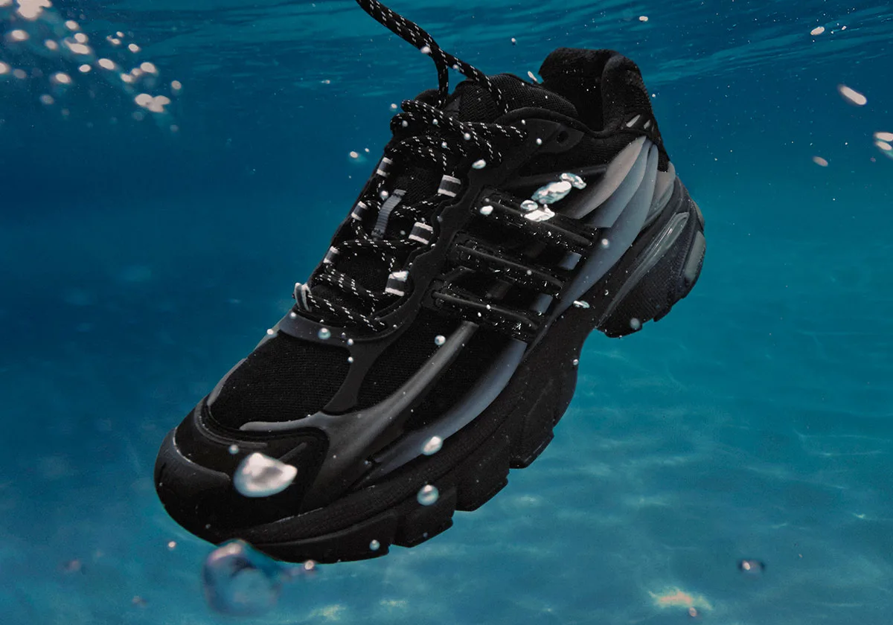
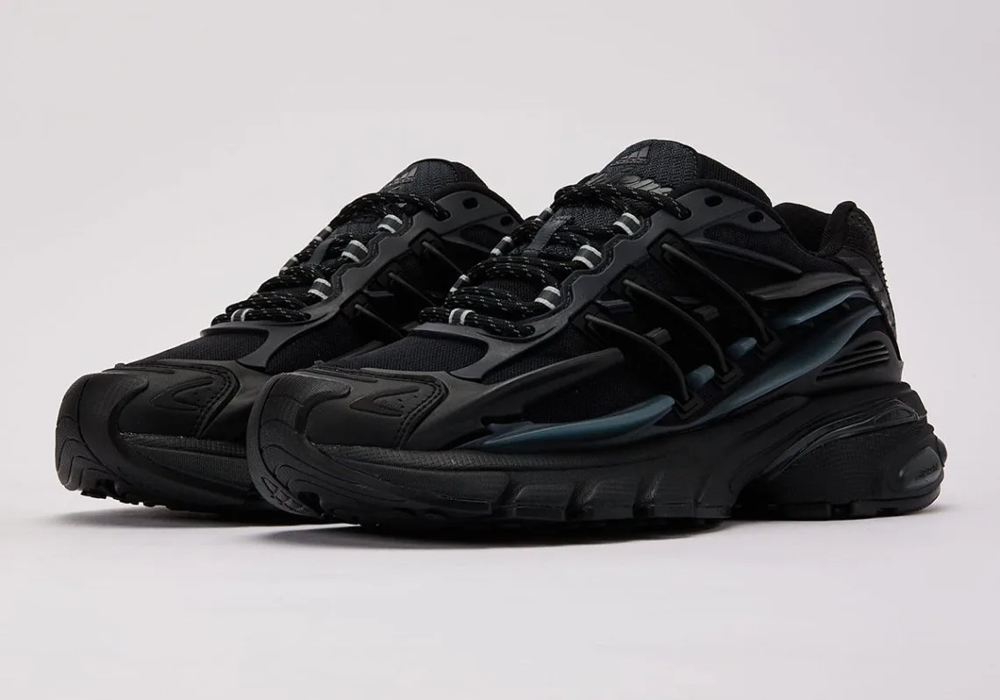
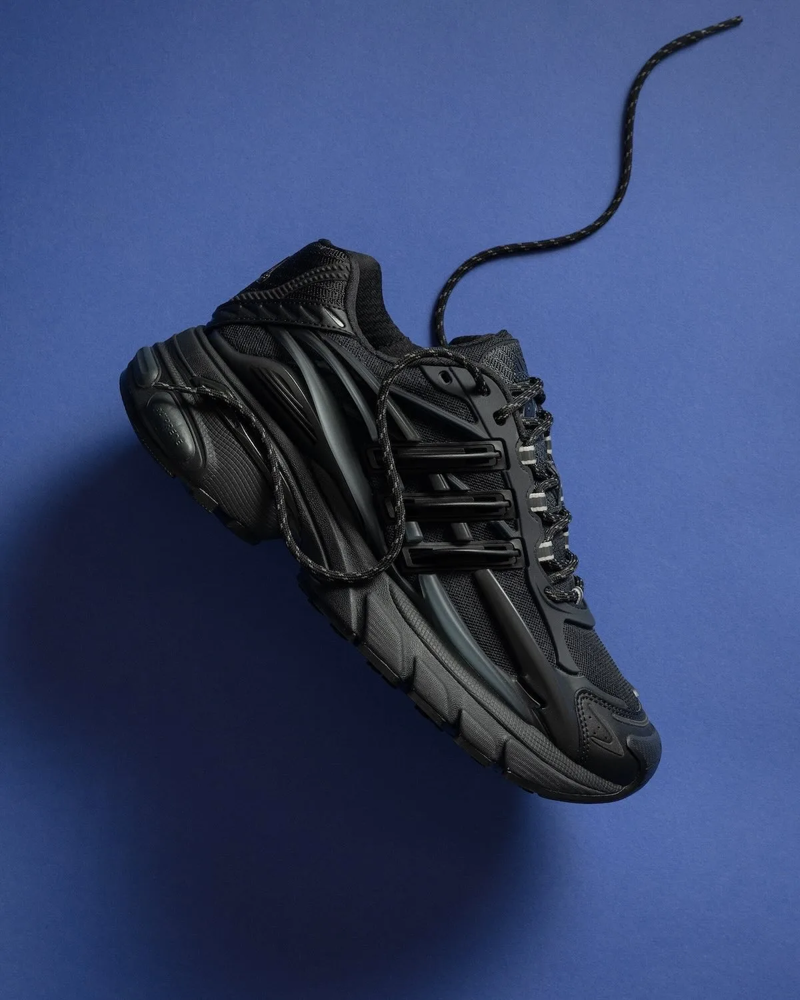
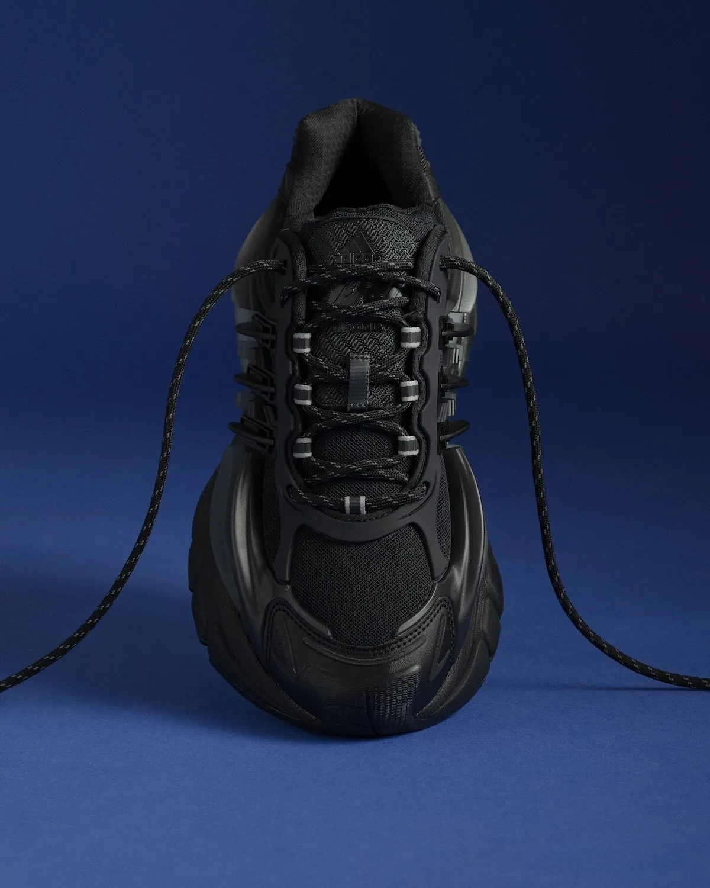
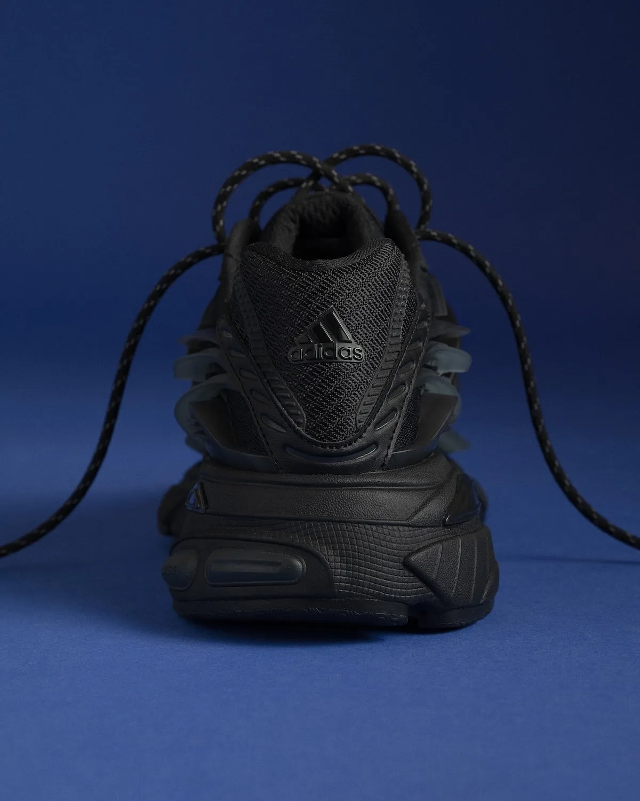
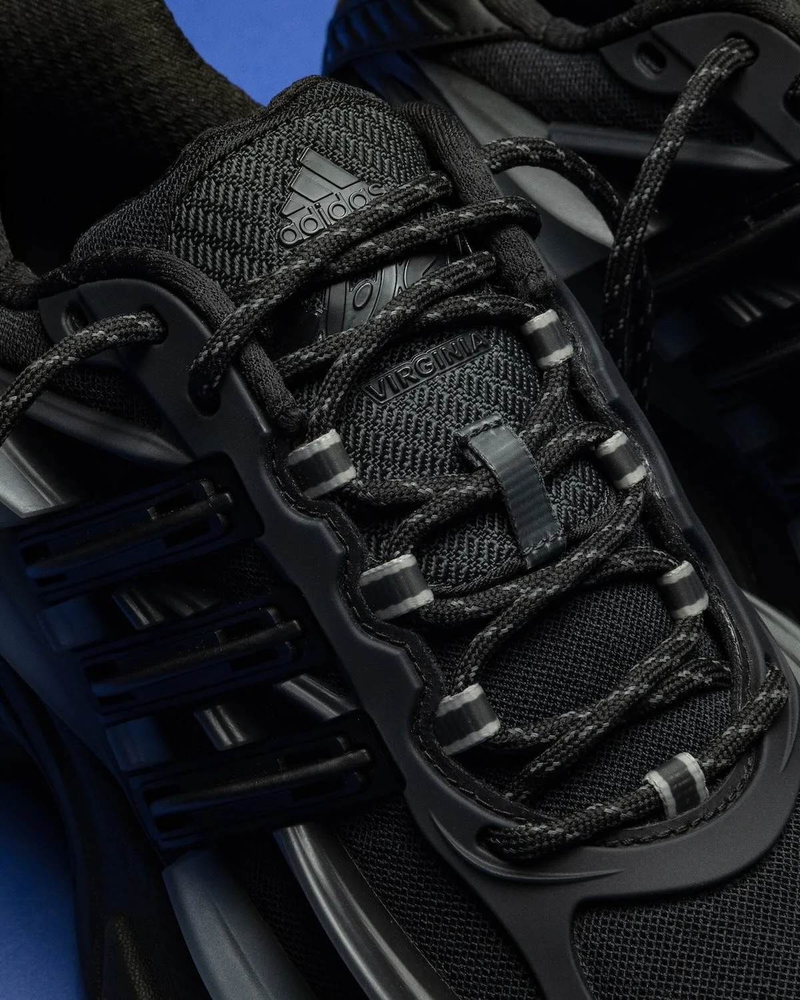
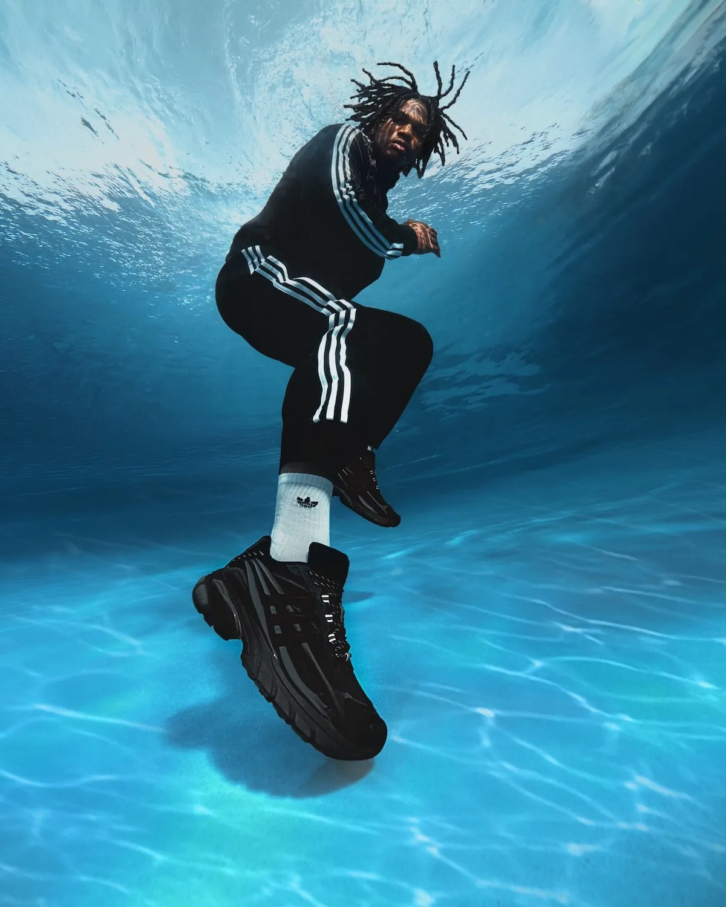

> [中文版 Chinese version](/life/pharrell-adidas-jellyfish-triple-black-restock-zh/)

Most restocks are an admission. They say the first release was too small, the demand was misread, and the brand would like a second turn at the same money. The return of the Pharrell Williams x adidas VIRGINIA Adistar Jellyfish "Triple Black" is a little different, and the difference is the whole story of this shoe. This is not a forgotten colorway being cleared off a shelf. It is the black version of a silhouette that Footwear News named its 2025 Shoe of the Year, coming back on the biggest shopping week of the year, at the exact moment its resale heat has finally cooled enough that buying it at retail is a decision about wearing it — not about flipping it.

The facts first, because tomorrow will move fast. The "Triple Black" (style code KJ3841) restocks globally on Wednesday, November 25, 2026, for $300. Drawings are open on the adidas CONFIRMED app and the VIRGINIA website, sign-ups opened on November 23, and Sneaker News lists a retail network that goes well beyond a boutique raffle: adidas US on CONFIRMED, Foot Locker, Sneaker Politics, SNIPES US, TAKOUT NY and DTLR among them. That breadth matters. The Jellyfish began its life as a shoe almost nobody could buy. Tomorrow it is a shoe almost anybody can try to buy, in the same week as the Black Friday Air Jordan 4 "Bred." That is not an accident of the calendar. It is the end of a deliberate arc — scarcity first, ubiquity later — and whether you like the shoe or not, the arc itself is worth understanding, because adidas and Pharrell have run it more patiently than almost anyone else in the industry.

The heat is documented, not assumed. Sneaker News published its restock breakdown on November 23 and updated it today, November 24. The Source and Modern Notoriety both carried the reissue on November 23–24, with the new Jeremiah Smith campaign. Complex Sneakers posted a hands-on unboxing on November 23 that drew thousands of likes and a comment thread still arguing about whether this is the best Jellyfish colorway of the year. Foot Locker Europe was staging box-drop stunts for it today. House of Heat put it in its Black Friday week calendar, November 23–29, alongside the Caitlin 1, the Victor Solomon Trophies pack and the Jordan 4 "Bred." When a restock is covered like a launch by that many outlets in 48 hours, it is a launch.

## The facts

| | |
|---|---|
| **Model** | Pharrell Williams x adidas VIRGINIA Adistar Jellyfish "Triple Black" |
| **Style code** | KJ3841 |
| **Colorway** | Carbon / Core Black / Carbon |
| **Restock date** | Wednesday, November 25, 2026 — global reissue via adidas CONFIRMED (drawings open), adidas.com, the VIRGINIA website and select retailers including Foot Locker, Sneaker Politics, SNIPES US, TAKOUT NY and DTLR |
| **Retail price** | $300 — price snapshot as of November 24, 2026, subject to change |
| **First releases** | Exclusive Billionaire Boys Club, Mercer Street, New York, in 2025; wider global release February 21, 2026 |
| **Upper** | Layered engineered mesh with a molded exoskeletal TPU cage; leather panels at toe and heel on the KJ3841 build as catalogued in retail listings |
| **Midsole** | Exaggerated wave-like Adistar platform inspired by a jellyfish's floating gills, with Adiprene heel cushioning in the Adistar Cushion 3 lineage |
| **Details** | Glow-in-the-dark treatments, speckled rope laces, VIRGINIA branding on the tongue, adidas branding at tongue and heel |
| **Campaign** | Fronted by adidas athlete and college football standout Jeremiah Smith, photographed underwater |
| **Honors** | The Jellyfish silhouette was named Footwear News' 2025 Shoe of the Year |

*The hero image of this restock: one Triple Black, underwater. The shoe was named for a sea creature, and adidas finally photographed it like one. Image: adidas / Pharrell Williams, via Sneaker News.*

## A short, strange history: a drop the NYPD had to end

To understand why a restock is news, you have to understand how abnormal this shoe's first year was. The Jellyfish was first unveiled at Paris Fashion Week in March 2025, per Sneaker News' model history, and it arrived with a claim most collaborations never make: that it was not a colorway of an existing shoe but a new silhouette that happened to have an archive shoe inside it. The base is the adidas Adistar Cushion 3, a mid-2000s technical runner — House of Heat dates the foundation shoe to 2005 — blown up, caged and re-proportioned until the original is a skeleton rather than a shape.

The early releases were staged like art events and stocked like them, too. Pairs moved through Pharrell's own channels and a small number of boutiques, and the first colorways sold out essentially instantly. The "Triple Black" had the most theatrical chapter of all: an early New York release last year that, as Sneaker News recounts, was cut short by the NYPD after the in-person drop drew more crowd than the street could hold. The pair then surfaced through an exclusive launch at Billionaire Boys Club on Mercer Street — Pharrell's own store, in SoHo — before adidas finally gave it a proper global release on February 21, 2026, alongside the "Royal Blue," in a news release dated February 17 that framed both pairs as moving from "cultural moments" to "global access."

That sequence — fashion-week debut, chaotic street drop, boutique exclusive, global release, award, restock — is usually spread across five years of a shoe's life. The Jellyfish compressed it into about twenty months. And the award in the middle of it was not a social-media poll. Footwear News' Shoe of the Year is an industry honor, voted in the trade, and it went to a $300 fashion-runner hybrid with no performance contract, no athlete signature and no retro nostalgia to lean on. Whatever you think of the shoe's looks, that almost never happens. The industry does not hand its annual prize to a curiosity. It hands it to the product it believes moved the market.

## The design: an archive runner wearing a sculpture

Strip the story away and look at the object, because the object has to justify $300 on its own. The Jellyfish's defining move is proportion. Everything on a normal Adistar is present — mesh base, Three Stripes, a cushioned heel — and everything is scaled wrong on purpose. The midsole is an exaggerated, wave-like platform whose layered rails are inspired, in adidas' own words, by "the floating gills of a jellyfish." The upper is a layered engineered mesh wrapped in a molded, cage-like exoskeleton, so the shoe reads as a skeleton over skin: hard TPU ribs flowing lengthwise, soft mesh breathing between them, the Three Stripes rebuilt as part of the cage rather than printed on top of it.

This is why the "Triple Black" is the important colorway, and not just the safe one. On the bright Jellyfish colorways — the debut oranges and olives, the Royal Blue that launched beside this pair in February — color does the explaining. You see the palette first and the structure second. In black, the palette disappears and the structure is all that is left. The cage, the gill rails, the stacked heel, the rope laces with their speckled fleck, the faint grey gradient inside the midsole ribs: in the product photography for KJ3841, shot against a deep blue ground, the shoe stops looking like a sneaker with a theme and starts looking like a piece of industrial design. Sneaker News makes the same point in plainer language: black is "a more eminently wearable version of the silhouette," a way to balance the compositional loudness that made the shoe famous. Both things are true at once, which is rare. This is simultaneously the most wearable Jellyfish and the one that shows the design most honestly.

The details repay a close look. The tongue carries both the adidas mark and a molded VIRGINIA hit — VIRGINIA being Pharrell's creative pseudonym and cultural platform, named for his home state, under which this whole line lives. The laces are thick speckled ropes running through webbing loops with striped lace keepers, closer to hiking hardware than to a flat cotton lace, and they are a functional part of the look: they are the tentacle line in a design that otherwise keeps its metaphor underwater, in the midsole. The glow-in-the-dark treatment, carried across the line and confirmed for this colorway by adidas, is the one party trick — invisible in daylight on a black shoe, which is exactly the point. And the heel keeps the Adistar's identity visible: a molded adidas badge over a textured, segmented heel counter that is pure mid-2000s running hardware, preserved like a fossil inside the new organism.

*The pair: in black, the color stops explaining the shoe and the structure has to. Note the gradient hiding inside the midsole rails — the one place the Triple Black is not quite triple. Image: DTLR, via Sneaker News.*

*Side view: the exoskeleton in full — cage stripes, flowing midsole ribs, and the segmented Adistar heel. Image: adidas / Pharrell Williams, via Modern Notoriety.*

## Underfoot: Adistar bones, lifestyle intentions

One clarification belongs in every Jellyfish review, because the shoe's running ancestry invites a misunderstanding. The Jellyfish is built on a runner and borrows a runner's cushioning language — the Adistar platform, with Adiprene cushioning in the heel in the Cushion 3 lineage, as House of Heat and retail cataloguing of KJ3841 both note — but it is a sportstyle shoe. Nobody at adidas is entering it in a marathon, and nobody buying it should train in it. The platform's job here is not energy return over 26 miles. It is stance: height, presence, and a cushioned, slightly rolling everyday ride under a very large piece of upper architecture.

Judged on those terms, the formula makes sense. A sculpture this top-heavy needs a wide, stable, visually heavy base, and the Adistar sole is all three. The layered rails are not hollow styling; they are the midsole, stacked and fluted so the shoe compresses as a structure rather than as a flat slab of foam. In daily wear, owners of the earlier colorways have consistently described the same trade: a comfortable, cushioned walk, real weight on the foot, and a silhouette that dictates the outfit rather than fitting into one. This restock changes none of that — it is the same KJ3841 construction as the February release, not a revision — so treat any performance discussion here as a verdict on the existing shoe, not a first test of a new one. There is no new wear test to report for a reissue, and pretending otherwise would be dishonest.

Fit guidance follows from the architecture. A molded TPU cage does not stretch the way a knit upper does, and the layered mesh underneath it has limited give across the midfoot, where the cage is densest. If you are between sizes or wide-footed, the cage is the argument for the larger size; if you wear your runners snug, know that this shoe's snugness is structural, not something that breaks in. Try them on if a retailer near you is stocking them in store — with Foot Locker in the launch network this time, that is a realistic option in a way it never was for the boutique drops.

*Front view: the width is the design. The molded toe cap and the converging cage explain both the stance and the sizing advice. Image: adidas / Pharrell Williams, via Modern Notoriety.*

*Heel view: mid-2000s Adistar hardware, preserved like a fossil — the molded badge and segmented counter under the new cage. Image: adidas / Pharrell Williams, via Modern Notoriety.*

## The campaign: Jeremiah Smith, underwater

The reissue arrives with a new face, and the choice of face is a small thesis statement. The campaign is fronted by Jeremiah Smith, the adidas athlete and college football standout, photographed underwater in a black three-stripe tracksuit, the Triple Blacks on his feet, suspended over a pool floor lit like a seabed. The Source and Modern Notoriety both led with it, and VZN Magazine's headline — Smith "takes the Triple Black Jellyfish underwater" — captures why it works: the shoe was named for a marine animal, rendered in gills and tentacle laces, and for a year and a half adidas photographed it on dry land in studios. This campaign finally puts it in its element.

It also quietly repositions the shoe. The first Jellyfish year was a fashion story — Paris, Pharrell, boutiques, an industry award. Putting a college football star, mid-breakout, at the center of the restock campaign is adidas threading the shoe back toward sport — not performance sport, but the cultural center of American sport, on the week of Thanksgiving football and Black Friday. Pharrell's own quote for the reissue, carried by both The Source and Modern Notoriety, points the same direction, outward: "Real newness is rare, and that's what VIRGINIA is for: silhouettes that didn't exist before. It started with the Jellyfish, and only a few people could get their hands on it. Seeing how people connected with it, we knew it was time to let more people in. That's this next chapter. We want to see it out in the world."

Read that quote as the strategy it plainly is. "Only a few people could get their hands on it" is phase one, stated proudly. "Let more people in" is phase two, starting tomorrow. Brands say versions of this constantly; what distinguishes the Jellyfish is that phase one actually worked — the shoe is more famous, not less, for having been hard to get — and that phase two is arriving while the design still has cultural momentum, rather than two years after it cooled.

*Tongue close-up: VIRGINIA molded into the tongue under the laces, adidas above it — the two signatures of the shoe, stacked in three inches. Image: adidas / Pharrell Williams, via Modern Notoriety.*

*The campaign: Jeremiah Smith, suspended underwater in the Triple Blacks. A football star, a pool, and a shoe named for a sea creature, finally in its element. Image: adidas / Pharrell Williams, via Modern Notoriety.*

## The market has changed — and that is the buying advice

Here is the part of this restock that matters most if your money is involved, and it comes straight from Sneaker News' November 23 breakdown: the "Triple Black" "has since become more attainable and therefore slightly less mania-inducing, with pairs now available under retail on most aftermarket sites." Sit with that sentence. A year ago this colorway's in-person release was shut down by police. In February it was a global drop at $300. Today, in the secondary market, it can be found under that $300. And tomorrow adidas will sell it again, at $300, through one of the widest retail networks the silhouette has ever had.

That is not a contradiction. It is a mature product behaving like one, and it splits tomorrow's buyers into two honest groups. If you want this shoe to wear — and in black, with wide trousers, relaxed denim or an all-black fit, it is genuinely one of the most distinctive things you can put on your feet right now — then tomorrow is the best buying moment the colorway has ever offered: retail price, your exact size, a legitimate retailer, a return policy, and no resale premium, shipping gamble or authenticity question. Enter the CONFIRMED drawing, try the VIRGINIA site, and work the retailer list; with this many doors, a wearable size should be gettable without paying anyone a markup.

If, on the other hand, you are looking at the Jellyfish as an asset, this restock is adidas telling you, politely and in public, that the asset phase of this colorway is over. The early, genuinely limited Jellyfish editions still command the large markups Sneaker News notes — scarcity did its work on those pairs permanently. A widely restocked pair whose aftermarket price already sits at or under retail is not an investment vehicle; it is a consumer product with excellent design. Buy it on that basis or not at all. There is no affiliate link and no discount angle in this review, deliberately: at a $300 snapshot price, subject to change, the value case for the Triple Black is that it is the Shoe of the Year's best colorway, available at the manufacturer's price, in your size, for the first time without a fight. That is enough.

Context sharpens the point. This is the most crowded sneaker week of the year: the Victor Solomon Trophies pack and the Kith x Star Wars ASICS "Darth Vader" also land November 25, the Air Jordan 4 "Bred" anchors Black Friday on November 27 at $230, and the Caitlin 1 "Ice Cold" went wide today at $140. Against that field, the Jellyfish is the most expensive and the least nostalgic — no retro, no license, no athlete's name on the box, just a two-year-old design idea. That it can headline a restock in that company, at that price, is the strongest evidence that the Shoe of the Year award was measuring something real.

## The verdict

The Pharrell x adidas VIRGINIA Adistar Jellyfish "Triple Black" is the rare hype shoe that survived its own hype cycle and came out the other side as a product. The design holds up in black better than in any other colorway, because black removes the palette and leaves the architecture — cage, gills, fossil Adistar heel and all — to justify the price on its own. The history holds up, too: a Paris debut, a drop the NYPD ended, a boutique exclusive, an industry Shoe of the Year, and now a genuinely wide second chance.

Tomorrow's restock will not recreate the mania of the first year, and it is not trying to. Sneaker News is right that the mania has cooled, and the aftermarket sitting under retail proves it. What is left is better than mania: a strange, sculptural, honestly original shoe, in its best colorway, at $300 from the people who made it. If you wanted one to wear, this is your week. If you wanted one to flip, that week was last year — and the difference between those two sentences is exactly how you know the Jellyfish grew up.

*Price is a snapshot as of November 24, 2026, subject to change. Sources: Sneaker News (restock breakdown, November 23, 2026, updated November 24 — November 25 restock, $300, CONFIRMED plus Foot Locker / Sneaker Politics / SNIPES US / TAKOUT NY, NYPD-curtailed early New York release, pairs available under retail on most aftermarket sites, early editions commanding large markups; model history — Paris Fashion Week March 2025 unveiling); adidas News (February 17, 2026 — Triple Black and Royal Blue global release February 21, Billionaire Boys Club Mercer Street exclusive, Footwear News 2025 Shoe of the Year, wave-like midsole inspired by floating gills, layered mesh with exoskeletal structure, glow-in-the-dark details, $300, VIRGINIA as Pharrell's creative platform); The Source (November 24, 2026 — global reissue November 25, sign-ups open November 23, Jeremiah Smith campaign, Pharrell quote); Modern Notoriety (November 23, 2026 — KJ3841, Carbon/Core Black/Carbon, $300, CONFIRMED and VIRGINIA drawings open, Jeremiah Smith campaign, Pharrell quote); House of Heat (Black Friday week calendar, November 23–29, 2026; Adistar Cushion 3 foundation from 2005, Adiprene cushioning); Complex Sneakers (hands-on unboxing, November 23, 2026). No new wear test exists for this reissue; fit and ride discussion reflects the unchanged KJ3841 construction released in February 2026.*
