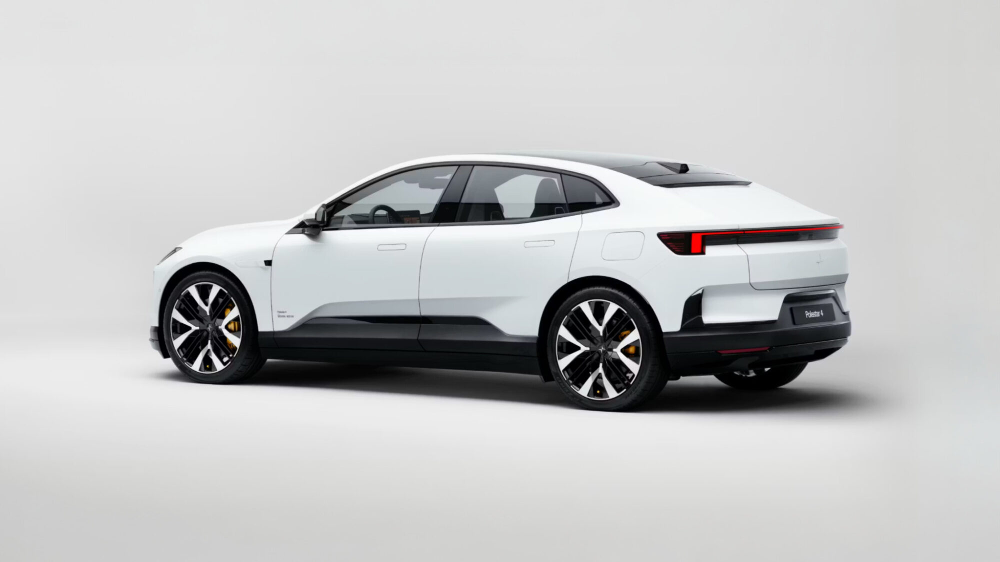
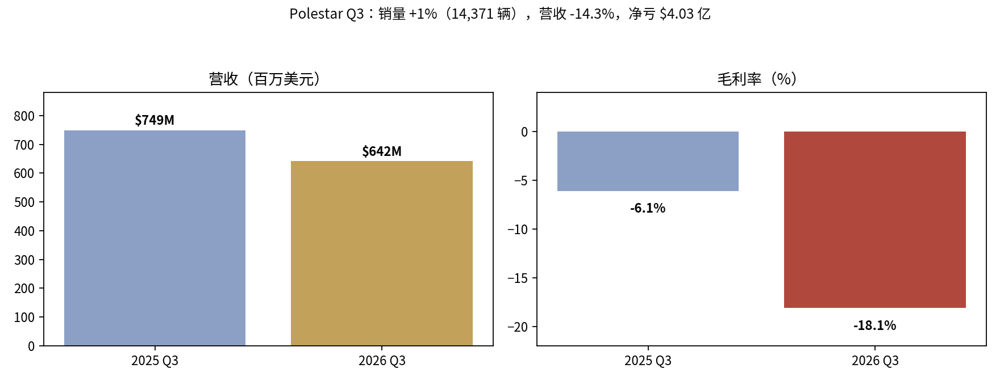

> [English version 英文版](/life/polestar-q3-loss-us-exit/)

*图片：Polestar 4 新闻图（经 Drive）。Polestar 于 2026 年 11 月 25 日发布 2026 年第三季度业绩。*

## 这个季度，用公司自己的数字

**Polestar**（极星，纳斯达克：PSNY）——吉利控股的瑞典电动车品牌——于 **2026 年 11 月 25 日**（周三）发布了第三季度部分业绩，比原定日期晚了二十天；公司称推迟是为留出更多时间完成季末结账。路透、Morningstar/道琼斯与公司自己的 Business Wire 公告在headline数字上一致，而这些数字描绘的是一家同时朝两个方向运动的企业：

- **零售销量：14,371 辆**，同比增长 **1.0%**（去年同期 14,222 辆）；
- **营收：6.42 亿美元**，同比下降 **14.3%**（去年同期 7.49 亿美元）；
- **毛利率：-18.1%**，较去年同期的 -6.1%（调整后 -7.9%）显著恶化；
- **净亏损：4.03 亿美元**，较去年同期的 3.65 亿美元扩大；
- **调整后 EBITDA 亏损：2.51 亿美元**，较去年同期的 2.59 亿美元略有改善——成本削减抵消了部分毛利恶化；
- **现金：6.53 亿美元**，低于去年同期的 9.95 亿美元，也低于 2025 年底的 11.59 亿美元；
- **市场反应：** 据路透，股价在早盘下跌约 **8%**。

前九个月是同一形状的拉长版：销量 44,790 辆（+0.6%），营收 20.02 亿美元（-7.8%），净亏损 12.45 亿美元，调整后 EBITDA 亏损 7.73 亿美元，差于去年同期的 5.61 亿美元。

请把前两个数字并排放在一起看，因为它们的背离就是整个季度的故事。Polestar 卖出了**更多**的车，却为此收到了**明显更少**的钱。单车营收从 2025 年 Q3 的约 52,700 美元降至 2026 年 Q3 的约 44,700 美元——一年之内每辆车少了约 15%。这在简单意义上不是需求问题，而是价格、产品结构与市场结构三者同时叠加的问题，而公司自己逐项点名了构成部分。

*作者自制图。数据：Polestar 经 Business Wire 发布的 2026 年 Q3 业绩公告，2026 年 11 月 25 日；路透，2026 年 11 月 25 日。*

## 为什么量涨价跌：营收为何在销量上升时下滑

Polestar 的公告以少见的坦率逐项列出了营收下滑的原因，按公司自己的顺序：**定价压力**；**产品结构中 Polestar 3 占比下降**（那款价格更高、在南卡罗来纳生产的中大型 SUV）；**市场结构不利**；**二手车业务因时点因素减少**；**碳积分销售减少**——本季计入营收的碳积分销售为 1,000 万美元，去年同期为 3,200 万美元，另有 800 万美元计入其他经营收入；以及**与北美市场有关的残值担保调整**。

毛利率的塌陷有它自己的点名原因：公司把**库存调整至可变现净值，主要因现款 Polestar 2 逐步停产**——说白了，那款开启了这个品牌的掀背车正在被减记，因为手头库存的价值已低于持有成本。Polestar 表示，这一减记被更新的 **Polestar 4** 占比上升部分抵消，Polestar 4 的毛利走势是正向的。产品故事与会计故事是同一个故事：老车在资产负债表上是负担，新车还没有大到能扛起全公司。

与此同时，管理层的成本纪律是真实可见的。销售、一般及行政费用与研发费用双双下降；尽管毛亏损从 4,600 万美元扩大到 1.16 亿美元，调整后 EBITDA 亏损仍略有收窄。CEO Michael Lohscheller 指出 **Polestar 4 SUV** "正在积聚势头，评价出色、订单簿强劲"，**韩国釜山**工厂已投产——这座工厂的重要性在于它为关键市场提供了中国之外的生产基地——旗舰 **Polestar 5** 也已开始交付。零售网络在真实扩张：**246 个销售网点**（同比 +28.8%）、**185 家活跃零售伙伴**、**31 个市场**，2026 年还在波罗的海国家新开销售。只看运营，这是一家在执行扩张的公司；只看单位经济，它是一家本季**每卖出一辆车对应约 28,000 美元净亏损**的公司（4.03 亿美元 ÷ 14,371 辆）——这个比率不是靠多开零售网点能修好的。

## 结构性故事：美国正在关门

在 Polestar 自己公告的财务表格下方，埋着一件会比本季数字活得更久的事。Polestar 表示，**美国商务部工业与安全局（BIS）**已通知它，将**不会依据《联网汽车规则》（Connected Vehicle Rule）授权其自 2027 款起在美国销售车辆**。公司的计划写得明明白白：预计**继续以库存销售往年款车型**，此后将**停止在美国销售新车**，在美剩余业务聚焦于支持现有车主——服务网络、保修及其他承诺。

请让这句话沉一沉。这不是一家公司在销售竞赛中落败后撤退，而是一家公司因为其所有权与软件供应链被监管挡在全球利润最丰厚的汽车市场之外——Polestar 由吉利控股，其车辆运行的联网软件带有与中国关联的来源，而《联网汽车规则》的设计目标正是排除这类组合。Polestar 已就 BIS 决定在 2026 年上半年计入约 **1.3 亿美元的负面调整**——残值担保成本、库存减记、员工与供应商的重组拨备——并警告随着美国重组推进，**未来还应预期进一步的负面调整**。

残值这一项值得单独一句，因为它触及的是车主而不只是股东。一个停止在某市场销售新车的品牌，其现有车主手中的车辆残值取决于不断收缩的经销网络与不确定的零部件与服务前景——这正是 Polestar 当年为租赁与贷款车辆写下的担保如今反过来让它花钱的原因，也是 2026 年底在美国考虑购买 Polestar 的任何人，无论自知与否，都在为一场退场定价的原因。

## 资产负债表：谁在让 Polestar 活着，以什么条件

一家以这个速度烧钱的公司靠贷款人与母公司生存，而 Polestar 的公告对两者都异常透明。2026 年前九个月，约 **34 亿美元融资额度被续期（约 29 亿）或新取得（约 4.6 亿）**。1 月与 3 月，它取得了 **7 亿美元新股权**。吉利瑞典与沃尔沃汽车分别将约 **3 亿美元与 3.4 亿美元**贷款转为股权；沃尔沃把剩余 **6.6 亿美元**股东贷款展期至 2031 年 12 月；9 月，吉利瑞典又提供了 **4 亿美元新股东贷款**。公司表示，截至 2026 年 9 月 30 日它**符合各项契约**——包括 9.5 亿美元俱乐部贷款，其贷款人已在 3 月同意放宽 2026 年的资产负债率区间与最低营收契约——并称正与贷款人就未来义务保持"建设性对话"。

把公告语言翻译过来就是：契约是放宽之后才达标的；现金 6.53 亿美元，对着单季 4.03 亿美元的净亏损；而撑起整个结构的是吉利——股东贷款、债转股与展期，叠加在 7 亿美元增资之上。这并不意味着崩溃迫在眉睫；以吉利的体量，母公司通常不会让一个上市品牌因为单个季度倒下。但这确实意味着 Polestar 的独立性在很大程度上只是理论。真正要紧的战略决定——争夺哪些市场、资助哪些车型、负毛利能吸收多久——是在一个集团组合内部做出的，而美国退场让这个组合朝着吉利并未选择、但现在将围绕其优化的方向简化：欧洲优先、高端、设计驱动，以釜山生产作为应对关税与规则的对冲。

管理层的叙事正靠向那个未来："更精简、更有韧性的 Polestar"，扩张中的欧洲零售网络（网点 +28%），覆盖欧洲的 **125 万个以上公共充电点**，Polestar 5 光环车型交付中，Polestar 4 作为高端 D 级 SUV 细分市场的走量希望，以及预览下一代 Polestar 2 与 Polestar 7 的"Formula 2030"概念车。作为一个有集团背书的欧洲高端电动车品牌，这是一家连贯的——尽管小得多的——公司，与 Polestar 2022 年上市时被描绘的那个全球性的、与特斯拉比肩的挑战者已不是一回事。

## 我们的判断

Polestar 的 Q3 是共用同一张利润表的三个故事。第一个是周期性的、可修的：老化的 Polestar 2 被减记，毛利更好的 Polestar 4 结构仍在爬坡，全行业的价格压力。第二个是财务性的、正在收窄的：-18.1% 的毛利率意味着"造一辆车卖一辆车"这个核心动作在计入任何管理费用之前就在毁灭价值，而缺口由母公司而非生意本身来桥接。第三个是地缘性的、且按已陈述的事实是终局性的：自 2027 款起，美国对 Polestar 新车关闭——靠规则，不靠竞争。

该记住的数字不是 4.03 亿美元亏损——Polestar 这样的亏损已经发了好几年。该记住的是：销量增长的同时单车营收一年下降约 15%，旁边是 6.53 亿美元现金，以及一个移除了高端电动车价格最好地区的市场退场。一个品牌可以靠小而活，可以靠补贴而活。Polestar 自己的公告留下的问题是：它能否同时以两种状态活下去——一个母公司持续签支票的小众欧洲高端品牌，在一个洗牌已经开始、而退场（如这次所示）不再总是自愿的行业里。

给美国读者一个简短的实用提示：Polestar 表示将继续以库存销售往年款车型，并通过服务网络与保修承诺支持现有车主。任何考虑购买的人，都应把这个品牌的美国黄昏计入价格——因为公司自己的会计已经这么做了，计入的数额是 1.3 亿美元，而且还在增加。

*来源：Polestar《Polestar Reports Select Results for the Third Quarter and First Nine Months of 2026》，Business Wire，2026 年 11 月 25 日（全部财务与运营数字、美国重组与 BIS 披露、融资与契约细节）；路透《Polestar's quarterly loss widens to $403 million as sales mix, pricing weigh》，2026 年 11 月 25 日（股价反应、推迟背景）；Morningstar/道琼斯，2026 年 11 月 25 日。单车营收与单车亏损为作者按 Polestar 报告总数计算。美国剩余库存的价格与可得性属经销商层面，随时间变化。*
