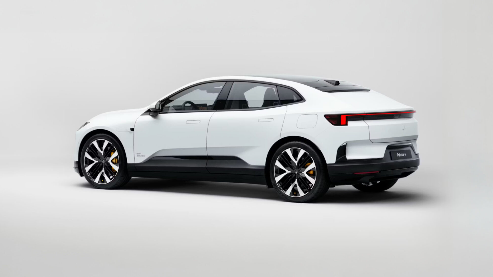
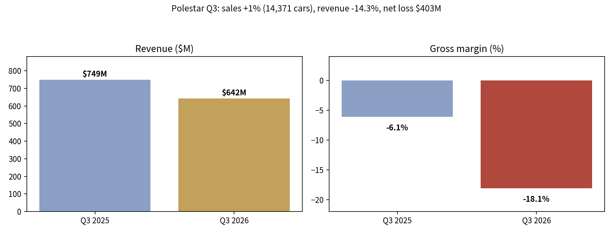

> [中文版 Chinese version](/life/polestar-q3-loss-us-exit-zh/)

*Image: Polestar 4 press photo (via Drive). Polestar reported Q3 2026 results on November 25, 2026.*

## The quarter, in the company's own numbers

**Polestar** (Nasdaq: PSNY), the Swedish electric-car brand controlled by Geely, reported select third-quarter results on **Wednesday, November 25, 2026** — twenty days after the report was originally scheduled, a postponement the company attributed to needing more time to conclude its quarter-end closing process. Reuters, Morningstar/Dow Jones and the company's own Business Wire release agree on the headline figures, and they describe a business moving in two directions at once:

- **Retail sales: 14,371 cars**, up **1.0%** year over year from 14,222.
- **Revenue: $642 million**, down **14.3%** from $749 million a year earlier.
- **Gross margin: negative 18.1%**, deteriorating from negative 6.1% — and from an adjusted negative 7.9% — a year earlier.
- **Net loss: $403 million**, widened from $365 million a year earlier.
- **Adjusted EBITDA loss: $251 million**, slightly improved from $259 million, because cost cuts offset part of the gross deterioration.
- **Cash: $653 million**, down from $995 million a year earlier and from $1,159 million at the end of 2025.
- **Market reaction:** shares fell about **8%** in morning trading, per Reuters.

For the first nine months, the picture is the same shape stretched out: 44,790 cars sold (+0.6%), revenue of $2,002 million (−7.8%), a net loss of $1,245 million, and an adjusted EBITDA loss of $773 million that is worse than the $561 million of a year earlier.

Hold the first two numbers next to each other, because their divergence is the whole quarter. Polestar sold *more* cars and collected *substantially less* money for them. Revenue per car fell from roughly $52,700 in Q3 2025 to roughly $44,700 in Q3 2026 — a decline of about 15% per vehicle in a single year. That is not a demand problem in the simple sense. It is a price, mix and market problem compounding at once, and the company names the components itself.

*Author's chart. Data: Polestar's Q3 2026 results release via Business Wire, November 25, 2026; Reuters, November 25, 2026.*

## Why revenue fell while volume rose

Polestar's release itemises the revenue decline with unusual candour. The drivers, in its own ordering: **pressure on pricing**; a **sales mix with a lower share of Polestar 3** cars (the higher-priced SUV built in South Carolina); a **less favourable market mix**; **lower used-car activity** due to timing; **lower carbon-credit sales** — $10 million booked in revenue this quarter against $32 million a year earlier, with a further $8 million in other operating income; and **residual value guarantee adjustments related to the North American markets**.

The gross margin collapse has its own named cause: the company adjusted **inventory to net realisable value, mainly due to the phase-out of the current Polestar 2** — in plain terms, the ageing liftback that launched the brand is being written down because the cars on hand are worth less than they cost to hold. That writedown was partially offset, Polestar says, by a higher share of the newer **Polestar 4**, whose margin development is positive. The product story and the accounting story are the same story: the old car is a liability on the balance sheet while the new car is not yet at the volume to carry the company.

Against that, management's cost discipline is real and visible. Selling, general and administrative expenses and R&D both fell; the adjusted EBITDA loss narrowed slightly despite a gross loss that more than doubled, from $46 million to $116 million. CEO Michael Lohscheller pointed to the **Polestar 4 SUV** "gaining momentum, with outstanding reviews and a strong order book," to production now underway in **Busan, South Korea** — a plant that matters because it gives Polestar a non-China production base for key markets — and to deliveries of the flagship **Polestar 5** having commenced. The retail network is genuinely expanding: **246 sales points** (excluding China: 246, up 28.8%), **185 active retail partners**, **31 markets**, and new launches across the Baltic states in 2026. On operations alone, this is a company executing an expansion. On unit economics, it is a company losing roughly **$28,000 of net loss for every car it sold** in the quarter ($403 million across 14,371 cars) — a ratio that no amount of retail-network growth fixes by itself.

## The structural story: America is closing

Buried below the financial tables in Polestar's own release is the item that will outlast this quarter's numbers. Polestar states that it was informed by the **US Department of Commerce's Bureau of Industry and Security (BIS)** that it will **not be granted an authorisation under the Connected Vehicle Rule to sell vehicles in the United States from model year 2027 onwards**. The company's plan, stated plainly: it expects to **continue selling previous model years in the US from inventory**, after which it will **cease the sale of new vehicles in the United States**, with remaining US activities focused on supporting existing customers — service network access, warranty and other commitments.

Let that settle. This is not a company losing a sales race and retreating. It is a company being regulated out of the world's most profitable car market because of its ownership and software-supply chain — Polestar is Geely-controlled, its cars run connected software with Chinese-linked provenance, and the Connected Vehicle Rule is designed to exclude exactly that. Polestar has already booked approximately **$130 million of negative adjustments** related to its US operations as a result of the BIS decision — residual value guarantees, inventory write-downs, restructuring provisions for employees and suppliers — in the first half of 2026, and it warns that **further negative adjustments should be expected** as the US restructuring proceeds.

The residual-value item deserves a sentence of its own, because it reaches customers, not just shareholders. A brand that stops selling new cars in a market leaves its existing owners holding vehicles whose resale values depend on a shrinking dealer footprint and an uncertain parts-and-service future — which is why the guarantees Polestar wrote on leased and financed cars are now costing it money, and why anyone cross-shopping a Polestar in the US in late 2026 is, whether they know it or not, pricing an exit.

## The balance sheet: who keeps Polestar alive, and on what terms

A company burning cash at this rate survives on its lenders and its parent, and Polestar's release is unusually transparent about both. During the first nine months of 2026, roughly **$3.4 billion of facilities were renewed (about $2.9 billion) or newly secured (about $460 million)**. In January and March it secured **$700 million of new equity**. Geely Sweden and Volvo Cars converted approximately **$300 million and $340 million** of loans into equity, respectively; Volvo extended its remaining **$660 million** shareholder loan to December 2031; and in September, Geely Sweden provided a new **$400 million shareholder loan**. The company says it was **in compliance with its covenants** as of September 30, 2026 — including the $950 million Club Loan, whose lenders agreed in March to amend the debt-to-asset and minimum-revenue covenants for 2026 — and that it continues a "constructive dialogue" with those lenders about future obligations.

Translated from filings language: the covenants had to be loosened to be met, the cash balance is $653 million against a quarterly net loss of $403 million, and the entity keeping the structure upright is Geely — shareholder loans, conversions and extensions, on top of the $700 million equity raise. None of this makes collapse imminent; parents with Geely's scale do not usually let a listed brand fail over a single quarter. All of it makes Polestar's independence largely theoretical. The strategic decisions that matter — which markets to contest, which models to fund, how long to absorb negative gross margins — are being made inside a group portfolio, and the US exit simplifies that portfolio in a direction Geely did not choose but will now optimise around: Europe-first, premium, design-led, with Busan production as the tariff-and-rules hedge.

Management's framing leans into exactly that future: a "leaner and more resilient Polestar," an expanding European retail network (sales points up 28%), more than **1.25 million public charging points** offered across Europe, the Polestar 5 halo car delivering, the Polestar 4 as the volume hope in the premium D-SUV segment, and a "Formula 2030" concept previewing the next Polestar 2 and the Polestar 7. As a European premium EV brand with group backing, that is a coherent — if much smaller — company than the global Tesla-adjacent challenger Polestar was pitched as at its 2022 listing.

## Our judgment

Polestar's Q3 is three stories sharing one income statement. The first is cyclical and fixable: an ageing Polestar 2 written down, a richer Polestar 4 mix still ramping, pricing pressure across the entire EV industry. The second is financial and narrowing: negative 18.1% gross margin means the core act of building and selling a car destroys value before a single dollar of overhead, and the gap is being bridged by a parent, not by the business. The third is geopolitical and, on the stated facts, final: from model year 2027, the United States is closed to new Polestars by rule, not by competition.

The number to remember is not the $403 million loss — Polestar has posted losses like it for years. It is the revenue per car, down roughly 15% in a year while volumes grew, next to a cash balance of $653 million and a market exit that removes the region where premium EVs earn their best prices. A brand can survive being small. It can survive being subsidised. The open question Polestar's own release leaves is whether it can survive being both at once — a niche European premium marque whose parent keeps writing the cheques, in an industry where the shakeout has already begun and the exits, as this one shows, are no longer always voluntary.

For US readers the practical note is short: Polestar says it will keep selling earlier model years from inventory and will support existing owners through its service network and warranty commitments. Anyone buying one should price the brand's American twilight into the deal — because the company's own accountants already have, to the tune of $130 million and counting.

*Sources: Polestar, "Polestar Reports Select Results for the Third Quarter and First Nine Months of 2026," Business Wire, November 25, 2026 (all financial and operational figures, US restructuring and BIS disclosure, funding and covenant details); Reuters, "Polestar's quarterly loss widens to $403 million as sales mix, pricing weigh," November 25, 2026 (share reaction, postponement context); Morningstar/Dow Jones, November 25, 2026. Revenue-per-car and loss-per-car figures are the author's arithmetic from Polestar's reported totals. Prices and availability of remaining US inventory are dealer-level and change over time.*
