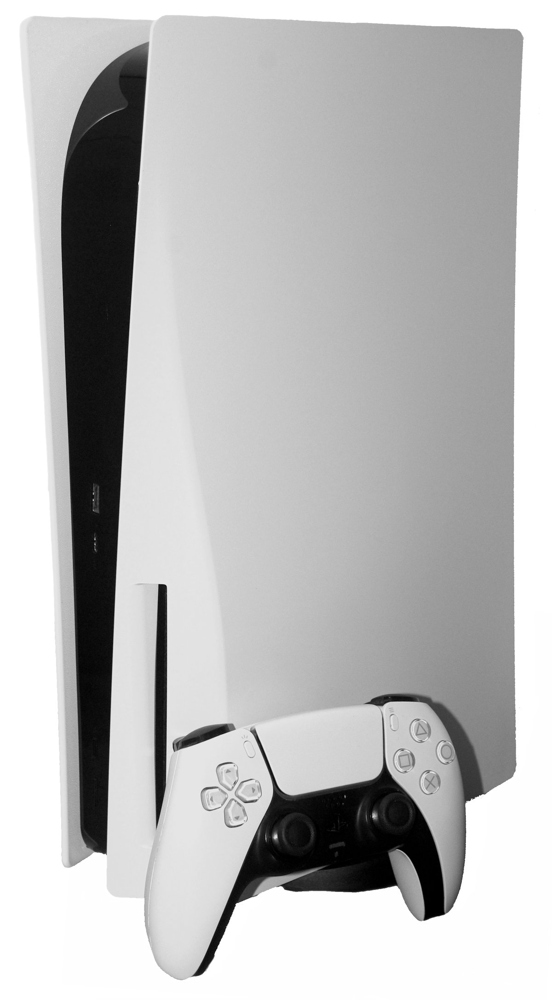
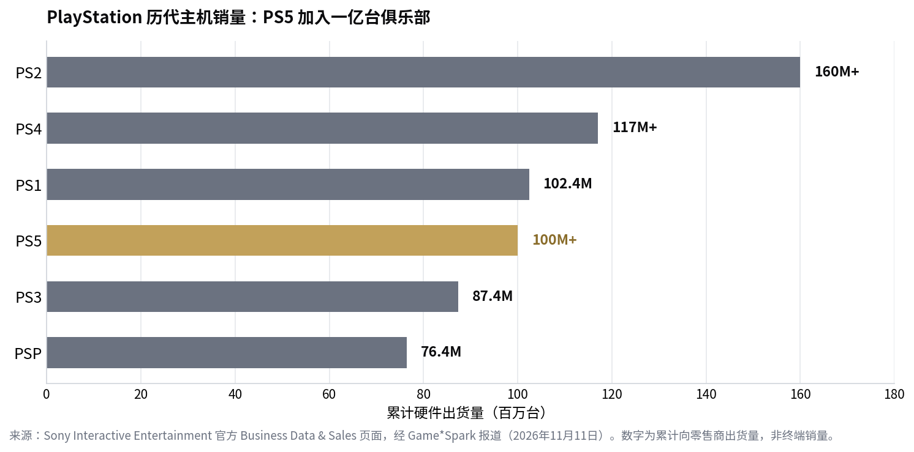

> [English version](/life/ps5-100-million-units/)

*初代 PlayStation 5 主机与 DualSense 手柄。照片来自 Wikimedia Commons。*

## 里程碑

Sony Interactive Entertainment 更新了官方 Business Data & Sales 页面的累计硬件数字：截至 **2026 年 11 月 10 日**，PlayStation 5 出货量突破**一亿台**。9 月底时为 **9,790 万台**，也就是说最近约 40 天里又出了约 **210 万台**——快到 Game*Spark 此前预测"要到 2027 年 2 月第三季度财报时才能确认"的时间表被提前了三个月。这些数字是向零售商的出货量，不是终端销量，这是索尼一贯的统计口径。

PS5 是第四款跨过一亿台的 PlayStation，排在 PS2、PS4 与初代 PlayStation 之后：

*PlayStation 历代主机销量：PS5 加入一亿台俱乐部。来源：Sony Interactive Entertainment 官方 Business Data & Sales 页面，经 Game*Spark 报道（2026 年 11 月 11 日）。数字为累计向零售商出货量，非终端销量。*

索尼同时公布，PS5 与 PS4 的累计软件销量已超过 **17.95 亿份**。

## 六年，比 PS4 稍慢一点

这个里程碑绕不开与 PS4 的对比——而索尼大概希望你谨慎地做这个对比。PS4 在 2019 年 4–6 月那个季度突破一亿台，也就是发售后**五年半多一点**。2020 年 11 月发售的 PS5 用了**约六年**。稍慢，原因并不难猜：疫情中首发、随后大约两年持续缺货、买得到的时候还中途涨过价。

正是这个背景让数字变得有意思，而不只是一个整数。PS5 是在 2021、2022 年被分析师写成"失去的一代"的开局下冲过一亿台的，而且没有靠 PS2、PS4 后期那种降价来拉动，也没有等它最大的系统级卖点游戏先发售。

## 接下来的故事才是全部

这个时间点不是巧合。**《GTA VI》将于 11 月 19 日**登陆 PS5 与 Xbox Series X/S——首发没有 PC 版——索尼同一天还推出新配色**午夜黑** PS5 数字版。PS5 与 Xbox Series X/S 的预载已于 11 月 10 日午夜开启。GTA VI 是游戏史上规模最大的发售，落在一亿台官宣后八天、假日季的起点。

但有个插曲，而且网上已经吵起来了：GTA VI 已确认在 PS5、PS5 Pro 与 Xbox Series X/S 上以 **30fps** 为目标，主机版首发**没有 60fps 性能模式**（Gadgets360）。据报游戏还要占用约 **210GB SSD 空间**。对于一个靠性能模式卖自己的主机世代来说，旗舰大作首发只有 30fps，是索尼没想要的话题——也是一些买家宁可等日后 PC 版、而不现在买硬件的理由。

索尼本周的其他动作指向同一方向——压榨现有装机量，而不是扩大它。11 月 PlayStation Plus 阵容由**《死亡搁浅 2：沙滩之上》**（11 月 17 日）、**《Hell Let Loose》**（11 月 11 日）与**《勇者斗恶龙 III HD-2D 重制版》**（11 月 17 日）领衔，共 10 款游戏。而在同一份公告里，PlayStation 表示 **PS Plus PC 应用将于 12 月 10 日停用**——按它自己的说法，是因为 PC 上几乎没人用。

## 结论

一亿台是个里程碑，不是终点线，老实说要两面看。一面是：一台疫情中首发、缺货两年、中途涨价的主机，六年里加入了一亿台俱乐部——这在 2022 年看起来是乐观的预测。另一面是：它比 PS4 慢，而下一程要靠一款 30fps、占 210GB 的游戏。

真正值得盯的数字不是一亿，而是 **1.17 亿**——PS4 的最终总量，也是 PS5 需要追上的差距。如果 GTA VI 像业界预期的那样带动硬件，PS5 会在假日季超过 PS4 的最终成绩，"比 PS4 慢"的说法就此消失。如果没有，六年的速度看起来就会像天花板，而不是地板。

## 来源

- Sony Interactive Entertainment，Business Data & Sales 页面，经 Game*Spark，"PS5 Surpasses 100 Million Units Worldwide in Its Sixth Year"，2026 年 11 月 11 日（截至 11 月 10 日破亿；9 月 30 日 9,790 万；PS2 1.6 亿+、PS4 1.17 亿+、PS1 1.024 亿、PS3 8,740 万、PSP 7,640 万；PS4 约五年半破亿；GTA VI 与午夜黑 11 月 19 日）。
- The World Insiders，"PlayStation 5 sales pass 100 million ahead of GTA VI"，2026 年 11 月 11 日（截至 11 月 10 日破亿；累计软件超 17.95 亿份；GTA VI 11 月 19 日，首发无 PC 版）。
- Insider Gaming，2026 年 11 月 11 日（PS5 超一亿台；2020 年 11 月发售）。
- Gadgets360，2026 年 11 月 11 日（GTA VI 在 PS5、PS5 Pro、Xbox Series S/X 上目标 30fps；首发无 60fps 性能模式；11 月 10 日午夜开启预载；据报约 210GB SSD）。
- CGMagazine，"PlayStation Plus Announces 10 Games and The Death of the PC App"，2026 年 11 月 11 日（11 月阵容由死亡搁浅 2、Hell Let Loose、勇者斗恶龙 III HD-2D 领衔；PS Plus PC 应用 12 月 10 日停用）。
